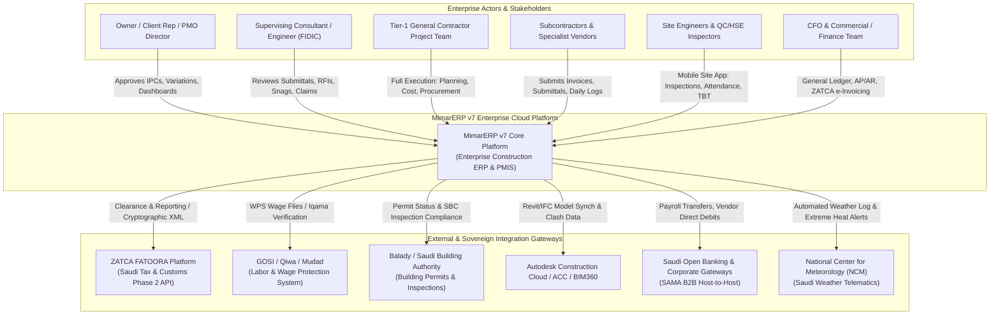
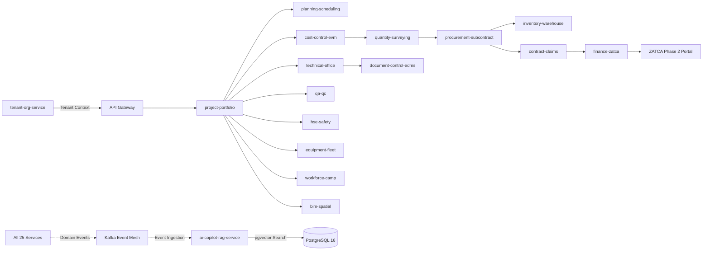
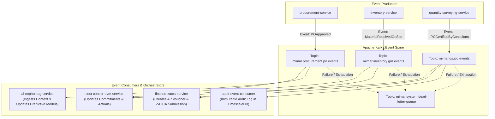
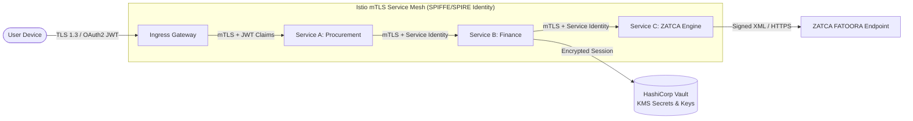
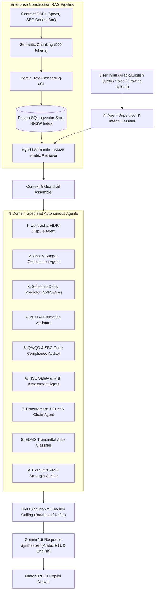
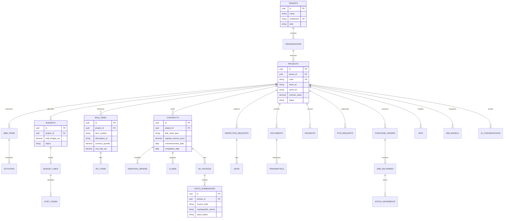
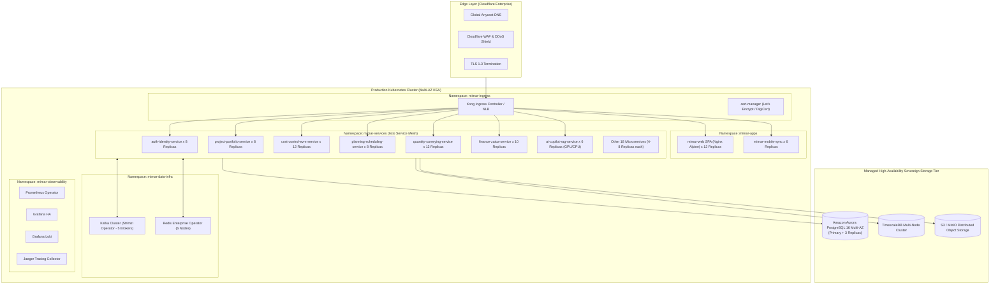

# MimarERP v7 — Enterprise Construction ERP Platform
## Complete System Architecture Specification & Engineering Blueprint

---

### Document Control
- **Document Version:** 7.0.0-ENTERPRISE-RELEASE
- **Document ID:** MIMAR-ARCH-001
- **Classification:** Highly Confidential / Enterprise Architectural Standard
- **Author:** Chief Enterprise System Architect (@architect)
- **Reviewers:** Enterprise Engineering Council, Security Architecture Review Board, Construction Domain Advisory Board
- **Compliance Certification:** PMI / PMBOK 7th Edition, FIDIC (Red, Yellow, Silver, White Books), ISO 9001:2015, ISO 45001:2018, ISO 14001:2015, Saudi Building Code (SBC), Saudi ZATCA E-Invoicing Phase 2 (FATOORA), Saudi Personal Data Protection Law (PDPL).

---

## 1. Executive Summary & Architectural Principles

### 1.1 Executive Overview
**MimarERP v7** is a cloud-native, multi-tenant enterprise resource planning (ERP) and project management information system (PMIS) engineered specifically for the mega-construction and engineering sector in the Kingdom of Saudi Arabia (KSA) and the broader GCC/MENA region. Designed to power Tier-1 General Contractors, Engineering Consultancies, Project Management Offices (PMOs), Government Gigaproject Authorities (e.g., NEOM, Red Sea Global, Qiddiya, ROSHN, Diriyah Gate), and Subcontractors, MimarERP v7 delivers a mission-critical platform engineered to surpass legacy solutions including Oracle Primavera Unifier, Oracle Aconex, Procore, Autodesk Construction Cloud (ACC), SAP S/4HANA Construction, InEight, and Viewpoint Vista.

MimarERP v7 bridges the divide between field execution and corporate financial governance. It unifies the entire project lifecycle: from feasibility and prequalification, estimation, tender bidding, contract administration under standard FIDIC regimes, CPM scheduling and earned value cost control, quantity surveying, procurement and subcontracts, warehouse inventory and batch tracking, heavy equipment fleet telematics, labor camp accommodation and biometric payroll (WPS), through QA/QC inspection testing plans, HSE safety permits, ISO compliance, BIM 4D/5D spatial visualization, automated ZATCA Phase 2 tax invoicing, up to AI-assisted dispute resolution and predictive executive intelligence.

```
+-------------------------------------------------------------------------------------------------------+
|                                        MIMAR ERP v7 CAPABILITY SPECTRUM                               |
+-------------------------------------+-----------------------------------+-----------------------------+
| Commercial & Contractual            | Technical & Field Operations      | Enterprise Governance       |
+-------------------------------------+-----------------------------------+-----------------------------+
| - FIDIC Contract Management         | - Site Inspections (WIR/MIR/ITP)  | - Multi-Company Consolidation|
| - Variation Orders & Claims (EOT)   | - RFI & Submittal Workflows       | - Multi-Currency (SAR Base) |
| - BOQ & Interim Payment Certs (IPC) | - BIM 4D/5D Spatial Integration   | - ZATCA Phase 2 E-Invoicing |
| - Procurement & Subcontracts        | - QA/QC Non-Conformance (NCR)     | - Saudi Labor Law & Camp HR |
| - Committed Cost vs EVM Control     | - HSE Permit-To-Work (PTW) & TBT  | - 9 Specialized AI Agents   |
+-------------------------------------+-----------------------------------+-----------------------------+
```

### 1.2 Competitive Benchmark Matrix

| Feature Dimension | MimarERP v7 | Oracle Primavera Unifier | Oracle Aconex | Procore | Autodesk Construction Cloud (ACC) | SAP Construction (S/4HANA) | InEight / Viewpoint |
| :--- | :--- | :--- | :--- | :--- | :--- | :--- | :--- |
| **Architecture Topology** | Distributed Microservices (Fastify/Node.js) | Monolithic Enterprise Java | Distributed Monolith | Ruby/React Monolith to Services | Hybrid Microservices | ERP Core Monolith + Sidecars | Heavy Client / Hybrid Monolith |
| **Frontend Strategy** | High-Performance Vanilla JS SPA (Zero Framework Lock-in) | Java Applet / Legacy React | Angular / React Hybrid | React SPA | React / WebAssembly | SAP Fiori / UI5 | .NET Desktop / React Web |
| **Saudi Localization** | Native Arabic RTL, ZATCA Phase 2 XML/UBL, SBC Codes | Partial Arabic, Third-party ZATCA | Localization Layer | Partial (Third-party) | Minimal GCC Localization | Partner Add-on Modules | Very Low Localization |
| **Contract Framework** | Native FIDIC (Red, Yellow, Silver, White) & Saudi Govt Tenders Law | Custom BP Config required | Configurable Forms | US-centric AIA G702/G703 | US Construction Contracts | S/4 Contract Module Config | Heavy Customization |
| **BIM Integration** | Native IFC/BCF WebGL 4D/5D Engine (No external license) | External Navisworks/BIM 360 bridge | BIM Model Viewer (Add-on) | Procore BIM (Limited) | Autodesk Revit Native Engine | External 3D Viewer | External Bentley / Navisworks |
| **Field Offline Support** | Native PWA + Vector-Clock Delta Sync (SQLite to Postgres) | Unifier Mobile (Fragile Sync) | Aconex Field App | Procore Field App | PlanGrid Engine | SAP Service App | Limited |
| **Autonomous AI** | 9 Domain-Specialized Gemini LLM Agents + pgvector RAG | No native LLM Copilot | Oracle AI (Predictive Insights) | Copilot Beta | Autodesk AI (Drafting) | Joule Assistant (Generic) | Basic Statistical Modeling |
| **Multi-Tenancy** | Schema-per-Tenant + Strict Row Level Security (RLS) | Database / Instance per Org | Partitioned Multi-Tenant | Shared DB with Org IDs | Shared AWS Multi-Tenant | Client-per-Tenant | Database per Customer |
| **Concurrent Capacity** | 100,000+ Concurrent Site Users (K8s Auto-scale) | Scalability bottlenecks on DB | Enterprise Grade | 50k Concurrent Users | Enterprise Cloud | Enterprise High-Cost Tier | Mid-market Scalability limits |

### 1.3 Core Architectural Tenets
1. **Zero-Framework-Overhead Web Architecture:** The user interface is engineered as an enterprise-grade Single Page Application (SPA) using ultra-fast, standards-compliant **Vanilla JavaScript (ES2024+)**, native Web Components, HTML5, and CSS3 Modern Grid/Flexbox with full bidirectional Arabic (RTL) and English (LTR) typography. This eliminates React/Vue virtual DOM reconciliation bottlenecks, eliminates heavy node_modules bundle bloat, ensures sub-second page loads on remote desert construction sites with 3G mobile connections, and provides 100% control over memory allocation and lifecycle.
2. **Domain-Driven Microservices (Node.js & Fastify):** Bounded contexts are encapsulated into independent, containerized microservices implemented using Node.js and Fastify. Fastify offers low overhead (up to 30,000 req/sec per node) with native JSON Schema validation, strict asynchronous execution, and standard OpenTelemetry instrumentation.
3. **Defense-in-Depth Multi-Tenancy:** Hard physical-logical data isolation using **Schema-per-Tenant PostgreSQL 16**, reinforced by database-level Row-Level Security (RLS) policies. No tenant data ever crosses boundary thresholds.
4. **Asynchronous Event-Driven Backbone:** High-throughput Apache Kafka streaming infrastructure decoupling write models from read projections, orchestrating distributed Saga workflows, propagating transactional outbox events, and feeding real-time operational telematics.
5. **Saudi Sovereign Compliance by Design:** Built from the ground up for KSA: direct cryptographic integration with the ZATCA FATOORA Phase 2 clearance/reporting portal (ECDSA secp256k1 signatures, cryptographic stamps, QR codes, UBL 2.1 XML invoices), full alignment with the Saudi Building Code (SBC), Saudi Government Tenders and Procurement Law (GTPL), and compliance with the Saudi Personal Data Protection Law (PDPL) with in-kingdom cloud hosting.
6. **Multi-Dimensional Entity Hierarchy:** Complete support for Multi-Tenant SaaS, Multi-Company (Holding company with unlimited subsidiaries), Multi-Branch, Multi-Project, Multi-Cost-Center, Multi-Currency (SAR native, USD, EUR, GBP, AED, QAR with real-time exchange rates), and Multi-Language (Arabic native RTL, English LTR).
7. **Autonomous Construction Intelligence:** Integrated Google Gemini LLM API orchestrating 9 domain-specialized AI autonomous agents operating over an enterprise RAG (Retrieval-Augmented Generation) pipeline backed by PostgreSQL `pgvector` embeddings.

## 2. C4 Architecture Models & System Maps

### 2.1 C4 Level 1: System Context Diagram
The System Context Diagram visualizes MimarERP v7 in relation to users, roles, gigaproject authorities, external government systems, and supplier ecosystems.



### 2.2 C4 Level 2: Container Diagram
The Container Diagram illustrates the high-level technical runtime boundaries of MimarERP v7.

```mermaid
flowchart TB
    subgraph Client_Tier["Client Presentation Tier (Browser & Native Mobile)"]
        WebSPA["Vanilla JS Enterprise SPA
(ES2024+, Web Components, RTL/LTR)
Static Assets served via CDN / NGINX"]
        MobilePWA["Field Mobile App (PWA / Capacitor)
(Offline-First SQLite + Biometric Auth)"]
    end

    subgraph Edge_Gateway_Tier["Edge & Security Ingress Tier"]
        Cloudflare["Cloudflare Enterprise Edge
(DDoS, WAF, SSL Termination, Arabic CDN)"]
        KongGW["Kong Enterprise API Gateway / Fastify Ingress
(JWT Auth, Rate Limiting, Dynamic Tenant Routing)"]
    end

    subgraph Microservices_Tier["Kubernetes Microservice Mesh Tier (Fastify / Node.js)"]
        AuthSvc["auth-identity-service"]
        TenantSvc["tenant-org-service"]
        ProjectSvc["project-portfolio-service"]
        CostSvc["cost-control-evm-service"]
        PlanningSvc["planning-scheduling-service"]
        QSSvc["quantity-surveying-service"]
        ProcureSvc["procurement-subcontract-service"]
        DocSvc["document-control-edms-service"]
        TechSvc["technical-office-service"]
        ContractSvc["contract-claims-service"]
        QAQCSvc["qa-qc-service"]
        HSESvc["hse-safety-service"]
        BIMSvc["bim-spatial-service"]
        FinanceSvc["finance-zatca-service"]
        AISvc["ai-copilot-rag-service"]
    end

    subgraph Event_Streaming_Tier["Event Streaming & Distributed Messaging"]
        KafkaCluster["Apache Kafka Cluster + Schema Registry
(Event Spine, Sagas, Outbox CDC via Debezium)"]
    end

    subgraph Data_Persistence_Tier["Polyglot Persistence Tier"]
        PostgresDB[("PostgreSQL 16 Cluster
(Schema-Per-Tenant, RLS, pgvector)")]
        RedisCluster[("Redis 7 Enterprise Cluster
(Sessions, Redlock, Rate Limits, L2 Cache)")]
        MongoDBAtlas[("MongoDB 7 Cluster
(EDMS Metadata, RFI Threads, Form Schemas)")]
        Elasticsearch[("Elasticsearch 8 Cluster
(Arabic/English Stemming, Document OCR Index)")]
        TimescaleDB[("TimescaleDB Cluster
(Equipment Telematics, Sensors, Attendance Logs)")]
        MinIOObject[("MinIO / S3 Object Storage
(Drawings, PDFs, BIM IFC Files, Photo Evidence)")]
    end

    Client_Tier -->|HTTPS / WSS| Cloudflare
    Cloudflare --> KongGW
    KongGW --> AuthSvc
    KongGW --> TenantSvc
    KongGW --> ProjectSvc
    KongGW --> CostSvc
    KongGW --> PlanningSvc
    KongGW --> QSSvc
    KongGW --> ProcureSvc
    KongGW --> DocSvc
    KongGW --> TechSvc
    KongGW --> ContractSvc
    KongGW --> QAQCSvc
    KongGW --> HSESvc
    KongGW --> BIMSvc
    KongGW --> FinanceSvc
    KongGW --> AISvc

    Microservices_Tier <--> KafkaCluster
    Microservices_Tier --> PostgresDB
    Microservices_Tier --> RedisCluster
    Microservices_Tier --> MongoDBAtlas
    Microservices_Tier --> Elasticsearch
    Microservices_Tier --> TimescaleDB
    Microservices_Tier --> MinIOObject
```



### 2.3 Microservices Interaction & Dependency Map
The 25 modular microservices interact via synchronous high-speed gRPC/REST for read compositions, and asynchronous Kafka domain events for all state-mutating transactional handoffs.



## 3. Microservice Architecture Deep-Dive

The platform is decomposed into 25 dedicated microservices. Each microservice is engineered in **Node.js (v20+ LTS) using Fastify**, providing asynchronous non-blocking I/O, OpenAPI (Swagger) generation, strict schema encapsulation, and health endpoints.

### 3.1 Detailed Microservice Catalog

#### 1. `api-gateway`
- **Purpose:** Central ingress reverse proxy, OAuth2/JWT token validation, rate-limiting, tenant subdomain dispatching, API versioning (`/api/v1/`), SSL termination, and request/response transformation.
- **Tech Stack:** Node.js, Fastify, `@fastify/http-proxy`, `@fastify/rate-limit`, Redis 7.
- **Domain Owned:** Routing tables, API security policies, rate-limit buckets, IP blacklisting.
- **Exposed APIs:** `/api/v1/*` (Reverse proxies all downstream services).

#### 2. `auth-identity-service`
- **Purpose:** Identity federation, multi-factor authentication (TOTP/SMS OTP), OAuth 2.0 / OpenID Connect, JWT issuance and rotation, RBAC permission resolution, session tracking.
- **Tech Stack:** Node.js, Fastify, Argon2, `jose` (JWT/JWE/JWS), Redis 7, PostgreSQL 16.
- **Domain Owned:** Users, User Credentials, MFA Secrets, Roles, Permissions, Refresh Tokens.
- **Exposed APIs:**
  - `POST /api/v1/auth/login` — User authentication, issue JWT & refresh cookie.
  - `POST /api/v1/auth/mfa/verify` — TOTP/SMS validation.
  - `POST /api/v1/auth/token/refresh` — Silent token renewal with reuse detection.
  - `POST /api/v1/auth/logout` — Token invalidation in Redis blacklist.
  - `GET /api/v1/auth/user/permissions` — Resolved permission bitmask for current user/tenant.

#### 3. `tenant-org-service`
- **Purpose:** Multi-tenant lifecycle management, dynamic database schema provisioning, multi-company hierarchy (Holding, Subsidiary, Joint Venture, Branch, Department), and Cost Center structures.
- **Tech Stack:** Node.js, Fastify, Knex.js / Drizzle ORM, PostgreSQL 16.
- **Domain Owned:** Tenants, Organizations, Branches, Cost Centers, Subscription Plans, Custom Domains.
- **Exposed APIs:**
  - `POST /api/v1/tenants` — Provision new tenant (creates schema, executes DDL migrations).
  - `GET /api/v1/organizations/tree` — Hierarchical company tree with consolidated subsidiaries.
  - `POST /api/v1/cost-centers` — Create / update WBS-linked cost centers.

#### 4. `project-portfolio-service`
- **Purpose:** Project governance, charter creation, Work Breakdown Structure (WBS), milestone tracking, project teams, stakeholder registry, project baselines.
- **Tech Stack:** Node.js, Fastify, PostgreSQL 16, Redis 7.
- **Domain Owned:** Projects, Project Phases, WBS Hierarchy, Milestones, Project Team Allocations, Baselines.
- **Exposed APIs:**
  - `GET /api/v1/projects` — Query projects with multi-branch/status filters.
  - `POST /api/v1/projects` — Initialize new project with default WBS templates.
  - `GET /api/v1/projects/:id/wbs` — Nested WBS tree with code dictionaries.
  - `POST /api/v1/projects/:id/baselines` — Freeze current project schedule and cost baseline.

#### 5. `cost-control-evm-service`
- **Purpose:** Project budgeting, Cost Breakdown Structure (CBS), commitment tracking (POs, subcontracts), actual cost capture, accruals, Earned Value Management (EVM) calculation (PV, EV, AC, CPI, SPI, EAC, VAC).
- **Tech Stack:** Node.js, Fastify, PostgreSQL 16, Redis 7.
- **Domain Owned:** Budgets, Budget Revisions, Cost Codes, Commitments, Actual Costs, EVM Snapshots.
- **Exposed APIs:**
  - `GET /api/v1/cost/evm/:projectId` — Real-time EVM indices (BCWS, BCWP, ACWP, CPI, SPI).
  - `POST /api/v1/cost/budgets` — Create original budget with multi-currency lines.
  - `POST /api/v1/cost/commitments` — Register PO/Subcontract commitment against cost code.
  - `GET /api/v1/cost/forecasts/:projectId` — Predictive cost forecast at completion (EAC).

#### 6. `planning-scheduling-service`
- **Purpose:** Critical Path Method (CPM) calculation, activity relationships (FS, SS, FF, SF with lead/lag), multi-calendar scheduling (Saudi holidays, Ramadan shift hours, Friday weekends), Primavera P6 (.xer/.xml) & MS Project import/export.
- **Tech Stack:** Node.js, Fastify, C++ WebAssembly / Worker threads for CPM math, PostgreSQL 16.
- **Domain Owned:** Schedules, Activities, Resource Assignments, Constraints, Calendars, Logic Links.
- **Exposed APIs:**
  - `POST /api/v1/planning/schedules/:id/calculate-cpm` — Execute forward/backward pass CPM engine.
  - `POST /api/v1/planning/import/p6` — Parse and ingest Primavera P6 XER binary file.
  - `GET /api/v1/planning/schedules/:id/gantt` — Optimized Gantt chart payload with dependencies.

#### 7. `estimation-tendering-service`
- **Purpose:** Detailed construction cost estimation, composite rate library (Labor, Material, Plant, Subcontract), overhead & profit markups, bid packaging, tender distribution, vendor bid comparison matrix.
- **Tech Stack:** Node.js, Fastify, PostgreSQL 16, MongoDB 7 (unstructured bid formats).
- **Domain Owned:** Cost Estimates, Resource Rate Library, Tender Packages, Bidders Lists, Bid Tabulations.
- **Exposed APIs:**
  - `POST /api/v1/estimation/assemblies` — Composite rate assembly calculation.
  - `POST /api/v1/tendering/packages` — Issue RFP package to prequalified vendors.
  - `GET /api/v1/tendering/comparison/:packageId` — Commercial & technical bid comparison sheet.

#### 8. `quantity-surveying-service`
- **Purpose:** Bill of Quantities (BOQ) management (Civil, MEP, Infrastructure), progress measurement, Interim Payment Certificates (IPC) for clients and subcontractors, retention calculations, advance payment amortization.
- **Tech Stack:** Node.js, Fastify, PostgreSQL 16, Redis 7.
- **Domain Owned:** BOQ Items, Joint Measurement Records, IPC Headers & Lines, Retentions, Variations in BOQ.
- **Exposed APIs:**
  - `POST /api/v1/qs/boq/import` — Bulk import Excel/CSV standard civil BOQ.
  - `POST /api/v1/qs/ipc` — Generate IPC with automated deductions (Advance, Retention, Penalties).
  - `GET /api/v1/qs/projects/:id/cumulative-progress` — Earned vs Billed quantity curves.

#### 9. `procurement-subcontract-service`
- **Purpose:** End-to-end supply chain execution: Purchase Requisitions (PR), Requests for Quotation (RFQ), Quotation Analysis, Purchase Orders (PO), Subcontract Agreements (Back-to-back FIDIC), Delivery Tracking, 3-Way Matching.
- **Tech Stack:** Node.js, Fastify, PostgreSQL 16, Kafka.
- **Domain Owned:** Purchase Requisitions, RFQs, PO Headers/Lines, Subcontracts, Vendor Evaluations.
- **Exposed APIs:**
  - `POST /api/v1/procurement/purchase-requests` — Submit PR with budget validation check.
  - `POST /api/v1/procurement/purchase-orders` — Issue PO with digital approval matrix.
  - `POST /api/v1/procurement/subcontracts` — Draft FIDIC subcontract with milestone payment terms.

#### 10. `inventory-warehouse-service`
- **Purpose:** Multi-warehouse, multi-yard inventory tracking, Goods Receipt Notes (GRN), Material Inspection Requests (MIR integration), Material Requisition Slips (MRS), batch/lot tracking, reorder thresholds.
- **Tech Stack:** Node.js, Fastify, PostgreSQL 16, Redis 7.
- **Domain Owned:** Warehouses, Bin Locations, Stock Items, Stock Movements, GRNs, Material Transfers.
- **Exposed APIs:**
  - `POST /api/v1/inventory/grn` — Receive goods on site with MIR verification link.
  - `POST /api/v1/inventory/issue` — Issue stock to project WBS/Cost Code with real-time valuation (FIFO/Weighted Average).
  - `GET /api/v1/inventory/levels` — Stock level matrix across all regional site warehouses.

#### 11. `equipment-fleet-service`
- **Purpose:** Heavy equipment master registry (Cranes, Excavators, Batching Plants, Generators), daily hour-meter logs, fuel delivery and consumption audits, preventive maintenance orders, telematics IoT ingest.
- **Tech Stack:** Node.js, Fastify, PostgreSQL 16, TimescaleDB (sensor/telematics).
- **Domain Owned:** Equipment Master, Equipment Allocations, Maintenance Work Orders, Fuel Logs, Breakdowns.
- **Exposed APIs:**
  - `POST /api/v1/equipment/telematics/ingest` — High-throughput IoT GPS/fuel data ingestion.
  - `POST /api/v1/equipment/work-orders` — Schedule preventative maintenance (500hr, 1000hr service).
  - `GET /api/v1/equipment/utilization` — Utilization efficiency and cost-per-hour analytics.

#### 12. `workforce-camp-service`
- **Purpose:** Construction labor force management, trade designations, Iqama and visa tracking, camp accommodation (rooms, beds, capacity), daily site biometric attendance, WPS payroll preparation compliant with Saudi Labor Law.
- **Tech Stack:** Node.js, Fastify, PostgreSQL 16, TimescaleDB.
- **Domain Owned:** Workers, Designations, Camp Master, Room Allocations, Attendance Punches, Payroll Runs.
- **Exposed APIs:**
  - `POST /api/v1/workforce/attendance/sync` — Ingest biometric face-recognition site logs.
  - `GET /api/v1/workforce/camp/occupancy` — Labor camp bed availability and facilities audit.
  - `POST /api/v1/workforce/payroll/wps` — Generate Saudi Mudad/WPS compliant SIF payroll file.

#### 13. `document-control-edms-service`
- **Purpose:** Aconex-class Engineering Document Management System (EDMS). Drawing revisions, transmittals (inbound/outbound), distribution matrices, automated review workflows (A, B, C, D approval codes), PDF watermarking.
- **Tech Stack:** Node.js, Fastify, MongoDB 7, MinIO/S3, Elasticsearch 8.
- **Domain Owned:** Document Registers, Revision Trees, Transmittals, Review Workflows, Document Permissions.
- **Exposed APIs:**
  - `POST /api/v1/edms/documents` — Upload drawing/document with metadata taxonomy.
  - `POST /api/v1/edms/transmittals` — Issue formal transmittal with automated watermarked ZIP.
  - `GET /api/v1/edms/search` — Elasticsearch full-text and OCR search across all project drawings.

#### 14. `technical-office-service`
- **Purpose:** Engineering workflow coordination: Shop Drawing Submittals, Material Submittals, Requests for Information (RFI), Technical Queries (TQ), Method Statements, and Design Clarifications.
- **Tech Stack:** Node.js, Fastify, PostgreSQL 16, MongoDB 7.
- **Domain Owned:** RFIs, Shop Drawings, Material Submittals, Method Statements, Technical Clarifications.
- **Exposed APIs:**
  - `POST /api/v1/tech-office/rfi` — Create RFI with automated routing to Consultant.
  - `POST /api/v1/tech-office/submittals` — Submit shop drawing review package.
  - `GET /api/v1/tech-office/rfi/aging` — RFI response aging report (Contractual 14-day FIDIC limit).

#### 15. `contract-claims-service`
- **Purpose:** Administration of FIDIC contracts (Red/Yellow/Silver Books), Particular Conditions, Variation Orders (VO), Extension of Time (EOT) requests, Delay Analysis (Time Impact Analysis - TIA), Claims Registers, Performance Bonds, Retentions.
- **Tech Stack:** Node.js, Fastify, PostgreSQL 16, Redis 7.
- **Domain Owned:** Prime Contracts, Subcontracts, Variation Requests/Orders, Claims, EOT Events, Guarantees.
- **Exposed APIs:**
  - `POST /api/v1/contracts/variations` — Lodge Variation Order with cost/time impact.
  - `POST /api/v1/contracts/claims` — Register formal contractual claim under FIDIC Clause 20.1.
  - `GET /api/v1/contracts/bonds/expiring` — Alert on bank guarantees and insurance policies expiring in 30 days.

#### 16. `qa-qc-service`
- **Purpose:** Quality Assurance and Control: Inspection and Test Plans (ITP), Work Inspection Requests (WIR), Material Inspection Requests (MIR), Non-Conformance Reports (NCR), Corrective Action Requests (CAR), Punch/Snag Lists.
- **Tech Stack:** Node.js, Fastify, PostgreSQL 16, MinIO (Photo evidence).
- **Domain Owned:** ITPs, Inspection Requests, NCRs, CARs, Punch List Items, Inspection Checklists.
- **Exposed APIs:**
  - `POST /api/v1/qaqc/wir` — Raise Work Inspection Request for site pour/erection.
  - `POST /api/v1/qaqc/ncr` — Issue Non-Conformance Report with root-cause categorization.
  - `POST /api/v1/qaqc/punch-list/items` — Pin snag item with photo and location on drawing.

#### 17. `hse-safety-service`
- **Purpose:** Health, Safety & Environment: Incident/Near-miss reporting, Hazard Identification, Permit-To-Work (PTW: Hot Work, Confined Space, Lifting, Excavation), Toolbox Talks (TBT), Safety Audits, ISO 45001/14001 compliance.
- **Tech Stack:** Node.js, Fastify, PostgreSQL 16, TimescaleDB.
- **Domain Owned:** Safety Incidents, PTWs, Hazard Assessments, TBT Attendance, Safety Violations.
- **Exposed APIs:**
  - `POST /api/v1/hse/incidents` — Immediate report of site safety incident with OSHA/Saudi classification.
  - `POST /api/v1/hse/ptw` — Issue digital Permit To Work with multi-level safety sign-offs.
  - `GET /api/v1/hse/kpis` — Calculate Lost Time Injury Frequency Rate (LTIFR) and Safe Man-Hours.

#### 18. `bim-spatial-service`
- **Purpose:** Building Information Modeling (BIM) data integration. IFC (Industry Foundation Classes) parsing, BCF (BIM Collaboration Format) issue tracking, 4D schedule simulation mapping, 5D quantity extraction, Autodesk ACC bi-directional sync.
- **Tech Stack:** Node.js, Fastify, WebAssembly IFC parser, MongoDB 7, MinIO.
- **Domain Owned:** BIM Models, Model Revisions, IFC Element Properties, BCF Clashes, 4D/5D Bindings.
- **Exposed APIs:**
  - `POST /api/v1/bim/models/upload` — Ingest IFC 4.3 model and parse spatial tree.
  - `GET /api/v1/bim/models/:id/elements` — Query BIM elements with WBS/BOQ linkage.
  - `POST /api/v1/bim/bcf/topics` — Create BCF clash issue linked to RFI or NCR.

#### 19. `finance-zatca-service`
- **Purpose:** Enterprise Financial Accounting: General Ledger, Chart of Accounts, Accounts Payable (AP), Accounts Receivable (AR), Bank Reconciliation, Saudi VAT 15%, ZATCA Phase 2 E-Invoicing (UBL 2.1 XML generation, ECDSA cryptographic signing, QR code generation, clearance/reporting API integration).
- **Tech Stack:** Node.js, Fastify, OpenSSL (ECDSA secp256k1), PostgreSQL 16, Redis 7.
- **Domain Owned:** Chart of Accounts, Journal Entries, AP/AR Invoices, Payments, Tax Returns, ZATCA Invoices.
- **Exposed APIs:**
  - `POST /api/v1/finance/invoices` — Create tax invoice, calculate 15% VAT, trigger ZATCA engine.
  - `POST /api/v1/finance/zatca/sign-and-submit` — Cryptographically sign UBL XML, submit to ZATCA FATOORA.
  - `GET /api/v1/finance/gl/trial-balance` — Multi-company consolidated trial balance in SAR.

#### 20. `crm-business-dev-service`
- **Purpose:** Client relationships, Client prequalification tracking, Lead and Tender Pipeline, Joint Venture partner database, Win/Loss analytics, client satisfaction audits.
- **Tech Stack:** Node.js, Fastify, PostgreSQL 16.
- **Domain Owned:** Leads, Clients, Opportunities, Prequalifications, Win/Loss Audits.
- **Exposed APIs:**
  - `GET /api/v1/crm/pipeline` — Commercial tender pipeline with weighted probability values.
  - `POST /api/v1/crm/prequalifications` — Track client approval status across government authorities.

#### 21. `pmo-governance-service`
- **Purpose:** Strategic Program and Portfolio Management. Cross-project aggregation, executive dashboards, Strategic KPI tracking, Stage-Gate governance, portfolio cash-flow forecasting.
- **Tech Stack:** Node.js, Fastify, PostgreSQL 16, Redis 7.
- **Domain Owned:** Programs, Portfolios, Stage-Gates, Strategic KPIs, Executive Portfolio Snapshots.
- **Exposed APIs:**
  - `GET /api/v1/pmo/executive-dashboard` — Consolidated health indices (Schedule, Cost, Safety, Quality).
  - `POST /api/v1/pmo/stage-gate/review` — Formal stage-gate transition approval.

#### 22. `offline-sync-mobile-service`
- **Purpose:** Field edge synchronization for mobile apps operating in remote locations without internet connectivity. Implements vector clock conflict resolution, bi-directional delta synchronization between local SQLite and backend PostgreSQL.
- **Tech Stack:** Node.js, Fastify, SQLite (Edge client protocol), PostgreSQL 16, Redis 7.
- **Domain Owned:** Sync Change Logs, Vector Clocks, Device Registrations, Sync Conflict Queues.
- **Exposed APIs:**
  - `POST /api/v1/sync/pull` — Pull delta changes since last sync timestamp.
  - `POST /api/v1/sync/push` — Push client offline mutations with optimistic conflict resolution.

#### 23. `notification-collaboration-service`
- **Purpose:** Real-time communications, in-app notification center, WebSockets / Server-Sent Events (SSE), push notifications (FCM/APNS), email (SMTP/SendGrid), SMS (Saudi Telecom Gateways: Unifonic/Taqnyat), and WhatsApp Business API.
- **Tech Stack:** Node.js, Fastify, Socket.IO / `ws`, Redis 7 Pub/Sub, Kafka.
- **Domain Owned:** Notification Templates, User Preferences, In-App Feeds, Delivery Logs.
- **Exposed APIs:**
  - `POST /api/v1/notifications/send` — Dispatch multi-channel notification.
  - `GET /api/v1/notifications/stream` — SSE stream for live browser push.

#### 24. `reporting-bi-service`
- **Purpose:** Enterprise construction report generation: PDF generation (Puppeteer with custom Arabic typography and official letterheads), multi-tab Excel financial workbooks, Jasper/BIRT integration, PowerBI / Apache Superset SQL connectivity.
- **Tech Stack:** Node.js, Fastify, Puppeteer, ExcelJS, PostgreSQL 16 (Read Replicas).
- **Domain Owned:** Report Templates, Scheduled Report Jobs, Generated Report Artifacts.
- **Exposed APIs:**
  - `POST /api/v1/reports/generate/pdf` — Render high-resolution print-ready engineering reports.
  - `POST /api/v1/reports/schedule` — Automate weekly PMO report dispatch to stakeholders.

#### 25. `ai-copilot-rag-service`
- **Purpose:** Multi-agent autonomous AI Copilot system powered by the **Google Gemini API** (Gemini 1.5 Pro / Flash). Implements a hybrid RAG (Retrieval-Augmented Generation) pipeline using PostgreSQL `pgvector` to semantically index construction specs, contracts, FIDIC standards, SBC codes, and daily site logs. Coordinates 9 specialist autonomous agents.
- **Tech Stack:** Node.js, Fastify, Google Gen AI SDK, LangChain/LlamaIndex JS, `pgvector`, PostgreSQL 16.
- **Domain Owned:** AI Conversations, Context Embeddings, Agent Tool Registries, Semantic Chunks, Audit Trails.
- **Exposed APIs:**
  - `POST /api/v1/ai/copilot/chat` — Multi-turn streaming chat with active project context.
  - `POST /api/v1/ai/rag/index-document` — Chunk and vectorize contract, specification, or code document.
  - `POST /api/v1/ai/agents/execute` — Trigger specialized autonomous agent task.

## 4. Database Architecture & Polyglot Persistence

MimarERP v7 employs a disciplined **Polyglot Persistence Strategy**, selecting database engines engineered specifically for distinct data velocity, consistency, relational depth, and search patterns.

```
+--------------------+--------------------------------+------------------------------------------------------------+
| Database Engine    | Deployment Topology            | Primary Workload Domain                                    |
+--------------------+--------------------------------+------------------------------------------------------------+
| PostgreSQL 16      | Primary + 3 Read Replicas (HA) | Transactional Core, Finance, WBS, Contracts, RLS, pgvector |
| Redis 7 Enterprise | Redis Cluster (3 Master, 3 Rep)| Distributed Sessions, Token Blacklist, Redlock, L2 Cache   |
| MongoDB 7          | 3-Node Replica Set             | EDMS Document Metadata, Dynamic Forms, RFI Message Threads |
| Elasticsearch 8    | 3 Data Nodes, 2 Master Nodes   | Arabic/English Full-Text Search, Drawing OCR Indexing      |
| TimescaleDB        | Hypertable Cluster on Postgres | IoT Equipment Telematics, Fuel Telemetry, Biometric Logs   |
| MinIO / AWS S3     | Distributed S3 Erasure Coding  | Engineering CAD/BIM Models, PDF Drawings, Photos, Receipts |
+--------------------+--------------------------------+------------------------------------------------------------+
```

### 4.1 PostgreSQL 16: The Transactional Backbone
- **Schema-Per-Tenant Isolation:** Each tenant has an isolated PostgreSQL schema (`tenant_<tenant_uuid>`), isolating tables, sequences, and indexes while operating on high-density shared database clusters. A shared `public` schema holds platform-wide metadata, tenant directories, and global billing records.
- **Row-Level Security (RLS):** In addition to schema separation, every transactional table enforces an RLS policy checking `current_setting('app.current_tenant_id')`. This defense-in-depth architecture prevents data leakage even in the event of an application-level SQL concatenation error.
- **Vector Embeddings (`pgvector`):** Dedicated tables store 768-dimensional and 1536-dimensional embeddings of project specifications, contract clauses, and daily site reports to power RAG retrieval directly in SQL with HNSW (Hierarchical Navigable Small World) indexing.

### 4.2 Redis 7: High-Throughput In-Memory Caching & Distributed Locks
- **L2 Cache:** Caching read-heavy, low-mutating reference data (Chart of Accounts, WBS dictionaries, Resource Master, UI Translations) with TTL-based and event-invalidated cache keys.
- **Distributed Locking (`Redlock`):** Critical operations (e.g., Sequential Document Numbering, IPC serial issuance, ZATCA invoice counter sequencing, Inventory stock reservation) utilize Redlock to eliminate race conditions across distributed microservices.
- **Session & JWT Blacklist:** Revoked tokens and user permission bitmasks are stored in Redis with sub-millisecond lookup latency.

### 4.3 MongoDB 7: Flexible Document & Collaboration Store
- **EDMS Metadata:** Construction drawings possess variable metadata tags (Revit family properties, consultant revision transmittal stamps, custom approval attributes). MongoDB documents allow schema flexibility without requiring costly PostgreSQL schema migrations for custom project fields.
- **Dynamic Form Engine:** User-defined inspection checklists, safety hazard forms, and subcontractor prequalification surveys are stored as native JSON documents with schema validation rules.

### 4.4 Elasticsearch 8: Search & Arabic NLP Engine
- **Arabic Stemming & Analysis:** Uses custom analyzers with Arabic normalization, elision removal, and root-based stemming (e.g., matching "مستخلص", "المستخلصات", "مستخلصاتنا" to the same root).
- **OCR Search:** Scanned engineering drawings and paper delivery notes undergo background Tesseract/Vision OCR and are indexed into Elasticsearch for instant searchability across millions of project records.

### 4.5 TimescaleDB: High-Density Time-Series Telematics
- **Hypertables:** Sensor feeds, equipment telematics (CAN-bus diagnostics, engine RPM, fuel level, GPS coordinates), weather conditions, and biometric attendance logs are partitioned across time intervals into TimescaleDB hypertables, enabling analytical queries over billions of data points with automatic data retention downsampling.

## 5. Event-Driven Architecture & Distributed Sagas

### 5.1 Apache Kafka Event Spine
MimarERP v7 uses **Apache Kafka 3.6+ (KRaft mode)** as the enterprise messaging spine, ensuring horizontal scalability, zero message loss, and replayability.



### 5.2 Kafka Topic Taxonomy & Partitioning Strategy
- **Topic Naming Convention:** `mimar.<domain>.<entity>.<event-type>` (e.g., `mimar.procurement.po.approved`, `mimar.finance.invoice.zatca-cleared`).
- **Partitioning Key:** All events are partitioned by `tenant_id` or composite `tenant_id:project_id` to guarantee strict FIFO ordering of transactions within a project context while distributing load uniformly across partitions.
- **Event Schema Standard:** All event payloads adhere to the **CloudEvents 1.0** specification, validated using Confluent Schema Registry (JSON Schema / Apache Avro).

```json
{
  "specversion": "1.0",
  "type": "mimar.procurement.po.approved",
  "source": "https://service.mimar.sa/procurement",
  "id": "e8b23c91-9512-4d2c-80a1-2fc17a10bb5a",
  "time": "2026-11-20T14:32:00.000Z",
  "datacontenttype": "application/json",
  "tenantid": "tenant-sa-redsea-019",
  "data": {
    "poId": "po-98421",
    "poNumber": "PO-REDSEA-2026-0814",
    "projectId": "proj-redsea-lux-resort",
    "vendorId": "vend-sa-steel-fabricators",
    "currency": "SAR",
    "totalAmount": 14500000.00,
    "vatAmount": 2175000.00,
    "costCode": "03-300-CONCRETE-REBAR",
    "wbsCode": "1.2.4.1",
    "approvedBy": "usr-director-alotaibi",
    "timestamp": "2026-11-20T14:31:58.210Z"
  }
}
```

### 5.3 Distributed Transactions: Orchestrated Saga Pattern
Because microservices maintain private database schemas, distributed cross-service transactions (such as converting an approved Interim Payment Certificate into Accounts Payable and committing financial ledger lines) use an **Orchestrated Saga Pattern**.

#### Concrete Saga Implementation: Interim Payment Certificate (IPC) Certification Workflow
1. **Saga Initiator:** Quantity Surveying Service receives Consultant signature on IPC #12. Emits `StartIPCCertificationSaga`.
2. **Step 1 (Cost Control):** `cost-control-evm-service` reserves budget line, converts committed cost to actual earned cost. Emits `BudgetUpdated`.
3. **Step 2 (Contract Management):** `contract-claims-service` updates cumulative certified gross and checks retention deduction ceiling (typically 10% capped at 5% contract value). Emits `ContractRetentionDeducted`.
4. **Step 3 (Finance & AP):** `finance-zatca-service` generates Accounts Payable Invoice, calculates 15% VAT, and creates pending draft. Emits `APInvoiceCreated`.
5. **Step 4 (ZATCA Engine):** `finance-zatca-service` runs cryptographic UBL 2.1 generator, signs with private ECDSA key, and transmits to ZATCA FATOORA gateway for clearance. Emits `ZATCAInvoiceCleared`.
6. **Compensating Actions (Rollback):** If Step 4 fails due to ZATCA validation rejection:
   - AP Invoice is marked `VOID_ZATCA_FAILED`.
   - Contract retention accumulation is reversed.
   - Budget actual cost is rolled back to committed state.
   - Notification is routed to Commercial Director and Chief Accountant.

### 5.4 Transactional Outbox Pattern with Debezium CDC
To prevent dual-write anomalies (writing to PostgreSQL and failing to post to Kafka), every service implements the **Transactional Outbox Pattern**. Application transactions insert their domain mutation and an outbox record within the same ACID database transaction. **Debezium CDC (Change Data Capture)** tails the PostgreSQL Write-Ahead Log (WAL) and streams outbox events to Kafka with exactly-once delivery guarantees.

## 6. API Gateway & Edge Architecture

### 6.1 Gateway Ingress Architecture
The API Gateway layer consists of **Kong Enterprise** deployed as an ingress controller alongside dedicated high-performance **Fastify Ingress Proxies**.

```
Client (Browser / Mobile / ZATCA webhook)
               |
    [ Cloudflare Enterprise Edge ] (DDoS, WAF, Global Anycast DNS, SSL Termination)
               |
    [ Ingress Controller / Kong Gateway ]
      +-- 1. Subdomain Multi-Tenant Extractor ({tenant}.mimar.sa)
      +-- 2. JWT Validation & Permission Bitmask Introspection
      +-- 3. Dynamic Header Injection (X-Tenant-ID, X-User-ID, X-Roles, X-Cost-Center)
      +-- 4. Rate Limiting (Token Bucket per IP / Tenant Tier)
      +-- 5. Request Body Sanitization & Arabic UTF-8 Normalization
      +-- 6. Path Routing (/api/v1/{service}/...)
               |
    [ Target Microservice Container in Kubernetes Pod ]
```

### 6.2 Routing Matrix & Path Namespace
All APIs are versioned under `/api/v1/`. The gateway maps URL paths directly to private Kubernetes cluster service endpoints:

| Gateway Path Pattern | Target Microservice | Protocol | Rate Limit (Req/min) |
| :--- | :--- | :--- | :--- |
| `/api/v1/auth/*` | `auth-identity-service:4001` | HTTP/REST | 60 (Strict brute-force guard) |
| `/api/v1/tenants/*` | `tenant-org-service:4002` | HTTP/REST | 120 |
| `/api/v1/projects/*` | `project-portfolio-service:4003`| HTTP/REST | 600 |
| `/api/v1/cost/*` | `cost-control-evm-service:4004` | HTTP/REST | 1200 |
| `/api/v1/planning/*` | `planning-scheduling-service:4005`| HTTP/REST | 600 |
| `/api/v1/estimation/*`| `estimation-tendering-service:4006`| HTTP/REST | 600 |
| `/api/v1/qs/*` | `quantity-surveying-service:4007`| HTTP/REST | 1200 |
| `/api/v1/procurement/*`| `procurement-subcontract-service:4008`| HTTP/REST| 1200 |
| `/api/v1/inventory/*`| `inventory-warehouse-service:4009`| HTTP/REST | 1800 |
| `/api/v1/equipment/*`| `equipment-fleet-service:4010` | HTTP/REST | 3000 (High telematics) |
| `/api/v1/workforce/*`| `workforce-camp-service:4011` | HTTP/REST | 2400 (Site clock-in spikes) |
| `/api/v1/edms/*` | `document-control-edms-service:4012`| HTTP/REST | 1200 |
| `/api/v1/tech-office/*`| `technical-office-service:4013`| HTTP/REST | 1200 |
| `/api/v1/contracts/*` | `contract-claims-service:4014` | HTTP/REST | 600 |
| `/api/v1/qaqc/*` | `qa-qc-service:4015` | HTTP/REST | 1800 |
| `/api/v1/hse/*` | `hse-safety-service:4016` | HTTP/REST | 1800 |
| `/api/v1/bim/*` | `bim-spatial-service:4017` | HTTP/REST | 600 |
| `/api/v1/finance/*` | `finance-zatca-service:4018` | HTTP/REST | 1200 |
| `/api/v1/ai/*` | `ai-copilot-rag-service:4025` | HTTP/REST & SSE | 300 (Streaming LLM responses) |
| `/ws/*` | `notification-collaboration-service:4023`| WebSocket | Unlimited persistent |

### 6.3 Security Transformation & Context Enrichment
When a request passes authentication at the Gateway, downstream microservices receive enriched HTTP headers, eliminating redundant database queries for identity verification:
- `X-Tenant-ID:` `c7921e10-4201-49fa-9481-9b9308e1215b`
- `X-Tenant-Schema:` `tenant_c7921e10420149fa`
- `X-User-ID:` `u9102-sa-eng-mansoor`
- `X-User-Roles:` `PROJECT_MANAGER,COST_ENGINEER`
- `X-Allowed-Projects:` `proj-101,proj-104,proj-209`
- `X-Language:` `ar-SA` (or `en-US`)
- `X-Correlation-ID:` Distributed tracing UUID propagated across all internal microservice calls.

## 7. Security Architecture, RBAC & Compliance

### 7.1 Zero Trust Security Framework
MimarERP v7 is engineered under the **Zero Trust Architecture (NIST SP 800-207)** paradigm: "Never trust, always verify." Every service-to-service communication is encrypted using **Mutual TLS (mTLS)** governed by an **Istio Service Mesh**, and every request requires verified tenant and identity context.



### 7.2 Authentication & Token Architecture
- **Stateless Access Tokens:** Compact signed JSON Web Tokens (JWT) signed using **RS256** or **Ed25519** with a 15-minute lifespan.
- **Stateful Refresh Tokens:** Cryptographically random 256-bit entropy tokens stored in secure, HttpOnly, SameSite=Strict cookies with 7-day expiration and automatic rotation.
- **Token Invalidation:** Redis-based token revocation list checked at the API gateway layer for immediate enterprise user de-provisioning.

### 7.3 Enterprise RBAC Matrix with 16 Construction Personas
Access control employs Role-Based Access Control (RBAC) combined with Attribute-Based Access Control (ABAC) for project-level scoping.

| Role Code | Role Title | Key Functional Permissions |
| :--- | :--- | :--- |
| `SYS_SUPER_ADMIN` | System Super Administrator | Full infrastructure access, tenant provisioning, global configurations. |
| `TENANT_ADMIN` | Tenant Enterprise Administrator | Tenant settings, organization chart, company branches, user onboarding. |
| `EXEC_DIRECTOR` | Executive Management / CEO / Board | Portfolio dashboards, stage-gate approvals, macro financial/cash-flow reports. |
| `PROJECT_MANAGER` | Project Manager (PM) | Project charter, baseline submission, change approval, site team assignment. |
| `PLANNING_ENG` | Planning & Scheduling Engineer | CPM schedule baseline, WBS, P6 import, progress curves, delay analysis. |
| `COST_ENGINEER` | Cost Control Engineer | CBS, budget revisions, commitment tracking, EVM calculations, cost forecasts. |
| `QUANTITY_SURVEYOR`| Senior Quantity Surveyor (QS) | BOQ creation, joint measurement validation, Interim Payment Certs (IPC). |
| `COMMERCIAL_MGR` | Commercial / Contract Manager | FIDIC contract administration, Variation Orders, Claims (EOT), Disputes. |
| `PROCUREMENT_MGR` | Procurement & Supply Chain Manager| PR approvals, RFQ issuance, PO sign-offs, vendor prequalifications. |
| `SITE_ENGINEER` | Field Site Engineer | Daily site logs, material requisition slips, inspection requests (WIR/MIR). |
| `QAQC_MANAGER` | QA/QC Manager / Inspector | Inspection and Test Plans (ITP), NCRs, CARs, Punch lists, Lab test audits. |
| `HSE_MANAGER` | HSE Safety Manager / Officer | Permit-To-Work (PTW) issuance, incident logs, Toolbox talks, LTIFR metrics. |
| `DOC_CONTROLLER` | Engineering Document Controller | EDMS drawing registers, transmittals, review workflows (A/B/C/D approval). |
| `BIM_MANAGER` | BIM / VDC Manager | 3D IFC models, BCF clash detection, 4D/5D time-cost model bindings. |
| `FINANCE_CFO` | Chief Financial Officer / Accountant| General Ledger, AP/AR, ZATCA Phase 2 E-Invoicing signing, tax returns. |
| `SUBCONTRACTOR_REP`| Subcontractor Project Representative| Portal access only: Submittal upload, RFI submission, draft IPC claims. |

### 7.4 Row-Level Security (RLS) Implementation
Within each tenant's PostgreSQL schema, defense-in-depth RLS guarantees multi-project access controls:

```sql
-- Enable RLS on core project transaction table
ALTER TABLE tenant_data.budgets ENABLE ROW LEVEL SECURITY;

-- Enforce policy checking user project assignment
CREATE POLICY budget_project_isolation_policy ON tenant_data.budgets
FOR ALL
USING (
    project_id IN (
        SELECT project_id 
        FROM tenant_data.project_team 
        WHERE user_id = NULLIF(current_setting('app.current_user_id', true), '')::uuid
          AND is_active = TRUE
    )
    OR EXISTS (
        SELECT 1 FROM tenant_data.user_roles ur
        WHERE ur.user_id = NULLIF(current_setting('app.current_user_id', true), '')::uuid
          AND ur.role_code IN ('SYS_SUPER_ADMIN', 'TENANT_ADMIN', 'EXEC_DIRECTOR')
    )
);
```

### 7.5 ZATCA Phase 2 Cryptographic Compliance
To comply with the Saudi Arabian ZATCA FATOORA Phase 2 requirements, the `finance-zatca-service` implements:
1. **Cryptographic Stamp:** Elliptic Curve Digital Signature Algorithm (**ECDSA secp256k1**) with SHA-256 hash digest over the canonicalized UBL 2.1 invoice XML.
2. **Invoice Hashing:** Base64-encoded SHA-256 hash of the current invoice XML, chained to the previous invoice's hash (`PIH` - Previous Invoice Hash) to create a tamper-evident blockchain-style hash chain.
3. **Cryptographic Stamp Identifier (CSID):** X.509 Digital Certificate issued by ZATCA's Compliance and Production CA stored in **HashiCorp Vault**.
4. **QR Code Structure:** Encoded TLV (Tag-Length-Value) Base64 string containing: (1) Seller Name, (2) VAT Registration Number, (3) Time Stamp, (4) Invoice Total with VAT, (5) VAT Total, (6) XML SHA-256 Hash, (7) ECDSA Signature, (8) ECDSA Public Key.

### 7.6 OWASP Top 10 Enterprise Mitigations
- **A01: Broken Access Control:** Enforced via Gateway JWT validation, RBAC middleware, and PostgreSQL Row-Level Security.
- **A02: Cryptographic Failures:** AES-256-GCM for sensitive data at rest (passwords, bank accounts, iqama numbers); TLS 1.3 for all in-transit network links; HashiCorp Vault for key rotation.
- **A03: Injection:** 100% parameterized queries via modern query builders (Knex/Drizzle); no raw string SQL concatenation; Fastify schema validation on all inputs.
- **A04: Insecure Design:** Threat modeling for all construction payment and approval workflows (anti-tamper digital signatures on IPCs and POs).
- **A05: Security Misconfiguration:** Hardened Alpine/Distroless Docker images; non-root user execution; automated vulnerability scanning with Trivy and Snyk.
- **A06: Vulnerable & Outdated Components:** Automated Dependabot and Snyk scanning in CI/CD pipeline blocking builds with CVSS score > 7.0.
- **A07: Identification & Auth Failures:** Argon2 password hashing; mandatory MFA for executive and finance roles; brute-force rate-limiting.
- **A08: Software & Data Integrity Failures:** Signed Git commits; signed container images via Cosign; verified npm lockfiles.
- **A09: Security Logging & Monitoring:** Immutable audit log stream in Kafka; centralized indexing in Elasticsearch/Loki; automated SIEM alerts on privilege escalation.
- **A10: Server-Side Request Forgery (SSRF):** Strict egress proxy whitelisting; isolation of internal Kubernetes DNS endpoints from user-specified webhook URLs.

### 7.7 Enterprise Penetration Testing Checklist
1. Static Application Security Testing (SAST) via SonarQube & Semgrep.
2. Dynamic Application Security Testing (DAST) via OWASP ZAP.
3. Subdomain takeover and tenant header spoofing verification.
4. JWT tampering tests (none-algorithm attack, signature stripping, key confusion).
5. SQL Injection testing across complex nested filter parameters.
6. Broken Object Level Authorization (BOLA/IDOR) verification on drawing/document IDs.
7. File upload bypass testing (MIME-type spoofing, polyglot PDF/SVG exploits).

## 8. Multi-Tenant Architecture & Domain Routing

### 8.1 Tenant Isolation Strategy: Schema-Per-Tenant
To deliver absolute data privacy, regulatory compliance with the Saudi Personal Data Protection Law (PDPL), and performance isolation across enterprise mega-contractors, MimarERP v7 uses a **Schema-Per-Tenant architecture** on shared high-availability PostgreSQL clusters.

```
PostgreSQL Cluster: mimar_db_cluster_prod
|
+-- Database: mimar_master_db
    |
    +-- Schema: public (Global System Catalog)
    |   +-- tenants (id, name, subdomain, custom_domain, status, plan, db_cluster_id)
    |   +-- tenant_subscriptions
    |   +-- global_audit_registry
    |   +-- saudi_building_codes_reference
    |
    +-- Schema: tenant_9a8b_redsea_authority (Isolated Tenant 1)
    |   +-- projects, wbs_items, budgets, cost_codes, contracts, ipc_items, ...
    |
    +-- Schema: tenant_4f1c_el_seif_contracting (Isolated Tenant 2)
    |   +-- projects, wbs_items, budgets, cost_codes, contracts, ipc_items, ...
    |
    +-- Schema: tenant_8d2e_nesma_partners (Isolated Tenant 3)
        +-- projects, wbs_items, budgets, cost_codes, contracts, ipc_items, ...
```

### 8.2 Subdomain & Custom Domain Routing
- **Subdomain Routing:** Requests to `https://redsea.mimar.sa` are parsed by the Ingress Controller. The subdomain `redsea` is resolved in the Redis tenant cache to obtain `tenant_id: 9a8b...` and target schema `tenant_9a8b_redsea_authority`.
- **Custom Enterprise Domains:** Enterprise clients utilizing custom domains (e.g., `https://erp.elseif.com`) configure a CNAME record pointing to `custom.mimar.sa`. Cloudflare SSL for SaaS handles automated SNI certificate generation.

### 8.3 Connection Pooling & Schema Switching
To prevent connection exhaustion when running thousands of schemas, MimarERP v7 integrates **PgBouncer** in transaction pooling mode. The application uses a Fastify tenancy plugin that binds each incoming request's database client to the resolved schema via:
```javascript
// Fastify Tenancy Middleware Plugin
fastify.addHook('preHandler', async (request, reply) => {
  const tenantSchema = request.headers['x-tenant-schema'];
  if (!tenantSchema) {
    reply.code(400).send({ error: 'Missing Tenant Context' });
    return;
  }
  // Acquire pooled connection and set search path
  const client = await fastify.pg.connect();
  await client.query(`SET search_path TO "${tenantSchema}", public`);
  request.db = client;
});
```

### 8.4 Tenant Onboarding Automation Workflow
1. Tenant Registration API triggered (Self-service or Enterprise sales provisioning).
2. Record created in `public.tenants` with status `PROVISIONING`.
3. Worker executes schema creation DDL: `CREATE SCHEMA tenant_<uuid>`.
4. Flyway / Knex migration engine executes standard DDL migrations creating all 180+ core tables, views, and stored procedures within the new schema.
5. Seed data injected: Saudi Standard Chart of Accounts, Master CSI MasterFormat / UniFormat Cost Codes, Saudi Labor Law Camp Rule Templates, Default RBAC Roles.
6. Tenant Admin credentials issued, welcome email dispatched in Arabic/English.
7. Status updated to `ACTIVE`. Total provisioning time: < 4.2 seconds.

## 9. DevOps, CI/CD & Observability

### 9.1 GitOps CI/CD Pipeline Architecture
MimarERP v7 utilizes a modern **GitOps** pipeline orchestrated by **GitHub Actions** and **ArgoCD** deploying to managed Kubernetes clusters.

```mermaid
flowchart LR
    Dev([Developer]) -->|Git Push| Repo[GitHub Monorepo]
    Repo -->|Trigger| GHA[GitHub Actions CI]
    
    subgraph CI_Pipeline["Automated Quality & Security Gates"]
        GHA --> Lint["ESLint & Prettier"]
        Lint --> Test["Unit & Integration Tests"]
        Test --> SAST["SonarQube & Snyk Scan"]
        SAST --> Build["Docker Multi-Stage Build"]
        Build --> Scan["Trivy Container Scan"]
        Scan --> Push["Push to Private Registry (ECR/Harbor)"]
    end

    Push -->|Update Helm Image Tag| GitOpsRepo[GitOps Config Repo]
    GitOpsRepo -->|Automated Sync| ArgoCD[ArgoCD GitOps Controller]
    ArgoCD -->|Blue/Green Deploy| K8sCluster[Production Kubernetes Cluster]
```



### 9.2 Containerization Strategy (Distroless Dockerfiles)
All 25 microservices are packaged using multi-stage Docker builds based on **Google Container Tools Distroless Node.js**, minimizing attack surfaces (no bash, no package managers) and shrinking image footprints to < 85MB.

```dockerfile
# Multi-Stage Production Dockerfile for Fastify Microservices
FROM node:20-alpine AS builder
WORKDIR /app
COPY package*.json ./
RUN npm ci --only=production
COPY . .
RUN npm run build

FROM gcr.io/distroless/nodejs20-debian12:nonroot
WORKDIR /app
COPY --from=builder /app/dist ./dist
COPY --from=builder /app/node_modules ./node_modules
COPY --from=builder /app/package.json ./package.json

USER nonroot:nonroot
EXPOSE 4000
ENV NODE_ENV=production
CMD ["dist/server.js"]
```

### 9.3 Blue-Green & Canary Deployment Strategy
- **Flagger & Istio Service Mesh:** Deployments utilize **Flagger** for automated Canary deployments. When a new version is deployed, Istio shifts 5% of incoming traffic to the Canary version.
- **Automated Rollback Metric Gates:** Prometheus metrics monitor HTTP 5xx error rates and p99 latency. If error rates exceed 0.2% or p99 latency spikes above 450ms over a 5-minute analysis window, Flagger automatically rolls back traffic to the Blue version without service disruption.

### 9.4 Full-Stack Observability Pipeline
- **Prometheus:** Scrapes operational metrics from each microservice pod via `/metrics` (Fastify Prometheus plugin). Tracks req/sec, response latency, active database connections, Kafka consumer lag, and garbage collection pauses.
- **Grafana:** Central operational dashboards displaying business and engineering telemetry: Active Sites, Real-Time Workers on Site, Daily IPC Volume, Server Health, and Error Budgets.
- **Grafana Loki:** High-performance log aggregation collecting structured JSON logs from all pods.
- **OpenTelemetry & Jaeger:** Distributed end-to-end tracing capturing correlation IDs across Gateway -> Microservice -> Kafka -> Downstream Microservice -> Database.

## 10. AI Architecture: Gemini Construction Copilot & Multi-Agent Swarm

### 10.1 Autonomous Construction Intelligence Framework
MimarERP v7 integrates enterprise AI natively using the **Google Gemini API** (Gemini 1.5 Pro with its 2-million-token context window for massive drawing specs and multi-volume FIDIC contracts, and Gemini 1.5 Flash for sub-second field queries).



### 10.2 The 9 Specialist Construction AI Agents

#### 1. Contract & FIDIC Dispute Agent
- **Role:** Autonomous legal and contractual advisor specialized in FIDIC 1999/2017 Red, Yellow, and Silver Books and the Saudi Government Tenders and Procurement Law (GTPL).
- **System Prompt:**
  ```text
  You are the Senior FIDIC Contract Claims & Legal Specialist for MimarERP v7.
  Your responsibility is to analyze contractual correspondence, site instructions, and variation orders under FIDIC General Conditions.
  Strictly verify compliance with Clause 20.1 (Contractor's Claims) and Clause 3.5 (Determinations).
  Alert the user immediately if notice of claim has not been submitted within the mandatory 28-day statutory period.
  Cite exact FIDIC clauses, Saudi Civil Transactions Law articles, and relevant Particular Conditions.
  Always provide bilingual analysis in formal Arabic and contractual English.
  ```
- **Tools:** `search_contract_clauses`, `check_claim_timeline`, `draft_fidic_notice`, `retrieve_correspondence`.

#### 2. Cost & Budget Optimization Agent
- **Role:** Autonomous cost engineer detecting budget overruns, analyzing cost-to-complete, and recommending value engineering.
- **Tools:** `get_evm_metrics`, `query_budget_variance`, `forecast_eac`, `find_rate_discrepancies`.

#### 3. Schedule Delay Predictor Agent (CPM & EVM)
- **Role:** Critical Path Method schedule risk analyzer predicting future project delays using historical weather patterns, productivity logs, and supply chain lead times.
- **Tools:** `calculate_critical_path`, `simulate_monte_carlo_schedule`, `identify_near_critical_paths`, `query_weather_forecast`.

#### 4. BOQ & Estimation Assistant
- **Role:** Automated quantity extraction, composite unit rate builder, and variance detector between tender estimates and actual site costs.
- **Tools:** `parse_boq_items`, `lookup_market_unit_rates`, `calculate_composite_crew_cost`, `compare_boq_vs_drawings`.

#### 5. QA/QC & Saudi Building Code (SBC) Compliance Auditor
- **Role:** Verifies inspection requests (WIR/MIR), Non-Conformance Reports (NCR), and material submittals against Saudi Building Codes (SBC 201, 301, 401, 801).
- **Tools:** `search_sbc_codes`, `validate_concrete_pour_checklist`, `cross_check_astm_standards`, `audit_ncr_closure`.

#### 6. HSE Safety & Risk Assessment Agent
- **Role:** Site safety auditor identifying high-risk activities, verifying Permit-To-Work prerequisites, and conducting predictive incident analytics.
- **Tools:** `check_ptw_hazards`, `generate_toolbox_talk_topic`, `calculate_heat_stress_index`, `audit_site_ppe_compliance`.

#### 7. Procurement & Supply Chain Agent
- **Role:** Tracks vendor lead times, flags international shipping bottlenecks, and conducts automated quotation evaluation scoring.
- **Tools:** `compare_vendor_quotes`, `track_po_delivery_status`, `check_vendor_prequalification`, `calculate_penalty_deductions`.

#### 8. Document Controller & Transmittal Auto-Classifier
- **Role:** Automatically inspects uploaded drawing files (PDF/DWG), extracts title block metadata (Drawing Number, Revision, Discipline, Scale), and classifies transmittal packages.
- **Tools:** `ocr_drawing_title_block`, `match_drawing_to_wbs`, `validate_transmittal_distribution`, `stamp_approval_code`.

#### 9. Executive PMO Strategic Copilot
- **Role:** Synthesizes gigaproject portfolio health for C-suite leadership, generating concise executive summaries and early-warning alerts.
- **Tools:** `generate_portfolio_health_summary`, `query_cash_flow_liquidity`, `rank_high_risk_projects`, `draft_board_report`.

## 11. Complete Monorepo Project Structure

MimarERP v7 is structured as an enterprise monorepo using **pnpm workspaces** and **TurboRepo**, ensuring shared type contracts, standardized linting, and rapid incremental builds.

```
mimar-erp-v7/
├── apps/
│   ├── api-gateway/                      # Fastify / Kong Gateway Ingress Engine
│   │   ├── src/
│   │   │   ├── plugins/                  # Auth, Tenancy, RateLimit, CORS, Metrics
│   │   │   ├── routes/                   # Dynamic reverse proxy routes
│   │   │   └── server.ts
│   │   └── Dockerfile
│   ├── web/                              # Enterprise Vanilla JS Frontend SPA
│   │   ├── public/
│   │   │   ├── assets/                   # Fonts (Cairo, IBM Plex Sans Arabic), Icons, Logos
│   │   │   └── locales/                  # en-US.json, ar-SA.json translations
│   │   ├── src/
│   │   │   ├── core/                     # SPA Router, State Store, Http Client, Event Bus
│   │   │   ├── components/               # Native Web Components (DataGrid, Gantt, Kanban, Drawer)
│   │   │   ├── modules/                  # 25 Construction Domain UI Feature Modules
│   │   │   │   ├── project-management/   # WBS, Milestones, Project Charter Views
│   │   │   │   ├── cost-control/         # Budgets, EVM S-Curves, CBS Views
│   │   │   │   ├── planning-scheduling/  # Interactive SVG Gantt Chart, CPM Viewer
│   │   │   │   ├── bim-viewer/           # WebGL Three.js / WebAssembly IFC 3D Viewer
│   │   │   │   ├── edms-drawings/        # Drawing markup tool, PDF viewer, Transmittals
│   │   │   │   ├── finance-zatca/        # Tax Invoices, ZATCA QR inspection, GL
│   │   │   │   └── ai-copilot/           # Streaming Copilot Chat Widget & Agent Controls
│   │   │   ├── styles/                   # RTL/LTR bidirectional modular design tokens
│   │   │   └── index.html                # Single entry HTML (Zero React/Vue runtime)
│   │   └── Dockerfile
│   └── mobile/                           # PWA & Capacitor Offline Field Mobile App
│       ├── src/
│       │   ├── offline/                  # SQLite storage, Vector Clock delta synch
│       │   ├── camera/                   # Snag photo capture, barcode/QR scanner
│       │   └── views/                    # Site Daily Logs, WIR/MIR Inspection Forms
│       └── capacitor.config.json
├── services/                             # 25 Node.js / Fastify Microservices
│   ├── auth-identity-service/
│   ├── tenant-org-service/
│   ├── project-portfolio-service/
│   ├── cost-control-evm-service/
│   ├── planning-scheduling-service/
│   ├── estimation-tendering-service/
│   ├── quantity-surveying-service/
│   ├── procurement-subcontract-service/
│   ├── inventory-warehouse-service/
│   ├── equipment-fleet-service/
│   ├── workforce-camp-service/
│   ├── document-control-edms-service/
│   ├── technical-office-service/
│   ├── contract-claims-service/
│   ├── qa-qc-service/
│   ├── hse-safety-service/
│   ├── bim-spatial-service/
│   ├── finance-zatca-service/
│   ├── crm-business-dev-service/
│   ├── pmo-governance-service/
│   ├── offline-sync-mobile-service/
│   ├── notification-collaboration-service/
│   ├── reporting-bi-service/
│   └── ai-copilot-rag-service/
├── packages/
│   ├── shared/                           # Shared TypeScript Types & Common Utilities
│   │   ├── src/
│   │   │   ├── types/                    # Domain models, CloudEvents types, ZATCA UBL interfaces
│   │   │   ├── errors/                   # Enterprise AppError classes & status codes
│   │   │   ├── utils/                    # Arabic number formatting, Hijri calendar converter
│   │   │   └── constants/                # Saudi VAT rate (0.15), Currency codes (SAR base)
│   ├── database/                         # Migrations, Database Client Factory & ORM Schemas
│   │   ├── src/
│   │   │   ├── migrations/               # PostgreSQL DDL migrations (Flyway / Knex)
│   │   │   ├── seeds/                    # Saudi Chart of Accounts, CSI MasterFormat
│   │   │   └── rls-policies/             # Row-Level Security SQL scripts
│   └── logger/                           # Structured JSON Pino Logger with OpenTelemetry
├── infrastructure/
│   ├── docker/                           # Local docker-compose (Kafka, Postgres, Redis, MinIO)
│   ├── kubernetes/                       # Base Helm Charts & Kustomize Manifests
│   │   ├── charts/
│   │   │   ├── mimar-core/
│   │   │   ├── mimar-services/
│   │   │   └── mimar-ingress/
│   │   └── overlays/
│   │       ├── staging/
│   │       └── production/
│   └── terraform/                        # Cloud Infrastructure as Code (AWS / OCI KSA Region)
│       ├── modules/                      # EKS, RDS Aurora Postgres, ElastiCache, Kafka MSK
│       └── environments/prod/
└── docs/
    └── architecture/
        ├── 01-system-architecture.md     # Master Architecture Specification (This document)
        ├── 02-database-schema.md         # Database Schema & Entity Relationships
        └── 03-zatca-compliance.md        # ZATCA Phase 2 Cryptographic Integration
```

## 12. ERD Overview Across All 25 Modules

The domain model spans 25 integrated modules unified by relational foreign keys, tenant scoping, and immutable audit trails.



### 12.1 Core Relational Tables by Domain Module
1. **Core Platform:** `tenants`, `tenant_users`, `users`, `roles`, `organizations`, `cost_centers`, `audit_logs`.
2. **Project Management:** `projects`, `project_phases`, `wbs_items`, `milestones`, `baselines`, `project_team`.
3. **Cost Control & EVM:** `budgets`, `budget_lines`, `cost_codes`, `actual_costs`, `commitments`, `evm_snapshots`.
4. **Planning & Scheduling:** `schedules`, `activities`, `activity_relationships` (FS/SS/FF/SF), `calendars`, `progress_updates`.
5. **Estimation & Tendering:** `estimates`, `estimate_items`, `rate_library`, `bid_packages`, `vendor_bids`.
6. **Quantity Surveying:** `boq_items`, `quantity_tracking`, `ipc_headers`, `ipc_items`, `retention_ledgers`.
7. **Procurement & Subcontracts:** `purchase_requests`, `rfqs`, `quotations`, `po_headers`, `po_lines`, `subcontracts`.
8. **Inventory & Warehouse:** `warehouses`, `stock_items`, `stock_movements`, `material_requests`, `grn_headers`.
9. **Equipment & Fleet:** `equipment_master`, `fuel_logs`, `utilization_logs`, `maintenance_orders`, `telematics_feed`.
10. **Workforce & Camp:** `employees`, `designations`, `attendance_logs`, `camp_rooms`, `room_assignments`, `payroll_runs`.
11. **Document Control (EDMS):** `documents`, `document_revisions`, `transmittals`, `transmittal_items`, `review_cycles`.
12. **Technical Office:** `shop_drawings`, `material_submittals`, `rfis`, `rfi_responses`, `method_statements`.
13. **Contract Management:** `contracts`, `contract_lines`, `variation_orders`, `eot_requests`, `bank_guarantees`.
14. **Claims Administration:** `claims_register`, `delay_events`, `delay_analysis_records`, `quantum_calculations`.
15. **QA/QC:** `itps`, `itp_checkpoints`, `inspection_requests` (WIR/MIR), `ncrs`, `cars`, `punch_list_items`.
16. **HSE Safety:** `hse_incidents`, `near_misses`, `risk_assessments`, `ptw_permits`, `toolbox_talks`.
17. **BIM & Spatial:** `bim_models`, `bim_revisions`, `ifc_elements`, `bcf_clash_topics`, `bim_4d_links`.
18. **CRM & Business Dev:** `leads`, `clients`, `opportunities`, `prequalifications`, `tender_pipeline`.
19. **PMO Governance:** `programs`, `portfolios`, `portfolio_projects`, `kpi_definitions`, `stage_gates`.
20. **Finance & Accounting:** `gl_accounts`, `journal_entries`, `je_lines`, `ap_invoices`, `ar_invoices`, `payments`.
21. **Finance / ZATCA Phase 2:** `zatca_invoices`, `zatca_submissions`, `e_invoice_xml`, `cryptographic_certificates`.
22. **Mobile Edge Sync:** `offline_sync_queue`, `device_registrations`, `sync_conflict_logs`.
23. **Collaboration & Comms:** `notifications`, `notification_templates`, `channel_subscriptions`.
24. **Reporting & BI:** `report_templates`, `scheduled_jobs`, `generated_reports`.
25. **AI Copilot & Knowledge:** `ai_conversations`, `ai_messages`, `ai_context_embeddings`, `ai_actions_log`.

## 13. Scalability, High Availability & Disaster Recovery

### 13.1 Scalability Target: 100,000 Concurrent Site Users
To support simultaneous nationwide construction operations across multiple gigaprojects (e.g., 25,000 site engineers logging WIRs, 50,000 foremen clocking labor attendance, 15,000 supply chain and commercial managers issuing POs/IPCs, and 10,000 executive and consultant reviewers):

```
Scalability Metrics & Thresholds:
- Concurrent Active Sessions: 100,000 concurrent connected users
- Peak Request Throughput: 45,000 HTTP/WebSocket requests per second
- Average API Latency: p95 < 120ms, p99 < 350ms (at 45k req/sec)
- High Availability SLA: 99.99% uptime (< 52.6 minutes unscheduled downtime/year)
- Disaster Recovery RPO: < 5 minutes (Continuous Write-Ahead Log replication)
- Disaster Recovery RTO: < 15 minutes (Automated Multi-AZ failover)
```

### 13.2 Database Scaling & Sharding Topology
1. **Vertical Isolation by Project Clustered Shards:** PostgreSQL clusters are grouped into multi-tenant database pools (e.g., `db-cluster-sa-central-1`, `db-cluster-sa-west-1`). Super-large gigaproject authorities (e.g., NEOM Authority) are allocated dedicated database clusters while retaining application-tier multi-tenancy.
2. **Read-Write Splitting with PgBouncer:**
   - **Primary Node:** Handles all `INSERT`, `UPDATE`, `DELETE` mutations and transaction-scoped read-after-write operations.
   - **3 Dedicated Read Replicas:** Read-only queries (Gantt chart generation, BOQ tree browsing, EVM history, executive reports) are load-balanced across read replicas using asynchronous streaming replication with replication lag < 100ms.
3. **Partitioning Strategy for High-Velocity Tables:**
   - `audit_logs` partitioned by Range (`created_at` monthly intervals).
   - `attendance_logs` and `equipment_telematics` partitioned by TimescaleDB hypertables across 7-day chunks.
   - `stock_movements` partitioned by List on `tenant_id`.

### 13.3 Caching Hierarchy & Cache Invalidation
```
Browser Cache (Static Assets, PWA Shell, Fonts, Icons - Immutable 1 year cache with content hash)
      |
Cloudflare Enterprise Edge (Edge CDN caching for public reference data and compiled client packages)
      |
Redis Cluster L2 Cache (Tenant metadata, User Permissions, WBS Code trees, Currency Exchange rates)
      |
PostgreSQL Shared Buffers (In-memory buffer pool sized to 75% of dedicated DB RAM)
```
- **Event-Driven Cache Invalidation:** When a resource is mutated (e.g., Budget approved), an event is posted to Kafka. The relevant microservice consumes the event and evicts corresponding cache keys in Redis across all cluster nodes.

### 13.4 Front-End Performance on Remote Site Connections
- **Zero React/Vue Bundle Tax:** The Vanilla JS single-page application is served as compressed Brotli chunks totaling < 180KB initial transfer (compared to 3MB+ for typical React/Angular enterprise frameworks).
- **Service Worker Prefetching:** Critical construction modules (Inspection forms, RFI submission, Daily Site Logs) are precached in browser IndexedDB/CacheStorage, ensuring instant execution even during transient satellite connection dropouts in remote desert sites.

## 14. Production Deployment Topology & Kubernetes Architecture

### 14.1 Production Kubernetes (EKS / OKE) Architecture
The platform is deployed across three Availability Zones (AZ) in Saudi Arabian data centers (AWS me-central-1 / OCI Riyadh / STC Cloud), guaranteeing sovereign data residency.



### 14.2 Master Technology Stack Matrix

| Architectural Layer | Component / Technology | Specification & Version | Rationale & Selection Criteria |
| :--- | :--- | :--- | :--- |
| **Frontend Framework** | Pure Vanilla JavaScript | ES2024+, Web Components, HTML5, CSS3 Grid/Flex | Zero runtime overhead, instant sub-second cold starts, 180KB bundle size, absolute memory lifecycle control, no framework obsolescence. |
| **Frontend UI Localization**| Bidirectional CSS Tokens | Arabic RTL primary, English LTR secondary | Native support for Saudi engineering typography (Cairo / IBM Plex Sans Arabic). |
| **Backend Microservices** | Node.js + Fastify | Node.js 20 LTS, Fastify 4.26+ | Up to 30,000 req/sec per pod, low memory footprint (< 90MB RSS), native JSON schema compilation via `fast-json-stringify`. |
| **Primary Relational DB** | PostgreSQL 16 | PostgreSQL 16.2 Enterprise | Native schema-per-tenant support, robust ACID transactions, Row-Level Security, JSONB operators, `pgvector` extension. |
| **Vector DB (AI Embeddings)**| `pgvector` Extension | pgvector 0.7+ | Seamless hybrid transactional + semantic vector search within PostgreSQL, eliminating separate vector database operational overhead. |
| **Distributed Caching** | Redis Enterprise | Redis 7.2 Cluster | Sub-millisecond latency for sessions, permission bitmasks, distributed Redlock synchronization, and real-time pub/sub. |
| **Unstructured Document DB** | MongoDB Enterprise | MongoDB 7.0 Replica Set | Dynamic schema flexibility for variable EDMS drawing metadata, RFI conversation streams, and user-defined inspection forms. |
| **Enterprise Search** | Elasticsearch | Elasticsearch 8.12+ | Advanced Arabic linguistic stemmers, full-text drawing indexing, and OCR-scanned site ticket searchability. |
| **Time-Series IoT DB** | TimescaleDB | TimescaleDB 2.14 on Postgres | Automated time-partitioning hypertables for equipment telematics, fuel telemetry, and biometric site attendance punches. |
| **Object Storage** | MinIO / AWS S3 | S3 API Compliant Erasure Coding | Scalable storage for massive CAD drawings, BIM models, high-res site photos, and ZATCA compliance XML archives. |
| **Event Streaming Spine** | Apache Kafka | Kafka 3.6 (KRaft mode, Strimzi K8s) | High-throughput distributed event streaming, replayable audit logs, event-sourcing foundation, and Saga orchestration. |
| **Change Data Capture** | Debezium | Debezium 2.5 Engine | Reliable Transactional Outbox CDC from PostgreSQL WAL to Kafka, eliminating dual-write inconsistencies. |
| **API Gateway / Ingress** | Kong Enterprise + Fastify | Kong Gateway 3.6 | Enterprise edge routing, JWT validation, DDoS rate limiting, dynamic tenant header injection, and SSL termination. |
| **Containerization** | Docker Distroless | Google Distroless Node.js 20 | Minimal attack surface, zero extraneous binaries/shells, compliance with enterprise security hardening standards. |
| **Container Orchestration** | Kubernetes | K8s 1.29+ (EKS / OKE KSA Region) | Horizontal Pod Autoscaling (HPA), KEDA event-driven auto-scaling, automated rolling updates, and self-healing resilience. |
| **Service Mesh** | Istio | Istio 1.21+ Ambient / Sidecar | Mutual TLS (mTLS) zero-trust encryption, fine-grained traffic routing, and distributed telemetry. |
| **GitOps & Continuous Deploy**| ArgoCD + Flagger | ArgoCD 2.10, Flagger 1.35 | Declarative GitOps deployment with automated Canary/Blue-Green traffic shifting and automated metric rollbacks. |
| **Observability & Tracing** | OpenTelemetry Stack | Prometheus, Grafana, Loki, Jaeger | Unified metric scraping, structured log aggregation, and distributed tracing with correlation IDs across all 25 services. |
| **Artificial Intelligence** | Google Gemini API | Gemini 1.5 Pro & Gemini 1.5 Flash | 2M-token context window for massive drawing specifications and multi-volume FIDIC contracts; autonomous agent tool execution. |
| **ZATCA Cryptography** | OpenSSL / Node Crypto | ECDSA secp256k1, SHA-256, UBL 2.1 | Sovereign cryptographic compliance with Saudi Tax and Customs Authority Phase 2 FATOORA specifications. |

---

### Architectural Certification & Sign-off
This document represents the definitive System Architecture Specification for **MimarERP v7**. All microservices, database schemas, API contracts, deployment manifests, and AI workflows shall be developed in strict conformity with the standards and constraints detailed herein.

**Approved by:** Chief Enterprise System Architect (@architect)  
**Date:** 2026-11-20  
**Status:** APPROVED FOR IMPLEMENTATION