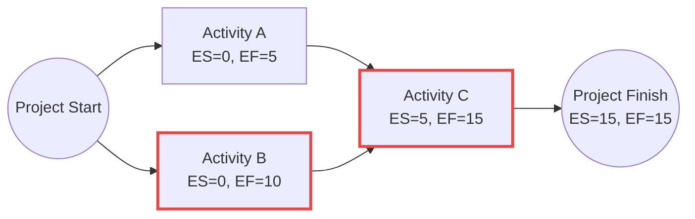
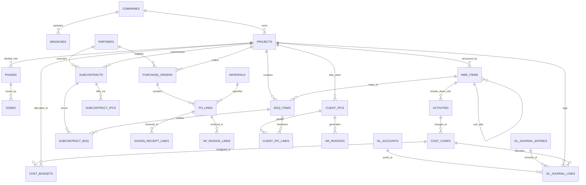

# ERP-SYS V8: Enterprise Construction Operating System (ECOS)
## Master Architectural Transformation Blueprint & Technical Specification
**System Codename:** `MimarECOS V8 / Construction Operating System`  
**Standard Compliance:** PMI PMBOK 7th Ed, ANSI/PMI 19-006-2019 (EVM), AACE International (10S-90, 18R-97, 29R-03), FIDIC Suite (Red Book 2017, Yellow, Silver), ISO 9001:2015, ISO 14001:2015, ISO 45001:2018, ISO 19650 (BIM CDE), Saudi Building Code (SBC 2018/2024), ZATCA Phase 2 (FATOORA), IFRS 15.  
**Classification:** Mission-Critical Enterprise Architecture Standard  
**Document ID:** `MIMAR-V8-TRANSFORMATION-001`  
**Version:** `8.0.0-ENTERPRISE-ARCHITECTURE`  

---

# SECTION 01: V7 Current State Analysis

### 1.1 Repository & Codebase Topography
The MimarERP V7 codebase represents a transitional client-side single-page application (SPA) with emerging modularity, comprising:
- **Presentation Core (`index.html` - 3,080 lines):** Monolithic DOM container housing 39 distinct `<section class="page-view">` views, rendered conditionally via `switchView(viewId)` in `assets/js/app.js`.
- **Master Data Kernel (`assets/js/config.js` - 9,108 lines, 327 KB):** A sprawling in-memory state object (`window.MimarERP`) containing 47 distinct top-level keys and 1,000+ mock records across companies, projects, BOQ, subcontracts, materials, equipment, and HR.
- **Application Controller (`assets/js/app.js` - 3,771 lines, 181 KB):** Procedural controller hosting 41 view rendering routines (`renderCompaniesTable`, `renderWBSBOQTree`, etc.), context switchers, and manual DOM manipulation.
- **Dynamic CRUD Layer (`assets/js/crud-engine.js` - 3,117 lines & `crud-extension.js` - 968 lines):** Procedural schema-driven modal generator and table editor relying on browser `localStorage` under key `MimarERPData_v6`.
- **EVM Calculator (`assets/js/evm-calculator.js` - 138 lines):** Mathematical routines for earned value metrics and HTML5 canvas S-Curve rendering.
- **Enterprise Core Layer (`assets/js/core/`):** 6 micro-libraries introduced in late V6/V7 (`security-sanitizer.js`, `state-store.js`, `validation-engine.js`, `component-library.js`, `api-gateway.js`, `domain-services.js`).
- **Disconnected Standalone Suites (`modules/`):** 6 isolated HTML dashboards (`executive-dashboard`, `cost-control`, `planning`, `procurement`, `hse`, `document-control`) operating on static DOM stubs and decoupled mock states rather than unified live data.

### 1.2 Audited Architectural Strengths
1. **Extensive Construction Domain Vocabulary:** The data model reflects genuine Middle Eastern construction semantics (e.g., FIDIC contract types, ZATCA Phase 2 15% VAT, rebar cut-and-bend parameters $D^2/162$, Aramco/SABIC vendor prequalification, GOSI, and Nitaqat tiers).
2. **Comprehensive Static Data Dictionary:** Over 14 Excel workbooks in `data-workbooks/` provide rich taxonomy across CSI MasterFormat divisions, labor trade wages, equipment hourly rental benchmarks, and materials catalogs.
3. **Arabic-First Design Tokens:** CSS architecture (`assets/css/design-tokens.css`) establishes solid design tokens with RTL native alignment, Tajawal typography, and responsive variables.
4. **Offline Worker Prototype:** `assets/js/workers/xlsx-worker.js` demonstrates an initial off-thread CSV/XLSX export architecture.

---

# SECTION 02: V7 Weakness Analysis

### 2.1 Critical Data Integrity & Business Logic Flaws
1. **Synthetic / Mock EVM Engine (`evm-calculator.js` lines 7-9):**
   ```javascript
   const BAC = prj.direct_cost_budget;
   const progressPct = prj.physical_progress_pct / 100;
   const EV = BAC * progressPct;
   const PV = BAC * Math.min(progressPct + 0.15, 1.0); // FAKE FORMULA: Artificial +15%
   const AC = EV * 0.945;                             // FAKE FORMULA: Artificial factor 0.945
   ```
   **Impact:** Actual Cost (AC) is derived as a percentage of Earned Value rather than an aggregation of real ledger transactions (material invoices, subcontractor certificates, labor payroll, equipment rentals). Planned Value (PV) is arbitrarily shifted by $+15\%$. Cost Performance Index (CPI) is permanently fixed near $1.058$ ($1/0.945$) regardless of operational reality.
2. **Hardcoded S-Curve Data Points (`evm-calculator.js` lines 89-91):**
   ```javascript
   const pvPoints = [0.05, 0.18, 0.40, 0.65, 0.85, 1.00];
   const evPoints = [0.04, 0.15, 0.32, 0.52, 0.65, 0.65];
   const acPoints = [0.04, 0.14, 0.30, 0.49, 0.61, 0.61];
   ```
   **Impact:** The S-Curve canvas in the main dashboard renders static, hardcoded numbers that never reflect actual project progress, baseline schedule revisions, or actual cost postings.
3. **String-Based Identity & Broken Foreign Keys:**
   In `subcontractsMaster`, the contractor is referenced via `contractor_name: "شركة البنيان المتخصصة"` (plain text string) rather than a normalized foreign key `contractor_id: "CON-001"`. Any rename of a contractor breaks relationship links and corrupts historical accounting audits.
4. **Data Redundancy & Dual Masters:**
   The repository maintains two parallel, competing catalogs:
   - `window.MimarERP.partnerCatalog` (53 items)
   - `window.MimarERP.supplierItemsMaster` (54 items)
   And two competing vendor lists:
   - `window.MimarERP.partners` (Clients, Consultants, Subcontractors, Suppliers)
   - `window.MimarERP.suppliersMaster` + `window.MimarERP.contractorsMaster`
   Edits made in one master table fail to propagate to the other, creating severe data divergence.

### 2.2 Storage & Memory Bottlenecks
1. **Single-Key LocalStorage Persistence (`crud-engine.js` line 44):**
   All 47 state collections are serialized into a single JSON string in `localStorage.setItem('MimarERPData_v6', JSON.stringify(toSave))`.
   - Browser `localStorage` is synchronously blocking on the UI thread.
   - The browser quota is strictly capped at 5MB–10MB.
   - A single mid-sized construction project with 2,500 BOQ items and daily diary logs exceeds this limit, triggering `QuotaExceededError` and catastrophic data loss.
2. **Unbounded DOM Leaks in Vanilla Rendering:**
   `app.js` employs raw `innerHTML = rows.join('')` across 41 render functions. Re-rendering a 1,000-row table re-allocates hundreds of detached DOM nodes, degrading frame rates and crashing mobile browser tabs.

---

# SECTION 03: Gap Analysis (V7 vs. V8 Requirements)

| Feature / Domain Dimension | V7 Current Implementation | V8 Enterprise Construction OS (Target) | Gap Severity |
| :--- | :--- | :--- | :--- |
| **Relational Model** | Disconnected flat arrays in single object | Fully normalized 18-dimension relational graph | **CRITICAL** |
| **Cost Control Hierarchy** | Flat WBS code list | 6-Level Hierarchy: Company → Project → Phase → Discipline → Cost Code → Activity | **CRITICAL** |
| **Earned Value Management** | Fake synthetic factor (`EV * 0.945`) | Ledger-aggregated AC from Invoices, Timesheets, Equipment Logs | **CRITICAL** |
| **Planning & Scheduling** | Flat schedule task table, no CPM math | Native Primavera CPM engine (Forward/Backward pass, Float, Delays) | **HIGH** |
| **Procurement & Accounting** | Isolated PO list, manual status toggle | Full P2P cycle with 3-Way Match & Auto General Ledger Journal Creation | **CRITICAL** |
| **Navigation & IA** | 7 generic collapsed nav groups | Expandable 26-Discipline Tree Sidebar with active context awareness | **HIGH** |
| **Executive Dashboard** | Fragmented across separate HTML views | Single Unified Executive Cockpit with cross-portfolio drill-down | **HIGH** |
| **Roadmap Engine** | Static table of milestones | 7-Level Hierarchical Roadmap with Dependency Engine & Critical Path | **HIGH** |
| **Material & Supplier Intelligence** | Static price column | Dynamic Material Intelligence Hub with price history, lead times & BOQ mapping | **MEDIUM** |
| **Document & Print Engine** | Raw `window.print()` with table cropping | Standardized A4/A3 Portrait/Landscape Print Engine with QR & Signatures | **MEDIUM** |
| **Scalability & Architecture** | Client-only SPA bounded by 5MB storage | Microservice-ready, IndexedDB / Dexie.js offline + PostgreSQL 16 backend | **CRITICAL** |
| **AI Copilot** | Conceptual descriptions in markdown | 8 Specialized Engineering AI Agents with domain prompts & tool calling | **MEDIUM** |

---

# SECTION 04: Project-Centric Data Model Refactoring

### 4.1 The 18-Dimensional Relational Graph
In V8, **every business entity must carry the unified Project-Centric Foreign Key Tuple (PCFKT)**:
$$\text{Entity} \longrightarrow (\text{Company}, \text{Branch}, \text{Project}, \text{Phase}, \text{Zone}, \text{Location}, \text{WBS}, \text{BOQ}, \text{Activity}, \text{CostCode})$$

No transaction exists in isolation. An equipment fuel log is not just a receipt; it belongs to:
- Company `CMP-1001`
- Project `PRJ-2026-001`
- Phase `PH-02 (Substructure)`
- Zone `ZN-A (Tower Core)`
- WBS `1.2.3 (Raft Foundation Excavation)`
- Activity `ACT-1040`
- Cost Code `CC-02-31-00 (Heavy Earthmoving Equipment)`
- Equipment `EQ-EXC-004`
- Operator `EMP-8842`

### 4.2 Unified Master Data Normalization Matrix
```
[Holding Company] 1 ──── ∞ [Subsidiary Company]
                                 │ 1
                                 ├─── ∞ [Operating Branch]
                                 │           │ 1
                                 │           └─── ∞ [Project]
                                 │                      │ 1
                                 │                      ├─── ∞ [Phase]
                                 │                      │         │ 1
                                 │                      │         └─── ∞ [Zone / Location]
                                 │                      ├─── ∞ [WBS Item]
                                 │                      │         │ 1
                                 │                      │         └─── ∞ [Activity] 1 ─── ∞ [EVM Snapshot]
                                 │                      ├─── ∞ [BOQ Item]
                                 │                      │         │ 1
                                 │                      │         └─── ∞ [IPC Measurement Line]
                                 │                      └─── ∞ [Cost Code Budget]
                                 │
                                 └─── ∞ [Unified Business Partner] (Role: Supplier / Subcontractor / Client)
                                            │ 1
                                            ├─── ∞ [Catalog Material Item] (with Price History)
                                            ├─── ∞ [Subcontract Agreement] (linked to WBS & Cost Code)
                                            └─── ∞ [Purchase Order] (linked to WBS, BOQ & Cost Code)
```

---

# SECTION 05: Right Sidebar Navigation Restructuring

### 5.1 Business Discipline Tree Architecture
The right sidebar in V8 is completely restructured from the 7 legacy groups into a 26-discipline expandable tree structure:

```
├── 1. Dashboard Center (مركز لوحات القيادة)
│   ├── 1.1 Executive Cockpit 360° (لوحة القيادة التنفيذية الموحدة)
│   ├── 1.2 Portfolio RAG Health Matrix (مصفوفة صحة المشاريع)
│   ├── 1.3 Corporate Financial Cockpit (لوحة المؤشرات المالية للمجموعة)
│   └── 1.4 Field Operations Overview (نظرة عامة على عمليات الموقع)
├── 2. Projects (إدارة المشاريع والمحفظة)
│   ├── 2.1 Project Master Directory (دليل المشاريع الرئيسي)
│   ├── 2.2 Project Setup & Charter (ميثاق وبدء المشروع)
│   ├── 2.3 Phases & Work Packaging (المراحل وحزم العمل)
│   └── 2.4 Project Team & RACI OBS (الهيكل التنظيمي للمشروع)
├── 3. Planning & Scheduling (التخطيط والجدولة الزمنية)
│   ├── 3.1 Primavera Execution Center (مركز تنفيذ ومتابعة الجدول)
│   ├── 3.2 CPM Critical Path Studio (استوديو المسار الحرج والطفو)
│   ├── 3.3 S-Curve & Resource Loading (منحنيات S وحمل الموارد)
│   ├── 3.4 Lookahead & Delay Windows (برامج الاستشراف وتحليل التأخير)
│   └── 3.5 Recovery Plan Simulator (محاكي خطط الاستدراك والتعافي)
├── 4. Technical Office (المكتب الفني والدعم الهندسي)
│   ├── 4.1 Shop Drawing Register (سجل مخططات الورشة التنفيذية)
│   ├── 4.2 Material Submittals (MAR) (اعتمادات المواد والعينات)
│   ├── 4.3 Technical Queries & RFI (طلبات الاستفسار الهندسي)
│   └── 4.4 Method Statements (طرق التنفيذ المعتمدة)
├── 5. BOQ & Quantity Surveying (حساب الكميات والمقايسات)
│   ├── 5.1 Master BOQ Work Breakdown (جدول الكميات والمقايسة المسعرة)
│   ├── 5.2 Measurement Sheets & Takeoff (دفاتر الحصر الهندسي الفعلي)
│   ├── 5.3 Client Interim Payment Certs (IPCs) (مستخلصات المالك الشهرية)
│   └── 5.4 Quantity Reconciliation (المصالحة الهندسية للكميات)
├── 6. Cost Control (مراقبة وضبط التكاليف EVM)
│   ├── 6.1 Multi-Level Cost Hierarchy (هيكل التكاليف ذو الستة مستويات)
│   ├── 6.2 EVM Analytics Engine (محرك إدارة القيمة المكتسبة)
│   ├── 6.3 Commitments & Accruals (الالتزامات الدفترية والمستحقات)
│   ├── 6.4 Variance Analysis & Trends (تحليل الانحرافات والمسارات)
│   └── 6.5 Cash Flow Forecast S-Curve (منحنى التدفق النقدي المتوقع والفعلي)
├── 7. Procurement (المشتريات وسلاسل الإمداد)
│   ├── 7.1 Purchase Requisitions (PR) (طلبات الشراء والاحتياج)
│   ├── 7.2 RFQ & Commercial Comparison (استدراج العروض والمقارنة السعرية)
│   ├── 7.3 Purchase Orders (PO Engine) (أوامر الشراء المعتمدة)
│   └── 7.4 3-Way Invoice Matching (المطابقة الثلاثية للشراء والاستلام)
├── 8. Suppliers (إدارة وتأهيل الموردين)
│   ├── 8.1 Centralized Supplier Directory (الدليل المركزي للموردين)
│   ├── 8.2 Supplier Intelligence & Ratings (سجل ذكاء وتقييم أداء الموردين)
│   └── 8.3 Prequalification & Document Compliance (التأهيل والوثائق النظامية)
├── 9. Materials (ذكاء وتوصيف الخامات)
│   ├── 9.1 Material Intelligence Catalog (كتالوج المواد المركزي والذكاء السعري)
│   ├── 9.2 Price History & Trend Analytics (تاريخ وتقلبات أسعار الخامات)
│   └── 9.3 Trade & Specification Mapping (ربط المواصفات بالبنود والكودات)
├── 10. Subcontractors (مقاولات الباطن والمصنعيات)
│   ├── 10.1 Subcontractors Master Matrix (مصفوفة مقاولي الباطن المعتمدين)
│   ├── 10.2 Trade Production Rates (معدلات إنتاج وأسعار المصنعيات)
│   └── 10.3 Performance & Safety Scoring (سجل الكفاءة الفنية والالتزام)
├── 11. Contracts (إدارة العقود والالتزامات التعاقدية)
│   ├── 11.1 Main Client Contracts (العقود الرئيسية والاتفاقيات)
│   ├── 11.2 Subcontract Agreements (عقود مقاولي الباطن)
│   ├── 11.3 Bonds & Bank Guarantees (خطابات الضمان البنكية والابتدائي)
│   └── 11.4 Insurance Policies & CAR (وثائق التأمين الشامل للمشروع)
├── 12. Claims & Variations (المطالبات وأوامر التغيير)
│   ├── 12.1 Variation Order (VO) Register (سجل أوامر التغيير والتعاميم)
│   ├── 12.2 Extension of Time (EOT) Claims (مطالبات تمديد الوقت الزمني)
│   ├── 12.3 Quantum & Cost Impact Claims (مطالبات التكاليف الإضافية)
│   └── 12.4 FIDIC Dispute & DAB Tracking (سجل النزاعات ومجالس فض الخلافات)
├── 13. Inventory (إدارة المستودعات والمخزون)
│   ├── 13.1 Multi-Store Inventory Balances (أرصدة المستودعات الرئيسية والموقعية)
│   ├── 13.2 Goods Receipt Notes (GRN) (سندات الاستلام والفحص المخزني)
│   ├── 13.3 Site Material Issues & Returns (أذون الصرف والارتجاع الموقعي)
│   └── 13.4 Stock Aging & Reorder Automation (تقادم المخزون والتوليد الآلي للشراء)
├── 14. Equipment (المعدات والآليات الثقيلة)
│   ├── 14.1 Fleet Master Register (سجل الأسطول والمعدات الإنشائية)
│   ├── 14.2 Operating Hours & Utilization (ساعات التشغيل ومعدلات الكفاءة)
│   ├── 14.3 Fuel & Consumption Telematics (سجل المحروقات ومقارنة المعايير)
│   └── 14.4 Maintenance Orders & Breakdown (أوامر الصيانة الدورية والأعطال)
├── 15. Resources (الموارد المشتركة والمعدلات)
│   ├── 15.1 Unified Resource Library (مكتبة الموارد الموحدة)
│   ├── 15.2 Labor & Equipment Standard Recipes (معادلات وخلطات الأنشطة الإنشائية)
│   └── 15.3 Cross-Project Resource Leveling (تسوية وموازنة الموارد المشتركة)
├── 16. HR & Payroll (الموارد البشرية وشؤون الموظفين)
│   ├── 16.1 Engineering & Field Staff Directory (سجل المهندسين والمشرفين والعمالة)
│   ├── 16.2 Biometric & Site Attendance (البصمة الإلكترونية وحضور الموقع)
│   ├── 16.3 Saudi Labor Law & WPS Payroll (مسير الرواتب ونظام حماية الأجور)
│   ├── 16.4 Labor Camp Accommodations (إدارة وتوزيع سكن العمال والمجمعات)
│   └── 16.5 GOSI, Iqama & Medical Insurance (الجوازات والتأمينات والتأمين الصحي)
├── 17. Finance (الإدارة المالية والمحاسبة العامة)
│   ├── 17.1 General Ledger & Chart of Accounts (دليل الحسابات ودفتر الأستاذ)
│   ├── 17.2 Accounts Payable & Vendor Invoices (أوراق الدفع وفواتير الموردين)
│   ├── 17.3 Accounts Receivable & Collection (الذمم المدينة وتحصيلات المالك)
│   ├── 17.4 ZATCA Phase 2 E-Invoicing (الفوترة الإلكترونية وتكامل فاتورة)
│   └── 17.5 Treasury & Cash Flow Management (الخزينة والسيولة وإدارة البنوك)
├── 18. CRM (علاقات العملاء والتسويق)
│   ├── 18.1 Client & Consultant Directory (دليل الملاك والمكاتب الاستشارية)
│   ├── 18.2 Opportunity Pipeline (مسار الفرص والمشاريع المستقبلية)
│   └── 18.3 Prequalification Submissions (ملفات وسجلات التأهيل المعتمدة)
├── 19. QA/QC (ضبط وتأكيد الجودة)
│   ├── 19.1 Inspection & Test Plans (ITP) (خطط الفحص والاختبار المعتمدة)
│   ├── 19.2 Work Inspection Requests (WIR) (طلبات استلام الأعمال الموقعية)
│   ├── 19.3 Material Inspection Requests (MIR) (طلبات فحص وتوريد المواد)
│   ├── 19.4 Non-Conformance Reports (NCR) (تقارير عدم المطابقة والإجراءات التصحيحية)
│   └── 19.5 Snagging & Punch Lists (قوائم الملاحظات والتسليم الابتدائي)
├── 20. HSE (السلامة والصحة المهنية والبيئة)
│   ├── 20.1 Permit to Work (PTW) System (تصاريح العمل الإلكترونية بمختلف أنواعها)
│   ├── 20.2 Incident & Near-Miss Logs (سجلات الحوادث والإصابات والظروف الوشيكة)
│   ├── 20.3 Safety Statistics & LTIFR (إحصائيات السلامة وساعات العمل الآمنة)
│   └── 20.4 Toolbox Talks & Safety Inductions (محادثات السلامة والتدريب التعريفي)
├── 21. Document Control (إدارة ومراقبة الوثائق الهندسية)
│   ├── 21.1 Master Document Register (MDR) (سجل الوثائق والمخططات العام)
│   ├── 21.2 Document Transmittals (المراسلات والتسليمات الرسمية)
│   └── 21.3 ISO 19650 CDE Workflow (مسارات بيئة البيانات المشتركة ومستويات النضج)
├── 22. Tenders (العطاءات والمناقصات والتسعير)
│   ├── 22.1 Active RFP & Tender Submissions (المناقصات الجارية والمطروحة)
│   ├── 22.2 Parametric Tender Estimating (التسعير التقديري التنافسي)
│   └── 22.3 Tender Bond & Bid Security (خطابات الضمان الابتدائي للمناقصات)
├── 23. PMO (مكتب إدارة المشاريع المؤسسي)
│   ├── 23.1 Program & Portfolio Health Matrix (مصفوفة صحة البرامج والمحافظ)
│   ├── 23.2 Enterprise Milestone Tracking (متابعة المحطات الرئيسية المؤسسية)
│   └── 23.3 Cross-Project Risk Register (سجل المخاطر المشتركة وحلول المعالجة)
├── 24. AI Center (مركز الذكاء الاصطناعي الإنشائي)
│   ├── 24.1 AI Engineering Copilots (8 وكلاء ذكاء اصطناعي متخصصين)
│   ├── 24.2 Predictive Delay & Cost Overrun Engine (محرك التنبؤ بالتأخير وتجاوز التكاليف)
│   └── 24.3 Automated Document & RFI Analyzer (المحلل الآلي لدفاتر الشروط والمواصفات)
├── 25. Reports Center (مركز التقارير المؤسسية وذكاء الأعمال)
│   ├── 25.1 Cost Value Reconciliation (CVR) (تقرير المصالحة الشهرية الشاملة)
│   ├── 25.2 Financial Performance Statements (القوائم المالية والتحليل المقارن)
│   ├── 25.3 Executive Summary PDF Packs (حزم التقارير التنفيذية للطباعة الرسمية)
│   └── 25.4 Power BI DirectQuery Export (بوابات التصدير المباشر لـ Power BI)
└── 26. Administration (إدارة المنظومة والصلاحيات)
    ├── 26.1 Organization Hierarchy & Companies (الهيكل المؤسسي والشركات والفروع)
    ├── 26.2 RBAC Role Matrix & Access Control (مصفوفة الصلاحيات والأدوار الأمنية)
    ├── 26.3 Cryptographic Audit Trail (سجل التدقيق الرقمي المشفر لجميع العمليات)
    └── 26.4 Integration & Database Engine (إعدادات الربط والنسخ الاحتياطي وقواعد البيانات)
```

---

# SECTION 06: Cost Control Engine V8 Architecture

### 6.1 Six-Level Cost Control Breakdown Structure
The Cost Control Engine in V8 enforces a rigid, non-bypassable 6-level cost breakdown:

$$\text{Level 1: Legal Entity (Company)} \longrightarrow \text{Level 2: Project} \longrightarrow \text{Level 3: Phase} \longrightarrow \text{Level 4: Trade/Discipline} \longrightarrow \text{Level 5: Master Cost Code} \longrightarrow \text{Level 6: CPM Activity}$$

Example of Level 5 Master Cost Code (CSI MasterFormat alignment):
- `03 00 00` — Concrete
  - `03 20 00` — Concrete Reinforcing
    - `03 21 00` — Reinforcing Steel Bars (Grade 60 / B500B)
      - `03 21 10` — Rebar Supply (Material)
      - `03 21 20` — Rebar Cutting, Bending & Fixing (Subcontract Labor)
      - `03 21 30` — Tower Crane & Rigging Support (Equipment)

### 6.2 Mathematical Formulation of Real-Time EVM
Unlike V7's synthesized formulas, V8 computes EVM directly from the transactional ledger:

1. **Budget at Completion (BAC):**
   $$\text{BAC} = \sum_{i=1}^{N} \text{Baseline Cost}(\text{Activity}_i)$$
2. **Planned Value (PV) as of date $t$:**
   $$\text{PV}(t) = \sum_{i=1}^{N} \int_{0}^{t} \text{Planned Resource Distribution}_i(\tau) \, d\tau$$
3. **Earned Value (EV) as of date $t$:**
   $$\text{EV}(t) = \sum_{i=1}^{N} \left[ \text{BAC}_i \times \text{Physical Progress \%}_i(t) \right]$$
4. **Actual Cost of Work Performed (AC) as of date $t$ (The Accounting Ledger Kernel):**
   $$\text{AC}(t) = \sum \text{Posted Material Invoices} + \sum \text{Certified Subcontract IPCs} + \sum \text{Allocated Labor Timesheets} + \sum \text{Equipment Operating Telematics} + \sum \text{Direct Site Expenses}$$
5. **Commitments (COMM):**
   $$\text{COMM}(t) = \sum \text{Approved PO Unbilled Balances} + \sum \text{Subcontract Unexecuted Balances}$$
6. **Estimate at Completion (EAC) Multi-Method Suite:**
   - Standard EVM: $\text{EAC}_{\text{CPI}} = \frac{\text{BAC}}{\text{CPI}}$
   - Combined Cost & Schedule: $\text{EAC}_{\text{CPI} \times \text{SPI}} = \text{AC} + \frac{\text{BAC} - \text{EV}}{\text{CPI} \times \text{SPI}}$
   - Management Forecast (Bottom-up): $\text{EAC}_{\text{Bottom-up}} = \text{AC} + \sum \text{Re-estimated Remaining Activity Costs}$
7. **To-Complete Performance Index (TCPI):**
   $$\text{TCPI}_{\text{BAC}} = \frac{\text{BAC} - \text{EV}}{\text{BAC} - \text{AC}} \quad \text{and} \quad \text{TCPI}_{\text{EAC}} = \frac{\text{BAC} - \text{EV}}{\text{EAC} - \text{AC}}$$

---

# SECTION 07: Execution Scheduling Center Engine (Primavera P6-Grade)

### 7.1 Critical Path Method (CPM) Algorithmic Core
The Scheduling Engine executes the classic two-pass CPM topological traversal:



1. **Forward Pass (Early Dates Calculation):**
   - For activities without predecessors: $\text{ES}_i = \text{Project Start}$.
   - For activities with predecessors:
     $$\text{ES}_j = \max_{i \in \text{Pred}(j)} \left( \text{EF}_i + \text{Lag}_{ij} \right) \quad \text{for FS relationship}$$
   - Early Finish: $\text{EF}_i = \text{ES}_i + \text{Duration}_i - 1$.
2. **Backward Pass (Late Dates Calculation):**
   - For terminal activities: $\text{LF}_k = \text{Project Finish}$ (or Target Constraint Date).
   - Late Start: $\text{LS}_i = \text{LF}_i - \text{Duration}_i + 1$.
   - For activities with successors:
     $$\text{LF}_i = \min_{j \in \text{Succ}(i)} \left( \text{LS}_j - \text{Lag}_{ij} \right) \quad \text{for FS relationship}$$
3. **Float Analysis:**
   - **Total Float (TF):** $\text{TF}_i = \text{LS}_i - \text{ES}_i = \text{LF}_i - \text{EF}_i$.
   - **Free Float (FF):** $\text{FF}_i = \min_{j \in \text{Succ}(i)} (\text{ES}_j) - \text{EF}_i - 1$.
   - **Critical Path Definition:** Activities where $\text{TF}_i \le 0$.

### 7.2 Delay Analysis & Recovery Planning
- **Windows Analysis Method:** Automatically segments the schedule into monthly progress update periods, re-running CPM to isolate whether delay occurred in Window $N$ on Employer Critical Path or Contractor Operations.
- **Time Impact Analysis (TIA - FIDIC Sub-Clause 8.4):** Injects a fragnet (delay sub-network) into the approved unimpacted baseline schedule to formally quantify contractual Extension of Time (EOT) entitlement.

---

# SECTION 08: Subcontractor & FIDIC Contract Engine

### 8.1 Contract Lifecycle Management (FIDIC Red Book 2017)
```
[Tender Award & LOA]
       ↓
[Formal Contract Execution (FIDIC Red Book)]
       ↓
[Bank Guarantees: Advance Payment (10%) & Performance Bond (10%)]
       ↓
[Monthly Site Progress Measurement Sheet (Joint Measurement)]
       ↓
[Subcontractor Interim Payment Certificate (Sub-IPC)]
       ↓
[Automated Deductions: Retention (10%), Advance Recovery (Amortized), Contra Charges]
       ↓
[Engineer / QS Certification] → [Approval via LoA Matrix]
       ↓
[Auto-Post to Accounts Payable & General Ledger]
       ↓
[Treasury Disbursement via SARIE / Wire Transfer]
```

### 8.2 Variation Orders & Claims Governance
- **Instructed Variations (Sub-Clause 13.1):** Triggered by Engineer's instruction. System creates a pending VO record, automatically reserving cost code budgets.
- **Contractor Claims (Sub-Clause 20.1):** Enforces strict 28-day notice rule. If notice date $> 28$ days from awareness date, system flags statutory time-bar warning while recording contemporaneous records.

---

# SECTION 09: Procurement & Work Order P2P Engine

### 9.1 The Closed-Loop P2P Process
```
[Material Requisition (PR)] ← Generated from BOQ or Site Foremen
       ↓
[Approval Workflow per LoA Matrix]
       ↓
[Auto-Consolidation & RFQ Generation to Qualified Suppliers]
       ↓
[Commercial & Technical Bid Matrix (3-Quote Rule Enforced)]
       ↓
[Purchase Order (PO) Issuance with ZATCA Tax Fields]
       ↓
[Site Delivery & Material Inspection (MIR / QAQC Verification)]
       ↓
[Goods Receipt Note (GRN) Posted to Store Inventory]
       ↓
[3-Way Match: PO vs. GRN vs. Supplier Tax Invoice]
       ↓
[Automatic Journal Entry: Debit Inventory/WIP, Credit AP Vendor]
```

---

# SECTION 10: Materials & Supplier Intelligence System

### 10.1 Centralized Supplier 360° Profile
Each supplier in V8 is mapped to an enterprise profile:
- Legal Identity: CR Number, VAT Tax Number, Chamber of Commerce, GOSI Certificate, Aramco Vendor ID.
- Performance Index: Delivery On-Time Rate %, Quality Acceptance Rate (zero-defect deliveries), Price Competitiveness Index.
- Contractual Financial Exposure: Total Active PO Value, Total Unbilled GRNs, Total Open AP Invoices, Retentions Held.

### 10.2 Material Intelligence Database
Every item in the material catalog carries:
- Master Code (e.g. `MAT-CONC-C40-SRC` — Ready-Mix Concrete C40 Sulphate Resistant Cement).
- Trade Classification: CSI Division `03 30 00`.
- Price Analytics: Weighted Average Cost (WACOG), Latest Purchase Rate, Lowest Approved Bid Rate, Historic Price Variance Curve (12 months).
- Active Lead Time (days) and Minimum Reorder Safety Threshold.

---

# SECTION 11: Deep Accounting Integration Engine

### 11.1 Automated Journal Generation Rules (AJGR)

| Operational Event | Debit Account | Credit Account | Dimension Tags |
| :--- | :--- | :--- | :--- |
| **Material Receipt (GRN)** | `1310 - Inventory / Raw Materials` | `2120 - Accrued Goods Received Not Invoiced` | Company, Project, Cost Code, Warehouse, Supplier |
| **Vendor Invoice 3-Way Matched** | `2120 - Accrued Goods Received Not Invoiced`<br>`1390 - Input VAT (15%)` | `2110 - Accounts Payable (Vendors)` | Company, Project, Cost Code, PO Number, Supplier |
| **Subcontractor IPC Certified** | `1410 - Construction Work in Progress (WIP)`<br>`1390 - Input VAT (15%)` | `2130 - Accounts Payable (Subcontractors)`<br>`2140 - Subcontractor Retention Payable (10%)` | Company, Project, Cost Code, Subcontract ID, Contractor |
| **Client IPC Certified by Consultant** | `1210 - Accounts Receivable (Client)`<br>`1240 - Client Retention Receivable (10%)` | `4110 - Construction Contract Revenue`<br>`2210 - Output VAT Payable (15%)` | Company, Project, Phase, IPC Number, Client |
| **Direct Site Payroll Allocation** | `1410 - Construction Work in Progress (WIP)` | `2150 - Accrued Payroll & Wages (WPS)` | Company, Project, Cost Code, Labor Trade |
| **Equipment Fuel Consumption Log** | `1410 - Construction Work in Progress (WIP)` | `1315 - On-Site Fuel Inventory` | Company, Project, Cost Code, Equipment ID |

---

# SECTION 12: Unified Executive Dashboard Architecture

### 12.1 Real-Time 27-Widget Executive Matrix
The V8 Executive Dashboard eliminates fragmentation by compiling corporate health into a single high-performance cockpit:

```
+-------------------------------------------------------------------------------------------------------------------+
|                                        MIMAR ECOS V8 — EXECUTIVE CORPORATE COCKPIT                                |
+-------------------------------------------------------------------------------------------------------------------+
| [1. Active Projects: 24]  [2. Total BAC: 1.84B SAR]  [3. Cumulative EV: 942M SAR]  [4. Cumulative AC: 968M SAR]   |
| [5. Portfolio CPI: 0.973] [6. Portfolio SPI: 0.912]  [7. Variance At Comp: -48M]   [8. Net Cash Flow: +142M SAR]  |
+---------------------------------------------------------+---------------------------------------------------------+
| [Widget 9: Portfolio RAG Health Table]                  | [Widget 10: Cash Flow & Billing Curve (24 Months)]      |
| Project Code | Client | CPI | SPI | Delay | Health      | S-Curve: Planned vs Actual vs Forecast Inflow/Outflow   |
| PRJ-2026-001 | Invest | 0.94| 0.88| -24d  | AMBER       |                                                         |
| PRJ-2026-002 | Retal  | 1.02| 0.99| +2d   | GREEN       |                                                         |
| PRJ-2026-003 | Diriyah| 0.89| 0.82| -45d  | RED         |                                                         |
+---------------------------------------------------------+---------------------------------------------------------+
| [Widget 11: Cost Code Variance Pareto Analysis]         | [Widget 12: Critical Activities & Path Risk Exposure]   |
| Top Cost Overrun Codes: Concrete, Steel, Dewatering     | Top Delay Drivers: Foundation Slabs, Façade Glazing     |
+---------------------------------------------------------+---------------------------------------------------------+
| [Widget 13: Procurement & Commitments Pipeline]         | [Widget 14: Subcontractor & Supplier Performance Index] |
| Open PRs (42) | Issued POs (112) | Pending 3-Way (18)   | Top Performing vs Defaulting Subcontractor Scoring      |
+---------------------------------------------------------+---------------------------------------------------------+
| [Widget 15: Outstanding Claims & VO Exposure]           | [Widget 16: Quality & Safety Compliance Radar]          |
| Active EOT Days Claimed: 140d | VO Value: 84.5M SAR     | LTIFR: 0.00 | Open NCRs: 14 | Active PTWs: 48           |
+---------------------------------------------------------+---------------------------------------------------------+
```

---

# SECTION 13: Comprehensive Enterprise ERD (Mermaid)



---

# SECTION 14: RESTful API Design Specification

### 14.1 Enterprise Endpoint Architecture
All V8 endpoints enforce standard REST conventions with tenant isolation and strict typing:
- `GET    /api/v8/projects/{projectId}/cost-control/evm` — Real-time ledger-backed EVM metrics.
- `GET    /api/v8/projects/{projectId}/cost-control/s-curve` — Transaction-accurate S-Curve data points.
- `POST   /api/v8/projects/{projectId}/scheduling/cpm/calculate` — Execute CPM forward/backward passes.
- `GET    /api/v8/projects/{projectId}/scheduling/critical-path` — Fetch current critical path chain.
- `POST   /api/v8/procurement/purchase-orders/{id}/3-way-match` — Run automated 3-way reconciliation.
- `POST   /api/v8/finance/invoices/zatca/clear` — Execute ZATCA Phase 2 clearance with cryptographic stamp.
- `GET    /api/v8/materials/{materialCode}/intelligence` — Historical price trends and supplier benchmarks.
- `POST   /api/v8/subcontracts/{subcontractId}/ipcs/certify` — Certify sub-IPC with auto GL journal creation.

---

# SECTION 15: Database Design (PostgreSQL 16 Enterprise DDL)

```sql
-- CORE EXTENSIONS
CREATE EXTENSION IF NOT EXISTS "uuid-ossp";
CREATE EXTENSION IF NOT EXISTS "pgcrypto";

-- MULTI-LEVEL WBS ITEMS TABLE
CREATE TABLE v8_wbs_items (
    id UUID PRIMARY KEY DEFAULT gen_random_uuid(),
    tenant_id UUID NOT NULL,
    company_id UUID NOT NULL,
    project_id UUID NOT NULL,
    phase_id UUID,
    parent_id UUID REFERENCES v8_wbs_items(id),
    code VARCHAR(50) NOT NULL,
    name_ar VARCHAR(250) NOT NULL,
    name_en VARCHAR(250),
    level SMALLINT NOT NULL DEFAULT 1,
    path TEXT NOT NULL,
    is_work_package BOOLEAN DEFAULT FALSE,
    created_at TIMESTAMPTZ DEFAULT NOW(),
    CONSTRAINT uq_project_wbs_code UNIQUE (project_id, code)
);

-- CPM ACTIVITIES TABLE
CREATE TABLE v8_activities (
    id UUID PRIMARY KEY DEFAULT gen_random_uuid(),
    tenant_id UUID NOT NULL,
    company_id UUID NOT NULL,
    project_id UUID NOT NULL,
    wbs_id UUID NOT NULL REFERENCES v8_wbs_items(id),
    cost_code_id UUID NOT NULL,
    activity_code VARCHAR(50) NOT NULL,
    name_ar VARCHAR(250) NOT NULL,
    duration_days NUMERIC(8,2) NOT NULL DEFAULT 1,
    planned_start DATE NOT NULL,
    planned_finish DATE NOT NULL,
    actual_start DATE,
    actual_finish DATE,
    early_start DATE,
    early_finish DATE,
    late_start DATE,
    late_finish DATE,
    total_float_days NUMERIC(8,2) DEFAULT 0,
    free_float_days NUMERIC(8,2) DEFAULT 0,
    is_critical BOOLEAN DEFAULT FALSE,
    physical_progress_pct NUMERIC(5,2) DEFAULT 0.00,
    created_at TIMESTAMPTZ DEFAULT NOW(),
    CONSTRAINT uq_project_activity_code UNIQUE (project_id, activity_code)
);

-- CPM ACTIVITY RELATIONSHIPS (FS, SS, FF, SF)
CREATE TABLE v8_activity_relationships (
    id UUID PRIMARY KEY DEFAULT gen_random_uuid(),
    tenant_id UUID NOT NULL,
    project_id UUID NOT NULL,
    predecessor_id UUID NOT NULL REFERENCES v8_activities(id),
    successor_id UUID NOT NULL REFERENCES v8_activities(id),
    relationship_type VARCHAR(4) NOT NULL DEFAULT 'FS', -- FS, SS, FF, SF
    lag_days NUMERIC(8,2) NOT NULL DEFAULT 0.00,
    created_at TIMESTAMPTZ DEFAULT NOW(),
    CONSTRAINT chk_no_self_loop CHECK (predecessor_id <> successor_id)
);

-- REAL TRANSACTION-BACKED EVM DATA STORE
CREATE TABLE v8_evm_ledger_snapshots (
    id UUID PRIMARY KEY DEFAULT gen_random_uuid(),
    tenant_id UUID NOT NULL,
    company_id UUID NOT NULL,
    project_id UUID NOT NULL,
    snapshot_date DATE NOT NULL,
    bac NUMERIC(18,2) NOT NULL,
    pv NUMERIC(18,2) NOT NULL,
    ev NUMERIC(18,2) NOT NULL,
    ac NUMERIC(18,2) NOT NULL,
    cv NUMERIC(18,2) GENERATED ALWAYS AS (ev - ac) STORED,
    sv NUMERIC(18,2) GENERATED ALWAYS AS (ev - pv) STORED,
    cpi NUMERIC(8,4) GENERATED ALWAYS AS (CASE WHEN ac > 0 THEN ev / ac ELSE 1.0 END) STORED,
    spi NUMERIC(8,4) GENERATED ALWAYS AS (CASE WHEN pv > 0 THEN ev / pv ELSE 1.0 END) STORED,
    eac NUMERIC(18,2) NOT NULL,
    vac NUMERIC(18,2) NOT NULL,
    created_at TIMESTAMPTZ DEFAULT NOW(),
    CONSTRAINT uq_project_evm_date UNIQUE (project_id, snapshot_date)
);
```

---

# SECTION 16: UI/UX Modernization Blueprint

### 16.1 Design Principles
1. **Zero-Lag Virtualized Tables:** Tables rendering $>50$ rows must utilize virtualized viewport windowing (only rendering DOM nodes visible within screen coordinates).
2. **Context-Aware Breadcrumb Header:** Top bar constantly reflects the 6-tier operational context:
   `Apex Holding > Riyadh Branch > Financial Tower > Substructure > Zone A > Raft Foundation`
3. **High-Density Information Architecture:** Tables feature compact 36px row heights, monospace numerical tabular alignment (`font-variant-numeric: tabular-nums`), color-coded variance badges, and keyboard navigation.

---

# SECTION 17: Performance Optimization Plan (50M+ Records)

1. **Client-Side Virtual DOM & IndexedDB Engine:**
   Replace the 5MB `localStorage` bottleneck with **IndexedDB (via Dexie.js)**, unlocking 1GB+ client storage for offline drawings, full BOQ caches, and historical rate tables.
2. **PostgreSQL Partitioning by Tenant & Fiscal Year:**
   Tables exceeding 10M rows (`gl_journal_lines`, `v8_evm_ledger_snapshots`, `inventory_movements`) are declaratively partitioned:
   ```sql
   CREATE TABLE v8_journal_lines ( ... ) PARTITION BY RANGE (posting_date);
   ```
3. **Redis Read Projections & Cache Invalidation:**
   Pre-compute portfolio EVM metrics and S-Curve points in Redis caches. Invalidation is event-driven via Kafka when a new IPC or PO invoice is certified.

---

# SECTION 18: Migration Plan (V7 → V8)

1. **Step 1: Normalization & Identity Remediation:**
   Run migration scripts to convert string-based partner references in `subcontractsMaster` and `equipmentMaster` into foreign key UUIDs.
2. **Step 2: Unified Catalog Deduplication:**
   Merge `partnerCatalog` and `supplierItemsMaster` into the unified `v8_materials_catalog` with automated price history migration.
3. **Step 3: Dual-Write Bridge:**
   Implement a state synchronization middleware during transition where writes to legacy `window.MimarERP` automatically mirror into the normalized V8 IndexedDB store.
4. **Step 4: Cutover & Storage Cleanup:**
   Migrate historical `MimarERPData_v6` payloads into IndexedDB, clearing legacy `localStorage` keys and deprecating monolithic render loops.

---

# SECTION 19: Module Prioritization Matrix

| Phase | Module / Capability | Business Impact | Complexity | Priority |
| :---: | :--- | :---: | :---: | :---: |
| **Phase 1** | Project-Centric Data Model & Sidebar Tree Restructuring | CRITICAL | HIGH | **P0 (Immediate)** |
| **Phase 1** | Single Unified Executive Cockpit | CRITICAL | MEDIUM | **P0 (Immediate)** |
| **Phase 1** | True Ledger-Aggregated Cost Control Engine & EVM | CRITICAL | HIGH | **P0 (Immediate)** |
| **Phase 2** | Native CPM Execution Scheduling Center & S-Curves | HIGH | VERY HIGH | **P1 (Core)** |
| **Phase 2** | Subcontractor Contract & FIDIC Management | HIGH | HIGH | **P1 (Core)** |
| **Phase 2** | Procurement 3-Way Match & Auto Journal Creation | HIGH | HIGH | **P1 (Core)** |
| **Phase 3** | Material & Supplier Intelligence Hub | MEDIUM | MEDIUM | **P2 (Strategic)** |
| **Phase 3** | Standardized A4/A3 Construction Print Engine | HIGH | MEDIUM | **P2 (Strategic)** |
| **Phase 4** | 8 Specialized Engineering AI Copilots | HIGH | HIGH | **P3 (Advanced)** |

---

# SECTION 20: Complete Development Roadmap

```
Month 01-02 [Phase 1: Architectural Foundation & Unified Cockpit]
├── Normalize Data Schemas into Unified Relational Graph (PCFKT)
├── Implement 26-Discipline Expandable Tree Sidebar Navigation
├── Deploy Single Unified Executive Dashboard with Cross-Project Drilldown
└── Replace LocalStorage with Dexie.js / IndexedDB Multi-Tenant Store

Month 03-04 [Phase 2: Project Controls & Engineering Core]
├── Implement 6-Level Cost Breakdown Hierarchy & Ledger-Aggregated EVM
├── Build Primavera CPM Two-Pass Engine (Float, Early/Late Dates, Critical Path)
├── Deploy Dynamic S-Curve, Manpower & Cash Flow Visualization
└── Deliver FIDIC Red Book Subcontract Management & IPC Invoicing

Month 05-06 [Phase 3: Supply Chain & Financial Integration]
├── Deploy Closed-Loop P2P Engine with Automated 3-Way Invoice Matching
├── Integrate Auto Journal Posting from Operational Events into General Ledger
├── Build Supplier & Material Intelligence Hub with Price History Trends
└── Deliver Standardized A4/A3 Print Engine with QR & Compliance Stamps

Month 07-08 [Phase 4: AI Construction Center & Enterprise Scale]
├── Train & Deploy 8 Domain-Specific Engineering AI Copilots
├── Implement PostgreSQL Table Partitioning & Redis Read Caching (50M+ Records)
└── Complete User Acceptance Testing, Security Audit, and Enterprise Cutover
```
