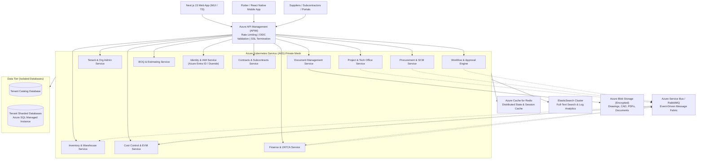
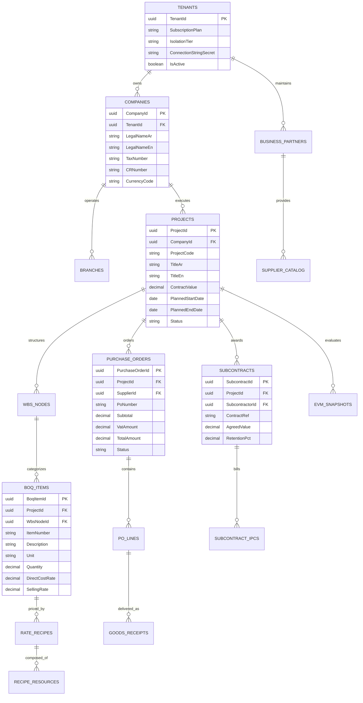
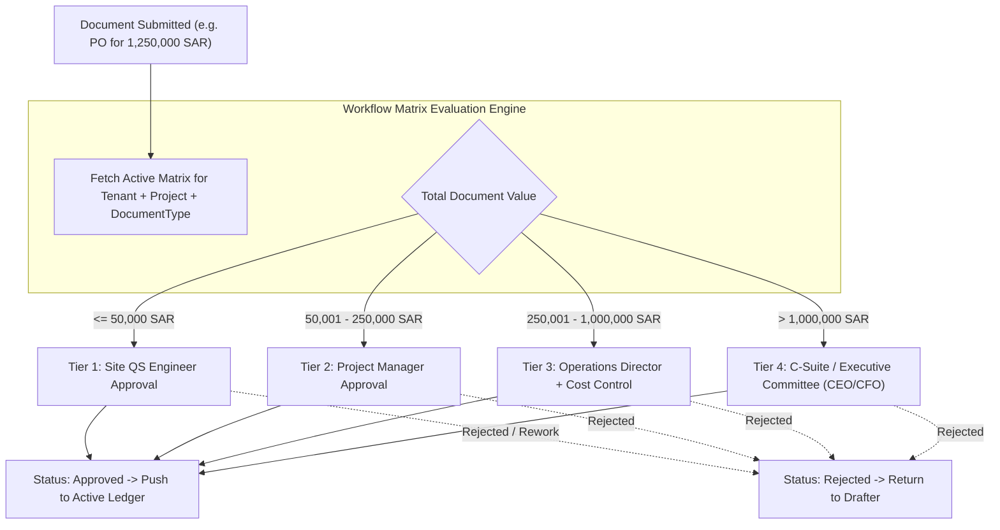
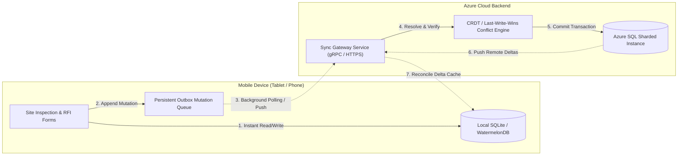

# Enterprise Construction ERP SaaS Platform: Master Architectural Blueprint & System Specification
**Product Codename:** `Aethelgard ERP` / `Mimar Enterprise ERP 3.0`  
**Target Market:** Tier-1 General Contractors, EPC Mega-Contractors, Real Estate Developers, Infrastructure Authorities  
**Classification:** Mission-Critical Enterprise Multi-Tenant SaaS Platform  
**Compliance Standards:** FIDIC (Red, Yellow, Silver Books), PMI PMBOK & EVM (ANSI/PMI 19-006-2019), AACE International (10S-90, 18R-97, 29R-03), CSI MasterFormat (50 Divisions), ZATCA Phase 2 (FATOORA), ISO 9001 / 14001 / 45001 / 19650 (BIM CDE)

---

## Executive Summary & Design Tenets

This specification defines the production-ready target architecture for a Tier-1 commercial Construction Enterprise Resource Planning (ERP) platform. Designed from first principles to overcome the legacy architectural debt observed in monolithic construction software, this system delivers:

1. **Zero Hardcoding & Total Data Dynamism:** Every code, workflow, approval threshold, document number sequence, currency, tax schema, and organizational relationship is governed by tenant-isolated Master Data Engines.
2. **Infinite Multi-Tenancy:** Horizontal scalability supporting thousands of tenant organizations, each managing unlimited legal entities (companies), operating branches, joint ventures, projects, subcontractors, vendors, and concurrent users.
3. **Clean Architecture & Domain-Driven Design (DDD):** Strict isolation of core business rules from infrastructure, databases, and UI frameworks via explicit Bounded Contexts, Aggregates, Value Objects, and Domain Events.
4. **Command Query Responsibility Segregation (CQRS) & Event-Driven Backbone:** High-throughput write transactions powered by MediatR commands and transactional outbox patterns, paired with hyper-optimized read projections via Dapper, Redis caching, and ElasticSearch.
5. **Contractual & Statutory Rigor:** Native support for FIDIC Red Book claim lifecycles, PMI/AACE Earned Value Management (EVM), and ZATCA Phase 2 cryptographic e-invoicing.

---

## 1. Complete Functional Requirements Document (FRD)

The platform is partitioned into 29 cohesive functional modules spanning the entire construction project lifecycle:

```
┌────────────────────────────────────────────────────────────────────────────────────────────────────────┐
│                                   ENTERPRISE SaaS CONTROL PLANE                                        │
│  [Tenant Management]   [Subscription & Billing]   [Global Audit Trail]   [Feature Flags / Licensing]   │
└──────────────────────────────────────────────────┬─────────────────────────────────────────────────────┘
                                                   │
┌──────────────────────────────────────────────────┴─────────────────────────────────────────────────────┐
│                                       CORE ENTERPRISE MODULES                                          │
├──────────────────────────┬─────────────────────────────┬───────────────────────────────────────────────┤
│ 1. Identity & Access     │ 2. Organization Structure   │ 3. Master Data Management                     │
│    - Azure Entra ID / SSO│    - Holding > Company >    │    - CSI MasterFormat 50 Divs                 │
│    - SCIM Provisioning   │      Branch > Cost Centers  │    - Uniformat II Elements                    │
│    - Fine-Grained RBAC   │    - Joint Venture Sharing  │    - Unit of Measure Engine (ISO)             │
│    - Step-up MFA         │    - Multi-Currency (FX)    │    - Dynamic Attributes System                │
├──────────────────────────┼─────────────────────────────┼───────────────────────────────────────────────┤
│ 4. Project Portfolio     │ 5. Technical Office         │ 6. Work Breakdown (WBS) & BOQ                 │
│    - EPC / Design-Build  │    - Drawing Register       │    - 5-Level Hierarchical WBS                 │
│    - Project Charter     │    - Shop Drawing Revisions │    - Re-measured & Lump-Sum BOQ               │
│    - Milestones & Bonds  │    - Transmittals & RFIs    │    - Price Breakdown (Direct/Indirect)        │
│    - Site Mobilization   │    - Submittals & Approvals │    - Dynamic Rate Analysis Recipes            │
├──────────────────────────┼─────────────────────────────┼───────────────────────────────────────────────┤
│ 7. Quantity Surveying    │ 8. Planning & Scheduling    │ 9. Cost Control & EVM                         │
│    - Measurement Sheets  │    - Primavera P6 XER Sync  │    - Budget Baseline (BAC) Control            │
│    - Auto-Deduction Rules│    - Critical Path (CPM)    │    - Real-Time PV, EV, AC Calculation         │
│    - Drawing Line Callout│    - Resource Leveling      │    - CPI, SPI, EAC, VAC, TCPI Metrics         │
│    - Quantity Growth Log │    - Lookahead Schedules    │    - Cost Value Reconciliation (CVR)          │
├──────────────────────────┼─────────────────────────────┼───────────────────────────────────────────────┤
│ 10. Procurement (SCM)    │ 11. Inventory & Warehouse   │ 12. Contract & Subcontract Mgt                │
│    - Material Req (MR)   │    - Multi-Site Warehouses  │    - FIDIC Red Book Subcontracts              │
│    - RFQ / Bid Levelling │    - GRN with QC Inspection │    - Interim Payment Cert (IPC)               │
│    - Purchase Orders     │    - Batch & Serial Control │    - Retention & Advance Guarantees           │
│    - 3-Way Match Check   │    - Min/Max Safety Stock   │    - Variation Orders (VOs) & Claims          │
├──────────────────────────┼─────────────────────────────┼───────────────────────────────────────────────┤
│ 13. Financial Management │ 14. Human Resources & Payroll│ 15. Plant, Machinery & Equipment              │
│    - Chart of Accounts   │    - Site Labor Attendance  │    - Fleet Telematics & GPS Log               │
│    - AP / AR / GL        │    - Crew Productivity      │    - Preventative Maintenance Engine          │
│    - ZATCA Phase 2 XML   │    - Wage Protection (WPS)  │    - Internal Plant Hire Cross-Charge         │
│    - Retainage Ledgers   │    - Visa & Iqama Tracking  │    - Fuel & Operator Logbooks                 │
├──────────────────────────┼─────────────────────────────┼───────────────────────────────────────────────┤
│ 16. QA/QC & Inspection   │ 17. HSE & Incident Control  │ 18. Tendering & CRM                           │
│    - Inspection (WIR/MIR)│    - Safety Observation Log │    - Opportunity Pipeline                     │
│    - Non-Conformance NCR │    - Hazard Near-Miss Mgmt  │    - Estimating / Bid Generation              │
│    - Punch Lists / Snag  │    - Safe Work Method SWMS  │    - Subcontractor Quotes Levelling           │
├──────────────────────────┼─────────────────────────────┼───────────────────────────────────────────────┤
│ 19. Document Mgt (DMS)   │ 20. Workflow & Approvals    │ 21. Stakeholder Portals                       │
│    - ISO 19650 BIM CDE   │    - Multi-Tier Thresholds  │    - Vendor / Supplier Portal                 │
│    - Version Control     │    - Dynamic Routing Engine │    - Subcontractor IPC Portal                 │
│    - Watermark & Redact  │    - SLA & Auto-Escalation  │    - Client & Consultant Portal               │
└──────────────────────────┴─────────────────────────────┴───────────────────────────────────────────────┘
```

---

## 2. System Architecture & Topology

The platform implements a **Cloud-Native, Event-Driven Microservices Architecture** deployed on Azure Kubernetes Service (AKS), utilizing Azure API Management as the single enterprise ingress point.



---

## 3. Database Design & Multi-Tenancy Strategy

### Multi-Tenancy Model: Hybrid Sharded Database Architecture
To satisfy Tier-1 enterprise data sovereignty, performance isolation, and compliance regulations, the system utilizes a **Hybrid Catalog + Sharded Elastic Pool** model:

1. **Enterprise / Dedicated Tenants:** Receive a dedicated Azure SQL Database isolated in their chosen geographic region (Saudi Arabia Central for ZATCA, UAE North, Europe West).
2. **Standard / Shared Tenants:** Grouped in shared Azure SQL Elastic Pools, partitioned via **Row-Level Security (RLS)** using `TenantId` session contexts injected automatically by EF Core Global Query Filters.



---

## 4. Domain-Driven Design (DDD) Clean Architecture

```
D:\ERP sys\
├── src\
│   ├── Core\
│   │   ├── Domain\                             # Enterprise Core Business Rules & Aggregates
│   │   │   ├── Common\                         # BaseEntity, AggregateRoot, ValueObject, IAuditable
│   │   │   ├── Entities\                       # Project, BoqItem, PurchaseOrder, SubcontractAgreement
│   │   │   ├── Events\                         # PurchaseOrderApprovedEvent, IpcCertifiedEvent
│   │   │   ├── Exceptions\                     # DomainValidationException, NegativeBudgetException
│   │   │   └── ValueObjects\                   # Money, TaxId, Percentage, GeoCoordinate
│   │   │
│   │   └── Application\                        # Orchestration & CQRS Use Cases
│   │       ├── Common\                         # Interfaces (ICurrentTenant, IApplicationDbContext)
│   │       │   ├── Behaviors\                  # MediatR Logging, Validation, Performance Pipeline
│   │       │   └── Security\                   # PermissionAuthorizationPolicy, TenantContextFilter
│   │       ├── Features\                       # Slice-per-Feature CQRS Structure
│   │       │   ├── BOQ\                        # Commands & Queries
│   │       │   ├── CostControl\                # RecalculateEvmMetrics, GetScurve
│   │       │   ├── Procurement\                # CreatePurchaseOrder, ApprovePo
│   │       │   └── Invoicing\                  # GenerateZatcaXml, SubmitIpc
│   │       └── EventHandlers\                  # Domain Event Consumers (MediatR INotificationHandler)
│   │
│   ├── Infrastructure\
│   │   ├── Persistence\                        # EF Core 9, Migrations, Interceptors, Configurations
│   │   │   ├── Contexts\                       # ApplicationDbContext, TenantCatalogDbContext
│   │   │   ├── Interceptors\                   # AuditableEntityInterceptor, TenantIsolationInterceptor
│   │   │   └── Repositories\                   # Generic & Specialized Aggregate Repositories
│   │   ├── Identity\                           # Azure Entra ID, Token Validation, Claims Principal
│   │   ├── Messaging\                          # Azure Service Bus / RabbitMQ MassTransit Integration
│   │   ├── Storage\                            # Azure Blob Storage DMS Implementation
│   │   └── ZatcaCompliance\                    # Cryptographic ECDSA Signing, QR Generation
│   │
│   └── Presentation\
│       ├── Api\                                # ASP.NET Core 9 Web API Host (Controllers / Minimal APIs)
│       └── WebClient\                          # Next.js 15 Enterprise Portal (App Router / TypeScript)
```

---

## 5. Microservice & Bounded Context Decomposition

| Microservice | Primary Bounded Context | Database Strategy | Key Event Publications |
|---|---|---|---|
| **Identity & IAM** | Authentication, Users, Roles, Claims | Isolated SQL / Entra ID | `UserCreatedEvent`, `RoleAssignedEvent` |
| **Tenant Management** | Tenants, Subscriptions, Quotas | Tenant Catalog DB | `TenantProvisionedEvent`, `TenantSuspendedEvent` |
| **Project & WBS** | Projects, WBS Hierarchy, Milestones | Sharded Tenant DB | `ProjectCharterApprovedEvent`, `WbsCreatedEvent` |
| **BOQ & Estimating** | BOQ Items, CSI Codes, Rate Recipes | Sharded Tenant DB | `BoqBaselinedEvent`, `RateRecipeUpdatedEvent` |
| **Technical Office** | Measurements, Drawings, RFIs, Submittals | Sharded Tenant DB + Blob | `TakeoffSheetVerifiedEvent`, `RfiClosedEvent` |
| **Procurement & SCM** | Material Reqs, RFQs, POs, Vendor Portal | Sharded Tenant DB | `PoApprovedEvent`, `GrnAcceptedEvent` |
| **Inventory Management**| Warehouses, Stock Ledger, Dispatches | Sharded Tenant DB | `StockIssuedEvent`, `ReorderThresholdTriggeredEvent` |
| **Contract Administration**| FIDIC Contracts, Subcontracts, VOs | Sharded Tenant DB | `VoApprovedEvent`, `RetentionReleasedEvent` |
| **Cost Control & EVM** | EVM Snapshots, CVR, BAC, Forecasts | Sharded Tenant DB | `CostOverrunDetectedEvent`, `EacUpdatedEvent` |
| **Finance & Billing** | Client IPCs, AP/AR, ZATCA Phase 2 | Sharded Tenant DB | `ClientIpcCertifiedEvent`, `TaxInvoicePushedEvent` |
| **Workflow Engine** | Approval Matrices, Delegations | Sharded Tenant DB | `ApprovalStepAssignedEvent`, `WorkflowCompletedEvent` |
| **Document Mgmt (DMS)** | ISO 19650 CDE, CAD, PDFs, Redactions | Azure Blob + Metadata DB | `DocumentVersionedEvent`, `DrawingWatermarkedEvent` |

---

## 6. Core Domain Model Implementation (.NET 9 C#)

### A. Core Aggregate Root: Purchase Order with Budget Integrity Validation
```csharp
namespace Aethelgard.Domain.Entities.Procurement;

using Aethelgard.Domain.Common;
using Aethelgard.Domain.Events;
using Aethelgard.Domain.Exceptions;
using Aethelgard.Domain.ValueObjects;

public sealed class PurchaseOrder : AggregateRoot<Guid>, IAuditableEntity
{
    private readonly List<PurchaseOrderLine> _lines = new();

    public Guid TenantId { get; private set; }
    public Guid ProjectId { get; private set; }
    public Guid SupplierId { get; private set; }
    public string PoNumber { get; private set; } = null!;
    public Money TotalAmountExclVat { get; private set; } = Money.Zero;
    public Percentage VatRate { get; private set; } = Percentage.FromDecimal(0.15m);
    public Money VatAmount { get; private set; } = Money.Zero;
    public Money TotalAmountInclVat { get; private set; } = Money.Zero;
    public PurchaseOrderStatus Status { get; private set; }
    public IReadOnlyCollection<PurchaseOrderLine> Lines => _lines.AsReadOnly();

    public DateTime CreatedAtUtc { get; set; }
    public string CreatedBy { get; set; } = null!;
    public DateTime? ModifiedAtUtc { get; set; }
    public string? ModifiedBy { get; set; }

    private PurchaseOrder() { } // Required by EF Core

    public static PurchaseOrder Create(
        Guid tenantId,
        Guid projectId,
        Guid supplierId,
        string poNumber,
        string currency)
    {
        var po = new PurchaseOrder
        {
            Id = Guid.NewGuid(),
            TenantId = tenantId,
            ProjectId = projectId,
            SupplierId = supplierId,
            PoNumber = poNumber,
            Status = PurchaseOrderStatus.Draft,
            TotalAmountExclVat = Money.Zero(currency),
            VatAmount = Money.Zero(currency),
            TotalAmountInclVat = Money.Zero(currency)
        };

        po.AddDomainEvent(new PurchaseOrderCreatedEvent(po.Id, po.PoNumber, projectId));
        return po;
    }

    public void AddLine(
        Guid boqItemId,
        Guid materialId,
        string description,
        string unit,
        decimal quantity,
        Money unitPrice,
        decimal allocatedBudgetRemaining)
    {
        if (Status != PurchaseOrderStatus.Draft)
            throw new DomainValidationException("Lines can only be appended to a Draft Purchase Order.");

        var lineTotal = unitPrice.Multiply(quantity);
        if (lineTotal.Amount > allocatedBudgetRemaining)
            throw new BudgetOverrunException($"Line '{description}' total {lineTotal} exceeds remaining BOQ budget of {allocatedBudgetRemaining}.");

        var line = new PurchaseOrderLine(Id, boqItemId, materialId, description, unit, quantity, unitPrice);
        _lines.Add(line);

        RecalculateTotals();
    }

    public void SubmitForApproval()
    {
        if (!_lines.Any())
            throw new DomainValidationException("A Purchase Order must contain at least one line item before submission.");

        Status = PurchaseOrderStatus.PendingApproval;
        AddDomainEvent(new PurchaseOrderSubmittedEvent(Id, TotalAmountInclVat.Amount));
    }

    public void Approve(string approverId)
    {
        if (Status != PurchaseOrderStatus.PendingApproval)
            throw new DomainValidationException("Only Purchase Orders in PendingApproval state can be approved.");

        Status = PurchaseOrderStatus.Approved;
        AddDomainEvent(new PurchaseOrderApprovedEvent(Id, approverId, TotalAmountInclVat.Amount));
    }

    private void RecalculateTotals()
    {
        var currency = _lines.First().UnitPrice.Currency;
        var subtotal = _lines.Aggregate(Money.Zero(currency), (acc, l) => acc.Add(l.TotalPrice));
        TotalAmountExclVat = subtotal;
        VatAmount = subtotal.Multiply(VatRate.Value);
        TotalAmountInclVat = TotalAmountExclVat.Add(VatAmount);
    }
}
```

### B. MediatR Command Handler with CQRS & FluentValidation
```csharp
namespace Aethelgard.Application.Features.Procurement.Commands.CreatePurchaseOrder;

using MediatR;
using FluentValidation;
using Aethelgard.Application.Common.Interfaces;
using Aethelgard.Domain.Entities.Procurement;
using Aethelgard.Domain.ValueObjects;

public sealed record CreatePurchaseOrderCommand(
    Guid ProjectId,
    Guid SupplierId,
    string Currency,
    List<PoLineItemDto> Items) : IRequest<Guid>;

public sealed record PoLineItemDto(
    Guid BoqItemId,
    Guid MaterialId,
    string Description,
    string Unit,
    decimal Quantity,
    decimal UnitPrice);

public sealed class CreatePurchaseOrderCommandValidator : AbstractValidator<CreatePurchaseOrderCommand>
{
    public CreatePurchaseOrderCommandValidator()
    {
        RuleFor(x => x.ProjectId).NotEmpty();
        RuleFor(x => x.SupplierId).NotEmpty();
        RuleFor(x => x.Currency).Length(3).NotEmpty();
        RuleFor(x => x.Items).NotEmpty().WithMessage("Purchase Order requires at least one item.");
        RuleForEach(x => x.Items).ChildRules(item =>
        {
            item.RuleFor(i => i.Quantity).GreaterThan(0);
            item.RuleFor(i => i.UnitPrice).GreaterThan(0);
            item.RuleFor(i => i.Description).NotEmpty().MaximumLength(500);
        });
    }
}

public sealed class CreatePurchaseOrderCommandHandler : IRequestHandler<CreatePurchaseOrderCommand, Guid>
{
    private readonly IApplicationDbContext _context;
    private readonly ICurrentTenantService _tenantService;
    private readonly INumberSequenceService _sequenceService;

    public CreatePurchaseOrderCommandHandler(
        IApplicationDbContext context,
        ICurrentTenantService tenantService,
        INumberSequenceService sequenceService)
    {
        _context = context;
        _tenantService = tenantService;
        _sequenceService = sequenceService;
    }

    public async Task<Guid> Handle(CreatePurchaseOrderCommand request, CancellationToken cancellationToken)
    {
        var poNumber = await _sequenceService.GetNextNumberAsync(
            request.ProjectId,
            DocumentType.PurchaseOrder,
            cancellationToken);

        var po = PurchaseOrder.Create(
            _tenantService.TenantId,
            request.ProjectId,
            request.SupplierId,
            poNumber,
            request.Currency);

        foreach (var item in request.Items)
        {
            var remainingBudget = await _context.BoqItems
                .Where(b => b.Id == item.BoqItemId)
                .Select(b => b.RemainingDirectCostBudget)
                .SingleOrDefaultAsync(cancellationToken);

            po.AddLine(
                item.BoqItemId,
                item.MaterialId,
                item.Description,
                item.Unit,
                item.Quantity,
                Money.Create(item.UnitPrice, request.Currency),
                remainingBudget);
        }

        _context.PurchaseOrders.Add(po);
        await _context.SaveChangesAsync(cancellationToken);

        return po.Id;
    }
}
```

---

## 7. Multi-Tier Approval Matrix Engine



---

## 8. Fine-Grained Role-Based Access Control (RBAC) Matrix

| Module / Area | Super Admin | Project Director | Project Manager | Lead QS / Tech Office | Cost Controller | Site Engineer | Finance Manager | Procurement Lead |
|---|:---:|:---:|:---:|:---:|:---:|:---:|:---:|:---:|
| **Company & Master Data** | CRUD | R | R | R | R | - | R | R |
| **Project Setup & WBS** | CRUD | CRUDA | CRUDA | CRU | R | R | R | - |
| **BOQ & Rate Analysis** | CRUD | CRUDA | CRUDA | CRUDA | CRUDA | R | R | R |
| **Measurement Sheets (Takeoff)**| CRUD | R | A | CRUDA | R | CRU | - | - |
| **Purchase Orders & RFQs** | CRUD | A | A (>250k) | R | Verify Budget | R | A (>500k) | CRUDA |
| **Subcontract Agreements & VOs**| CRUD | CRUDA | CRUDA | CRU | Verify Cost | - | Legal/Fin A | CRU |
| **Interim Payment Certs (IPCs)**| CRUD | A | A | CRU (Certify)| Audit & Deduct| Verify Site | Audit & Pay | - |
| **Cost Control & EVM Snapshots**| CRUD | R | R | R | CRUDA | - | R | - |
| **ZATCA Tax Invoices** | CRUD | - | - | - | - | - | CRUDA | - |
| **Audit Logs & Security** | CRUDA | R | - | - | - | - | - | - |

*Key:* **C** = Create, **R** = Read, **U** = Update, **D** = Delete, **A** = Authorize/Approve.

---

## 9. Production-Grade Database DDL (SQL Server 2022)

```sql
-- =============================================================================
-- TENANT CATALOG SCHEMA (Global System Database)
-- =============================================================================
CREATE SCHEMA [sys_tenant] AUTHORIZATION [dbo];
GO

CREATE TABLE [sys_tenant].[Tenants] (
    [TenantId] UNIQUEIDENTIFIER NOT NULL DEFAULT NEWSEQUENTIALID(),
    [TenantCode] VARCHAR(32) NOT NULL,
    [OrganizationName] NVARCHAR(255) NOT NULL,
    [SubscriptionTier] VARCHAR(32) NOT NULL,
    [IsolationMode] VARCHAR(32) NOT NULL,
    [DedicatedDbServer] VARCHAR(255) NULL,
    [DedicatedDbName] VARCHAR(128) NULL,
    [IsActive] BIT NOT NULL DEFAULT 1,
    [MaxActiveProjects] INT NOT NULL DEFAULT 10,
    [MaxStorageGb] INT NOT NULL DEFAULT 100,
    [CreatedAtUtc] DATETIME2(7) NOT NULL DEFAULT SYSUTCDATETIME(),
    CONSTRAINT [PK_Tenants] PRIMARY KEY CLUSTERED ([TenantId]),
    CONSTRAINT [UQ_Tenants_TenantCode] UNIQUE ([TenantCode])
);
GO

-- =============================================================================
-- SHARDED TENANT SCHEMA (Applied to each Sharded Database)
-- =============================================================================
CREATE SCHEMA [core] AUTHORIZATION [dbo];
GO
CREATE SCHEMA [tech] AUTHORIZATION [dbo];
GO
CREATE SCHEMA [scm]  AUTHORIZATION [dbo];
GO
CREATE SCHEMA [cost] AUTHORIZATION [dbo];
GO
CREATE SCHEMA [fin]  AUTHORIZATION [dbo];
GO

-- 1. COMPANIES & MASTER DATA
CREATE TABLE [core].[Companies] (
    [CompanyId] UNIQUEIDENTIFIER NOT NULL DEFAULT NEWSEQUENTIALID(),
    [TenantId] UNIQUEIDENTIFIER NOT NULL,
    [CompanyCode] VARCHAR(32) NOT NULL,
    [LegalNameAr] NVARCHAR(255) NOT NULL,
    [LegalNameEn] NVARCHAR(255) NOT NULL,
    [CommercialRegNumber] VARCHAR(32) NOT NULL,
    [TaxIdentificationNumber] VARCHAR(32) NOT NULL,
    [BaseCurrency] CHAR(3) NOT NULL DEFAULT 'SAR',
    [IsActive] BIT NOT NULL DEFAULT 1,
    [CreatedAtUtc] DATETIME2(7) NOT NULL DEFAULT SYSUTCDATETIME(),
    [CreatedBy] VARCHAR(128) NOT NULL,
    CONSTRAINT [PK_Companies] PRIMARY KEY CLUSTERED ([CompanyId]),
    CONSTRAINT [UQ_Companies_Code] UNIQUE ([TenantId], [CompanyCode])
);
GO

-- 2. PROJECTS (With FIDIC Baseline Details)
CREATE TABLE [core].[Projects] (
    [ProjectId] UNIQUEIDENTIFIER NOT NULL DEFAULT NEWSEQUENTIALID(),
    [TenantId] UNIQUEIDENTIFIER NOT NULL,
    [CompanyId] UNIQUEIDENTIFIER NOT NULL,
    [ProjectCode] VARCHAR(32) NOT NULL,
    [TitleAr] NVARCHAR(255) NOT NULL,
    [TitleEn] NVARCHAR(255) NOT NULL,
    [ContractType] VARCHAR(32) NOT NULL,
    [OriginalContractValue] DECIMAL(18, 4) NOT NULL,
    [RevisedContractValue] DECIMAL(18, 4) NOT NULL,
    [DirectCostBudget] DECIMAL(18, 4) NOT NULL,
    [PlannedStartDate] DATE NOT NULL,
    [PlannedCompletionDate] DATE NOT NULL,
    [ActualStartDate] DATE NULL,
    [ActualCompletionDate] DATE NULL,
    [RetentionPercentage] DECIMAL(5, 2) NOT NULL DEFAULT 10.00,
    [AdvancePaymentPercentage] DECIMAL(5, 2) NOT NULL DEFAULT 10.00,
    [VatRatePercentage] DECIMAL(5, 2) NOT NULL DEFAULT 15.00,
    [Status] VARCHAR(32) NOT NULL DEFAULT 'Active',
    [CreatedAtUtc] DATETIME2(7) NOT NULL DEFAULT SYSUTCDATETIME(),
    [RowVersion] ROWVERSION NOT NULL,
    CONSTRAINT [PK_Projects] PRIMARY KEY CLUSTERED ([ProjectId]),
    CONSTRAINT [FK_Projects_Companies] FOREIGN KEY ([CompanyId]) REFERENCES [core].[Companies] ([CompanyId]),
    CONSTRAINT [UQ_Projects_Code] UNIQUE ([TenantId], [ProjectCode])
);
GO

-- 3. WORK BREAKDOWN STRUCTURE (WBS)
CREATE TABLE [tech].[WbsNodes] (
    [WbsNodeId] UNIQUEIDENTIFIER NOT NULL DEFAULT NEWSEQUENTIALID(),
    [TenantId] UNIQUEIDENTIFIER NOT NULL,
    [ProjectId] UNIQUEIDENTIFIER NOT NULL,
    [ParentWbsNodeId] UNIQUEIDENTIFIER NULL,
    [WbsCode] VARCHAR(64) NOT NULL,
    [CsiDivision] VARCHAR(16) NULL,
    [Level] INT NOT NULL,
    [TitleAr] NVARCHAR(255) NOT NULL,
    [TitleEn] NVARCHAR(255) NOT NULL,
    [WeightPercentage] DECIMAL(7, 4) NOT NULL DEFAULT 0.0000,
    CONSTRAINT [PK_WbsNodes] PRIMARY KEY CLUSTERED ([WbsNodeId]),
    CONSTRAINT [FK_WbsNodes_Projects] FOREIGN KEY ([ProjectId]) REFERENCES [core].[Projects] ([ProjectId]),
    CONSTRAINT [FK_WbsNodes_Parent] FOREIGN KEY ([ParentWbsNodeId]) REFERENCES [tech].[WbsNodes] ([WbsNodeId])
);
GO

-- 4. BILL OF QUANTITIES (BOQ)
CREATE TABLE [tech].[BoqItems] (
    [BoqItemId] UNIQUEIDENTIFIER NOT NULL DEFAULT NEWSEQUENTIALID(),
    [TenantId] UNIQUEIDENTIFIER NOT NULL,
    [ProjectId] UNIQUEIDENTIFIER NOT NULL,
    [WbsNodeId] UNIQUEIDENTIFIER NOT NULL,
    [ItemNumber] VARCHAR(32) NOT NULL,
    [DescriptionAr] NVARCHAR(MAX) NOT NULL,
    [UnitOfMeasure] NVARCHAR(32) NOT NULL,
    [ContractQuantity] DECIMAL(18, 4) NOT NULL,
    [ApprovedVariationQuantity] DECIMAL(18, 4) NOT NULL DEFAULT 0,
    [TotalProjectedQuantity] AS ([ContractQuantity] + [ApprovedVariationQuantity]) PERSISTED,
    [DirectUnitCostRate] DECIMAL(18, 4) NOT NULL,
    [SellingUnitRate] DECIMAL(18, 4) NOT NULL,
    [OriginalBudgetAmount] AS ([ContractQuantity] * [DirectUnitCostRate]) PERSISTED,
    [SellingTotalAmount] AS (([ContractQuantity] + [ApprovedVariationQuantity]) * [SellingUnitRate]) PERSISTED,
    [Status] VARCHAR(32) NOT NULL DEFAULT 'Approved',
    CONSTRAINT [PK_BoqItems] PRIMARY KEY CLUSTERED ([BoqItemId]),
    CONSTRAINT [FK_BoqItems_Projects] FOREIGN KEY ([ProjectId]) REFERENCES [core].[Projects] ([ProjectId]),
    CONSTRAINT [FK_BoqItems_WbsNodes] FOREIGN KEY ([WbsNodeId]) REFERENCES [tech].[WbsNodes] ([WbsNodeId])
);
GO

-- 5. COST CONTROL - EVM SNAPSHOTS
CREATE TABLE [cost].[EvmSnapshots] (
    [SnapshotId] UNIQUEIDENTIFIER NOT NULL DEFAULT NEWSEQUENTIALID(),
    [TenantId] UNIQUEIDENTIFIER NOT NULL,
    [ProjectId] UNIQUEIDENTIFIER NOT NULL,
    [CutoffDate] DATE NOT NULL,
    [BudgetAtCompletion] DECIMAL(18, 4) NOT NULL,
    [PlannedValue] DECIMAL(18, 4) NOT NULL,
    [EarnedValue] DECIMAL(18, 4) NOT NULL,
    [ActualCost] DECIMAL(18, 4) NOT NULL,
    [CostVariance] AS ([EarnedValue] - [ActualCost]) PERSISTED,
    [ScheduleVariance] AS ([EarnedValue] - [PlannedValue]) PERSISTED,
    [CostPerformanceIndex] AS (CASE WHEN [ActualCost] > 0 THEN [EarnedValue] / [ActualCost] ELSE 1.0 END) PERSISTED,
    [SchedulePerformanceIndex] AS (CASE WHEN [PlannedValue] > 0 THEN [EarnedValue] / [PlannedValue] ELSE 1.0 END) PERSISTED,
    [EstimateAtCompletion] AS (CASE WHEN [ActualCost] > 0 AND [EarnedValue] > 0 THEN [BudgetAtCompletion] / ([EarnedValue] / [ActualCost]) ELSE [BudgetAtCompletion] END) PERSISTED,
    [VarianceAtCompletion] AS ([BudgetAtCompletion] - (CASE WHEN [ActualCost] > 0 AND [EarnedValue] > 0 THEN [BudgetAtCompletion] / ([EarnedValue] / [ActualCost]) ELSE [BudgetAtCompletion] END)) PERSISTED,
    [CreatedBy] VARCHAR(128) NOT NULL,
    [CreatedAtUtc] DATETIME2(7) NOT NULL DEFAULT SYSUTCDATETIME(),
    CONSTRAINT [PK_EvmSnapshots] PRIMARY KEY CLUSTERED ([SnapshotId]),
    CONSTRAINT [FK_EvmSnapshots_Projects] FOREIGN KEY ([ProjectId]) REFERENCES [core].[Projects] ([ProjectId])
);
GO

-- 6. ROW-LEVEL SECURITY (RLS) FOR TENANT ISOLATION
CREATE PREDICATE FUNCTION [sys_tenant].[fn_TenantSecurityPredicate](@TenantId UNIQUEIDENTIFIER)
RETURNS TABLE
WITH SCHEMABINDING
AS
RETURN SELECT 1 AS [fn_securityResult]
WHERE @TenantId = CAST(SESSION_CONTEXT(N'TenantId') AS UNIQUEIDENTIFIER)
   OR CAST(SESSION_CONTEXT(N'IsSuperAdmin') AS BIT) = 1;
GO

CREATE SECURITY POLICY [sys_tenant].[TenantSecurityPolicy]
ADD FILTER PREDICATE [sys_tenant].[fn_TenantSecurityPredicate]([TenantId]) ON [core].[Companies],
ADD FILTER PREDICATE [sys_tenant].[fn_TenantSecurityPredicate]([TenantId]) ON [core].[Projects],
ADD FILTER PREDICATE [sys_tenant].[fn_TenantSecurityPredicate]([TenantId]) ON [tech].[BoqItems],
ADD FILTER PREDICATE [sys_tenant].[fn_TenantSecurityPredicate]([TenantId]) ON [cost].[EvmSnapshots]
WITH (STATE = ON);
GO
```

---

## 10. Next.js 15 & Material UI Frontend Architecture

```tsx
// src/app/(dashboard)/cost-control/page.tsx
'use client';

import React from 'react';
import { 
  Box, Grid, Card, CardContent, Typography, Chip 
} from '@mui/material';
import { useAppSelector } from '@/store/hooks';
import { ScurveCanvas } from '@/components/cost-control/ScurveCanvas';
import { ZatcaComplianceBadge } from '@/components/finance/ZatcaComplianceBadge';

export default function CostControlPage() {
  const currentProject = useAppSelector(state => state.project.activeProject);
  const evmMetrics = useAppSelector(state => state.costControl.latestEvm);

  return (
    <Box sx={{ p: 3, direction: 'rtl' }}>
      <Box sx={{ display: 'flex', justifyContent: 'space-between', alignItems: 'center', mb: 3 }}>
        <div>
          <Typography variant="h4" fontWeight={700} color="primary.main">
            مركز مراقبة التكاليف وإدارة القيمة المكتسبة (EVM & Cost Control)
          </Typography>
          <Typography variant="body2" color="text.secondary">
            مشروع: {currentProject?.titleAr} | كود: {currentProject?.projectCode}
          </Typography>
        </div>
        <ZatcaComplianceBadge isCompliant={true} phase={2} />
      </Box>

      {/* KPI Cards Grid */}
      <Grid container spacing={2} sx={{ mb: 3 }}>
        <Grid item xs={12} sm={6} md={3}>
          <Card elevation={2} sx={{ borderTop: 4, borderColor: 'primary.main' }}>
            <CardContent>
              <Typography variant="caption" color="text.secondary">ميزانية الإنجاز الكلية (BAC)</Typography>
              <Typography variant="h5" fontWeight={700}>
                {evmMetrics?.budgetAtCompletion.toLocaleString()} SAR
              </Typography>
              <Chip label="ميزانية الأساس المعتمدة" size="small" sx={{ mt: 1 }} />
            </CardContent>
          </Card>
        </Grid>

        <Grid item xs={12} sm={6} md={3}>
          <Card elevation={2} sx={{ borderTop: 4, borderColor: 'success.main' }}>
            <CardContent>
              <Typography variant="caption" color="text.secondary">القيمة المكتسبة الفعلية (EV)</Typography>
              <Typography variant="h5" fontWeight={700} color="success.main">
                {evmMetrics?.earnedValue.toLocaleString()} SAR
              </Typography>
              <Typography variant="caption" color="text.secondary">
                مؤشر الأداء CPI: <strong>{evmMetrics?.cpi.toFixed(3)}</strong>
              </Typography>
            </CardContent>
          </Card>
        </Grid>

        <Grid item xs={12} sm={6} md={3}>
          <Card elevation={2} sx={{ borderTop: 4, borderColor: 'warning.main' }}>
            <CardContent>
              <Typography variant="caption" color="text.secondary">التكلفة الفعلية المنصرفة (AC)</Typography>
              <Typography variant="h5" fontWeight={700} color="warning.main">
                {evmMetrics?.actualCost.toLocaleString()} SAR
              </Typography>
              <Typography variant="caption" color="text.secondary">
                انحراف التكلفة CV: <strong>{evmMetrics?.costVariance.toLocaleString()} SAR</strong>
              </Typography>
            </CardContent>
          </Card>
        </Grid>

        <Grid item xs={12} sm={6} md={3}>
          <Card elevation={2} sx={{ borderTop: 4, borderColor: 'info.main' }}>
            <CardContent>
              <Typography variant="caption" color="text.secondary">التنبؤ عند الاكتمال (EAC)</Typography>
              <Typography variant="h5" fontWeight={700} color="info.main">
                {evmMetrics?.estimateAtCompletion.toLocaleString()} SAR
              </Typography>
              <Typography variant="caption" color="text.secondary">
                وفر/عجز متوقع VAC: <strong>{evmMetrics?.varianceAtCompletion.toLocaleString()} SAR</strong>
              </Typography>
            </CardContent>
          </Card>
        </Grid>
      </Grid>

      {/* S-Curve Visualization Canvas */}
      <Card elevation={2} sx={{ mb: 3 }}>
        <CardContent>
          <Typography variant="h6" fontWeight={600} gutterBottom>
            منحنى التدفق المالي التراكمي (Cash Flow S-Curve: Planned vs. Earned vs. Actual)
          </Typography>
          <Box sx={{ height: 380, width: '100%' }}>
            <ScurveCanvas data={evmMetrics?.historicalCurves} />
          </Box>
        </CardContent>
      </Card>
    </Box>
  );
}
```

---

## 11. Mobile Application Architecture (Offline-First Site Operations)



---

## 12. Azure Cloud Deployment & DevOps Strategy

### Infrastructure as Code Topology
```
[Azure Traffic Manager / Front Door]
        │
        ├── (Global WAF / DDoS Protection)
        │
        ▼
[Azure API Management (APIM Premium)]
        │
        ├── AKS Cluster (Zone Redundant across 3 Availability Zones)
        │     ├── Ingress Controller (NGINX / Envoy)
        │     ├── Core Services Pods (HPA Autoscaling: 3 - 50 pods)
        │     └── Background Worker Pods (KEDA scaled via Azure Service Bus queue depth)
        │
        ├── Azure Cache for Redis (Premium P2 Cluster with Persistence)
        ├── Azure Service Bus (Premium Tier with Geo-Disaster Recovery)
        ├── Azure Key Vault (HSM-backed Key Protection for ZATCA Certificates)
        └── Azure SQL Managed Instance (Business Critical Tier with 99.99% SLA)
```

---

## 13. Power BI Embedded & Business Intelligence Architecture

### Key DAX Measures Engine
```dax
// Portfolio Cost Performance Index (Cumulative CPI)
Cumulative_CPI = 
DIVIDE(
    SUM(Fact_EVM_Daily_Snapshots[EarnedValue]),
    SUM(Fact_EVM_Daily_Snapshots[ActualCost]),
    1.000
)

// Portfolio Estimate at Completion (EAC)
Portfolio_EAC = 
VAR TotalBAC = SUM(Fact_EVM_Daily_Snapshots[BudgetAtCompletion])
VAR CurrentCPI = [Cumulative_CPI]
RETURN
IF(
    CurrentCPI > 0,
    DIVIDE(TotalBAC, CurrentCPI, TotalBAC),
    TotalBAC
)

// Variance at Completion (VAC)
Portfolio_VAC = 
SUM(Fact_EVM_Daily_Snapshots[BudgetAtCompletion]) - [Portfolio_EAC]
```

---

## 14. Verification, Acceptance Criteria & Implementation Roadmap

| Phase | Milestone Name | Duration | Primary Deliverable |
|---|---|---|---|
| **Phase 1** | **Core Framework & IAM** | Weeks 1 - 4 | Multi-Tenant Infrastructure, Azure Entra ID, Identity Service, Clean Architecture Scaffold |
| **Phase 2** | **Technical Office & BOQ** | Weeks 5 - 10 | 5-Level WBS, CSI MasterFormat Engine, BOQ Re-measurement, Takeoff Sheets |
| **Phase 3** | **Supply Chain & Subcontracts** | Weeks 11 - 16 | Procurement, RFQs, 3-Way Match, FIDIC Subcontracts, Retention Ledgers |
| **Phase 4** | **Cost Control & EVM Engine**| Weeks 17 - 20 | Real-time S-Curve, EVM Snapshots, MediatR CQRS Event Sync, CVR Reporting |
| **Phase 5** | **Finance & ZATCA Phase 2** | Weeks 21 - 24 | Cryptographic FATOORA XML, QR Code generation, AP/AR/GL integration |
| **Phase 6** | **Mobile Offline & BI Launch**| Weeks 25 - 28 | Site Mobile App (Flutter), Power BI Embedded Portfolios, Pen-Testing, Commercial Go-Live |
