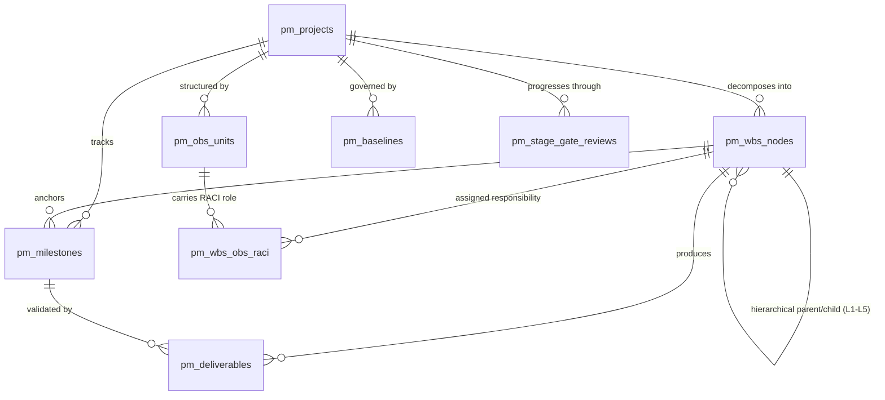

# Module 04: Project Management & Lifecycle Governance

## 1. Purpose
The Project Management module in MimarERP v7 serves as the central operational backbone and governance engine for enterprise construction, infrastructure, and engineering projects. It standardizes the end-to-end project lifecycle across all development stages—from Tender bidding to Project Closeout—in strict adherence to the Project Management Institute (PMI) PMBOK Guide (7th Edition) performance domains and value delivery principles. The module enforces structured Work Breakdown Structures (WBS Levels 1–5), Organizational Breakdown Structures (OBS), contractual RACI responsibility assignments, formal multi-revision baseline control, and rigorous contractual milestone and Liquidated Damages (LD) tracking tailored for Mega and Giga projects across Saudi Arabia (e.g., NEOM, Red Sea, ROSHN, Qiddiya, and Saudi Aramco standards).

---

## 2. Business Objectives
1. **Full Lifecycle Governance**: Institutionalize standard stage-gate controls across all 6 phases: Tender, Award, Mobilization, Execution, Testing & Commissioning, and Final Closeout.
2. **Hierarchical WBS/OBS Integration**: Provide deterministic Level 1–5 WBS breakdown integrated with enterprise OBS to produce an enforceable RACI matrix (Responsible, Accountable, Consulted, Informed) across all project packages.
3. **Rigorous Baseline Integrity**: Maintain inviolable audit trails for Original Baseline (BL0) and approved Revisions (BL1, BL2, etc.), capturing change order justification, cost impacts, and executive approvals.
4. **Contractual Milestone & LD Protection**: Mitigate employer dispute and financial exposure by tracking contractual milestones with real-time Liquidated Damages (LD) liability accrual and proactive breach warning triggers.
5. **PMI PMBOK 7 Compliance**: Systematically measure and govern the 8 project performance domains (Stakeholders, Team, Development Approach, Planning, Project Work, Delivery, Measurement, Uncertainty).
6. **Cross-Functional Single Source of Truth**: Act as the master orchestrator binding Cost Control, Planning & Scheduling, Quantity Surveying, Procurement, HSE, and Quality.

---

## 3. User Roles & Permissions

| Role Name | Scope / Access Level | Core Responsibilities |
| :--- | :--- | :--- |
| **Project Director (PD)** | Multi-Project / Portfolio | Stage-gate transitions, baseline revision sign-off, major milestone LD approvals, strategic risk governance. |
| **Project Manager (PM)** | Single Project / Contract | Day-to-day project operations, WBS approval, RACI assignment, milestone sign-off, subcontractor management. |
| **Planning & Controls Lead** | Project Assigned | WBS decomposition (L1-L5), baseline generation, milestone progress verification, schedule integration. |
| **Project Engineer / Site PM** | Work Package / Section | WBS task execution, daily progress logging, deliverable submission, site issue tracking. |
| **Contracts & Claims Manager** | Enterprise / Project | Contractual milestone definition, LD calculation validation, delay event notification, change order alignment. |
| **QA/QC & HSE Managers** | Project Functional | Stage-gate compliance clearance, quality/safety milestone hold-point approvals. |
| **Client / Consultant PM (Auditor)**| External Portal | Milestone certification, deliverable acceptance/rejection, formal gate review verification. |

---

## 4. Database Tables

### `pm_projects`
| Column Name | Data Type | Constraints | Description |
| :--- | :--- | :--- | :--- |
| `id` | UUID | PRIMARY KEY, DEFAULT gen_random_uuid() | Unique project identifier |
| `tenant_id` | UUID | NOT NULL | Multi-tenant organization isolation |
| `project_code` | VARCHAR(50) | NOT NULL, UNIQUE | Enterprise project code (e.g., PRJ-RYD-2026-004) |
| `project_name` | VARCHAR(255) | NOT NULL | Official contract name |
| `client_name` | VARCHAR(255) | NOT NULL | Client entity (e.g., PIF, Aramco, Ministry) |
| `contract_type` | VARCHAR(50) | NOT NULL | 'LUMP_SUM', 'FIDIC_RED_BOOK', 'COST_PLUS', 'GMP', 'EPC' |
| `lifecycle_stage` | VARCHAR(50) | NOT NULL DEFAULT 'TENDER' | 'TENDER', 'AWARD', 'MOBILIZATION', 'EXECUTION', 'COMMISSIONING', 'CLOSEOUT' |
| `contract_value_sar` | NUMERIC(16,2) | NOT NULL DEFAULT 0.00 | Total original contract sum in SAR |
| `revised_value_sar` | NUMERIC(16,2) | NOT NULL DEFAULT 0.00 | Current contract sum including approved variations |
| `commencement_date` | DATE | NOT NULL | Official contract start / NTP date |
| `contractual_finish_date` | DATE | NOT NULL | Original contractual completion date |
| `revised_finish_date` | DATE | NOT NULL | Extended completion date (EOT approved) |
| `ld_rate_per_day_sar` | NUMERIC(12,2) | NOT NULL DEFAULT 0.00 | Contractual LD penalty per day of delay |
| `ld_max_cap_percentage`| NUMERIC(5,2) | NOT NULL DEFAULT 10.00 | Maximum legal LD cap percentage (typically 10% under Saudi law) |
| `status` | VARCHAR(30) | NOT NULL DEFAULT 'ACTIVE' | 'DRAFT', 'ACTIVE', 'SUSPENDED', 'HANDED_OVER', 'TERMINATED', 'CLOSED' |
| `created_at` | TIMESTAMPTZ | NOT NULL DEFAULT NOW() | Record creation audit timestamp |
| `updated_at` | TIMESTAMPTZ | NOT NULL DEFAULT NOW() | Record update audit timestamp |

### `pm_wbs_nodes`
| Column Name | Data Type | Constraints | Description |
| :--- | :--- | :--- | :--- |
| `id` | UUID | PRIMARY KEY, DEFAULT gen_random_uuid() | Unique WBS node ID |
| `tenant_id` | UUID | NOT NULL | Multi-tenant isolation |
| `project_id` | UUID | NOT NULL, REFERENCES `pm_projects` | Linked project |
| `parent_id` | UUID | NULL, REFERENCES `pm_wbs_nodes` | Self-referencing parent node (NULL for Level 1) |
| `wbs_code` | VARCHAR(50) | NOT NULL | Structured hierarchical code (e.g., 1.2.3.4.1) |
| `wbs_level` | SMALLINT | NOT NULL CHECK (wbs_level BETWEEN 1 AND 5) | WBS Level (1: Project, 2: Subproject, 3: Discipline, 4: Work Package, 5: Work Item) |
| `name` | VARCHAR(255) | NOT NULL | WBS node title (e.g., Substructure Concrete Works) |
| `description` | TEXT | NULL | Scope of work detailed description |
| `weightage_percentage` | NUMERIC(6,3) | NOT NULL DEFAULT 0.000 | Planned physical weightage relative to project |
| `planned_progress` | NUMERIC(5,2) | NOT NULL DEFAULT 0.00 | S-Curve derived planned physical progress |
| `actual_progress` | NUMERIC(5,2) | NOT NULL DEFAULT 0.00 | Certified actual physical progress |
| `cost_code_prefix` | VARCHAR(30) | NULL | Linked standard Cost Breakdown Structure (CBS) code |
| `is_summary_node` | BOOLEAN | NOT NULL DEFAULT FALSE | True if node has children |
| `status` | VARCHAR(30) | NOT NULL DEFAULT 'NOT_STARTED' | 'NOT_STARTED', 'IN_PROGRESS', 'COMPLETED', 'ON_HOLD' |

### `pm_obs_units`
| Column Name | Data Type | Constraints | Description |
| :--- | :--- | :--- | :--- |
| `id` | UUID | PRIMARY KEY, DEFAULT gen_random_uuid() | Unique OBS node ID |
| `tenant_id` | UUID | NOT NULL | Multi-tenant isolation |
| `project_id` | UUID | NOT NULL, REFERENCES `pm_projects` | Linked project |
| `parent_id` | UUID | NULL, REFERENCES `pm_obs_units` | Hierarchy parent department/unit |
| `obs_code` | VARCHAR(50) | NOT NULL | OBS Code (e.g., OBS-CIV-01) |
| `unit_name` | VARCHAR(150) | NOT NULL | Unit name (e.g., Structural Engineering Dept, Subcontractor A) |
| `lead_user_id` | UUID | NOT NULL, REFERENCES `sys_users` | Unit Lead / Department Manager |
| `unit_type` | VARCHAR(50) | NOT NULL | 'INTERNAL_DEPARTMENT', 'SUBCONTRACTOR', 'CONSULTANT', 'THIRD_PARTY' |

### `pm_wbs_obs_raci`
| Column Name | Data Type | Constraints | Description |
| :--- | :--- | :--- | :--- |
| `id` | UUID | PRIMARY KEY, DEFAULT gen_random_uuid() | Unique record ID |
| `wbs_id` | UUID | NOT NULL, REFERENCES `pm_wbs_nodes` | Target WBS node |
| `obs_id` | UUID | NOT NULL, REFERENCES `pm_obs_units` | Assigned organizational unit |
| `raci_role` | VARCHAR(1) | NOT NULL CHECK (raci_role IN ('R', 'A', 'C', 'I')) | RACI role designation |
| `assigned_user_id` | UUID | NULL, REFERENCES `sys_users` | Specific nominated person |
| `notes` | VARCHAR(255) | NULL | Assignment notes / delegation scope |

### `pm_baselines`
| Column Name | Data Type | Constraints | Description |
| :--- | :--- | :--- | :--- |
| `id` | UUID | PRIMARY KEY, DEFAULT gen_random_uuid() | Unique baseline identifier |
| `project_id` | UUID | NOT NULL, REFERENCES `pm_projects` | Linked project |
| `baseline_number` | VARCHAR(20) | NOT NULL | 'BL-00' (Original), 'BL-01' (Rev 1), etc. |
| `baseline_type` | VARCHAR(30) | NOT NULL | 'ORIGINAL', 'APPROVED_REVISION', 'INTERNAL_REFORECAST' |
| `cut_off_date` | DATE | NOT NULL | Baseline data date / freeze date |
| `bac_amount_sar` | NUMERIC(16,2) | NOT NULL | Budget at Completion frozen in baseline |
| `planned_completion_date` | DATE | NOT NULL | Schedule finish date frozen in baseline |
| `change_reason` | TEXT | NOT NULL | Commercial/technical justification for baseline change |
| `approved_by` | UUID | NOT NULL, REFERENCES `sys_users` | Sign-off authority (Project Director / Client) |
| `is_active` | BOOLEAN | NOT NULL DEFAULT FALSE | Only one active target baseline allowed |
| `snapshot_json` | JSONB | NOT NULL | Full frozen hierarchy of WBS, CBS, and Milestone dates |

### `pm_milestones`
| Column Name | Data Type | Constraints | Description |
| :--- | :--- | :--- | :--- |
| `id` | UUID | PRIMARY KEY, DEFAULT gen_random_uuid() | Milestone ID |
| `project_id` | UUID | NOT NULL, REFERENCES `pm_projects` | Linked project |
| `wbs_id` | UUID | NOT NULL, REFERENCES `pm_wbs_nodes` | Linked Level 3/4 WBS node |
| `milestone_code` | VARCHAR(50) | NOT NULL | Reference code (e.g., MS-STR-01) |
| `name` | VARCHAR(255) | NOT NULL | Milestone name (e.g., Substructure Podium Pour Complete) |
| `milestone_type` | VARCHAR(50) | NOT NULL | 'CONTRACTUAL_KEY', 'BILLING_GATE', 'INTERNAL_TARGET', 'REGULATORY' |
| `contractual_due_date`| DATE | NOT NULL | Contractual deadline date |
| `current_forecast_date`| DATE | NOT NULL | CPM schedule forecasted completion date |
| `actual_completion_date`| DATE | NULL | Date officially achieved and certified |
| `ld_applicable` | BOOLEAN | NOT NULL DEFAULT FALSE | Does late delivery incur contractual LDs? |
| `ld_rate_override_sar`| NUMERIC(12,2) | NULL | Specific LD rate if different from project standard |
| `calculated_ld_sar` | NUMERIC(14,2) | NOT NULL DEFAULT 0.00 | Accrued LD liability if current forecast > contractual date |
| `payment_weight_percentage` | NUMERIC(5,2) | NOT NULL DEFAULT 0.00 | Milestone billing percentage entitlement |
| `status` | VARCHAR(30) | NOT NULL DEFAULT 'PENDING' | 'PENDING', 'ACHIEVED', 'DELAYED', 'WAIVED', 'DISPUTED' |

### `pm_deliverables`
| Column Name | Data Type | Constraints | Description |
| :--- | :--- | :--- | :--- |
| `id` | UUID | PRIMARY KEY, DEFAULT gen_random_uuid() | Deliverable ID |
| `project_id` | UUID | NOT NULL, REFERENCES `pm_projects` | Linked project |
| `milestone_id` | UUID | NULL, REFERENCES `pm_milestones` | Prerequisite for milestone completion |
| `wbs_id` | UUID | NOT NULL, REFERENCES `pm_wbs_nodes` | Parent work package |
| `deliverable_code` | VARCHAR(50) | NOT NULL | Deliverable ref (e.g., DEL-DWG-CIV-004) |
| `title` | VARCHAR(255) | NOT NULL | Deliverable title |
| `deliverable_type` | VARCHAR(50) | NOT NULL | 'TECHNICAL_SUBMITTAL', 'METHOD_STATEMENT', 'SHOP_DRAWING', 'INSPECTION_RECORD', 'AS_BUILT' |
| `submission_status` | VARCHAR(30) | NOT NULL DEFAULT 'NOT_SUBMITTED' | 'NOT_SUBMITTED', 'SUBMITTED', 'UNDER_REVIEW', 'APPROVED', 'APPROVED_WITH_COMMENTS', 'REVISE_RESUBMIT' |
| `submission_deadline`| DATE | NOT NULL | Due date for transmittal |
| `consultant_transmittal_ref` | VARCHAR(100) | NULL | Document Control transmittal reference |

### `pm_stage_gate_reviews`
| Column Name | Data Type | Constraints | Description |
| :--- | :--- | :--- | :--- |
| `id` | UUID | PRIMARY KEY, DEFAULT gen_random_uuid() | Stage gate review record ID |
| `project_id` | UUID | NOT NULL, REFERENCES `pm_projects` | Project |
| `gate_name` | VARCHAR(50) | NOT NULL | 'TENDER_TO_AWARD', 'AWARD_TO_MOBILIZATION', 'MOB_TO_EXECUTION', 'EXEC_TO_COMMISSIONING', 'COMM_TO_CLOSEOUT' |
| `checklist_results` | JSONB | NOT NULL | Mandatory checklist items and verification states |
| `readiness_score` | NUMERIC(5,2) | NOT NULL | Percentage readiness score (0-100%) |
| `gate_status` | VARCHAR(30) | NOT NULL DEFAULT 'IN_EVALUATION' | 'IN_EVALUATION', 'APPROVED', 'CONDITIONAL_APPROVAL', 'REJECTED' |
| `approved_by` | UUID | NULL, REFERENCES `sys_users` | Final sign-off by Project Director / Executive PMO |
| `approval_timestamp` | TIMESTAMPTZ | NULL | Timestamp of gate passage |

---

## 5. Entity Relationships



---

## 6. Business Workflow

```
[Phase 1: Tender] ---> (Stage Gate 1) ---> [Phase 2: Award & NTP]
                                                 |
                                                 v
[Phase 3: Mobilization] <---------------- (Stage Gate 2)
      |
      v
(Stage Gate 3: Execution Readiness)
      |
      v
[Phase 4: Execution & Baseline Freeze (BL0)] <--> (Change Mgmt: BL1, BL2...)
      |
      +---> Milestone Tracker & Deliverables Sign-off
      |          |
      |          +---> Milestone Met? -> Issue Billing Gate
      |          +---> Milestone Delayed? -> Trigger LD Accrual Alert
      v
(Stage Gate 4: Substantial Completion)
      |
      v
[Phase 5: Testing & Commissioning] ---> (Stage Gate 5) ---> [Phase 6: Project Closeout]
```

### Detailed Execution Steps:
1. **Tender to Award Transition (Gate 1)**:
   - System registers tender estimation data, bid requirements, and risk matrix.
   - Upon receipt of Letter of Intent (LOI) / Notice to Proceed (NTP), Stage Gate Review 1 validates contract signature, bank guarantees, and insurance policies before unlocking project setup.
2. **WBS & OBS Decomposition (Levels 1–5)**:
   - Planning Lead defines Level 1 (Project) down to Level 5 (Work Items).
   - Coding follows standard: `1` (Project) > `1.1` (Substructure) > `1.1.2` (Piling) > `1.1.2.1` (Bored Cast-in-situ Piles) > `1.1.2.1.1` (Rebar Cage Installation).
   - OBS units are mapped to each WBS node via `pm_wbs_obs_raci`, ensuring exactly **one Accountable (A)** and at least **one Responsible (R)** per node.
3. **Milestone Register & Contractual LD Setup**:
   - Contracts Manager establishes all Sectional and Contractual Milestones with explicit LD penalty rules (e.g., 0.1% per day of contract value, capped at 10%).
   - Linkages are created between Milestones and mandatory Deliverables (e.g., Civil Defense approval, Authority NOC, Consultant inspection reports).
4. **Baseline Freeze (BL0)**:
   - PMO triggers Baseline Freeze after client approval. System creates a tamper-proof JSON snapshot in `pm_baselines`.
   - All subsequent schedule, scope, and cost EVM comparisons are anchored against this frozen baseline until an official revision (BL1, BL2) is approved.
5. **Execution & Deliverables Governance**:
   - Site teams log daily work against WBS Level 5.
   - Physical progress rolls up from Level 5 to Level 1 based on pre-defined weightages.
   - Deliverables are routed to consultants; status changes (e.g., "Revise & Resubmit") update milestone forecast dates.
6. **Milestone Breach & LD Protection Mechanism**:
   - If a contractual milestone forecast slips past its contractual due date, the system calculates accrued liability:
     $$\text{Accrued LD} = \min((\text{Forecast Date} - \text{Contract Date}) \times \text{LD Rate/Day}, \text{Contract Value} \times \text{Cap})$$
   - Automated dispute warning letters and Time Impact Analysis (TIA) logs are initiated in Contracts module.
7. **Testing, Commissioning & Closeout (Gates 4 & 5)**:
   - Stage Gate 4 verifies snag-free testing, authority approvals, and TOC (Taking Over Certificate) issuance.
   - Final Closeout releases retention bonds, reconciles final accounts, and archives project knowledge bases.

---

## 7. UI Screens List

- **PM-01: Project Master Cockpit**: High-level portfolio and project overview; interactive lifecycle stage-gate timeline; quick health metrics (Schedule Health, Cost Variance, Risk Exposure, LD Liability).
- **PM-02: WBS & RACI Tree Studio**: Dual-pane interactive tree designer for Level 1–5 decomposition; drag-and-drop hierarchy management; right-side RACI matrix assignment drawer with OBS picker.
- **PM-03: Milestone Register & LD Command Center**: Tabular register of contractual and sectional milestones; live countdown clocks to critical dates; dynamic Liquidated Damages calculation simulator; one-click contractual notification generator.
- **PM-04: Baseline Management & Version Comparison**: Audit log of all baseline revisions (BL0, BL1, BL2); side-by-side visual diff showing changes in scope, cost, and finish dates; formal baseline revision submission modal.
- **PM-05: Deliverables & Technical Submittal Matrix**: Searchable tracking grid of all deliverables mapped to milestones and WBS nodes; status chips (Approved, Revise, Overdue); direct link to Document Control transmittals.
- **PM-06: Stage-Gate Evaluation & Readiness Gatekeeper**: Interactive readiness checklist with weighted scorecards for each lifecycle transition; reviewer sign-off panel with digital signature and certificate issuance.

---

## 8. Dashboard Design

### KPIs Row:
- **Contract Completion Health**: Planned % vs Actual % vs Target Delta.
- **Milestone Adherence Index**: Count of On-Track vs Delayed Contractual Milestones.
- **Accrued LD Liability**: Current SAR exposure from projected contractual breaches.
- **Stage-Gate Status**: Current active gate, days in phase, checklist readiness %.
- **PMBOK 7 Performance Index**: Composite health score across the 8 PMBOK domains.

### Charts & Visuals:
- **Interactive Lifecycle Stepper**: Horizontal chevron visualization highlighting completed, active, and upcoming lifecycle phases with gate status flags.
- **Milestone Burn-Down Chart**: Dual-axis line chart plotting planned milestone completions vs actual completions month-over-month.
- **RACI Resource Allocation Heatmap**: Matrix highlighting workload concentration (number of Accountable nodes per Project Manager/Engineer) to prevent management bottlenecks.
- **LD Liability Trend vs Cap**: Stacked area chart showing cumulative LD risk progression against contractual legal cap (10%).

### Filters:
- Project / Sub-Package selector, Lifecycle stage, Milestone classification (Contractual / Internal), RACI Responsible Person, Delay Risk severity (Red / Amber / Green).

---

## 9. Reports

1. **Contractual Milestone Status & LD Exposure Report**: Comprehensive register of all contractual milestones, due dates, forecast dates, slip variance, and accrued SAR LD liability.
2. **WBS Progress Rollup Ledger (L1 to L5)**: Complete work breakdown hierarchy with weightage percentages, planned vs actual progress, and variance analysis.
3. **Enterprise OBS-WBS Responsibility (RACI) Matrix**: Tabular cross-matrix showing every WBS element against assigned Responsible and Accountable staff.
4. **Baseline Comparison & Variance Ledger**: Detail report comparing BL0 vs current active baseline (BL1/BL2) with change order approval reference numbers.
5. **Stage-Gate Readiness & Transition Audit Pack**: Formal executive sign-off sheet detailing checklist compliance, outstanding snags, and approval signatures for phase transitions.
6. **Deliverable Submittal Tracking Report**: Live log of all technical submittals, consultant review cycle turnaround times, and pending revisions.
7. **PMBOK 7 Performance Domain Audit Scorecard**: Holistic quarterly assessment grading compliance across the 8 performance domains.
8. **Delay Notification & Contractual Notice Register**: Chronological record of contractor-to-client delay notices triggered by milestone variances.
9. **Project Mobilization Readiness Checklist**: Detailed punch-list report verifying site offices, permits, plant mobilization, and safety clearance prior to civil works commencement.
10. **Project Closeout & Handover Certificate Pack**: Consolidated dossier comprising TOC, Taking Over certificates, DLP schedules, and retention release status.

---

## 10. Key Performance Indicators (KPIs)

| KPI Code | KPI Name | Formula | Target | Red (Critical) | Amber (Warning) | Green (Healthy) |
| :--- | :--- | :--- | :--- | :--- | :--- | :--- |
| **KPI-PM-01** | Milestone Schedule Slippage | $\text{Forecast Date} - \text{Contract Date}$ | $\le 0\text{ days}$ | $> 14\text{ days}$ | $1 - 14\text{ days}$ | $\le 0\text{ days}$ |
| **KPI-PM-02** | LD Financial Exposure Ratio | $(\text{Accrued LD SAR} / \text{Contract Value SAR}) \times 100$ | $0.00\%$ | $> 5.0\%$ | $0.1\% - 5.0\%$ | $0.00\%$ |
| **KPI-PM-03** | RACI Accountability Coverage | $(\text{WBS Nodes with 1 'A'} / \text{Total WBS}) \times 100$ | $100\%$ | $< 98\%$ | $98\% - 99.9\%$ | $100\%$ |
| **KPI-PM-04** | Stage-Gate Gatekeeper Compliance | $(\text{Approved Gates with 100\% Score} / \text{Total Gates}) \times 100$ | $100\%$ | $< 90\%$ | $90\% - 99\%$ | $100\%$ |
| **KPI-PM-05** | Deliverable First-Pass Acceptance | $(\text{Approved Deliverables on Rev 0} / \text{Total Submitted}) \times 100$ | $\ge 85\%$ | $< 70\%$ | $70\% - 84.9\%$ | $\ge 85\%$ |

---

## 11. API Endpoints

| Method | Endpoint URL | Auth Scope | Description |
| :--- | :--- | :--- | :--- |
| `GET` | `/api/v7/pm/projects` | `pm.read` | List projects with lifecycle stage and summary health |
| `POST` | `/api/v7/pm/projects` | `pm.admin` | Create new project master record |
| `GET` | `/api/v7/pm/projects/{id}/wbs-tree` | `pm.read` | Retrieve full recursive WBS hierarchy (Levels 1–5) |
| `POST` | `/api/v7/pm/projects/{id}/wbs-nodes` | `pm.write` | Add or update WBS node with weightage |
| `GET` | `/api/v7/pm/projects/{id}/milestones` | `pm.read` | Fetch milestone register with calculated LD exposure |
| `POST` | `/api/v7/pm/projects/{id}/milestones` | `pm.write` | Create or update milestone |
| `POST` | `/api/v7/pm/projects/{id}/baselines/freeze` | `pm.director` | Freeze current state into an immutable baseline (BL0, BL1) |
| `GET` | `/api/v7/pm/projects/{id}/baselines/compare` | `pm.read` | Compare two baseline snapshots (e.g., BL0 vs BL1) |
| `POST` | `/api/v7/pm/projects/{id}/stage-gates/evaluate`| `pm.approve` | Submit stage-gate readiness evaluation |
| `POST` | `/api/v7/pm/projects/{id}/stage-gates/sign-off`| `pm.director` | Formally approve stage transition to next lifecycle phase |

---

## 12. Required Permissions

| Entity | Read | Create / Write | Approve | Delete / Archive |
| :--- | :--- | :--- | :--- | :--- |
| **Project Master** | `pm.project.view` | `pm.project.edit` | `pm.project.approve` | `pm.project.admin` |
| **WBS Nodes** | `pm.wbs.view` | `pm.wbs.edit` | `pm.wbs.approve` | `pm.wbs.admin` |
| **OBS & RACI Matrix** | `pm.raci.view` | `pm.raci.edit` | `pm.raci.approve` | `pm.raci.admin` |
| **Contractual Milestones** | `pm.milestone.view` | `pm.milestone.edit`| `pm.milestone.approve`| `pm.milestone.admin` |
| **Baseline Revisions** | `pm.baseline.view` | `pm.baseline.edit` | `pm.baseline.freeze` | `pm.baseline.admin` |
| **Stage Gates** | `pm.gate.view` | `pm.gate.edit` | `pm.gate.signoff` | `pm.gate.admin` |
| **Deliverables** | `pm.deliverable.view`| `pm.deliverable.edit`| `pm.deliverable.certify`| `pm.deliverable.delete` |

---

## 13. Approval Workflows

### 1. Stage-Gate Transition Approval Workflow:
- **Prerequisite**: Stage checklist score must reach $\ge 95\%$.
- **Level 1**: Project Manager (PM) initiates readiness review and signs off.
- **Level 2**: Lead Controls Engineer, QA/QC Manager, and HSE Manager provide non-objection clearance.
- **Level 3**: Project Director (PD) grants final authorization to proceed to the next phase.
- **SLA / Escalation**: 5 working days review window. Auto-escalates to Executive VP of Operations if stalled.

### 2. Baseline Revision Approval Matrix:
- **BL0 (Original Baseline)**: Prepared by Planning Lead $\rightarrow$ Certified by PM $\rightarrow$ Approved by Project Director $\rightarrow$ Approved by Client / Employer.
- **BL1+ (Subsequent Baseline Revisions)**: Requires approved Commercial Change Order or Variation Order reference $\rightarrow$ PM submission $\rightarrow$ Head of Project Controls approval $\rightarrow$ Executive Board / Director sign-off.

---

## 14. AI Features

1. **Predictive Milestone Slippage Engine**:
   - **Inputs**: Daily site logs, submittal turnaround times, historical contractor productivity rates, weather anomalies.
   - **Outputs**: Probability distribution of contractual milestone slippage (Monte Carlo simulation) and early warning indicator (7–30 days before breach).
2. **Automated RACI Conflict & Bottleneck Detector**:
   - **Inputs**: Current WBS-OBS assignment matrix and user resource calendars.
   - **Outputs**: Detection of WBS nodes with missing 'A' or multiple 'A's, and alerting on single individuals overloaded with $> 25$ critical accountability nodes.
3. **PMBOK 7 Principle Compliance Auditor**:
   - **Inputs**: Project meeting minutes, risk logs, stakeholder engagement feedback.
   - **Outputs**: Automated health ratings across "Demonstrate Leadership Behaviors", "Navigate Complexity", and "Optimize Risk Responses".

---

## 15. Automations

1. **Automated Liquidated Damages (LD) Accrual Calculation**:
   - **Trigger**: Daily schedule update cron job (runs 01:00 AM).
   - **Condition**: Milestone is classified as `CONTRACTUAL_KEY`, `status != 'ACHIEVED'`, and `current_forecast_date > contractual_due_date`.
   - **Action**: Compute daily penalty, update `calculated_ld_sar`, send high-priority alert to PM and Legal/Contracts team.
2. **WBS Progress Auto-Rollup**:
   - **Trigger**: Approval of Level 5 Daily Site Quantity or Progress Entry.
   - **Condition**: Work item status changes or actual quantity updates.
   - **Action**: Recalculate parent nodes (Level 4 through Level 1) using normalized weighted averages and update project overall physical completion %.
3. **Stage-Gate Expiry & Notification Pulse**:
   - **Trigger**: 14 days and 7 days prior to scheduled gate transition date.
   - **Action**: Dispatch automated checklist status digest to all assigned functional leads with outstanding items highlighted.

---

## 16. Integration Requirements

1. **Planning & Scheduling (Module 06)**: Bi-directional synchronization with CPM activity schedules; imports P6/MS Project XER/XML files and maps CPM activities to WBS Level 5.
2. **Cost Control (Module 05)**: Synchronizes WBS nodes with Cost Breakdown Structure (CBS) cost codes; provides physical progress inputs for Earned Value Management (EVM).
3. **Quantity Surveying (Module 07)**: Links contractual milestones to Interim Payment Certificate (IPC) billing gates and BOQ work packages.
4. **Document Control (Module 10)**: Connects deliverables to transmittals, consultant RFIs, and Material Inspection Requests (MIRs).
5. **Enterprise HR / ERP Core**: Binds OBS personnel units to employee rosters, role capabilities, and active site badges.
