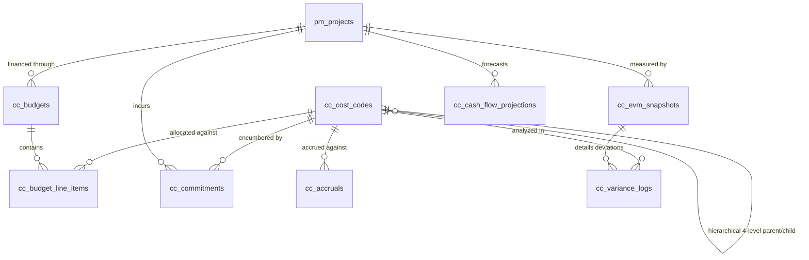

# Module 05: Cost Control & Earned Value Management (EVM)

## 1. Purpose
The Cost Control module in MimarERP v7 delivers enterprise-grade financial governance, Earned Value Management (EVM), budget versioning, commitment encumbrance, and cash flow forecasting for large-scale construction and engineering projects. It enforces a standardized 4-level Cost Breakdown Structure (CBS: Division > Category > Sub-Category > Item) harmonized with MasterFormat and ISO 12006, tracking budgets from original baseline to current revised budget. By reconciling physical progress from Planning and QS with real-time financial commitments (Purchase Orders, Subcontracts) and general ledger accruals, the module provides project leadership with mathematically rigorous cost-to-complete forecasts (EAC), early risk detection, and proactive cash flow protection under Saudi corporate and governmental financial standards.

---

## 2. Business Objectives
1. **Precision Earned Value Management (EVM)**: Systematically compute and monitor all ANSI/EIA-748 EVM parameters (PV, EV, AC, CV, SV, CPI, SPI, EAC, ETC, VAC, TCPI) at weekly and monthly reporting intervals.
2. **Unified 4-Level Cost Hierarchy**: Implement a rigid 4-level Cost Breakdown Structure (CBS) ensuring strict cost allocation, preventing unbudgeted expenditures across all trades and disciplines.
3. **Multi-Horizon Budget Governance**: Maintain transparent versioning across Original Approved Budget (OAB), Approved Budget Changes (ABC), Current Working Budget (CWB), and Management Reserve / Contingency allocations.
4. **Comprehensive Commitment & Accruals Accounting**: Track financial encumbrances (PO commitments, subcontract awards) and project accruals (Goods Received Not Invoiced - GRNI, and Work Done Not Certified - WDNC) to prevent hidden cost shocks.
5. **Multi-Model EAC Forecasting**: Provide executive decision-makers with three standardized Estimate at Completion (EAC) projections: mathematical extrapolation, performance factor weighted, and bottom-up re-estimation.
6. **Cash Flow & S-Curve Financial Modeling**: Generate dynamic monthly S-Curves mapping planned expenditure, expected billings, certified receivables, and net funding requirements over the project lifecycle.

---

## 3. User Roles & Permissions

| Role Name | Scope / Access Level | Core Responsibilities |
| :--- | :--- | :--- |
| **Chief Financial Officer / Cost Director** | Enterprise / Portfolio | Approve baseline project budgets, authorize contingency drawdowns, approve cross-project budget transfers (> SAR 250,000). |
| **Lead Cost Control Manager** | Regional / Multi-Project | Establish CBS structure, freeze EVM monthly snapshots, approve budget adjustments (up to SAR 250,000), review EAC variance narratives. |
| **Project Cost Engineer** | Assigned Project | Cost code mapping, monthly EVM calculations, commitment tracking, accrual logging, monthly cost report generation. |
| **Project Manager (PM)** | Single Project | Budget ownership, approve internal cost transfers within work packages, review weekly cost performance and variance root causes. |
| **Site QS / Billing Engineer** | Project Site | Furnish certified work-in-place values (EV) and uncertified work accruals (WDNC) for monthly EVM cut-offs. |
| **Procurement Specialist** | Project Assigned | Monitor PO commitment consumption against cost codes and verify commitment release. |
| **Accounts Payable (AP) Accountant**| Enterprise Finance | Record actual vendor/subcontractor invoice postings against cost codes and confirm payment vouchers. |

---

## 4. Database Tables

### `cc_cost_codes`
| Column Name | Data Type | Constraints | Description |
| :--- | :--- | :--- | :--- |
| `id` | UUID | PRIMARY KEY, DEFAULT gen_random_uuid() | Unique cost code identifier |
| `tenant_id` | UUID | NOT NULL | Multi-tenant isolation |
| `parent_id` | UUID | NULL, REFERENCES `cc_cost_codes` | Parent cost code in 4-level hierarchy |
| `cost_code` | VARCHAR(50) | NOT NULL, UNIQUE | Hierarchical code (e.g., 03-210-05-01) |
| `level` | SMALLINT | NOT NULL CHECK (level BETWEEN 1 AND 4) | 1=Division, 2=Category, 3=Sub-Category, 4=Item |
| `name` | VARCHAR(255) | NOT NULL | Descriptive name (e.g., Ready-Mix Concrete Grade 40) |
| `cost_nature` | VARCHAR(30) | NOT NULL | 'LABOR', 'MATERIAL', 'EQUIPMENT', 'SUBCONTRACT', 'INDIRECT', 'OVERHEAD' |
| `standard_uom` | VARCHAR(20) | NULL | Standard Unit of Measure (M3, TON, HRS, LS) |
| `is_active` | BOOLEAN | NOT NULL DEFAULT TRUE | Cost code active status |

### `cc_budgets`
| Column Name | Data Type | Constraints | Description |
| :--- | :--- | :--- | :--- |
| `id` | UUID | PRIMARY KEY, DEFAULT gen_random_uuid() | Unique budget identifier |
| `tenant_id` | UUID | NOT NULL | Multi-tenant isolation |
| `project_id` | UUID | NOT NULL, REFERENCES `pm_projects` | Linked project |
| `budget_version` | VARCHAR(20) | NOT NULL | 'ORIGINAL', 'REV_01', 'REV_02', 'WORKING' |
| `status` | VARCHAR(30) | NOT NULL DEFAULT 'DRAFT' | 'DRAFT', 'UNDER_REVIEW', 'APPROVED', 'SUPERSEDED' |
| `original_budget_sar` | NUMERIC(16,2) | NOT NULL DEFAULT 0.00 | Initial approved budget (BAC) |
| `approved_changes_sar`| NUMERIC(16,2) | NOT NULL DEFAULT 0.00 | Net approved variations / transfers |
| `current_budget_sar` | NUMERIC(16,2) | NOT NULL DEFAULT 0.00 | Current authorized budget (Original + Changes) |
| `contingency_sar` | NUMERIC(14,2) | NOT NULL DEFAULT 0.00 | Allocated contingency reserve |
| `management_reserve_sar`| NUMERIC(14,2)| NOT NULL DEFAULT 0.00 | Management reserve held at PMO level |
| `effective_date` | DATE | NOT NULL | Approval / activation date |
| `approved_by` | UUID | NULL, REFERENCES `sys_users` | Financial authority sign-off |

### `cc_budget_line_items`
| Column Name | Data Type | Constraints | Description |
| :--- | :--- | :--- | :--- |
| `id` | UUID | PRIMARY KEY, DEFAULT gen_random_uuid() | Line item identifier |
| `budget_id` | UUID | NOT NULL, REFERENCES `cc_budgets` | Parent budget header |
| `cost_code_id` | UUID | NOT NULL, REFERENCES `cc_cost_codes` | Target 4-level cost code |
| `wbs_node_id` | UUID | NOT NULL, REFERENCES `pm_wbs_nodes` | Corresponding PM WBS node |
| `planned_qty` | NUMERIC(14,4) | NOT NULL DEFAULT 0.0000 | Budgeted quantity |
| `unit_rate_sar` | NUMERIC(14,2) | NOT NULL DEFAULT 0.00 | Unit cost in SAR |
| `allocated_amount_sar`| NUMERIC(16,2)| NOT NULL | Total allocated line budget |
| `contingency_allocated`| NUMERIC(14,2)| NOT NULL DEFAULT 0.00 | Line-specific risk contingency |

### `cc_commitments`
| Column Name | Data Type | Constraints | Description |
| :--- | :--- | :--- | :--- |
| `id` | UUID | PRIMARY KEY, DEFAULT gen_random_uuid() | Commitment ID |
| `project_id` | UUID | NOT NULL, REFERENCES `pm_projects` | Linked project |
| `cost_code_id` | UUID | NOT NULL, REFERENCES `cc_cost_codes` | Allocated cost code |
| `commitment_type` | VARCHAR(30) | NOT NULL | 'PURCHASE_ORDER', 'SUBCONTRACT_AGREEMENT', 'SERVICE_ORDER' |
| `reference_number` | VARCHAR(50) | NOT NULL | PO or Subcontract contract number |
| `vendor_id` | UUID | NOT NULL, REFERENCES `proc_vendors` | Supplier / Subcontractor entity |
| `original_committed_sar`| NUMERIC(15,2)| NOT NULL | Initial contract / PO sum |
| `approved_change_orders_sar`| NUMERIC(15,2)| NOT NULL DEFAULT 0.00| Approved variations to commitment |
| `invoiced_actual_sar`| NUMERIC(15,2) | NOT NULL DEFAULT 0.00 | Cumulative AP invoices posted |
| `unliquidated_balance_sar`| NUMERIC(15,2)| NOT NULL | Remaining commitment liability (Committed - Invoiced) |
| `status` | VARCHAR(30) | NOT NULL DEFAULT 'COMMITTED' | 'COMMITTED', 'PARTIALLY_INVOICED', 'FULLY_INVOICED', 'CANCELLED' |

### `cc_accruals`
| Column Name | Data Type | Constraints | Description |
| :--- | :--- | :--- | :--- |
| `id` | UUID | PRIMARY KEY, DEFAULT gen_random_uuid() | Unique accrual ID |
| `project_id` | UUID | NOT NULL, REFERENCES `pm_projects` | Linked project |
| `cost_code_id` | UUID | NOT NULL, REFERENCES `cc_cost_codes` | Impacted cost code |
| `period_ending` | DATE | NOT NULL | Accounting period cut-off date |
| `accrual_type` | VARCHAR(30) | NOT NULL | 'GRNI' (Goods Received Not Invoiced), 'WDNC' (Work Done Not Certified) |
| `source_reference` | VARCHAR(100) | NOT NULL | Delivery note (GRN) or Site Measurement Sheet ID |
| `accrued_amount_sar`| NUMERIC(15,2) | NOT NULL CHECK (accrued_amount_sar >= 0) | Estimated unbilled actual cost |
| `status` | VARCHAR(30) | NOT NULL DEFAULT 'ACTIVE' | 'ACTIVE', 'REVERSED', 'INVOICED_MATCHED' |

### `cc_evm_snapshots`
| Column Name | Data Type | Constraints | Description |
| :--- | :--- | :--- | :--- |
| `id` | UUID | PRIMARY KEY, DEFAULT gen_random_uuid() | EVM calculation record ID |
| `project_id` | UUID | NOT NULL, REFERENCES `pm_projects` | Linked project |
| `snapshot_date` | DATE | NOT NULL | EVM data date (cut-off) |
| `bac_sar` | NUMERIC(16,2) | NOT NULL | Budget at Completion (Total current budget) |
| `pv_sar` | NUMERIC(16,2) | NOT NULL | Planned Value (Baseline budget to date) |
| `ev_sar` | NUMERIC(16,2) | NOT NULL | Earned Value (BAC * Physical % Complete) |
| `ac_sar` | NUMERIC(16,2) | NOT NULL | Actual Cost (Invoiced Actuals + Approved Accruals) |
| `cv_sar` | NUMERIC(16,2) | NOT NULL | Cost Variance (EV - AC) |
| `sv_sar` | NUMERIC(16,2) | NOT NULL | Schedule Variance (EV - PV) |
| `cpi` | NUMERIC(6,4) | NOT NULL | Cost Performance Index (EV / AC) |
| `spi` | NUMERIC(6,4) | NOT NULL | Schedule Performance Index (EV / PV) |
| `eac_method_1_sar` | NUMERIC(16,2) | NOT NULL | EAC = BAC / CPI (Assumes current cost efficiency continues) |
| `eac_method_2_sar` | NUMERIC(16,2) | NOT NULL | EAC = AC + (BAC - EV) (Assumes remaining work at planned rate) |
| `eac_method_3_sar` | NUMERIC(16,2) | NOT NULL | EAC = AC + [(BAC - EV) / (CPI * SPI)] (Considers schedule drag) |
| `etc_sar` | NUMERIC(16,2) | NOT NULL | Estimate to Complete (EAC - AC) |
| `vac_sar` | NUMERIC(16,2) | NOT NULL | Variance at Completion (BAC - EAC) |
| `tcpi_bac` | NUMERIC(6,4) | NOT NULL | To-Complete Performance Index based on BAC |
| `tcpi_eac` | NUMERIC(6,4) | NOT NULL | To-Complete Performance Index based on EAC |
| `is_official` | BOOLEAN | NOT NULL DEFAULT TRUE | Official monthly certified snapshot |

### `cc_cash_flow_projections`
| Column Name | Data Type | Constraints | Description |
| :--- | :--- | :--- | :--- |
| `id` | UUID | PRIMARY KEY, DEFAULT gen_random_uuid() | Record ID |
| `project_id` | UUID | NOT NULL, REFERENCES `pm_projects` | Linked project |
| `period_month` | DATE | NOT NULL | Projected month (first day of month) |
| `planned_cost_sar` | NUMERIC(15,2) | NOT NULL DEFAULT 0.00 | Planned monthly expenditure (PV monthly) |
| `forecast_cost_sar`| NUMERIC(15,2) | NOT NULL DEFAULT 0.00 | Revised monthly cash outflow requirement |
| `planned_billing_sar`| NUMERIC(15,2)| NOT NULL DEFAULT 0.00 | Projected IPC revenue submission |
| `expected_cash_in_sar`| NUMERIC(15,2)| NOT NULL DEFAULT 0.00| Net cash received after retention/advance recovery |
| `net_cash_flow_sar`| NUMERIC(15,2) | NOT NULL | Expected Monthly Cash In minus Cash Out |
| `cumulative_funding_gap_sar`| NUMERIC(16,2)| NOT NULL | Peak working capital financing required |

### `cc_variance_logs`
| Column Name | Data Type | Constraints | Description |
| :--- | :--- | :--- | :--- |
| `id` | UUID | PRIMARY KEY, DEFAULT gen_random_uuid() | Variance log ID |
| `snapshot_id` | UUID | NOT NULL, REFERENCES `cc_evm_snapshots` | Source EVM snapshot |
| `cost_code_id` | UUID | NOT NULL, REFERENCES `cc_cost_codes` | Target cost code suffering variance |
| `variance_type` | VARCHAR(20) | NOT NULL | 'COST_OVERRUN', 'SCHEDULE_SLIP', 'UNDERSPEND' |
| `variance_amount_sar`| NUMERIC(15,2)| NOT NULL | CV or SV numerical amount |
| `root_cause_category`| VARCHAR(50) | NOT NULL | 'MATERIAL_PRICE_HIKE', 'LOW_PRODUCTIVITY', 'REWORK', 'ENGINEERING_DELAY', 'CLIENT_CHANGE' |
| `explanation_narrative`| TEXT | NOT NULL | Cost Engineer detailed root cause explanation |
| `corrective_action_plan`| TEXT | NOT NULL | Mitigation strategy and target resolution date |
| `reviewed_by` | UUID | NULL, REFERENCES `sys_users` | Cost Control Manager verification |

---

## 5. Entity Relationships



---

## 6. Business Workflow

```
[Contract Award & Tender BOQ]
            |
            v
[1. Budget Baseline Establishment (BAC)] ---> Allocate into 4-Level CBS
            |
            v
[2. Commitment Governance (PO & Subcontracts)] ---> Real-time Encumbrance Check
            |
            +---> (If Budget Available) -> Release Order
            +---> (If Budget Exceeded)  -> Hard Stop / Require Budget Transfer
            |
            v
[3. Site Progress & Cost Capture (Monthly Cut-Off)]
            |
            +---> Physical Progress % (from PM/Planning) -> Calculate PV & EV
            +---> Invoiced AP Actuals + Accruals (GRNI & WDNC) -> Calculate AC
            |
            v
[4. EVM Performance Computation]
            |
            +---> Calculate CPI, SPI, CV, SV
            +---> Generate 3 EAC Projections (Standard, Rate-Only, Schedule-Weighted)
            +---> Calculate TCPI (To-Complete Performance Index)
            |
            v
[5. Variance Explanation & Recovery Planning]
            |
            +---> If CPI < 0.95 -> Trigger Mandatory Variance Root Cause Log
            |
            v
[6. Cash Flow S-Curve & Working Capital Forecasting]
```

### EVM Calculation Formulation Standards:
1. **Cost Variance ($CV$)**: $CV = EV - AC$
2. **Schedule Variance ($SV$)**: $SV = EV - PV$
3. **Cost Performance Index ($CPI$)**: $CPI = \frac{EV}{AC}$
4. **Schedule Performance Index ($SPI$)**: $SPI = \frac{EV}{PV}$
5. **Estimate at Completion ($EAC$) Models**:
   - **Method 1 (Typical Performance)**: $EAC_1 = \frac{BAC}{CPI}$
   - **Method 2 (Atypical Performance / Budgeted Future Rate)**: $EAC_2 = AC + (BAC - EV)$
   - **Method 3 (Combined Cost & Schedule Drag Impact)**: $EAC_3 = AC + \frac{BAC - EV}{CPI \times SPI}$
6. **Estimate to Complete ($ETC$)**: $ETC = EAC - AC$
7. **Variance at Completion ($VAC$)**: $VAC = BAC - EAC$
8. **To-Complete Performance Index ($TCPI$)**:
   - Toward BAC Target: $TCPI_{BAC} = \frac{BAC - EV}{BAC - AC}$
   - Toward Revised EAC Target: $TCPI_{EAC} = \frac{BAC - EV}{EAC - AC}$

---

## 7. UI Screens List

- **CC-01: EVM Command Center**: High-impact executive cockpit; primary EVM KPI cards (BAC, PV, EV, AC, CPI, SPI, EAC, VAC); multi-model EAC toggle; interactive S-Curve visualizer; alert ticker for cost code overruns.
- **CC-02: 4-Level CBS Tree & Budget Allocator**: Interactive hierarchical tree grid showing Division > Category > Sub-Category > Item; live budget vs commitment vs actual rollup; inline budget adjustment controls.
- **CC-03: Budget Transfer & Contingency Reallocation Studio**: Multi-step wizard to transfer funds between cost codes; automated impact assessment on affected work packages; contingency drawdown request form with approval routing.
- **CC-04: Commitments & Accruals Workbench**: Live tracker for all PO and Subcontract commitments; unliquidated commitment balances; GRNI / WDNC accruals creation panel with auto-reversal date settings.
- **CC-05: Cash Flow & S-Curve Forecasting Modeler**: Dynamic monthly cash projection matrix (planned cost, actual burn, billing, net collections); peak financing gap indicator; exportable high-resolution S-Curve visual.
- **CC-06: Variance Narrative & Root Cause Diagnostic Console**: Grid filtering cost codes where $CPI < 0.95$ or $CV < -\text{SAR } 50,000$; 5-Whys root cause categorization; corrective action plan tracking with target recovery dates.

---

## 8. Dashboard Design

### Executive KPI Strip:
- **BAC (Budget at Completion)**: Total authorized project budget in SAR.
- **Earned Value ($EV$) vs Actual Cost ($AC$)**: Side-by-side gauge with Net Cost Variance ($CV$).
- **CPI (Cost Performance Index)**: Large color-coded dial (Green: $\ge 1.0$, Amber: $0.95 - 0.99$, Red: $< 0.95$).
- **SPI (Schedule Performance Index)**: Color-coded dial reflecting physical time efficiency.
- **EAC Projection Range**: Minimum, Most Likely, and Maximum forecast with Variance at Completion ($VAC$).
- **TCPI Feasibility Indicator**: Work effort efficiency required to meet remaining budget targets.

### Charts & Visuals:
- **Comprehensive S-Curve Chart**: Pure SVG multi-line graph plotting:
  1. *Baseline Planned Value ($PV$)* curve (smooth baseline S-curve).
  2. *Earned Value ($EV$)* curve up to current data date.
  3. *Actual Cost ($AC$)* curve showing cumulative expenditures.
  4. *Forecast / EAC* trajectory extending to completion date.
- **CBS Cost Variance Waterfall Chart**: Breakdown of cost overrun/underrun contributors by Level 1 Division (Concrete, Steel, MEP, Finishes, Site Indirects).
- **Monthly Net Cash Flow & Working Capital Deficit**: Bar/Line combination showing monthly surplus/deficit and cumulative cash drain.

### Global Filters:
- Project selector, Cut-off reporting period, Cost Code Division (1–4), Work Package, Cost Nature (Labor/Material/Equipment/Subcontract).

---

## 9. Reports

1. **Comprehensive Monthly EVM Performance Pack**: Executive 15-page dossier detailing PV, EV, AC, CPI, SPI, 3 EAC methods, and critical trade variances.
2. **CBS 4-Level Budget vs Actual vs Commitment Ledger**: Full financial breakdown by Division, Category, Sub-Category, and Item with uncommitted budget balances.
3. **Commitment Status & PO Encumbrance Ledger**: Register of all active purchase orders and subcontracts with invoiced amounts and outstanding liabilities.
4. **Uncertified Accruals Audit Register (GRNI & WDNC)**: Listing of site deliveries and completed works entered into accruals prior to invoice verification.
5. **Estimate at Completion (EAC) Multi-Scenario Analysis**: Comparative report detailing Method 1 (CPI), Method 2 (Budgeted), and Method 3 (CPI x SPI) projections.
6. **Cash Flow S-Curve & Peak Funding Requirement Report**: Monthly cash inflow (IPC payments) vs outflow (vendor disbursements) with financing deficit profile.
7. **To-Complete Performance Index (TCPI) Viability Assessment**: Benchmark comparing historical CPI against required TCPI to identify unrealistic recovery expectations.
8. **Cost Code Overrun & Risk Exception Log**: Audit exception report listing every cost code with an unfavorable variance exceeding 5% or SAR 25,000.
9. **Contingency & Management Reserve Utilization Log**: Chronological register of all contingency drawdowns, justification memos, and remaining risk reserves.
10. **Labor & Equipment Rate Variance Report**: Analysis comparing budgeted hourly standard plant/labor rates against actual site payroll and equipment timesheet allocations.

---

## 10. Key Performance Indicators (KPIs)

| KPI Code | KPI Name | Formula | Target | Red (Critical) | Amber (Warning) | Green (Healthy) |
| :--- | :--- | :--- | :--- | :--- | :--- | :--- |
| **KPI-CC-01** | Cost Performance Index ($CPI$) | $EV / AC$ | $\ge 1.000$ | $< 0.950$ | $0.950 - 0.999$ | $\ge 1.000$ |
| **KPI-CC-02** | Schedule Performance Index ($SPI$) | $EV / PV$ | $\ge 1.000$ | $< 0.900$ | $0.900 - 0.999$ | $\ge 1.000$ |
| **KPI-CC-03** | Variance at Completion Ratio ($VAC\%$) | $((BAC - EAC) / BAC) \times 100$ | $\ge 0.0\%$ | $< -5.0\%$ | $-5.0\% - -0.1\%$ | $\ge 0.0\%$ |
| **KPI-CC-04** | TCPI vs CPI Performance Gap | $TCPI_{BAC} - CPI$ | $\le 0.05$ | $> 0.15$ | $0.06 - 0.15$ | $\le 0.05$ |
| **KPI-CC-05** | Uncommitted Contingency Reserve | $(\text{Remaining Contingency} / \text{Original Contingency}) \times 100$ | $\ge 30\%$ | $< 15\%$ | $15\% - 29.9\%$ | $\ge 30\%$ |

---

## 11. API Endpoints

| Method | Endpoint URL | Auth Scope | Description |
| :--- | :--- | :--- | :--- |
| `GET` | `/api/v7/cost/projects/{id}/evm-summary` | `cost.read` | Retrieve latest EVM parameters (PV, EV, AC, CPI, SPI, EAC) |
| `POST` | `/api/v7/cost/projects/{id}/evm-snapshots` | `cost.lead` | Execute monthly EVM calculation and freeze certified snapshot |
| `GET` | `/api/v7/cost/projects/{id}/cbs-tree` | `cost.read` | Retrieve 4-level CBS tree with rolled-up budgets and commitments |
| `POST` | `/api/v7/cost/projects/{id}/budget-transfers`| `cost.write` | Submit internal budget reallocation between cost codes |
| `GET` | `/api/v7/cost/projects/{id}/commitments` | `cost.read` | Fetch all active commitments, PO values, and unliquidated balances |
| `POST` | `/api/v7/cost/projects/{id}/accruals` | `cost.write` | Record monthly GRNI or WDNC accrual entry |
| `GET` | `/api/v7/cost/projects/{id}/cashflow` | `cost.read` | Retrieve monthly cash flow projection data and S-Curve coordinates |
| `POST` | `/api/v7/cost/projects/{id}/variance-logs` | `cost.write` | Submit root cause explanation narrative for unfavorable cost codes |

---

## 12. Required Permissions

| Entity | Read | Create / Write | Approve | Admin / Supervise |
| :--- | :--- | :--- | :--- | :--- |
| **Cost Breakdown Structure (CBS)**| `cost.cbs.view` | `cost.cbs.edit` | `cost.cbs.approve`| `cost.cbs.admin` |
| **Project Budgets & Revisions** | `cost.budget.view` | `cost.budget.edit` | `cost.budget.approve` | `cost.budget.admin` |
| **Commitments & Encumbrances** | `cost.commit.view` | `cost.commit.edit` | `cost.commit.release` | `cost.commit.admin` |
| **Accruals (GRNI / WDNC)** | `cost.accrual.view` | `cost.accrual.edit` | `cost.accrual.post` | `cost.accrual.admin` |
| **EVM Calculation Snapshots** | `cost.evm.view` | `cost.evm.calculate`| `cost.evm.certify` | `cost.evm.admin` |
| **Contingency Drawdowns** | `cost.contingency.view`| `cost.contingency.request`| `cost.contingency.approve`| `cost.contingency.admin` |

---

## 13. Approval Workflows

### 1. Budget Baseline & Revision Approval:
- **Step 1**: Cost Control Engineer compiles draft budget lines mapped to WBS.
- **Step 2**: Project Manager validates operational feasibility and verifies quantities.
- **Step 3**: Lead Cost Control Manager reviews unit rates against historical market standards.
- **Step 4**: Project Director & CFO formally sign off. Baseline is frozen immutable.

### 2. Budget Transfer Matrix:
- **Intra-Category Transfer ($\le \text{SAR } 50,000$)**: Requires PM and Lead Cost Engineer approval (SLA: 2 days).
- **Inter-Category Transfer ($\text{SAR } 50,001 - 250,000$)**: Requires Lead Cost Control Manager and Project Director approval (SLA: 3 days).
- **Major Transfer / Contingency Drawdown ($> \text{SAR } 250,000$)**: Requires Executive Committee / CFO approval (SLA: 5 days).

---

## 14. AI Features

1. **Intelligent EAC Machine Learning Regressor**:
   - **Inputs**: Historical productivity rates, supplier price indices, subcontractor dispute logs, rainfall/heat index data, and weekly burn rates.
   - **Outputs**: High-confidence probabilistic Estimate at Completion ($EAC_{AI}$) with P10/P50/P90 risk distributions, highlighting hidden margin erosion 60 days before traditional EVM flags it.
2. **Automated PO Commitment Budget Guard**:
   - **Inputs**: Incoming Purchase Requisition lines and target Cost Code balance.
   - **Outputs**: Instant commitment check; if order creates a projected deficit, AI suggests potential underutilized sibling cost codes with surplus funding.
3. **Automated Cost Variance Narrative Synthesizer**:
   - **Inputs**: Cost code delta, ERP material pricing shifts, equipment idle logs, and labor timesheet spikes.
   - **Outputs**: Auto-drafted professional English/Arabic variance explanation narratives for the monthly executive pack, reducing report drafting time by 80%.

---

## 15. Automations

1. **Low CPI Executive Alert Trigger**:
   - **Trigger**: Monthly or weekly EVM snapshot run.
   - **Condition**: Project level $CPI < 0.90$ OR any Division level $CPI < 0.85$.
   - **Action**: Immediately flag project as RED, send high-priority alert to PM, Cost Director, and VP Operations, and automatically open a mandatory Variance Cause Log.
2. **Real-Time PO Commitment Encumbrance**:
   - **Trigger**: Approval of Purchase Order in Module 08.
   - **Condition**: Line items linked to active CBS cost code.
   - **Action**: Increment `unliquidated_balance_sar` in commitments table, reduce available budget, and log real-time encumbrance.
3. **Automated Monthly Accrual Reversals**:
   - **Trigger**: 1st day of new financial reporting month (00:01 AM).
   - **Condition**: Status is `ACTIVE` and `accrual_type` in ('GRNI', 'WDNC').
   - **Action**: Generate offsetting reversal journal draft for Finance General Ledger and mark accrual status `REVERSED`.

---

## 16. Integration Requirements

1. **Project Management (Module 04)**: Direct synchronization with WBS nodes; physical progress % from PM feeds directly into Earned Value ($EV = BAC \times \text{Physical Progress } \%$).
2. **Planning & Scheduling (Module 06)**: Activity early/late schedule distributions map to CBS items to generate the baseline Planned Value ($PV$) distribution curve.
3. **Quantity Surveying (Module 07)**: Interim Payment Certificates (IPC) and subcontractor billings supply verified actual progress quantities and certified billed actuals.
4. **Procurement (Module 08)**: Purchase Orders and Subcontract Agreements feed financial commitments into Cost Control.
5. **ERP General Ledger & Accounts Payable (AP)**: Matched vendor invoices and payroll journal entries provide certified Actual Cost ($AC$) figures.
