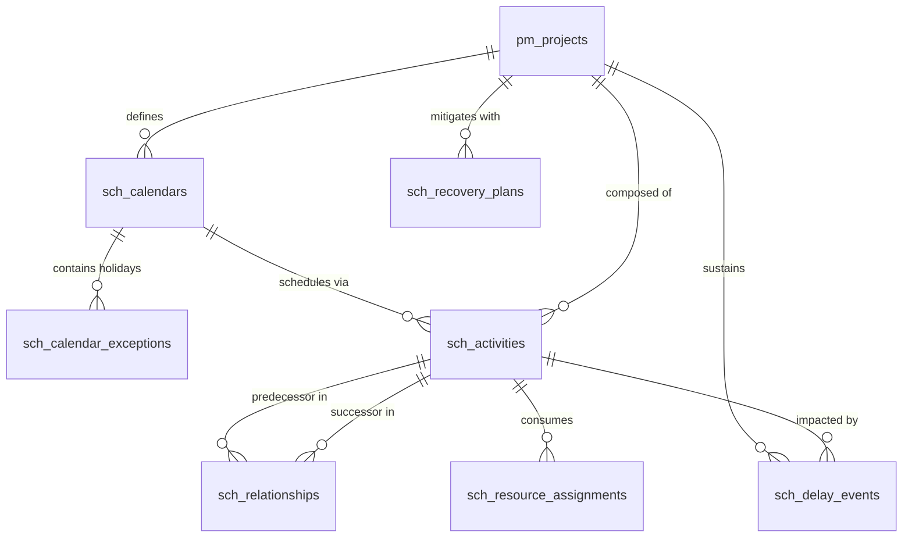

# Module 06: Planning, Scheduling & Delay Analysis

## 1. Purpose
The Planning & Scheduling module in MimarERP v7 delivers an industrial-grade, Critical Path Method (CPM) project scheduling and delay forensics platform designed for enterprise engineering and construction contractors in Saudi Arabia and the GCC. Engineered to seamlessly interoperate with Oracle Primavera P6 (via bi-directional XER/XML APIs) and Microsoft Project, the module models complex project networks with four activity classifications, four dependency relationship types with positive/negative lags, eight calendar constraint types, and specialized multi-shift calendars incorporating Saudi national and Islamic holidays. It powers dynamic Early/Late S-Curve generation, multi-tier resource loading (labor, plant, materials), and forensic delay analysis protocols (Time Impact Analysis, Windows Analysis, As-Planned vs As-Built) to protect contractual rights under FIDIC and Saudi GTPL contracts.

---

## 2. Business Objectives
1. **Mathematical CPM Rigor**: Execute deterministic forward and backward pass Critical Path Method calculations to determine Early Start (ES), Early Finish (EF), Late Start (LS), Late Finish (LF), Total Float (TF), and Free Float (FF) with zero latency.
2. **Primavera P6 Interoperability**: Provide frictionless two-way synchronization with Oracle Primavera P6 (.XER / XML) and Microsoft Project, preserving all WBS structures, activity codes, user fields, and schedule logic.
3. **Multi-Calendar & Saudi Locale Modeling**: Support 5-day, 6-day, and 7-day calendars, split shifts, Ramadan reduced working hours (under Saudi Labor Law), Saudi National Day, Founding Day, and Eid holidays.
4. **Comprehensive Resource Loading & Leveling**: Profile and level manpower trades, heavy construction equipment, and bulk materials with cost rates to derive resource-loaded early and late cash distribution curves.
5. **Contractual Forensic Delay Analysis**: Standardize delay forensic methodologies (Time Impact Analysis - TIA, Windows Analysis, As-Planned vs As-Built) with fragnet insertion to substantiate Extension of Time (EOT) claims.
6. **Agile Recovery Schedule Generation**: Support fast-track recovery workflows and crashing scenarios when critical paths suffer unauthorized negative float.

---

## 3. User Roles & Permissions

| Role Name | Scope / Access Level | Core Responsibilities |
| :--- | :--- | :--- |
| **Planning Director / PMO Lead** | Enterprise / Portfolio | Approve Master Schedule baselines, validate enterprise calendar definitions, authorize official TIA EOT submittals to clients. |
| **Lead Planning Engineer** | Project Assigned | Master schedule architecture, CPM logic network authoring, resource loading, critical path analysis, monthly P6 updates. |
| **Site Planning / Field Engineer** | Section / Package | Weekly progress updating, actual date logging, remaining duration forecasting, lookahead schedule extraction. |
| **Contracts & Claims Specialist** | Project / Multi-Project | Fragnet network modeling, delay event logging, concurrent delay analysis, EOT entitlement substantiation. |
| **Project Manager (PM)** | Single Project | Review and sign off on weekly lookahead programs, critical path mitigation plans, and acceleration proposals. |
| **Site Superintendents / Trade Leads**| Work Package | Execute daily tasks in accordance with 2-week/4-week lookahead schedules and report task start/completion dates. |

---

## 4. Database Tables

### `sch_calendars`
| Column Name | Data Type | Constraints | Description |
| :--- | :--- | :--- | :--- |
| `id` | UUID | PRIMARY KEY, DEFAULT gen_random_uuid() | Unique calendar ID |
| `tenant_id` | UUID | NOT NULL | Multi-tenant isolation |
| `project_id` | UUID | NULL, REFERENCES `pm_projects` | NULL for Global Calendar; Project ID for project-specific |
| `calendar_name` | VARCHAR(100) | NOT NULL | Name (e.g., '6-Day Site Construction - Saudi Standard') |
| `calendar_type` | VARCHAR(30) | NOT NULL | 'FIVE_DAY', 'SIX_DAY', 'SEVEN_DAY', 'CUSTOM_SHIFT' |
| `working_days_mask` | BIT(7) | NOT NULL DEFAULT B'0111110' | Bitmask for Mon-Sun (or Sat-Thu for Saudi standard: Sun-Thu or Sat-Thu) |
| `standard_hours_per_day`| NUMERIC(4,2)| NOT NULL DEFAULT 8.00 | Standard working hours per shift |
| `ramadan_hours_per_day` | NUMERIC(4,2)| NOT NULL DEFAULT 6.00 | Reduced working hours mandated by Saudi Labor Law |
| `is_default` | BOOLEAN | NOT NULL DEFAULT FALSE | Default project calendar flag |

### `sch_calendar_exceptions`
| Column Name | Data Type | Constraints | Description |
| :--- | :--- | :--- | :--- |
| `id` | UUID | PRIMARY KEY, DEFAULT gen_random_uuid() | Exception ID |
| `calendar_id` | UUID | NOT NULL, REFERENCES `sch_calendars` | Parent calendar |
| `exception_name` | VARCHAR(100) | NOT NULL | E.g., 'Saudi National Day 2026', 'Eid Al-Fitr Holiday' |
| `start_date` | DATE | NOT NULL | Non-working start date |
| `end_date` | DATE | NOT NULL | Non-working end date (inclusive) |
| `is_working_override` | BOOLEAN | NOT NULL DEFAULT FALSE | True if forcing a normally non-working day into working day |

### `sch_activities`
| Column Name | Data Type | Constraints | Description |
| :--- | :--- | :--- | :--- |
| `id` | UUID | PRIMARY KEY, DEFAULT gen_random_uuid() | Unique activity ID |
| `tenant_id` | UUID | NOT NULL | Multi-tenant isolation |
| `project_id` | UUID | NOT NULL, REFERENCES `pm_projects` | Linked project |
| `wbs_node_id` | UUID | NOT NULL, REFERENCES `pm_wbs_nodes` | Corresponding WBS node (Level 4 or 5) |
| `calendar_id` | UUID | NOT NULL, REFERENCES `sch_calendars` | Assigned calendar |
| `activity_code` | VARCHAR(50) | NOT NULL | Activity identifier (e.g., ACT-CIV-1020) |
| `activity_name` | VARCHAR(255) | NOT NULL | Activity description |
| `activity_type` | VARCHAR(30) | NOT NULL | 'TASK', 'WBS_SUMMARY', 'MILESTONE_START', 'MILESTONE_FINISH', 'HAMMOCK' |
| `original_duration_days`| NUMERIC(6,2)| NOT NULL CHECK (original_duration_days >= 0) | Original planned duration in days |
| `remaining_duration_days`| NUMERIC(6,2)| NOT NULL CHECK (remaining_duration_days >= 0)| Remaining duration |
| `actual_duration_days` | NUMERIC(6,2)| NOT NULL DEFAULT 0.00 | Actual working days spent |
| `physical_percent_complete`| NUMERIC(5,2)| NOT NULL DEFAULT 0.00 | Progress % complete (0-100) |
| `early_start` | DATE | NULL | Calculated CPM Early Start |
| `early_finish` | DATE | NULL | Calculated CPM Early Finish |
| `late_start` | DATE | NULL | Calculated CPM Late Start |
| `late_finish` | DATE | NULL | Calculated CPM Late Finish |
| `actual_start` | DATE | NULL | Certified Actual Start date |
| `actual_finish` | DATE | NULL | Certified Actual Finish date |
| `total_float_days` | NUMERIC(6,2)| NOT NULL DEFAULT 0.00 | Total Float (LS - ES) |
| `free_float_days` | NUMERIC(6,2)| NOT NULL DEFAULT 0.00 | Free Float |
| `is_critical` | BOOLEAN | NOT NULL DEFAULT FALSE | True if total_float_days <= 0 |
| `constraint_type` | VARCHAR(30) | NOT NULL DEFAULT 'ASAP' | 'ASAP', 'ALAP', 'SNET', 'SNLT', 'FNET', 'FNLT', 'MFO', 'MSO' |
| `constraint_date` | DATE | NULL | Date for constraint parameter |
| `status` | VARCHAR(20) | NOT NULL DEFAULT 'NOT_STARTED' | 'NOT_STARTED', 'IN_PROGRESS', 'COMPLETED' |

### `sch_relationships`
| Column Name | Data Type | Constraints | Description |
| :--- | :--- | :--- | :--- |
| `id` | UUID | PRIMARY KEY, DEFAULT gen_random_uuid() | Unique relationship ID |
| `project_id` | UUID | NOT NULL, REFERENCES `pm_projects` | Linked project |
| `predecessor_id` | UUID | NOT NULL, REFERENCES `sch_activities`| Source activity |
| `successor_id` | UUID | NOT NULL, REFERENCES `sch_activities`| Target activity |
| `relationship_type` | VARCHAR(2) | NOT NULL CHECK (relationship_type IN ('FS', 'SS', 'FF', 'SF')) | Dependency logic |
| `lag_days` | NUMERIC(6,2)| NOT NULL DEFAULT 0.00 | Lead/Lag duration in days (+ or -) |
| `is_driving` | BOOLEAN | NOT NULL DEFAULT TRUE | Indicates if relationship controls successor early start |

### `sch_resource_assignments`
| Column Name | Data Type | Constraints | Description |
| :--- | :--- | :--- | :--- |
| `id` | UUID | PRIMARY KEY, DEFAULT gen_random_uuid() | Assignment ID |
| `activity_id` | UUID | NOT NULL, REFERENCES `sch_activities`| Target activity |
| `resource_type` | VARCHAR(30) | NOT NULL | 'LABOR', 'EQUIPMENT', 'MATERIAL' |
| `resource_name` | VARCHAR(150) | NOT NULL | Resource label (e.g., Shuttering Carpenter, 50-Ton Crane) |
| `planned_units` | NUMERIC(10,2)| NOT NULL | Total quantity or hours required |
| `unit_of_measure` | VARCHAR(20) | NOT NULL | 'HRS', 'DAYS', 'M3', 'TON' |
| `cost_per_unit_sar` | NUMERIC(12,2)| NOT NULL DEFAULT 0.00 | Hourly or unit cost rate in SAR |
| `total_cost_sar` | NUMERIC(15,2)| NOT NULL | Total planned cost (units * rate) |
| `actual_units` | NUMERIC(10,2)| NOT NULL DEFAULT 0.00 | Actual consumed units to date |

### `sch_delay_events`
| Column Name | Data Type | Constraints | Description |
| :--- | :--- | :--- | :--- |
| `id` | UUID | PRIMARY KEY, DEFAULT gen_random_uuid() | Delay event ID |
| `project_id` | UUID | NOT NULL, REFERENCES `pm_projects` | Linked project |
| `event_code` | VARCHAR(50) | NOT NULL | Unique delay reference (e.g., DLY-EVT-014) |
| `title` | VARCHAR(255) | NOT NULL | Title of event |
| `event_category` | VARCHAR(50) | NOT NULL | 'EMPLOYER_RISK', 'CONTRACTOR_RISK', 'FORCE_MAJEURE', 'CONCURRENT' |
| `analysis_method` | VARCHAR(50) | NOT NULL | 'TIME_IMPACT_ANALYSIS', 'WINDOWS_ANALYSIS', 'AS_PLANNED_VS_AS_BUILT' |
| `event_start_date` | DATE | NOT NULL | Inception date of delay event |
| `event_end_date` | DATE | NULL | Date delay ceased |
| `impacted_activity_id`| UUID | NOT NULL, REFERENCES `sch_activities`| Primary driving activity disrupted |
| `fragnet_json` | JSONB | NOT NULL | Inserted sub-network of activities modeling the delay |
| `assessed_critical_delay_days`| NUMERIC(6,2)| NOT NULL DEFAULT 0.00 | Net slippage caused to project completion |
| `eot_claimed_days` | NUMERIC(6,2)| NOT NULL DEFAULT 0.00 | Contractual Extension of Time claimed |
| `client_approval_status`| VARCHAR(30)| NOT NULL DEFAULT 'PENDING' | 'PENDING', 'APPROVED', 'DISPUTED', 'REJECTED' |

### `sch_recovery_plans`
| Column Name | Data Type | Constraints | Description |
| :--- | :--- | :--- | :--- |
| `id` | UUID | PRIMARY KEY, DEFAULT gen_random_uuid() | Recovery plan record ID |
| `project_id` | UUID | NOT NULL, REFERENCES `pm_projects` | Linked project |
| `revision_name` | VARCHAR(100) | NOT NULL | E.g., 'Structural Package Fast-Track Acceleration Plan' |
| `trigger_delay_days` | NUMERIC(6,2)| NOT NULL | Negative float or slip triggering recovery |
| `recovery_strategy` | VARCHAR(50) | NOT NULL | 'CRASHING' (Overtime/Shifts), 'FAST_TRACKING' (Parallel Logic), 'RE_SCOPING' |
| `recovered_days` | NUMERIC(6,2)| NOT NULL | Days regained in revised schedule |
| `cost_of_acceleration_sar`| NUMERIC(15,2)| NOT NULL DEFAULT 0.00| Additional premium / overtime budget required |
| `status` | VARCHAR(30) | NOT NULL DEFAULT 'DRAFT' | 'DRAFT', 'SUBMITTED', 'APPROVED', 'IMPLEMENTED' |

---

## 5. Entity Relationships



---

## 6. Business Workflow

```
[Import P6 XER / Create Activities]
            |
            v
[1. Define Calendars & Working Shifts (Saudi Holidays)]
            |
            v
[2. Build CPM Logic Network (FS, SS, FF, SF + Lags + Constraints)]
            |
            v
[3. Execute CPM Engine: Forward & Backward Pass]
            |
            +---> Compute Early Dates (ES, EF)
            +---> Compute Late Dates (LS, LF)
            +---> Compute Floats (Total Float = LS - ES; Free Float)
            +---> Identify Critical Path (Total Float <= 0)
            |
            v
[4. Resource Loading & Leveling (Labor, Heavy Plant, Material)]
            |
            v
[5. Generate Early/Late S-Curves (Planned Physical S-Curve)]
            |
            v
[6. Weekly / Monthly Progress Updating (Actual Starts/Finishes & %)]
            |
            +---> If Total Float >= 0 -> Schedule on Track
            +---> If Critical Path Slips (Negative Float):
                     |
                     +---> [Forensic Delay Analysis (TIA / Fragnet)] -> Substantiate EOT
                     +---> [Recovery Plan Workflow] -> Fast-Tracking & Crashing
```

### CPM Calculation Standards:
1. **Forward Pass (Early Dates)**:
   - For start activity: $ES = \text{Project Start}$
   - Early Finish: $EF = ES + \text{Duration} - 1 \text{ (calendar adjusted)}$
   - Successor Early Start: $ES_{succ} = \max(EF_{pred} + \text{Lag})$ for FS relationships.
2. **Backward Pass (Late Dates)**:
   - For finish activity: $LF = \text{Target Project Finish}$
   - Late Start: $LS = LF - \text{Duration} + 1 \text{ (calendar adjusted)}$
   - Predecessor Late Finish: $LF_{pred} = \min(LS_{succ} - \text{Lag})$ for FS relationships.
3. **Float Determination**:
   - $\text{Total Float (TF)} = LS - ES = LF - EF$
   - $\text{Free Float (FF)} = \min(ES_{succ}) - EF - 1$
   - $\text{Critical Activity Condition}: TF \le 0$

---

## 7. UI Screens List

- **SCH-01: Pure ES6 Gantt Studio**: High-performance interactive Gantt canvas rendered directly in vanilla JS; drag-to-link dependencies; timescale zooming (Day, Week, Month, Quarter); critical path highlight in red; baseline shadow bars.
- **SCH-02: CPM Logic & Precedence Network Modeler**: Interactive node diagram (PERT chart) showing early/late dates, duration, and driving relationships; instant cycle/loop detection; relationship lag editor.
- **SCH-03: Resource Histogram & Leveling Workbench**: Stacked bar charts showing trade manpower and heavy plant equipment demand over time; dynamic over-allocation warning line; automatic resource leveling engine.
- **SCH-04: S-Curve Generator & Early/Late Envelope**: Interactive SVG dual envelope chart showing Early Planned S-Curve, Late Planned S-Curve, and Actual Progress trajectory.
- **SCH-05: Forensic Delay & Time Impact Analysis (TIA) Studio**: Delay event register; fragnet modeling drawer to insert delay activities into the active schedule snapshot; before-and-after schedule comparison visualizer.
- **SCH-06: Enterprise Working Calendar Configurator**: Interactive monthly calendar builder; quick-toggle for 5/6/7 day working shifts; Saudi national holiday and Ramadan split-hour rule configurer.

---

## 8. Dashboard Design

### KPI Cards:
- **Project Critical Path Duration**: Total calendar days remaining on the longest driving path.
- **Schedule Variance ($SV$) in Days**: Current forecast finish vs contractual finish date.
- **Critical Path Total Float**: Minimum float in project schedule (alerts Red if $< 0$ days).
- **Lookahead 3-Week Activity Volume**: Number of activities planned to start in next 21 days.
- **DCMA 14-Point Quality Score**: Automated index score assessing schedule structural integrity.

### Visualizations:
- **Real-Time S-Curve Progress Envelope**: Visual chart displaying:
  1. Early Planned Curve (Optimistic).
  2. Late Planned Curve (Pessimistic baseline).
  3. Actual Earned Progress Line (Actual progress).
- **Total Float Distribution Histogram**: Bar chart showing volume of activities categorized by float ranges ($<0\text{ days}$, $0-10\text{ days}$, $11-30\text{ days}$, $>30\text{ days}$).
- **Two-Week Critical Path Lookahead Gantt**: Focused Gantt slice rendering activities with $TF \le 0$ scheduled for the immediate upcoming fortnight.

### Filters:
- Project selector, WBS node branch filter, Activity Type, Float threshold, Resource trade, Lookahead horizon (1 / 2 / 4 / 8 weeks).

---

## 9. Reports

1. **Critical Path & Driving Activities Schedule**: Listing of all active tasks on the longest path with zero or negative float.
2. **Two-Week & Four-Week Lookahead Site Task Register**: Actionable site-ready schedule detailing task names, crews, equipment, and prerequisites.
3. **Milestone Variance & Contractual Finish Drift**: Historical report tracking the progression of contractual milestone forecasted dates.
4. **DCMA 14-Point Schedule Health Assessment Audit**: Industry standard audit checking logic density, missing predecessors/successors, excessive lags, and invalid constraints.
5. **Float Consumption & Schedule Volatility Report**: Register highlighting activities that consumed more than 10 days of float in the current period.
6. **Resource Allocation & Utilization Forecast**: Man-hour demand curves categorized by trade (Carpenters, Steel Fixers, Masons, Electricians) and plant types.
7. **Time Impact Analysis (TIA) Substantiation Pack**: Formal claim document compiling pre-delay schedule, fragnet insertion, and post-delay schedule showing net delay days.
8. **As-Planned vs As-Built Delay Windows Ledger**: Retrospective forensic analysis comparing planned progress windows against as-built timeline.
9. **Constraint Utilization & Justification Audit**: Log of all activities governed by hard constraints (MFO, MSO, SNET) with engineering justification notes.
10. **Ramadan & Seasonal Shift Productivity Impact Report**: Impact simulation modeling the productivity variance during high-summer daylight restrictions and Ramadan hours.

---

## 10. Key Performance Indicators (KPIs)

| KPI Code | KPI Name | Formula | Target | Red (Critical) | Amber (Warning) | Green (Healthy) |
| :--- | :--- | :--- | :--- | :--- | :--- | :--- |
| **KPI-SCH-01** | Total Float Health | $\min(\text{Total Float})$ | $\ge 0\text{ days}$ | $< -10\text{ days}$ | $-10 - -1\text{ days}$| $\ge 0\text{ days}$ |
| **KPI-SCH-02** | DCMA 14-Point Quality | $(\text{Passed Metrics} / 14) \times 100$ | $\ge 95\%$ | $< 80\%$ | $80\% - 94.9\%$ | $\ge 95\%$ |
| **KPI-SCH-03** | Logic Density Ratio | $\text{Relationships} / \text{Activities}$ | $\ge 1.50$ | $< 1.20$ | $1.20 - 1.49$ | $\ge 1.50$ |
| **KPI-SCH-04** | Lookahead Hit Rate | $(\text{Tasks Started on Planned Date} / \text{Lookahead Tasks}) \times 100$ | $\ge 85\%$ | $< 65\%$ | $65\% - 84.9\%$ | $\ge 85\%$ |
| **KPI-SCH-05** | High Float Activities % | $(\text{Tasks with TF} > 44\text{ days} / \text{Total Tasks}) \times 100$ | $\le 5\%$ | $> 10\%$ | $5.1\% - 10\%$ | $\le 5\%$ |

---

## 11. API Endpoints

| Method | Endpoint URL | Auth Scope | Description |
| :--- | :--- | :--- | :--- |
| `GET` | `/api/v7/planning/projects/{id}/gantt` | `sch.read` | Retrieve complete activity and relationship network for Gantt canvas |
| `POST` | `/api/v7/planning/projects/{id}/cpm/recalculate` | `sch.write` | Execute full forward and backward pass CPM calculation |
| `POST` | `/api/v7/planning/projects/{id}/activities` | `sch.write` | Create or update activity with durations and constraints |
| `POST` | `/api/v7/planning/projects/{id}/relationships`| `sch.write` | Add dependency relationship (FS, SS, FF, SF with lag) |
| `POST` | `/api/v7/planning/projects/{id}/xer/import` | `sch.admin` | Upload and ingest Primavera P6 .XER file into project schema |
| `GET` | `/api/v7/planning/projects/{id}/xer/export` | `sch.read` | Export native Oracle Primavera P6 .XER file |
| `POST` | `/api/v7/planning/projects/{id}/delay-analysis/tia`| `sch.claims`| Insert fragnet sub-network and execute comparative TIA run |
| `GET` | `/api/v7/planning/projects/{id}/scurve-envelope`| `sch.read` | Retrieve early, late, and actual S-Curve distribution coordinates |

---

## 12. Required Permissions

| Entity | Read | Create / Edit | Recalculate / CPM | Export / Import |
| :--- | :--- | :--- | :--- | :--- |
| **Activities & Tasks** | `sch.activity.view` | `sch.activity.edit` | `sch.cpm.run` | `sch.xer.manage` |
| **Schedule Logic / Links**| `sch.logic.view` | `sch.logic.edit` | `sch.cpm.run` | `sch.xer.manage` |
| **Working Calendars** | `sch.calendar.view` | `sch.calendar.edit` | `sch.calendar.manage` | `sch.calendar.admin`|
| **Resource Assignments** | `sch.resource.view` | `sch.resource.edit` | `sch.resource.level` | `sch.resource.admin`|
| **Delay Fragnets & TIA** | `sch.claims.view` | `sch.claims.edit` | `sch.claims.calculate`| `sch.claims.certify`|
| **Schedule Baselines** | `sch.baseline.view` | `sch.baseline.edit` | `sch.baseline.freeze` | `sch.baseline.admin`|

---

## 13. Approval Workflows

### 1. Master Baseline Schedule Sign-Off:
- **Step 1**: Lead Planning Engineer builds CPM logic, resource loading, and resolves all negative float.
- **Step 2**: Project Manager validates site execution sequence and milestone alignment.
- **Step 3**: Head of PMO conducts DCMA 14-point audit check ($\ge 95\%$ pass required).
- **Step 4**: Project Director & Client Representative provide contractual baseline approval.

### 2. Time Impact Analysis (TIA) EOT Claim Workflow:
- **Step 1**: Site Planning Engineer identifies employer delay event and documents start/end dates.
- **Step 2**: Claims Specialist builds fragnet network representing the delay event.
- **Step 3**: Lead Planning Engineer runs TIA CPM simulation comparing unimpacted vs impacted schedules.
- **Step 4**: Contracts Director reviews and signs off on formal EOT claim package submitted to Engineer/Employer.

---

## 14. AI Features

1. **Automated DCMA 14-Point Schedule Validator**:
   - **Inputs**: Full activity network, calendars, logic links, and float values.
   - **Outputs**: Instant compliance score, identifying dangling activities (missing links), excessive lags, and negative float with automated remediation suggestions.
2. **Predictive Critical Path Slip Predictor**:
   - **Inputs**: Historical subcontractor daily productivity, site weather data, submittal turnaround speed, and current float consumption trends.
   - **Outputs**: Early warning predicting future critical path shifts up to 45 days in advance, alerting teams before negative float occurs.
3. **Intelligent Schedule Recovery Synthesizer**:
   - **Inputs**: Current negative float on critical path and available labor/equipment resource pools.
   - **Outputs**: Optimized fast-tracking (parallel relationship suggestions) and crashing combinations that regain critical schedule days at minimum incremental cost.

---

## 15. Automations

1. **Instant Negative Float Alarm Dispatch**:
   - **Trigger**: CPM engine recalculation.
   - **Condition**: Any activity on critical path drops below $0\text{ days}$ Total Float.
   - **Action**: Alert Planning Lead and PM; automatically tag affected downstream milestones as `AT_RISK`.
2. **Automated Weekly Lookahead Distribution**:
   - **Trigger**: Weekly cron job every Thursday at 17:00.
   - **Action**: Compile 2-week lookahead PDF and digital checklist for all site superintendents based on active CPM dates.
3. **Progress Synchronization from Mobile Field App**:
   - **Trigger**: Approval of Daily Site Diary in Module 23.
   - **Action**: Update actual start dates, remaining durations, and physical percent complete on matched Level 5 activities.

---

## 16. Integration Requirements

1. **Project Management (Module 04)**: Directly binds activity networks to the Level 1–5 WBS tree; updates milestone forecast completion dates.
2. **Cost Control (Module 05)**: Schedules early and late distribution dates for cost code activities to generate EVM Planned Value ($PV$) curves.
3. **Quantity Surveying (Module 07)**: Consumes certified BOQ work quantities to compute remaining activity durations based on standard site crew outputs.
4. **Oracle Primavera P6 (External)**: Direct bi-directional parser supporting P6 .XER file format (v8.x through v23.x) and Primavera XML schema.
5. **Mobile Field App (Module 23)**: Dispatches daily task lists to site engineers and ingests actual completion timestamps and site photos.
