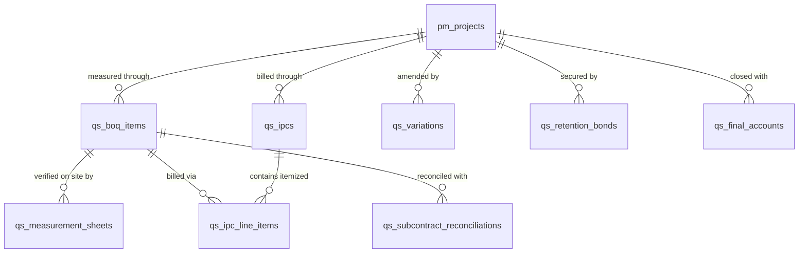

# Module 07: Quantity Surveying, Billing & Commercial Management

## 1. Purpose
The Quantity Surveying (QS) module in MimarERP v7 delivers a comprehensive, multi-standard commercial management and billing platform for enterprise contractors, consultants, and clients across Saudi Arabia and the GCC. Engineered to support CSI MasterFormat, NRM2 (New Rules of Measurement), POMI (Principles of Measurement International), and Saudi local government tendering norms, the module governs the complete commercial lifecycle: Bill of Quantities (BOQ) administration, Joint Site Measurement Sheets (JMS), three-way quantity reconciliations (Contract vs Measured vs Paid), Interim Payment Certificate (IPC) processing, advance payment and retention recovery, variation order life-cycles, and back-to-back subcontract billing reconciliations culminating in definitive Final Account settlement.

---

## 2. Business Objectives
1. **Multi-Standard BOQ Hierarchy**: Standardize complex BOQ packages across CSI MasterFormat (2020), NRM2, POMI, and MOMRA/Saudi GTPL standard measurement formats with multi-currency unit rates.
2. **Three-Way Quantity Reconciliation**: Continuously audit and reconcile Original Contract Quantities against Joint Site Measured Quantities, Certified Quantities, and Paid Quantities, preventing unapproved quantity overruns.
3. **End-to-End IPC Billing Governance**: Automate the full Interim Payment Certificate cycle—Prepare $\rightarrow$ Internal Review $\rightarrow$ Consultant Submission $\rightarrow$ Certified Valuation $\rightarrow$ Employer Payment—incorporating automated advance payment recovery, retention withholding, and ZATCA Phase 2 e-invoicing compliance.
4. **Advance Payment & Retention Protection**: Rigorously track advance payment amortization schedules, statutory retentions (typically 10% reducing to 5% upon Taking Over Certificate), and performance bond expiry dates.
5. **Comprehensive Variation & Claims Commercialization**: Manage the lifecycle of variations from Site Instruction (SI) through Contractor Assessment to Approved Variation Order (VO), updating the Revised Contract Sum in real time.
6. **Subcontract vs Client Back-to-Back Reconciliation**: Enforce back-to-back "pay-when-certified" and "pay-when-paid" commercial discipline between client IPCs and subcontractor payment applications, preventing cash leakage.

---

## 3. User Roles & Permissions

| Role Name | Scope / Access Level | Core Responsibilities |
| :--- | :--- | :--- |
| **Commercial Director** | Enterprise / Portfolio | Approve final account settlements, sign off on major variations (> SAR 500,000), authorize IPC submissions, manage contract sum adjustments. |
| **Lead Quantity Surveyor (QS Manager)**| Regional / Project | BOQ baseline control, IPC generation and review, variation pricing, joint measurement sheet verification, subcontractor valuation audits. |
| **Site Quantity Surveyor** | Project Site | Prepare daily Joint Measurement Sheets (JMS), take-offs from as-built drawings, physical quantity logs, subcontractor progress measurements. |
| **Contracts & Claims Manager** | Project Assigned | Variation contractual entitlement validation, review of consultant deductions, dispute formulation for rejected IPC items. |
| **Project Manager (PM)** | Single Project | Operational review of monthly IPC before client submission, sign-off on subcontractor valuations, approve site work completion records. |
| **Consultant / Client QS (Auditor)**| External Portal | Review submitted IPC lines, record consultant certified quantities, issue certified payment certificate, sign off on joint measurements. |
| **Finance / Billing Accountant** | Enterprise Finance | Match certified IPCs to ZATCA Phase 2 tax invoices, apply VAT, verify payment receipts, post retention and advance payment journals. |

---

## 4. Database Tables

### `qs_boq_items`
| Column Name | Data Type | Constraints | Description |
| :--- | :--- | :--- | :--- |
| `id` | UUID | PRIMARY KEY, DEFAULT gen_random_uuid() | Unique BOQ line ID |
| `tenant_id` | UUID | NOT NULL | Multi-tenant isolation |
| `project_id` | UUID | NOT NULL, REFERENCES `pm_projects` | Linked project |
| `wbs_node_id` | UUID | NOT NULL, REFERENCES `pm_wbs_nodes` | Corresponding PM WBS node |
| `cost_code_id` | UUID | NOT NULL, REFERENCES `cc_cost_codes` | Corresponding CBS cost code |
| `item_number` | VARCHAR(50) | NOT NULL | Item reference (e.g., 03.10.02.A) |
| `measurement_standard`| VARCHAR(30)| NOT NULL DEFAULT 'CSI_MASTERFORMAT' | 'CSI_MASTERFORMAT', 'NRM2', 'POMI', 'MOMRA_SAUDI' |
| `description` | TEXT | NOT NULL | Detailed technical item description |
| `uom` | VARCHAR(20) | NOT NULL | Unit of measure (M3, TON, M2, LM, NO, LS) |
| `contract_quantity` | NUMERIC(14,4) | NOT NULL CHECK (contract_quantity >= 0) | Original tender contract quantity |
| `unit_rate_sar` | NUMERIC(14,2) | NOT NULL CHECK (unit_rate_sar >= 0) | Contractual unit rate in SAR |
| `contract_amount_sar`| NUMERIC(16,2)| NOT NULL | Total amount (Qty * Rate) |
| `approved_variation_qty`| NUMERIC(14,4)| NOT NULL DEFAULT 0.0000 | Net variation quantity approved |
| `revised_quantity` | NUMERIC(14,4) | NOT NULL | Current legal quantity (Contract + Variations) |
| `cumulative_measured_qty`| NUMERIC(14,4)| NOT NULL DEFAULT 0.0000 | Total physical quantity verified on site |
| `cumulative_certified_qty`| NUMERIC(14,4)| NOT NULL DEFAULT 0.0000 | Total quantity certified by client consultant |
| `cumulative_invoiced_sar`| NUMERIC(16,2)| NOT NULL DEFAULT 0.00 | Total gross billed amount to date |
| `is_provisional_sum` | BOOLEAN | NOT NULL DEFAULT FALSE | True if provisional sum line |

### `qs_measurement_sheets`
| Column Name | Data Type | Constraints | Description |
| :--- | :--- | :--- | :--- |
| `id` | UUID | PRIMARY KEY, DEFAULT gen_random_uuid() | Unique JMS record ID |
| `tenant_id` | UUID | NOT NULL | Multi-tenant isolation |
| `project_id` | UUID | NOT NULL, REFERENCES `pm_projects` | Linked project |
| `jms_number` | VARCHAR(50) | NOT NULL, UNIQUE | Document reference (e.g., JMS-2026-0042) |
| `boq_item_id` | UUID | NOT NULL, REFERENCES `qs_boq_items` | Linked BOQ item |
| `location_reference` | VARCHAR(255) | NOT NULL | Grid line, floor, chainage, or zone |
| `measurement_date` | DATE | NOT NULL | Date joint measurement conducted on site |
| `takeoff_formula` | VARCHAR(255) | NULL | Mathematical formula (e.g., 4 * 12.5 * 0.6) |
| `measured_quantity` | NUMERIC(14,4) | NOT NULL CHECK (measured_quantity > 0) | Quantity surveyed |
| `consultant_rep_name`| VARCHAR(100) | NOT NULL | Name of supervising consultant engineer |
| `contractor_rep_name`| VARCHAR(100) | NOT NULL | Name of contractor site QS |
| `sheet_status` | VARCHAR(30) | NOT NULL DEFAULT 'DRAFT' | 'DRAFT', 'SUBMITTED', 'AGREED_ON_SITE', 'REJECTED' |
| `signed_scan_url` | VARCHAR(500) | NULL | Link to signed measurement sheet document |

### `qs_ipcs`
| Column Name | Data Type | Constraints | Description |
| :--- | :--- | :--- | :--- |
| `id` | UUID | PRIMARY KEY, DEFAULT gen_random_uuid() | Unique IPC ID |
| `tenant_id` | UUID | NOT NULL | Multi-tenant isolation |
| `project_id` | UUID | NOT NULL, REFERENCES `pm_projects` | Linked project |
| `ipc_number` | VARCHAR(50) | NOT NULL | Certificate reference (e.g., IPC-009) |
| `period_start_date` | DATE | NOT NULL | Billing period start date |
| `period_end_date` | DATE | NOT NULL | Billing period cut-off date |
| `submission_date` | DATE | NULL | Date officially submitted to consultant |
| `certification_date` | DATE | NULL | Date certified by consultant |
| `gross_billed_sar` | NUMERIC(16,2) | NOT NULL DEFAULT 0.00 | Gross work completed + materials on site |
| `material_on_site_sar`| NUMERIC(15,2)| NOT NULL DEFAULT 0.00 | Unincorporated materials on site (MOS) |
| `retention_deducted_sar`| NUMERIC(15,2)| NOT NULL DEFAULT 0.00| Retention withheld this period (e.g., 10%) |
| `advance_recovered_sar`| NUMERIC(15,2)| NOT NULL DEFAULT 0.00 | Advance payment recovery deduction |
| `other_deductions_sar`| NUMERIC(15,2)| NOT NULL DEFAULT 0.00 | Penalties, NCR deductions, or direct payments |
| `net_certified_sar` | NUMERIC(16,2) | NOT NULL DEFAULT 0.00 | Net certified payable before VAT |
| `vat_rate_percentage` | NUMERIC(4,2) | NOT NULL DEFAULT 15.00 | Standard Saudi VAT rate (15%) |
| `vat_amount_sar` | NUMERIC(15,2) | NOT NULL DEFAULT 0.00 | VAT payable in SAR |
| `total_payable_sar` | NUMERIC(16,2) | NOT NULL DEFAULT 0.00 | Net certified + VAT |
| `status` | VARCHAR(30) | NOT NULL DEFAULT 'DRAFT' | 'DRAFT', 'SUBMITTED', 'UNDER_REVIEW', 'CERTIFIED', 'PARTIALLY_PAID', 'FULLY_PAID' |
| `zatca_invoice_uuid` | UUID | NULL | UUID of ZATCA Phase 2 certified tax invoice |

### `qs_ipc_line_items`
| Column Name | Data Type | Constraints | Description |
| :--- | :--- | :--- | :--- |
| `id` | UUID | PRIMARY KEY, DEFAULT gen_random_uuid() | Unique line ID |
| `ipc_id` | UUID | NOT NULL, REFERENCES `qs_ipcs` | Parent IPC |
| `boq_item_id` | UUID | NOT NULL, REFERENCES `qs_boq_items` | Target BOQ item |
| `previous_qty` | NUMERIC(14,4) | NOT NULL DEFAULT 0.0000 | Certified quantity up to last IPC |
| `this_period_submitted_qty`| NUMERIC(14,4)| NOT NULL CHECK (this_period_submitted_qty >= 0) | Quantity claimed this period |
| `this_period_certified_qty`| NUMERIC(14,4)| NOT NULL DEFAULT 0.0000 | Quantity verified and accepted by consultant |
| `cumulative_certified_qty` | NUMERIC(14,4)| NOT NULL | Total cumulative certified (Previous + Certified) |
| `unit_rate_sar` | NUMERIC(14,2) | NOT NULL | Contract unit rate |
| `certified_amount_sar`| NUMERIC(16,2)| NOT NULL | This period amount certified (Certified Qty * Rate) |
| `consultant_comments` | TEXT | NULL | Reason for deductions or adjustments |

### `qs_retention_bonds`
| Column Name | Data Type | Constraints | Description |
| :--- | :--- | :--- | :--- |
| `id` | UUID | PRIMARY KEY, DEFAULT gen_random_uuid() | Record ID |
| `project_id` | UUID | NOT NULL, REFERENCES `pm_projects` | Linked project |
| `bond_type` | VARCHAR(50) | NOT NULL | 'ADVANCE_PAYMENT_GUARANTEE', 'PERFORMANCE_BOND', 'RETENTION_BOND' |
| `bank_name` | VARCHAR(150) | NOT NULL | Issuing Saudi licensed bank |
| `guarantee_number` | VARCHAR(100) | NOT NULL, UNIQUE | Bank guarantee instrument number |
| `amount_sar` | NUMERIC(16,2) | NOT NULL | Bond face value |
| `issue_date` | DATE | NOT NULL | Inception date |
| `expiry_date` | DATE | NOT NULL | Current valid expiry date |
| `retention_held_total_sar`| NUMERIC(16,2)| NOT NULL DEFAULT 0.00| Cumulative cash retention withheld in lieu of bond |
| `retention_released_sar` | NUMERIC(16,2)| NOT NULL DEFAULT 0.00| Retention funds released to contractor |
| `release_milestone` | VARCHAR(50) | NOT NULL | 'TAKING_OVER_CERTIFICATE' (50%), 'PERFORMANCE_CERTIFICATE' (100%) |
| `status` | VARCHAR(30) | NOT NULL DEFAULT 'ACTIVE' | 'ACTIVE', 'EXTENDED', 'RELEASED', 'CALLED_CASHED' |

### `qs_variations`
| Column Name | Data Type | Constraints | Description |
| :--- | :--- | :--- | :--- |
| `id` | UUID | PRIMARY KEY, DEFAULT gen_random_uuid() | Variation ID |
| `project_id` | UUID | NOT NULL, REFERENCES `pm_projects` | Linked project |
| `variation_number` | VARCHAR(50) | NOT NULL, UNIQUE | Reference (e.g., VO-CIV-003) |
| `title` | VARCHAR(255) | NOT NULL | Description of variation |
| `originator` | VARCHAR(30) | NOT NULL | 'CLIENT_INSTRUCTION', 'CONTRACTOR_PROPOSAL', 'SITE_CONDITION', 'STATUTORY_CHANGE' |
| `instruction_reference`| VARCHAR(100)| NULL | Site Instruction (SI) or Engineer's memo ref |
| `submitted_cost_sar` | NUMERIC(15,2) | NOT NULL | Contractor claimed valuation |
| `assessed_cost_sar` | NUMERIC(15,2) | NOT NULL DEFAULT 0.00 | Consultant evaluated cost |
| `agreed_cost_sar` | NUMERIC(15,2) | NOT NULL DEFAULT 0.00 | Formally agreed and approved sum |
| `schedule_extension_days`| NUMERIC(6,2)| NOT NULL DEFAULT 0.00 | Time extension granted with this VO |
| `status` | VARCHAR(30) | NOT NULL DEFAULT 'IDENTIFIED' | 'IDENTIFIED', 'SUBMITTED', 'UNDER_ASSESSMENT', 'AGREED', 'REJECTED', 'DISPUTED' |
| `approval_date` | DATE | NULL | Date official Variation Order signed |

### `qs_final_accounts`
| Column Name | Data Type | Constraints | Description |
| :--- | :--- | :--- | :--- |
| `id` | UUID | PRIMARY KEY, DEFAULT gen_random_uuid() | Final Account ID |
| `project_id` | UUID | NOT NULL, REFERENCES `pm_projects` | Linked project |
| `original_contract_sum_sar`| NUMERIC(16,2)| NOT NULL | Original tender sum |
| `net_variations_total_sar` | NUMERIC(16,2)| NOT NULL DEFAULT 0.00| Total net approved variations |
| `fluctuations_price_adjustment_sar`| NUMERIC(15,2)| NOT NULL DEFAULT 0.00| Material escalation / formula adjustments |
| `claims_settlement_sar` | NUMERIC(16,2)| NOT NULL DEFAULT 0.00 | Settled dispute and disruption claims |
| `adjusted_final_contract_sum_sar`| NUMERIC(16,2)| NOT NULL | Final agreed contract sum |
| `total_gross_certified_to_date_sar`| NUMERIC(16,2)| NOT NULL | Total gross certified across all IPCs |
| `balance_final_payment_due_sar` | NUMERIC(16,2)| NOT NULL | Outstanding final balance payable to contractor |
| `final_retention_release_sar` | NUMERIC(15,2)| NOT NULL DEFAULT 0.00| Final remaining retention released |
| `statement_of_completion_date` | DATE | NULL | Official final settlement sign-off date |
| `is_final_discharge_signed` | BOOLEAN | NOT NULL DEFAULT FALSE| Discharge certificate signed by both parties |

### `qs_subcontract_reconciliations`
| Column Name | Data Type | Constraints | Description |
| :--- | :--- | :--- | :--- |
| `id` | UUID | PRIMARY KEY, DEFAULT gen_random_uuid() | Reconciliation record ID |
| `project_id` | UUID | NOT NULL, REFERENCES `pm_projects` | Linked project |
| `subcontract_id` | UUID | NOT NULL | FK to Subcontract Agreement |
| `boq_item_id` | UUID | NOT NULL, REFERENCES `qs_boq_items` | Matching master client BOQ item |
| `client_certified_qty` | NUMERIC(14,4) | NOT NULL | Quantity approved and certified by main client |
| `subcontractor_claimed_qty`| NUMERIC(14,4)| NOT NULL | Quantity billed by subcontractor |
| `subcontractor_certified_qty`| NUMERIC(14,4)| NOT NULL | Quantity approved by main contractor to subcontractor |
| `quantity_leakage_delta`| NUMERIC(14,4) | NOT NULL | Risk metric: Subcontract Certified minus Client Certified |
| `billing_margin_sar` | NUMERIC(15,2) | NOT NULL | Commercial margin earned (Client Billed - Subcontract Cost) |

---

## 5. Entity Relationships



---

## 6. Business Workflow

```
[Original Tender BOQ & Contract Signing]
            |
            v
[1. Baseline BOQ Structure (CSI / NRM2 / Saudi GTPL Standards)]
            |
            v
[2. Site Physical Execution & Joint Site Measurement (JMS)]
            |
            +---> Contractor Site QS + Consultant Joint Walkthrough
            +---> Sign Joint Measurement Sheet (JMS) -> Log into System
            |
            v
[3. Monthly Interim Payment Certificate (IPC) Preparation]
            |
            +---> Compile Cumulative Certified + This Period Claimed
            +---> Add Materials on Site (MOS)
            +---> Calculate Deductions:
                     |---> Advance Payment Amortization (e.g. 10% gross)
                     |---> Retention Withholding (e.g. 10% up to 5% contract cap)
                     |---> Deductions & Penalties
            |
            v
[4. Consultant Review, Redlining & Official Certification]
            |
            +---> Consultant records certified quantities -> Net Certified Computed
            +---> Generate Certified Payment Certificate
            |
            v
[5. Finance Billing & ZATCA Phase 2 E-Invoice Dispatch]
            |
            v
[6. Ongoing Variation Management (SI -> VO -> BOQ Update)]
            |
            v
[7. Subcontract vs Client Back-to-Back Reconciliation]
            |
            v
[8. Taking Over (50% Retention Release) -> Final Measurement -> Final Account]
```

### IPC Billing Formulation Standards:
1. **Gross Valuation**:
   $$\text{Gross Total} = \sum (\text{Cumulative Certified Qty} \times \text{Unit Rate}) + \text{Materials On Site (MOS Valuation)}$$
2. **Standard Contract Deductions**:
   - **Advance Payment Recovery**:
     $$\text{Advance Deduction} = \min(\text{Gross This Period} \times \text{Amortization Rate \%}, \text{Remaining Advance Balance})$$
   - **Contractual Retention**:
     $$\text{Retention Deduction} = \text{Gross This Period} \times \text{Retention \% (until cumulative retention reaches 5\% or 10\% cap)}$$
3. **Net Certified Payable**:
   $$\text{Net Certified} = \text{Gross Certified} - \text{Previous Certified} - \text{Advance Recovery} - \text{Retention} - \text{Other Deductions}$$
4. **ZATCA Tax Calculation**:
   $$\text{VAT (15\%)} = \text{Net Certified} \times 0.15$$
   $$\text{Total Invoice Amount} = \text{Net Certified} + \text{VAT}$$

---

## 7. UI Screens List

- **QS-01: Multi-Standard BOQ Command Studio**: Spreadsheet-like data grid; fast tree navigation by CSI MasterFormat or NRM2 divisions; instant quantity and rate re-calculation; column configuration for Contract, Measured, Certified, and Invoiced quantities.
- **QS-02: Joint Site Measurement Sheet (JMS) Workbench**: Mobile-responsive site measurement logger; dynamic dimension calculation formula builder ($L \times W \times H$); signature capture canvas for consultant sign-off; photo attachment uploader.
- **QS-03: IPC Lifecycle & Certificate Generator**: Multi-tab billing command center; tab 1: Work in place breakdown, tab 2: Materials on site, tab 3: Retention & Advance recovery summary, tab 4: Official FIDIC/GTPL certificate printout; ZATCA cryptographic QR code generator.
- **QS-04: Variation Register & Pricing Studio**: Commercial variation pipeline tracking SI $\rightarrow$ Cost Assessment $\rightarrow$ Agreed VO; rate buildup calculator (labor, equipment, material breakdown for new items); impact preview on Total Contract Sum.
- **QS-05: Subcontract vs Client Back-to-Back Reconciliation Hub**: Dual-grid split view showing client certified quantities on the left and subcontractor billed quantities on the right; automatic color-highlighting of over-billing leakage risks.
- **QS-06: Final Account Closer & Retention Release Console**: Comprehensive settlement dashboard; reconciles all original BOQs, approved VOs, price adjustments, and penalty waivers; release scheduler for 50% TOC and 50% Final Retention.

---

## 8. Dashboard Design

### Financial Billing strip:
- **Original vs Revised Contract Sum**: Real-time contract value tracker including all signed variations.
- **Gross Certified to Date**: Cumulative work certified by the client consultant.
- **Cash Retention Withheld**: Total retention cash balance in client escrow vs contract cap.
- **Unamortized Advance Payment**: Remaining advance balance to be recovered.
- **Overdue Certified Receivables**: Net certified IPCs awaiting client disbursement (> 60 days).
- **Subcontract Billing Leakage**: Net SAR exposure where subcontractor certified exceeds client certified.

### Visualizations:
- **Monthly IPC Billing Pipeline**: Multi-bar chart comparing Submitted Value vs Certified Value vs Paid Value month-over-month.
- **Three-Way Quantity Reconciliation Gauge**: Bullet graphs across top 10 major BOQ items comparing Contract Qty vs Measured Qty vs Paid Qty.
- **Variation Impact Breakdown**: Donut chart detailing variation origins (Client Instruction, Unforeseen Conditions, Value Engineering, Statutory Changes).

### Global Filters:
- Project / Sub-contract package, Measurement Standard, IPC Number, Trade/Discipline, Variation Status, Billing Risk category.

---

## 9. Reports

1. **Interim Payment Certificate (IPC) Comprehensive Pack**: Executive dossier including payment certificate header, BOQ valuation detail, MOS register, and tax summary.
2. **Three-Way Quantity Reconciliation Ledger**: Line-by-line audit report comparing Contract Quantity, Site Measured Quantity, Consultant Certified Quantity, and Variance.
3. **Subcontractor Back-to-Back Billing Reconciliation**: Commercial control report identifying quantity and rate margins between client billings and trade subcontract payouts.
4. **Comprehensive Variation Order (VO) Register**: Chronological log of all site instructions, claimed amounts, consultant assessed amounts, approved sums, and EOT granted.
5. **Retention & Advance Payment Amortization Schedule**: Project-level ledger detailing advance balance drawdowns and retention accumulation vs release milestones.
6. **Cumulative Billing & Under/Over-Certification Analysis**: Historical tracking of consultant deductions and under-certifications per billing cycle.
7. **Final Account Statement of Completion Dossier**: Formal settlement document establishing the final contract sum, total disbursements, and final discharge.
8. **Materials On Site (MOS) Valuation & Inspection Log**: Register of delivered uninstalled materials, purchase value, certified inclusion %, and warehouse verification tags.
9. **BOQ Item Quantity Overrun Exception Audit**: Exception report listing items where measured quantities exceed $115\%$ of original contract quantities (FIDIC Clause 12.3 trigger).
10. **ZATCA Phase 2 E-Invoice Compliance Tax Audit**: Certified IPC billing log formatted for tax auditing, complete with UUIDs, cryptographic stamps, and VAT breakdowns.

---

## 10. Key Performance Indicators (KPIs)

| KPI Code | KPI Name | Formula | Target | Red (Critical) | Amber (Warning) | Green (Healthy) |
| :--- | :--- | :--- | :--- | :--- | :--- | :--- |
| **KPI-QS-01** | Consultant Certification Ratio | $(\text{Net Certified SAR} / \text{Net Submitted SAR}) \times 100$ | $\ge 95\%$ | $< 85\%$ | $85\% - 94.9\%$ | $\ge 95\%$ |
| **KPI-QS-02** | IPC Certification Turnaround Time| $\text{Certification Date} - \text{Submission Date}$ | $\le 14\text{ days}$| $> 28\text{ days}$ | $15 - 28\text{ days}$| $\le 14\text{ days}$|
| **KPI-QS-03** | Subcontract Quantity Leakage | $\sum \max(0, \text{Subcontract Qty} - \text{Client Qty}) \times \text{Rate}$| $\text{SAR } 0.00$ | $> \text{SAR } 50\text{k}$| $\text{SAR } 1 - 50\text{k}$| $\text{SAR } 0.00$ |
| **KPI-QS-04** | Variation Commercial Settlement Time| $\text{VO Agreement Date} - \text{SI Issue Date}$ | $\le 30\text{ days}$| $> 60\text{ days}$ | $31 - 60\text{ days}$| $\le 30\text{ days}$|
| **KPI-QS-05** | Over-Run Quantity Exposure | $(\text{Measured Qty Overrun Value} / \text{Contract Value}) \times 100$ | $\le 2.0\%$ | $> 5.0\%$ | $2.1\% - 5.0\%$ | $\le 2.0\%$ |

---

## 11. API Endpoints

| Method | Endpoint URL | Auth Scope | Description |
| :--- | :--- | :--- | :--- |
| `GET` | `/api/v7/qs/projects/{id}/boq-tree` | `qs.read` | Retrieve structured BOQ hierarchy with live quantities and rates |
| `POST` | `/api/v7/qs/projects/{id}/boq-items` | `qs.write` | Create or update BOQ item with measurement standard classification |
| `POST` | `/api/v7/qs/projects/{id}/measurement-sheets` | `qs.write` | Record signed Joint Site Measurement Sheet (JMS) |
| `GET` | `/api/v7/qs/projects/{id}/ipcs` | `qs.read` | List all IPCs with submission and certification statuses |
| `POST` | `/api/v7/qs/projects/{id}/ipcs/generate` | `qs.write` | Auto-generate draft IPC from approved JMS and MOS records |
| `POST` | `/api/v7/qs/projects/{id}/ipcs/{ipc_id}/certify`| `qs.certify`| Record consultant certified quantities and compute net payable |
| `GET` | `/api/v7/qs/projects/{id}/variations` | `qs.read` | Retrieve variation register with commercial status |
| `POST` | `/api/v7/qs/projects/{id}/variations` | `qs.write` | Submit new variation order proposal with rate breakdown |
| `POST` | `/api/v7/qs/projects/{id}/final-account/close` | `qs.director`| Execute final contract account settlement and lock project billing |

---

## 12. Required Permissions

| Entity | Read | Create / Edit | Certify / Verify | Approve / Finalize |
| :--- | :--- | :--- | :--- | :--- |
| **BOQ Master Items** | `qs.boq.view` | `qs.boq.edit` | `qs.boq.verify` | `qs.boq.admin` |
| **Joint Measurement Sheets** | `qs.jms.view` | `qs.jms.edit` | `qs.jms.sign` | `qs.jms.admin` |
| **Interim Payment Certificates**| `qs.ipc.view` | `qs.ipc.draft` | `qs.ipc.certify` | `qs.ipc.approve` |
| **Variation Orders (VO)** | `qs.vo.view` | `qs.vo.draft` | `qs.vo.assess` | `qs.vo.approve` |
| **Retention & Bonds** | `qs.bond.view` | `qs.bond.edit` | `qs.bond.verify` | `qs.bond.release` |
| **Final Account Statement** | `qs.final.view`| `qs.final.draft`| `qs.final.verify` | `qs.final.close` |

---

## 13. Approval Workflows

### 1. Interim Payment Certificate (IPC) Approval Workflow:
- **Step 1 (Internal Preparation)**: Site QS compiles approved JMS quantities $\rightarrow$ Lead QS audits unit rates and deductions $\rightarrow$ Project Manager operational sign-off.
- **Step 2 (Commercial Director Clearance)**: Commercial Director reviews gross billing and authorizes formal transmittal to Supervising Consultant.
- **Step 3 (Consultant Certification)**: Consultant QS reviews on site, applies redlines/deductions, and signs certified payment statement.
- **Step 4 (Finance & Tax Invoicing)**: Billing Accountant ingests certified amounts, generates ZATCA compliant e-Invoice with cryptographic hash, and books receivables journal.

### 2. Variation Order (VO) Commercial Settlement:
- **Valuation $\le \text{SAR } 100,000$**: Lead QS prices $\rightarrow$ PM approves $\rightarrow$ Consultant agrees (SLA: 14 days).
- **Valuation $\text{SAR } 100,001 - 500,000$**: Commercial Director review $\rightarrow$ Project Director approval $\rightarrow$ Client PM sign-off (SLA: 21 days).
- **Valuation $> \text{SAR } 500,000$**: Executive Committee / Board approval $\rightarrow$ Formal Contract Addendum executed (SLA: 30 days).

---

## 14. AI Features

1. **Automated Drawing & BIM Take-Off Engine**:
   - **Inputs**: CAD / IFC BIM models and PDF construction drawings.
   - **Outputs**: Automated quantity extraction mapped directly to standard BOQ items (concrete volume, formwork area, rebar tonnage), highlighting discrepancies against tender quantities.
2. **Consultant Deduction & Under-Certification Forecaster**:
   - **Inputs**: Historical consultant redline behavior, disputed item categories, and past measurement rejections.
   - **Outputs**: Pre-submission risk score predicting likely consultant deductions on draft IPC line items, recommending supporting documentation before transmittal.
3. **Subcontract Quantity Leakage Sentry**:
   - **Inputs**: Incoming subcontractor monthly payment claims and matched client-certified JMS logs.
   - **Outputs**: Instant alert flagging any subcontract line item where billed quantity exceeds client-approved quantity, stopping overpayment at source.

---

## 15. Automations

1. **Automated Advance Payment & Retention Amortization**:
   - **Trigger**: IPC draft generation.
   - **Action**: Compute exact advance payment recovery and retention deduction matching contractual caps; automatically cease deductions when caps (e.g. 10% contract value) are achieved.
2. **FIDIC Clause 12.3 Quantity Overrun Alarm**:
   - **Trigger**: New Joint Site Measurement Sheet entry.
   - **Condition**: Cumulative measured quantity exceeds $115\%$ of original contract BOQ quantity.
   - **Action**: Alert Commercial Director and Contracts Lead to initiate mandatory rate re-negotiation notice under FIDIC / GTPL rules.
3. **ZATCA Phase 2 E-Invoice Auto-Dispatch**:
   - **Trigger**: IPC marked as `CERTIFIED` by client consultant.
   - **Action**: Auto-generate XML e-Invoice, sign with cryptographic certificate, compute SHA-256 hash and QR code, and transmit to ZATCA Fatoora platform.

---

## 16. Integration Requirements

1. **Project Management (Module 04)**: Directly binds BOQ line items to WBS Level 4/5 nodes; synchronizes contractual milestone billing gates.
2. **Cost Control (Module 05)**: Certified IPC revenues update the actual revenue ledger and cash flow models; subcontractor certified payments update Actual Cost ($AC$).
3. **Planning & Scheduling (Module 06)**: Progress quantities from JMS feed into physical progress % updates for CPM activity remaining durations.
4. **Procurement & Subcontracts (Module 08)**: Matches subcontractor master agreements and rate schedules for back-to-back billing reconciliation.
5. **General Ledger & ZATCA e-Invoicing (ERP Core)**: Direct integration with Accounts Receivable and the ZATCA Fatoora API gateway for tax invoice clearance.
