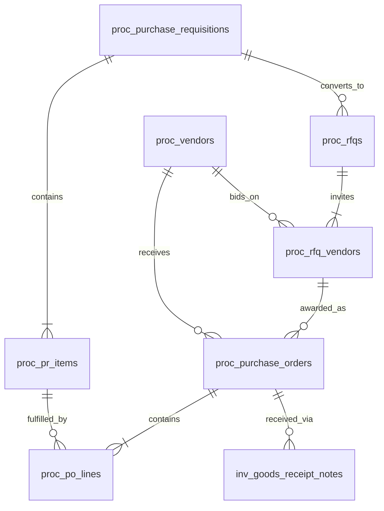

# Module 08: Procurement Management (P2P)

## 1. Purpose
The Procurement Management module in MimarERP v7 orchestrates the entire Procure-to-Pay (P2P) lifecycle for enterprise construction and engineering operations. It standardizes requisitioning, strategic sourcing, competitive vendor bidding, compliance-enforced approvals, purchase order governance, and seamless three-way matching against warehouse receipts and financial invoices. Specifically architected for the Saudi Arabian construction landscape, it natively enforces Government Tenders & Procurement Law (GTPL), Saudi Aramco (9COM/9CAT) and SABIC qualification standards, ZATCA Phase 2 e-invoicing synchronization, and mandatory 3-bid thresholds.

---

## 2. Business Objectives
1. **P2P Operational Efficiency**: Accelerate purchase requisition-to-order cycle time by 45% using automated routing and pre-approved vendor catalogs.
2. **Strict Compliance & Governance**: Enforce mandatory 3-bid competitive tender policies for all non-emergency purchases exceeding SAR 50,000, preventing unauthorized direct award.
3. **Saudi Regulatory & Aramco/SABIC Alignment**: Seamlessly comply with Saudi GTPL for public sector projects and Aramco/SABIC standards for industrial and energy infrastructure packages.
4. **Budgetary & Cost Code Control**: Prevent cost overruns through real-time commitment tracking against project WBS, cost codes, and approved CBS budgets before PO release.
5. **Vendor Relationship & Risk Management**: Centralize vendor prequalification scoring (financial stability, technical capabilities, HSE track record, ISO certifications) and dynamic performance evaluations.
6. **Framework Agreements & Blanket POs**: Streamline bulk material procurement (rebar, ready-mix concrete, aggregate) via blanket purchase orders with agile site call-offs.

---

## 3. User Roles & Permissions
| Role Name | Scope / Access Level | Core Responsibilities |
| :--- | :--- | :--- |
| **Procurement Director** | Enterprise / All Projects | Policy governance, approval of high-value POs (>SAR 500,000), vendor blacklisting, vendor prequalification sign-off. |
| **Procurement Manager** | Regional / Multi-Project | PO approval (SAR 100,000 to 500,000), RFQ management, bid evaluation committee head, vendor negotiation. |
| **Procurement Engineer / Buyer** | Project Assigned | Sourcing, RFQ dispatch, commercial bid tabs, PO drafting, expediting, supplier coordination. |
| **Site Material Engineer / QS** | Project Site | Initiating Material Purchase Requisitions (MPR), BOQ verification, sample approval validation. |
| **Project Manager (PM)** | Project | MPR operational approval, commercial concurrence, variation verification up to SAR 100,000. |
| **Vendor / Subcontractor** | External Portal | Submitting quotations, viewing POs, acknowledging delivery schedules, uploading ASN (Advance Shipping Notice). |
| **Quality / HSE Inspector** | Enterprise / Project | Technical and HSE prequalification vetting, incoming material compliance clearance. |

---

## 4. Database Tables

### `proc_purchase_requisitions`
| Column Name | Data Type | Constraints | Description |
| :--- | :--- | :--- | :--- |
| `id` | UUID | PRIMARY KEY, DEFAULT gen_random_uuid() | Unique identifier |
| `tenant_id` | UUID | NOT NULL | Multi-tenant isolation |
| `pr_number` | VARCHAR(50) | NOT NULL, UNIQUE | Human-readable PR reference (e.g., PR-2026-0812) |
| `project_id` | UUID | NOT NULL | FK to `pm_projects` |
| `wbs_node_id` | UUID | NOT NULL | FK to `pm_wbs_nodes` |
| `cost_code_id` | UUID | NOT NULL | FK to `cc_cost_codes` |
| `requester_id` | UUID | NOT NULL | FK to `sys_users` |
| `priority` | VARCHAR(20) | NOT NULL DEFAULT 'NORMAL' | 'URGENT', 'NORMAL', 'EMERGENCY' |
| `procurement_type` | VARCHAR(30) | NOT NULL | 'STANDARD', 'SUBCONTRACT', 'BLANKET_CALLOFF', 'GTPL_PUBLIC' |
| `required_site_date` | DATE | NOT NULL | Date material is required on-site |
| `justification` | TEXT | NULL | Reason for requisition |
| `estimated_total_sar` | NUMERIC(15,2) | NOT NULL DEFAULT 0.00 | Total estimated cost |
| `status` | VARCHAR(30) | NOT NULL DEFAULT 'DRAFT' | 'DRAFT', 'PENDING_APPROVAL', 'APPROVED', 'RFQ_ISSUED', 'PO_CREATED', 'CLOSED', 'REJECTED' |
| `created_at` | TIMESTAMPTZ | NOT NULL DEFAULT NOW() | Creation timestamp |
| `updated_at` | TIMESTAMPTZ | NOT NULL DEFAULT NOW() | Last update timestamp |
| `created_by` | UUID | NOT NULL | User who created |
| `is_deleted` | BOOLEAN | NOT NULL DEFAULT FALSE | Soft delete flag |

### `proc_pr_items`
| Column Name | Data Type | Constraints | Description |
| :--- | :--- | :--- | :--- |
| `id` | UUID | PRIMARY KEY, DEFAULT gen_random_uuid() | Unique identifier |
| `tenant_id` | UUID | NOT NULL | Multi-tenant isolation |
| `pr_id` | UUID | NOT NULL, REFERENCES `proc_purchase_requisitions` | Header PR reference |
| `item_code` | VARCHAR(50) | NOT NULL | Inventory master item code or generic |
| `unspsc_code` | VARCHAR(20) | NULL | UNSPSC classification code |
| `description` | TEXT | NOT NULL | Technical specification description |
| `boq_reference` | VARCHAR(50) | NULL | Reference to project BOQ line |
| `quantity_requested`| NUMERIC(14,4) | NOT NULL CHECK (quantity_requested > 0) | Quantity needed |
| `uom` | VARCHAR(20) | NOT NULL | Unit of measure (e.g., TON, M3, EA) |
| `estimated_unit_rate`| NUMERIC(15,2) | NOT NULL DEFAULT 0.00 | Estimated budget rate |
| `status` | VARCHAR(30) | NOT NULL DEFAULT 'PENDING' | 'PENDING', 'PO_COMMITTED', 'CANCELLED' |
| `created_at` | TIMESTAMPTZ | NOT NULL DEFAULT NOW() | Timestamp |

### `proc_rfqs`
| Column Name | Data Type | Constraints | Description |
| :--- | :--- | :--- | :--- |
| `id` | UUID | PRIMARY KEY, DEFAULT gen_random_uuid() | Unique identifier |
| `tenant_id` | UUID | NOT NULL | Multi-tenant isolation |
| `rfq_number` | VARCHAR(50) | NOT NULL, UNIQUE | RFQ document reference |
| `title` | VARCHAR(255) | NOT NULL | Package / RFQ title |
| `project_id` | UUID | NOT NULL | Project reference |
| `bid_closing_date` | TIMESTAMPTZ | NOT NULL | Submission deadline |
| `bid_opening_date` | TIMESTAMPTZ | NULL | Formal committee opening date |
| `is_gtpl_regulated` | BOOLEAN | NOT NULL DEFAULT FALSE | Saudi Government Procurement Law enforcement |
| `requires_3_bids` | BOOLEAN | NOT NULL DEFAULT TRUE | Mandatory 3-bid rule trigger |
| `commercial_terms` | JSONB | NULL | Payment terms, delivery penalties, warranty |
| `status` | VARCHAR(30) | NOT NULL DEFAULT 'DRAFT' | 'DRAFT', 'PUBLISHED', 'CLOSED', 'EVALUATION', 'AWARDED', 'CANCELLED' |
| `created_at` | TIMESTAMPTZ | NOT NULL DEFAULT NOW() | Timestamp |

### `proc_rfq_vendors`
| Column Name | Data Type | Constraints | Description |
| :--- | :--- | :--- | :--- |
| `id` | UUID | PRIMARY KEY, DEFAULT gen_random_uuid() | Unique identifier |
| `tenant_id` | UUID | NOT NULL | Multi-tenant isolation |
| `rfq_id` | UUID | NOT NULL, REFERENCES `proc_rfqs` | Parent RFQ |
| `vendor_id` | UUID | NOT NULL, REFERENCES `proc_vendors` | Invited vendor |
| `invitation_sent_at`| TIMESTAMPTZ | NULL | Timestamp of RFQ dispatch |
| `bid_status` | VARCHAR(30) | NOT NULL DEFAULT 'INVITED' | 'INVITED', 'ACKNOWLEDGED', 'SUBMITTED', 'DECLINED', 'DISQUALIFIED' |
| `technical_score` | NUMERIC(5,2) | NULL | Technical evaluation score (0-100) |
| `commercial_total` | NUMERIC(15,2) | NULL | Total bid price excluding VAT |
| `is_awarded` | BOOLEAN | NOT NULL DEFAULT FALSE | Final award indicator |

### `proc_purchase_orders`
| Column Name | Data Type | Constraints | Description |
| :--- | :--- | :--- | :--- |
| `id` | UUID | PRIMARY KEY, DEFAULT gen_random_uuid() | Unique identifier |
| `tenant_id` | UUID | NOT NULL | Multi-tenant isolation |
| `po_number` | VARCHAR(50) | NOT NULL, UNIQUE | Purchase Order reference |
| `po_type` | VARCHAR(30) | NOT NULL | 'STANDARD', 'BLANKET', 'CALL_OFF', 'ARAMCO_COMPLIANT' |
| `rfq_id` | UUID | NULL, REFERENCES `proc_rfqs` | Source RFQ |
| `vendor_id` | UUID | NOT NULL, REFERENCES `proc_vendors` | Selected Vendor |
| `project_id` | UUID | NOT NULL | Associated Project |
| `currency` | VARCHAR(3) | NOT NULL DEFAULT 'SAR' | Currency code |
| `exchange_rate` | NUMERIC(10,5) | NOT NULL DEFAULT 1.00000 | SAR base rate |
| `subtotal_amount` | NUMERIC(15,2) | NOT NULL | Total amount before tax |
| `vat_amount` | NUMERIC(15,2) | NOT NULL | 15% VAT component |
| `grand_total` | NUMERIC(15,2) | NOT NULL | Subtotal + VAT |
| `payment_terms` | VARCHAR(100) | NOT NULL | e.g., 'Net 60 Days with 10% Advance' |
| `delivery_location` | VARCHAR(255) | NOT NULL | Site warehouse or coordinates |
| `incoterms` | VARCHAR(20) | NOT NULL DEFAULT 'DDP' | DDP, FOB, CIF, EXW |
| `zatca_reference` | VARCHAR(100) | NULL | ZATCA pre-clearance reference hash |
| `approval_status` | VARCHAR(30) | NOT NULL DEFAULT 'DRAFT' | 'DRAFT', 'UNDER_APPROVAL', 'APPROVED', 'ISSUED', 'AMENDED', 'CANCELLED' |
| `created_at` | TIMESTAMPTZ | NOT NULL DEFAULT NOW() | Timestamp |

### `proc_po_lines`
| Column Name | Data Type | Constraints | Description |
| :--- | :--- | :--- | :--- |
| `id` | UUID | PRIMARY KEY, DEFAULT gen_random_uuid() | Unique identifier |
| `tenant_id` | UUID | NOT NULL | Multi-tenant isolation |
| `po_id` | UUID | NOT NULL, REFERENCES `proc_purchase_orders` | Parent PO |
| `pr_item_id` | UUID | NULL, REFERENCES `proc_pr_items` | Source Requisition Item |
| `cost_code_id` | UUID | NOT NULL | Account / WBS Cost Code |
| `item_code` | VARCHAR(50) | NOT NULL | Inventory SKU or General Item |
| `unspsc_code` | VARCHAR(20) | NULL | Standard commodity code |
| `description` | TEXT | NOT NULL | Line description |
| `ordered_quantity` | NUMERIC(14,4) | NOT NULL CHECK (ordered_quantity > 0) | Quantity ordered |
| `received_quantity`| NUMERIC(14,4) | NOT NULL DEFAULT 0.0000 | Cumulative received via GRN |
| `invoiced_quantity`| NUMERIC(14,4) | NOT NULL DEFAULT 0.0000 | Cumulative AP matched |
| `unit_price` | NUMERIC(15,2) | NOT NULL | Agreed unit price |
| `line_subtotal` | NUMERIC(15,2) | NOT NULL | Quantity * Unit Price |
| `vat_rate` | NUMERIC(5,2) | NOT NULL DEFAULT 15.00 | VAT rate percentage |
| `vat_amount` | NUMERIC(15,2) | NOT NULL | Line VAT |
| `total_amount` | NUMERIC(15,2) | NOT NULL | Subtotal + VAT |

### `proc_vendors`
| Column Name | Data Type | Constraints | Description |
| :--- | :--- | :--- | :--- |
| `id` | UUID | PRIMARY KEY, DEFAULT gen_random_uuid() | Unique identifier |
| `tenant_id` | UUID | NOT NULL | Multi-tenant isolation |
| `vendor_code` | VARCHAR(50) | NOT NULL, UNIQUE | Vendor number |
| `legal_name_en` | VARCHAR(255) | NOT NULL | Registered name in English |
| `legal_name_ar` | VARCHAR(255) | NOT NULL | Registered name in Arabic |
| `cr_number` | VARCHAR(20) | NOT NULL, UNIQUE | Commercial Registration (Saudi MoC) |
| `vat_number` | VARCHAR(15) | NOT NULL | 15-digit ZATCA VAT number |
| `aramco_vendor_id`| VARCHAR(50) | NULL | Saudi Aramco Vendor ID |
| `sabic_vendor_id` | VARCHAR(50) | NULL | SABIC Vendor ID |
| `financial_score` | NUMERIC(5,2) | NOT NULL DEFAULT 0.00 | Prequalification financial score |
| `technical_score` | NUMERIC(5,2) | NOT NULL DEFAULT 0.00 | Technical capabilities score |
| `hse_score` | NUMERIC(5,2) | NOT NULL DEFAULT 0.00 | Safety and environment score |
| `composite_rating`| NUMERIC(5,2) | NOT NULL DEFAULT 0.00 | Weighted total (A, B, C, D tier) |
| `prequal_status` | VARCHAR(30) | NOT NULL DEFAULT 'PENDING' | 'PENDING', 'APPROVED', 'EXPIRED', 'BLACKLISTED' |
| `is_active` | BOOLEAN | NOT NULL DEFAULT TRUE | Active vendor status |

---

## 5. Entity Relationships (Mermaid)



---

## 6. Business Workflow (P2P Lifecycle)

### Step-by-Step State Flow:
1. **Need Identification & Material Requisition**:
   - Site Engineer generates a Purchase Requisition (`proc_purchase_requisitions`).
   - Line items link to the project WBS, Bill of Quantities (BOQ), and budget cost codes.
   - System performs auto-check: Budget availability check (Available Budget = Allocated - Actuals - Commitments).
2. **Requisition Review & Multi-Level Approval**:
   - Cost Control validates budget sufficiency.
   - Project Manager approves operational need.
   - If estimated cost exceeds SAR 50,000, 3-bid RFQ flag is automatically locked to `TRUE`.
3. **RFQ Generation & Sourcing**:
   - Procurement Buyer consolidates PR items into an RFQ (`proc_rfqs`).
   - If project is Aramco/SABIC classified, vendor selector filters strictly for active Aramco 9COM/SABIC certified vendors.
   - If GTPL regulated, minimum 15-day bidding window and sealed electronic opening rules are enforced.
4. **Bid Opening & Commercial Comparison Matrix**:
   - Vendors submit technical and commercial bids through the portal.
   - At bid closing, commercial bid opening committee unlocks bids simultaneously.
   - System auto-generates a Comparative Bid Analysis (CBA) matrix highlighting lowest compliant bidder, payment variances, and warranty terms.
5. **Purchase Order Issuance & ZATCA Reference**:
   - Awarded vendor is converted into an approved Purchase Order (`proc_purchase_orders`).
   - Financial commitments are posted to Cost Control.
   - ZATCA cryptographic linkage metadata prepared for integration with AP invoice processing.
6. **Execution, Delivery, & 3-Way Matching**:
   - Material arrives at site store; storekeeper generates GRN (`inv_goods_receipt_notes`).
   - Quality inspector clears technical inspection (MIR - Material Inspection Request).
   - Finance AP performs 3-way matching: PO Quantity vs. GRN Quantity vs. Vendor Tax Invoice.

---

## 7. UI Screens
- **PR-01: Purchase Requisition Portal**: Fast data grid with BOQ lookup, budget live gauge, urgent indicator, multi-item file upload for specs/drawings.
- **RFQ-02: Strategic Sourcing & Bid Package Studio**: RFQ packager, vendor invitation picker with Aramco/SABIC/GTPL filters, document vault, deadline timer.
- **BID-03: Bid Opening & Commercial Comparison Matrix**: Interactive side-by-side tabular comparison of up to 6 vendors, unit rate breakdown, currency conversion, score normalizer, one-click award recommendation.
- **PO-04: Purchase Order Command Center**: Status life-cycle stepper, ZATCA tax breakdown, delivery milestones, blanket PO call-off balance tracker, PDF generation with QR verification.
- **VEN-05: Vendor 360 & Prequalification Console**: Profile overview, CR and VAT validation, Aramco ID, ESG/HSE audit scores, active commitments, on-time delivery (OTD) rating.

---

## 8. Dashboard
- **Executive Procurement Metrics**:
  - Open Commitment Volume (SAR) vs Monthly Budget Cap.
  - Active RFQs nearing closing deadline.
  - 3-Bid Compliance Gauge (target: 100% on >SAR 50k orders).
  - Average P2P Cycle Time (Requisition to Order Issued).
- **Vendor Performance Heatmap**:
  - Delivery punctuality index (On-Time In-Full - OTIF).
  - Material rejection rates per vendor.
  - High-risk vendors with expiring CR/ZATCA/Aramco certificates within 30 days.

---

## 9. Reports
1. **P2P Lifecycle Traceability Report**: End-to-end audit tracking PR → RFQ → PO → GRN → AP Invoice → Payment Voucher.
2. **Commitment vs. Budget Variance Report**: Encumbered purchase orders against project WBS cost codes.
3. **3-Bid Compliance Audit Ledger**: Regulatory report listing all purchases >SAR 50,000 showing participating bidders and deviation justifications.
4. **Blanket PO & Call-Off Exhaustion Report**: Track total contracted value, consumed call-offs, and remaining balance for bulk commodities.
5. **Vendor Performance & OTIF Scorecard**: Vendor rating on delivery timelines, technical compliance, and documentation accuracy.
6. **Saudi Aramco / SABIC Vendor Compliance Log**: Status of 9COM/9CAT approvals and contractor prequalification validity.
7. **GTPL Tender Analysis Report**: Sealed bid opening logs, committee member sign-offs, and disqualification registers.
8. **Price Variance Index (PVI)**: Tracking standard estimated rates vs actual awarded PO unit rates across quarters.
9. **Expediting & Delivery Overdue Register**: Live tracking of orders past promised dispatch or site delivery dates.
10. **ZATCA Withholding Tax & VAT Procurement Summary**: Tax breakdown across local and international procurement transactions.

---

## 10. Key Performance Indicators (KPIs)
| KPI Code | KPI Name | Formula | Target | Red (Critical) | Amber (Warning) | Green (Healthy) |
| :--- | :--- | :--- | :--- | :--- | :--- | :--- |
| **KPI-PR-01** | P2P Lead Time | $\sum (\text{PO Issue Date} - \text{PR Approval Date}) / N$ | $\le 10\text{ days}$ | $> 18\text{ days}$ | $11 - 18\text{ days}$ | $\le 10\text{ days}$ |
| **KPI-PR-02** | 3-Bid Adherence | $(\text{Compliant POs } > 50\text{k} / \text{Total POs } > 50\text{k}) \times 100$ | $100\%$ | $< 95\%$ | $95\% - 99.9\%$ | $100\%$ |
| **KPI-PR-03** | PO Cost Variance | $((\text{PO Amount} - \text{Budget Estimate}) / \text{Budget Estimate}) \times 100$ | $\le 0\%$ | $> +5\%$ | $0.1\% - 5\%$ | $\le 0\%$ |
| **KPI-PR-04** | OTIF Delivery Rate | $(\text{On-Time \& Full Deliveries} / \text{Total Deliveries}) \times 100$ | $\ge 92\%$ | $< 80\%$ | $80\% - 91\%$ | $\ge 92\%$ |
| **KPI-PR-05** | Vendor Defect Rate | $(\text{Rejected GRNs} / \text{Total GRNs}) \times 100$ | $\le 1.5\%$ | $> 4\%$ | $1.6\% - 4\%$ | $\le 1.5\%$ |

---

## 11. API Endpoints
- `POST /api/v1/procurement/requisitions`: Create new Purchase Requisition with line items.
- `GET /api/v1/procurement/requisitions/{id}`: Retrieve PR details, status, and approval audit log.
- `POST /api/v1/procurement/requisitions/{id}/approve`: Workflow approval action (PM, Cost Control, Director).
- `POST /api/v1/procurement/rfqs`: Create competitive RFQ package from approved PR lines.
- `POST /api/v1/procurement/rfqs/{id}/bids`: Vendor bid submission endpoint (commercial & technical rates).
- `GET /api/v1/procurement/rfqs/{id}/comparison-matrix`: Generate commercial bid evaluation matrix.
- `POST /api/v1/procurement/purchase-orders`: Generate Purchase Order from awarded bid or blanket call-off.
- `GET /api/v1/procurement/purchase-orders/{id}/pdf`: Generate official PDF with QR verification code and ZATCA hash.
- `GET /api/v1/procurement/vendors/prequalification/{vendorId}`: Fetch vendor credentials, Aramco/SABIC status, and ratings.

---

## 12. Required Permissions
- `proc:pr:create`: Create and update draft purchase requisitions.
- `proc:pr:approve_pm`: Project Manager level operational sign-off.
- `proc:pr:approve_cost`: Cost Control budget verification sign-off.
- `proc:rfq:manage`: Issue RFQs, manage vendor shortlists, close bids.
- `proc:bid:open_committee`: Member permission to participate in sealed bid opening.
- `proc:po:create`: Draft and amend purchase orders.
- `proc:po:approve_dir`: Final executive authorization for high-value purchase orders.
- `proc:vendor:evaluate`: Score vendor prequalification and audit records.

---

## 13. Approval Workflows & SLA Matrix
```
[Requisitioner] -> (PR Created)
       │
       ▼
[Cost Controller] (SLA: 24 hrs) ── Budget OK? ── No ──► [Reject / Return]
       │ Yes
       ▼
[Project Manager] (SLA: 24 hrs) ── Operational Need Validated
       │
       ▼
[Procurement Buyer] (SLA: 48 hrs) ── Convert to RFQ / 3 Bids Collected
       │
       ▼
[Bid Evaluation Committee] ── Commercial Tab Approved
       │
       ├─ Value < SAR 100,000 ──────────► [Procurement Manager Approval] (SLA: 24 hrs)
       ├─ Value SAR 100k - SAR 500,000 ──► [Operations Director Approval] (SLA: 48 hrs)
       └─ Value > SAR 500,000 ──────────► [CEO / Procurement Director Approval] (SLA: 48 hrs)
```

---

## 14. AI Features
1. **Intelligent Spend & Anomaly Detection**: Deep-learning algorithm detects unit-rate deviations from market indices for key construction commodities (steel, concrete, cabling) and flags overpriced bids.
2. **Automated RFQ Parsing & Bid Extraction**: AI OCR parses vendor PDF quotation sheets, extracts line items, quantities, and discount clauses, and populates the comparative bid analysis automatically.
3. **Smart Vendor Recommendation**: Recommends top 3 prequalified vendors for an RFQ based on past delivery speed, proximity to project coordinates, Aramco compliance rating, and lowest historical variance.

---

## 15. Automations
1. **Auto-PR on Reorder Level Breach**: When site inventory drops below calculated safety stock, the system automatically drafts an emergency MPR for review.
2. **3-Bid Enforcement Blocker**: Purchase Orders $> \text{SAR } 50,000$ cannot transition to `APPROVED` unless at least 3 distinct vendor proposals are attached or an official Sole Source Waiver is signed by the CEO.
3. **Contract Call-Off Ledger Deduction**: Issuing a call-off PO against a Blanket Agreement immediately decreases the committed quantity and value on the master agreement in real-time.

---

## 16. Integration Requirements
- **Cost Control & WBS**: Instant commitment reservation against cost code upon PO approval; releases commitments upon invoice posting.
- **Inventory & Warehouse Management**: Seamless handover of PO data to site storekeepers for Goods Receipt Notes (GRN) and automated barcode/QR creation.
- **Finance & General Ledger**: Automatic posting of procurement commitments, three-way matching verification, and VAT input reconciliation with ZATCA Phase 2.
- **Saudi Platforms (Aramco / Muqeem / ZATCA)**: Validation of vendor VAT registration through ZATCA API and verified registration on Aramco e-Marketplace.
