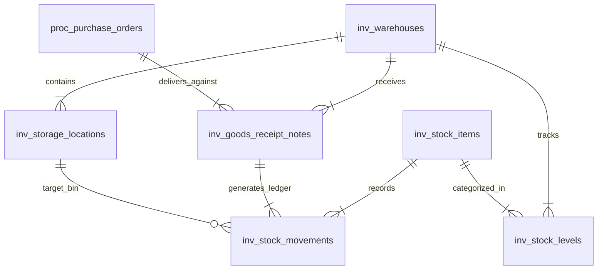

# Module 09: Inventory & Warehouse Management

## 1. Purpose
The Inventory & Warehouse Management module of MimarERP v7 delivers enterprise-grade tracking, valuation, and physical control of materials across all construction tiers. It establishes an omnichannel supply chain network comprising Central Distribution Centers, regional fabrication yards, project site stores, and containerized sub-stores. It enforces precise inventory valuation (FIFO and Weighted Average Cost - WACOG), real-time stock movements, mobile QR/barcode scanning, material reconciliation against engineering BOQs, and automated replenishment loops.

---

## 2. Business Objectives
1. **Multi-Tier Warehouse Network Visibility**: Maintain unified, real-time stock visibility across central logistics depots, project site warehouses, and transit locations.
2. **Material Reconciliation & Wastage Control**: Enforce strict reconciliation between BOQ estimated quantities, purchase order commitments, issued site quantities, and physical remaining balances to restrict wastage under 3%.
3. **Automated Replenishment & Safety Stock Protection**: Auto-generate purchase requisitions (PR) whenever stock hits dynamic safety levels, preventing site work stoppages.
4. **Optimized Working Capital (ABC & Slow-Moving Management)**: Categorize inventory via ABC-FSN analysis to liquidate slow-moving/dead stock and optimize cash tied up in long-lead materials.
5. **Digital Field Operations**: Eliminate paper-based storekeeping via mobile camera QR/barcode tracking for receiving (GRN), issuing to work crews, transfers, and annual cycle counting.
6. **Financial Valuation Integrity**: Guarantee strict compliance with IFRS and Saudi SOCPA standards through verifiable FIFO and WACOG cost layering.

---

## 3. User Roles & Permissions
| Role Name | Scope / Access Level | Core Responsibilities |
| :--- | :--- | :--- |
| **Logistics & Inventory Director** | Enterprise / Global | Strategic network design, warehouse authorization, disposal of dead stock, valuation methodology sign-off. |
| **Central Warehouse Manager** | Regional / Central Hub | Overseeing central stock, bulk shipments, cross-project transfers, consignment inventory. |
| **Site Storekeeper** | Project Site Store | Receiving material, creating GRN, bin location tagging, issuing materials against Store Issue Requests (SIR), scrap disposal. |
| **Material Controller / Site QA**| Project Site | Verification of Delivery Notes (DN), Mill Test Certificates (MTC), heat numbers, physical quarantine inspections. |
| **Site Engineer / Foreman** | Project Workfront | Raising Store Issue Requests (SIR), material return notes (MRN), logging daily physical consumption. |
| **Inventory Auditor** | Corporate Audit | Performing scheduled and surprise cycle counts, logging variance reports, auditing write-offs. |

---

## 4. Database Tables

### `inv_warehouses`
| Column Name | Data Type | Constraints | Description |
| :--- | :--- | :--- | :--- |
| `id` | UUID | PRIMARY KEY, DEFAULT gen_random_uuid() | Unique identifier |
| `tenant_id` | UUID | NOT NULL | Multi-tenant isolation |
| `code` | VARCHAR(50) | NOT NULL, UNIQUE | Warehouse code (e.g., WH-RYD-CENTRAL, WH-SITE-NEOM-01) |
| `name` | VARCHAR(255) | NOT NULL | Warehouse descriptive name |
| `type` | VARCHAR(30) | NOT NULL | 'CENTRAL_HUB', 'SITE_STORE', 'SUB_STORE', 'TRANSIT', 'FABRICATION_YARD' |
| `project_id` | UUID | NULL, REFERENCES `pm_projects` | Linked project (NULL for Central Warehouses) |
| `manager_id` | UUID | NOT NULL, REFERENCES `sys_users` | Assigned warehouse keeper |
| `location_coordinates`| POINT | NULL | GPS latitude and longitude |
| `address` | TEXT | NULL | Physical location description |
| `is_active` | BOOLEAN | NOT NULL DEFAULT TRUE | Operational status |
| `created_at` | TIMESTAMPTZ | NOT NULL DEFAULT NOW() | Timestamp |

### `inv_storage_locations` (Bins & Racks)
| Column Name | Data Type | Constraints | Description |
| :--- | :--- | :--- | :--- |
| `id` | UUID | PRIMARY KEY, DEFAULT gen_random_uuid() | Unique identifier |
| `tenant_id` | UUID | NOT NULL | Multi-tenant isolation |
| `warehouse_id` | UUID | NOT NULL, REFERENCES `inv_warehouses` | Parent warehouse |
| `zone` | VARCHAR(50) | NOT NULL | Zone / Yard area (e.g., 'ZONE-A', 'REBAR-YARD') |
| `aisle` | VARCHAR(20) | NULL | Aisle identifier |
| `rack` | VARCHAR(20) | NULL | Rack reference |
| `shelf_bin` | VARCHAR(20) | NOT NULL | Specific bin or slot code |
| `barcode` | VARCHAR(100) | NOT NULL, UNIQUE | Scannable barcode/QR string |
| `is_quarantine` | BOOLEAN | NOT NULL DEFAULT FALSE | Used for unverified or rejected materials |

### `inv_stock_items` (Catalog Master)
| Column Name | Data Type | Constraints | Description |
| :--- | :--- | :--- | :--- |
| `id` | UUID | PRIMARY KEY, DEFAULT gen_random_uuid() | Unique identifier |
| `tenant_id` | UUID | NOT NULL | Multi-tenant isolation |
| `item_code` | VARCHAR(50) | NOT NULL, UNIQUE | Material SKU code |
| `unspsc_code` | VARCHAR(20) | NULL | UNSPSC classification |
| `name_en` | VARCHAR(255) | NOT NULL | Description in English |
| `name_ar` | VARCHAR(255) | NOT NULL | Description in Arabic |
| `category_id` | UUID | NOT NULL | Material category (Civil, MEP, Steel, Chemicals) |
| `base_uom` | VARCHAR(20) | NOT NULL | Default unit of measure |
| `valuation_method` | VARCHAR(20) | NOT NULL DEFAULT 'WACOG' | 'WACOG' (Weighted Average), 'FIFO' |
| `reorder_level` | NUMERIC(14,4) | NOT NULL DEFAULT 0.0000 | Stock replenishment trigger threshold |
| `safety_stock` | NUMERIC(14,4) | NOT NULL DEFAULT 0.0000 | Absolute minimum reserve |
| `reorder_quantity` | NUMERIC(14,4) | NOT NULL DEFAULT 0.0000 | Standard auto-PR batch size |
| `abc_class` | VARCHAR(1) | NOT NULL DEFAULT 'B' | 'A' (High value), 'B' (Medium), 'C' (Low value) |
| `fsn_class` | VARCHAR(1) | NOT NULL DEFAULT 'N' | 'F' (Fast), 'S' (Slow), 'N' (Non-moving) |
| `is_batch_tracked` | BOOLEAN | NOT NULL DEFAULT FALSE | Requires heat/batch/lot number |
| `is_serial_tracked`| BOOLEAN | NOT NULL DEFAULT FALSE | Requires individual serial number |

### `inv_stock_levels` (Current Balance per Warehouse & Bin)
| Column Name | Data Type | Constraints | Description |
| :--- | :--- | :--- | :--- |
| `id` | UUID | PRIMARY KEY, DEFAULT gen_random_uuid() | Unique identifier |
| `tenant_id` | UUID | NOT NULL | Multi-tenant isolation |
| `warehouse_id` | UUID | NOT NULL, REFERENCES `inv_warehouses` | Warehouse |
| `stock_item_id` | UUID | NOT NULL, REFERENCES `inv_stock_items` | Material SKU |
| `location_id` | UUID | NULL, REFERENCES `inv_storage_locations` | Specific Bin / Rack |
| `quantity_on_hand` | NUMERIC(14,4) | NOT NULL DEFAULT 0.0000 | Physical quantity present |
| `quantity_allocated`| NUMERIC(14,4) | NOT NULL DEFAULT 0.0000 | Reserved for issued SIRs |
| `quantity_available`| NUMERIC(14,4) | GENERATED ALWAYS AS (quantity_on_hand - quantity_allocated) STORED | Available for new requests |
| `current_wacog_rate`| NUMERIC(15,4) | NOT NULL DEFAULT 0.0000 | Moving weighted average cost per unit |
| `total_value_sar` | NUMERIC(18,2) | GENERATED ALWAYS AS (quantity_on_hand * current_wacog_rate) STORED | Total inventory valuation |

### `inv_stock_movements` (Immutable Ledger)
| Column Name | Data Type | Constraints | Description |
| :--- | :--- | :--- | :--- |
| `id` | UUID | PRIMARY KEY, DEFAULT gen_random_uuid() | Unique identifier |
| `tenant_id` | UUID | NOT NULL | Multi-tenant isolation |
| `movement_type` | VARCHAR(30) | NOT NULL | 'GRN', 'ISSUE', 'RETURN', 'TRANSFER_OUT', 'TRANSFER_IN', 'ADJUSTMENT' |
| `stock_item_id` | UUID | NOT NULL, REFERENCES `inv_stock_items` | Material SKU |
| `source_warehouse_id`| UUID | NULL, REFERENCES `inv_warehouses` | Origin warehouse |
| `dest_warehouse_id`| UUID | NULL, REFERENCES `inv_warehouses` | Destination warehouse |
| `batch_lot_number` | VARCHAR(100) | NULL | Heat / Lot / Mill Certificate No |
| `quantity` | NUMERIC(14,4) | NOT NULL CHECK (quantity > 0) | Quantity transacted |
| `unit_cost_sar` | NUMERIC(15,4) | NOT NULL | Applied cost rate (FIFO/WACOG) |
| `total_cost_sar` | NUMERIC(18,2) | NOT NULL | Total transaction monetary value |
| `reference_doc_type`| VARCHAR(50) | NOT NULL | 'PO', 'SIR', 'TRANSFER_ORDER', 'STOCK_TAKE' |
| `reference_doc_id` | UUID | NOT NULL | ID of triggering source document |
| `cost_code_id` | UUID | NULL | Charged cost code (for issues) |
| `performed_by` | UUID | NOT NULL, REFERENCES `sys_users` | Operator user |
| `transaction_time` | TIMESTAMPTZ | NOT NULL DEFAULT NOW() | Timestamp |

### `inv_goods_receipt_notes` (GRN Header)
| Column Name | Data Type | Constraints | Description |
| :--- | :--- | :--- | :--- |
| `id` | UUID | PRIMARY KEY, DEFAULT gen_random_uuid() | Unique identifier |
| `tenant_id` | UUID | NOT NULL | Multi-tenant isolation |
| `grn_number` | VARCHAR(50) | NOT NULL, UNIQUE | Document reference (e.g. GRN-2026-0045) |
| `po_id` | UUID | NOT NULL, REFERENCES `proc_purchase_orders` | Purchase order reference |
| `warehouse_id` | UUID | NOT NULL, REFERENCES `inv_warehouses` | Receiving warehouse |
| `supplier_dn_number`| VARCHAR(100) | NOT NULL | Vendor Delivery Note / Invoice |
| `received_date` | DATE | NOT NULL | Delivery arrival date |
| `inspection_status` | VARCHAR(30) | NOT NULL DEFAULT 'PENDING' | 'PENDING', 'ACCEPTED', 'PARTIALLY_ACCEPTED', 'REJECTED' |
| `created_by` | UUID | NOT NULL | Storekeeper |
| `created_at` | TIMESTAMPTZ | NOT NULL DEFAULT NOW() | Timestamp |

---

## 5. Entity Relationships (Mermaid)



---

## 6. Business Workflow (Material Management)

### Step-by-Step Movement Lifecycle:
1. **Material Receipt & Quarantine (GRN)**:
   - Vendor truck arrives with delivery note.
   - Storekeeper scans PO barcode on mobile app, loading line items.
   - Material is placed in `ZONE-QUARANTINE`. GRN is generated in `PENDING` inspection state.
2. **Technical Inspection & Acceptance (MIR)**:
   - Material Quality Inspector inspects against technical specifications, heat numbers, and Mill Test Certificates (MTC).
   - If accepted, system moves material from quarantine to active bin locations (e.g., `RACK-B-04`) and updates `inv_stock_levels`.
   - WACOG rate is recalculated: $\text{New WACOG} = \frac{(\text{Current Value} + \text{New Inflow Value})}{(\text{Current Qty} + \text{New Inflow Qty})}$.
3. **Store Issue Request (SIR) to Project Workfront**:
   - Site Engineer creates an electronic Store Issue Request against an approved WBS Activity and Cost Code.
   - System checks BOQ reconciliation rule: if (Cumulative Issued + Requested Qty) > BOQ Cap, issue is blocked until Variation Order approval.
   - Storekeeper scans QR codes on outgoing materials; inventory is immediately deducted from the warehouse and costed to the project cost code.
4. **Inter-Store Transfers (Central to Site)**:
   - Site requests transfer from Central Hub; Central issues a `TRANSFER_OUT` movement.
   - Material enters `TRANSIT` warehouse.
   - Site Storekeeper inspects on arrival, scanning the dispatch QR code, triggering `TRANSFER_IN`.
5. **Periodic Reconciliation & Stock Take**:
   - Barcode cycle count conducted quarterly; physical variances logged via `ADJUSTMENT` movement with mandatory root-cause justification.

---

## 7. UI Screens
- **INV-01: Multi-Warehouse Command Center**: Geographic map view of all project sites and central hubs with stock valuation, storage capacity gauges, and alert badges.
- **INV-02: Mobile Receiving & Scanner**: Progressive Web App (PWA) screen optimized for site tablets/phones with camera-based barcode/QR scanning, photo attachment of delivery notes, and instant GRN generation.
- **INV-03: Material Reissue & Allocation Console**: Fast issue screen showing real-time available stock vs. BOQ allowances, work crew picker, and digital signature capture.
- **INV-04: BOQ Reconciliation Matrix**: Real-time project-level tabular grid displaying: Item Description | BOQ Qty | PO Ordered Qty | Received (GRN) Qty | Site Issued Qty | Site Balance | Variance %.
- **INV-05: ABC / FSN Stock Classification & Aging Matrix**: Visual dashboard analyzing stock turnover, dead inventory (>180 days no movement), and capital liquidation recommendations.

---

## 8. Dashboard
- **Executive Stock Valuation & Metrics**:
  - Total Enterprise Inventory Value (SAR) broken down by Central vs Project Site Stores.
  - Active Quarantine Value awaiting technical inspection.
  - Stock Turnover Ratio across major civil & MEP commodities.
  - Reorder threshold breach count (items below safety stock).
- **Material Risk & Wastage Gauge**:
  - Top 10 items exceeding BOQ consumption allowances.
  - Transit inventory aging (deliveries in transit >48 hours).
  - Monthly scrap and write-off value.

---

## 9. Reports
1. **Material Reconciliation Master Report**: Complete cross-functional balance comparing BOQ vs PO vs GRN vs Issued vs In-Stock per project.
2. **Stock Valuation Ledger (FIFO / WACOG)**: Certified valuation breakdown for internal auditors and financial closing.
3. **Goods Receipt Note (GRN) Inspection Log**: Detailed ledger of received consignments, inspection pass/fail rates, and vendor discrepancies.
4. **Slow-Moving & Dead Stock Analysis**: Materials with zero activity over 90, 180, and 365 days with salvage value estimation.
5. **Store Issue Audit by Cost Code**: Detailed material costs debited against project activities and WBS nodes.
6. **Bin Location & Utilization Report**: Capacity utilization percentages for racks, yards, and heavy-material zones.
7. **Inter-Warehouse Transfer Status Report**: Dispatches, transit times, and acknowledgment logs between central hubs and remote sites.
8. **Cycle Count Variance & Adjustment Register**: Physical vs. book inventory variance with monetary impact.
9. **Material Wastage & Scrap Disposition Report**: Documented scrap yields, damaged items, and authorized write-offs.
10. **Reorder & Auto-PR Dispatch Log**: Automated replenishment records triggered by safety-stock thresholds.

---

## 10. Key Performance Indicators (KPIs)
| KPI Code | KPI Name | Formula | Target | Red (Critical) | Amber (Warning) | Green (Healthy) |
| :--- | :--- | :--- | :--- | :--- | :--- | :--- |
| **KPI-INV-01** | Inventory Accuracy | $(\text{Items with 0 Discrepancy} / \text{Total Counted Items}) \times 100$ | $\ge 98\%$ | $< 92\%$ | $92\% - 97.9\%$ | $\ge 98\%$ |
| **KPI-INV-02** | Material Wastage Rate| $((\text{Issued Qty} - \text{Installed BOQ Qty}) / \text{Installed BOQ Qty}) \times 100$ | $\le 2.5\%$ | $> 5.0\%$ | $2.6\% - 5.0\%$ | $\le 2.5\%$ |
| **KPI-INV-03** | Stockout Frequency | $\text{Count of critical stockouts delaying site schedule}$ | $0$ | $> 2\text{ / month}$| $1 - 2\text{ / month}$ | $0$ |
| **KPI-INV-04** | Dead Stock Ratio | $(\text{Value of Dead Stock} / \text{Total Stock Value}) \times 100$ | $\le 3.0\%$ | $> 7.0\%$ | $3.1\% - 7.0\%$ | $\le 3.0\%$ |
| **KPI-INV-05** | Receiving Cycle Time | $\sum (\text{GRN Accepted Date} - \text{Truck Arrival Time}) / N$ | $\le 4\text{ hrs}$ | $> 12\text{ hrs}$ | $4.1 - 12\text{ hrs}$ | $\le 4\text{ hrs}$ |

---

## 11. API Endpoints
- `GET /api/v1/inventory/warehouses`: List all authorized warehouses and site sub-stores.
- `GET /api/v1/inventory/stock-levels`: Query real-time quantity and WACOG valuation by item and location.
- `POST /api/v1/inventory/grn`: Create Goods Receipt Note with mobile photo attachments and batch numbers.
- `POST /api/v1/inventory/grn/{id}/inspect`: Record QA/QC material inspection decision (Accept/Reject).
- `POST /api/v1/inventory/issue-requests`: Submit Store Issue Request linked to project WBS and Cost Code.
- `POST /api/v1/inventory/transfers`: Initiate and dispatch inter-warehouse stock transfer.
- `POST /api/v1/inventory/transfers/{id}/receive`: Confirm receipt of transfer consignment at site.
- `GET /api/v1/inventory/reconciliation/{projectId}`: Retrieve BOQ vs PO vs Issue reconciliation data.
- `POST /api/v1/inventory/barcode/generate`: Generate printable GS1/QR code label for bin or SKU.

---

## 12. Required Permissions
- `inv:warehouse:create`: Create and reconfigure warehouse master files and bin layouts.
- `inv:grn:create`: Perform mobile receiving and draft GRN documents.
- `inv:grn:inspect`: Technical clearance and inspection sign-off.
- `inv:issue:request`: Site engineer permission to submit material issue requests.
- `inv:issue:authorize`: Storekeeper permission to physically pick, pack, and disburse stock.
- `inv:transfer:manage`: Authorize movements between regional stores and projects.
- `inv:adjust:approve`: High-level sign-off for inventory write-downs and physical count reconciliations.

---

## 13. Approval Workflows & SLA Matrix
```
[Material Arrives] -> (Storekeeper GRN Drafted)
       │
       ▼
[QC Inspector] (SLA: 12 hrs) ── Approved? ── No ──► [Quarantine / Reject Vendor DN]
       │ Yes
       ▼
[Active Inventory Updated in Bin Locations]
       │
[Store Issue Request (SIR) by Site]
       │
       ▼
[BOQ Budget Validation Engine] ── Within BOQ Limit? ── No ──► [Requires PM Over-consumption Approval] (SLA: 24 hrs)
       │ Yes
       ▼
[Storekeeper Issue Confirmation via Mobile QR Scan] (SLA: 4 hrs)
```

---

## 14. AI Features
1. **Predictive Consumption & Run-Out Forecast**: Neural-network forecaster correlates upcoming schedule activities (from Primavera P6/BIM) with current stock to predict exact stock-out dates.
2. **Visual Defect & Specification Checker**: On-device vision model analyzes camera photos of rebar bundles, structural timber, and pipe labels to verify heat codes and detect structural surface corrosion before unloading.
3. **Automated Scrap Yield Optimization**: Rebar cut-and-bend optimization algorithm calculating minimal scrap configurations from standard 12-meter commercial lengths.

---

## 15. Automations
1. **Auto-Replenishment Engine**: Continuous cron evaluates `inv_stock_levels` against `reorder_level`; automatically generates Purchase Requisition when breached.
2. **Automatic Cost Code Debit**: Every physical store issue automatically creates a real-time debit entry in General Ledger (Project Work-in-Progress / Cost Code) and credit entry in Inventory Asset Account.
3. **Quarantine Lockout**: Materials in `ZONE-QUARANTINE` are programmatically prevented from being selected in Store Issue Requests until inspector clearance is recorded.

---

## 16. Integration Requirements
- **Procurement (P2P)**: Closes PO delivery milestones upon GRN posting; alerts buyers of rejected quantities for vendor replacement.
- **Project Cost Control**: Feeds actual installed material expenses into Cost Control EVM (Earned Value Management) calculations.
- **Mobile Hardware**: Native Bluetooth and camera barcode/RFID integration for zebra scanners, tablets, and ruggedized site devices.
- **General Ledger & Financial Accounting**: Automated journal vouchers for stock movements, WACOG variance adjustments, and year-end inventory valuation write-downs.
