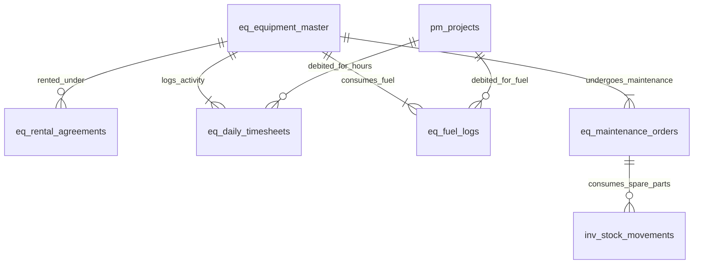

# Module 10: Plant, Machinery & Equipment Management (P&M)

## 1. Purpose
The Plant, Machinery & Equipment Management (P&M) module in MimarERP v7 delivers end-to-end operational control, financial lifecycle management, telematics integration, and maintenance governance over enterprise heavy machinery and construction fleets. The module unifies owned assets, third-party leased equipment, and operator-hired machinery. It provides precise utilization tracking, telemetry/sensor logging, fuel consumption benchmarks, scheduled preventive/meter-based servicing, rapid breakdown recovery, rental agreement extensions, and internal cost transfers to project cost codes.

---

## 2. Business Objectives
1. **Fleet Availability & Reliability**: Maximize active fleet operational uptime to $> 92\%$ via predictive and scheduled preventive maintenance (PM) routines.
2. **Precision Equipment Cost Allocation**: Realistically allocate internal plant ownership and operating costs (depreciation, operator payroll, routine maintenance, consumables) to project WBS cost codes based on daily logged operating hours.
3. **Rigorous Fuel Governance & Anti-Theft**: Enforce fuel consumption tracking against OEM baseline standards (Liters/Hour or Liters/Km), flagging theft, siphoning, and excessive idling instantly.
4. **Third-Party Rental Optimization**: Track leased and hired equipment contracts, mobilization/demobilization dates, off-hire notifications, and invoice verification to avoid idle rental charges.
5. **Regulatory & Statutory Compliance**: Maintain 100% active compliance for Saudi vehicle registrations (Istemarah), civil defense inspections, Aramco inspection stickers, third-party lifting certifications (TUV/SGS), and heavy equipment operator licenses.
6. **Total Cost of Ownership (TCO) & Asset Lifecycle**: Calculate lifetime maintenance-to-purchase ratios to identify economic replacement thresholds and asset salvage retirement points.

---

## 3. User Roles & Permissions
| Role Name | Scope / Access Level | Core Responsibilities |
| :--- | :--- | :--- |
| **P&M Director / Plant Manager** | Corporate Fleet | Fleet capital planning, equipment disposal, lease vs. buy analysis, workshop strategy, rental vendor master agreements. |
| **Fleet Maintenance Superintendent**| Regional Workshop | Preventive maintenance scheduling, overhaul management, spare parts requisitioning, breakdown dispatch. |
| **Equipment Dispatcher / Coordinator**| Enterprise / Logistics | Equipment mobilization requests, project allocations, inter-site logistics, lowbed transporter scheduling. |
| **Site Plant Engineer / Foreman** | Project Site | Daily equipment timesheets, operator verification, site breakdown logging, local maintenance clearance. |
| **Fuel Bowser Attendant / Dispenser** | Project Site | Recording daily fuel dispensing per asset, reading hour meters/odometers, fuel dip-stick checks. |
| **Equipment Operator / Driver** | Mobile App / Assigned Asset| Daily pre-start checklists, walk-around inspections, incident and fault reporting via mobile interface. |

---

## 4. Database Tables

### `eq_equipment_master`
| Column Name | Data Type | Constraints | Description |
| :--- | :--- | :--- | :--- |
| `id` | UUID | PRIMARY KEY, DEFAULT gen_random_uuid() | Unique identifier |
| `tenant_id` | UUID | NOT NULL | Multi-tenant isolation |
| `asset_code` | VARCHAR(50) | NOT NULL, UNIQUE | Asset code (e.g., CRN-500T-01, EXC-320D-04) |
| `name` | VARCHAR(255) | NOT NULL | Equipment title / model |
| `category` | VARCHAR(50) | NOT NULL | 'HEAVY_EARTHMOVING', 'LIFTING', 'TRANSPORT', 'GENERATORS', 'CONCRETE_EQUIPMENT' |
| `ownership_type` | VARCHAR(20) | NOT NULL | 'OWNED', 'RENTED', 'HIRED_WITH_OPERATOR' |
| `serial_number_vin` | VARCHAR(100) | NOT NULL, UNIQUE | Chassis VIN or Manufacturer Serial Number |
| `make` | VARCHAR(100) | NOT NULL | Manufacturer (e.g., Caterpillar, Komatsu, Liebherr) |
| `model_year` | INT | NOT NULL | Year of manufacture |
| `meter_type` | VARCHAR(20) | NOT NULL DEFAULT 'HOURS' | 'HOURS', 'KILOMETERS' |
| `current_meter_reading`| NUMERIC(12,2) | NOT NULL DEFAULT 0.00 | Latest cumulative operating meter reading |
| `standard_fuel_rate`| NUMERIC(6,2) | NOT NULL | Benchmark consumption (Liters per Hour/Km) |
| `internal_hourly_rate`| NUMERIC(10,2) | NOT NULL | Internal recharge rate to projects (SAR/Hour) |
| `current_project_id`| UUID | NULL, REFERENCES `pm_projects` | Active assigned project location |
| `status` | VARCHAR(30) | NOT NULL DEFAULT 'AVAILABLE' | 'AVAILABLE', 'OPERATIONAL', 'IDLE', 'BREAKDOWN', 'UNDER_MAINTENANCE', 'DECOMMISSIONED' |
| `purchase_date` | DATE | NULL | Acquisition date (owned) |
| `purchase_price_sar`| NUMERIC(15,2) | NULL | Original capital cost |
| `depreciation_method`| VARCHAR(20) | NOT NULL DEFAULT 'STRAIGHT_LINE' | 'STRAIGHT_LINE', 'HOURS_OF_SERVICE' |
| `salvage_value_sar` | NUMERIC(15,2) | NULL | Estimated residual value |
| `useful_life_months`| INT | NULL | Expected operating life in months |
| `aramco_sticker_valid_to`| DATE | NULL | Aramco site safety sticker expiry |
| `istemarah_valid_to`| DATE | NULL | Saudi vehicle registration expiry date |
| `insurance_valid_to`| DATE | NULL | Comprehensive machinery insurance expiry |
| `is_active` | BOOLEAN | NOT NULL DEFAULT TRUE | Operational status flag |
| `created_at` | TIMESTAMPTZ | NOT NULL DEFAULT NOW() | Timestamp |

### `eq_rental_agreements`
| Column Name | Data Type | Constraints | Description |
| :--- | :--- | :--- | :--- |
| `id` | UUID | PRIMARY KEY, DEFAULT gen_random_uuid() | Unique identifier |
| `tenant_id` | UUID | NOT NULL | Multi-tenant isolation |
| `agreement_number` | VARCHAR(50) | NOT NULL, UNIQUE | Rental agreement reference |
| `vendor_id` | UUID | NOT NULL, REFERENCES `proc_vendors` | Equipment rental supplier |
| `project_id` | UUID | NOT NULL, REFERENCES `pm_projects` | Assigned project |
| `start_date` | DATE | NOT NULL | Rental commencement date |
| `end_date` | DATE | NOT NULL | Contractual off-hire date |
| `rate_basis` | VARCHAR(20) | NOT NULL | 'MONTHLY', 'DAILY', 'HOURLY' |
| `agreed_rate_sar` | NUMERIC(15,2) | NOT NULL | Rate per unit time |
| `standard_hours_month`| INT | NOT NULL DEFAULT 240 | Threshold before overtime billing (e.g. 240h/mo) |
| `overtime_hourly_rate`| NUMERIC(10,2) | NOT NULL DEFAULT 0.00 | Rate charged per excess hour |
| `operator_included` | BOOLEAN | NOT NULL DEFAULT TRUE | If supplier provides licensed operator |
| `fuel_responsibility`| VARCHAR(20) | NOT NULL DEFAULT 'CLIENT' | 'CLIENT' (MimarERP), 'VENDOR' |
| `status` | VARCHAR(30) | NOT NULL DEFAULT 'ACTIVE' | 'ACTIVE', 'EXTENDED', 'OFF_HIRED', 'CLOSED' |

### `eq_daily_timesheets`
| Column Name | Data Type | Constraints | Description |
| :--- | :--- | :--- | :--- |
| `id` | UUID | PRIMARY KEY, DEFAULT gen_random_uuid() | Unique identifier |
| `tenant_id` | UUID | NOT NULL | Multi-tenant isolation |
| `equipment_id` | UUID | NOT NULL, REFERENCES `eq_equipment_master` | Asset reference |
| `project_id` | UUID | NOT NULL, REFERENCES `pm_projects` | Charged project |
| `cost_code_id` | UUID | NOT NULL | Project WBS cost code |
| `timesheet_date` | DATE | NOT NULL | Date of operation |
| `operator_id` | UUID | NULL, REFERENCES `hr_employees` | Operating staff member |
| `start_meter` | NUMERIC(12,2) | NOT NULL | Day start meter |
| `end_meter` | NUMERIC(12,2) | NOT NULL | Day end meter |
| `working_hours` | NUMERIC(5,2) | NOT NULL | Active productive hours |
| `idle_hours` | NUMERIC(5,2) | NOT NULL DEFAULT 0.00 | Non-productive ready hours |
| `breakdown_hours` | NUMERIC(5,2) | NOT NULL DEFAULT 0.00 | Down time on site |
| `allocated_cost_sar`| NUMERIC(12,2) | NOT NULL | Charged internal cost (Hours * Internal Rate) |
| `verified_by_pm` | BOOLEAN | NOT NULL DEFAULT FALSE | Site Manager approval flag |

### `eq_fuel_logs`
| Column Name | Data Type | Constraints | Description |
| :--- | :--- | :--- | :--- |
| `id` | UUID | PRIMARY KEY, DEFAULT gen_random_uuid() | Unique identifier |
| `tenant_id` | UUID | NOT NULL | Multi-tenant isolation |
| `equipment_id` | UUID | NOT NULL, REFERENCES `eq_equipment_master` | Asset fueled |
| `project_id` | UUID | NOT NULL, REFERENCES `pm_projects` | Consuming project |
| `dispense_date` | TIMESTAMPTZ | NOT NULL DEFAULT NOW() | Dispensing timestamp |
| `fuel_bowser_id` | UUID | NULL | Dispensing vehicle or stationary tank |
| `liters_dispensed` | NUMERIC(10,2) | NOT NULL CHECK (liters_dispensed > 0) | Quantity in liters |
| `fuel_rate_sar` | NUMERIC(6,2) | NOT NULL DEFAULT 0.75 | Diesel rate per liter |
| `total_fuel_cost` | NUMERIC(12,2) | GENERATED ALWAYS AS (liters_dispensed * fuel_rate_sar) STORED | Fuel financial cost |
| `meter_at_refuel` | NUMERIC(12,2) | NOT NULL | Meter reading at refuel point |
| `variance_vs_baseline`| NUMERIC(6,2)| NULL | Over/under baseline percentage |
| `dispensed_by` | UUID | NOT NULL, REFERENCES `sys_users` | Attendant |

### `eq_maintenance_orders`
| Column Name | Data Type | Constraints | Description |
| :--- | :--- | :--- | :--- |
| `id` | UUID | PRIMARY KEY, DEFAULT gen_random_uuid() | Unique identifier |
| `tenant_id` | UUID | NOT NULL | Multi-tenant isolation |
| `wo_number` | VARCHAR(50) | NOT NULL, UNIQUE | Work order reference |
| `equipment_id` | UUID | NOT NULL, REFERENCES `eq_equipment_master` | Equipment serviced |
| `type` | VARCHAR(30) | NOT NULL | 'PREVENTIVE_SCHEDULED', 'BREAKDOWN_CORRECTIVE', 'OVERHAUL', 'STATUTORY_INSPECTION' |
| `trigger_type` | VARCHAR(20) | NOT NULL | 'METER_INTERVAL', 'CALENDAR_INTERVAL', 'UNPLANNED_FAILURE' |
| `meter_interval` | INT | NULL | e.g., 250h, 500h, 1000h, 2000h service |
| `reported_failure` | TEXT | NULL | Symptoms or failure report |
| `cause_analysis` | TEXT | NULL | Root cause of breakdown |
| `downtime_start` | TIMESTAMPTZ | NOT NULL | Timestamp equipment went out of service |
| `downtime_end` | TIMESTAMPTZ | NULL | Timestamp repair completed and tested |
| `labor_cost_sar` | NUMERIC(12,2) | NOT NULL DEFAULT 0.00 | Workshop technician hours cost |
| `parts_cost_sar` | NUMERIC(12,2) | NOT NULL DEFAULT 0.00 | Requisitioned spare parts from Inventory |
| `total_order_cost` | NUMERIC(12,2) | GENERATED ALWAYS AS (labor_cost_sar + parts_cost_sar) STORED | Total repair cost |
| `status` | VARCHAR(30) | NOT NULL DEFAULT 'OPEN' | 'OPEN', 'IN_PROGRESS', 'WAITING_PARTS', 'COMPLETED', 'CLOSED' |

---

## 5. Entity Relationships (Mermaid)



---

## 6. Business Workflow (Equipment & Fleet Operations)

### Lifecycle Phases:
1. **Mobilization & Onboarding**:
   - Project raises Equipment Mobilization Request specifying specs (e.g. 50-Ton All Terrain Crane).
   - Dispatcher checks available internal fleet; if unavailable, issues Rental Agreement (`eq_rental_agreements`).
   - Gate inspection validates Aramco sticker, registration, and lifting certificate.
2. **Daily Operations & Telematics Utilization**:
   - Operator completes digital pre-start inspection via mobile app (fluid levels, tire pressure, hydraulics).
   - Work hours, idle hours, and breakdown hours logged on `eq_daily_timesheets`.
   - Project cost code is debited daily: $\text{Internal Cost} = \text{Operating Hours} \times \text{Internal Rate}$.
3. **Daily Fuel Dispensation & Telemetry Audit**:
   - Bowser arrives at machine; attendant enters asset code, reads meter, and dispenses diesel.
   - System checks actual consumption against OEM benchmark: $\text{Burn Rate} = \frac{\Delta \text{Fuel}}{\Delta \text{Hours}}$.
   - If burn rate exceeds benchmark by $> 15\%$, automated theft/leak alert triggers inspection.
4. **Preventive Maintenance (PM) Cycle**:
   - System monitors running meter readings; when approaching a 250h/500h/1000h threshold, an automated PM Work Order is generated.
   - Required standard service kits (filters, engine oil, hydraulic lubricants) are auto-reserved in the site warehouse.
5. **Breakdown & Corrective Recovery**:
   - Breakdown logged on site; status flips to `BREAKDOWN`.
   - Maintenance team dispatched with mobile service truck. Root cause recorded (wear & tear, operator misuse, poor lubrication).
   - Repair tested, sign-off completed, asset status restored to `AVAILABLE`.

---

## 7. UI Screens
- **EQ-01: Enterprise Fleet Radar & Telematics Dashboard**: Visual map showing live positions, operational status indicators (Green=Working, Amber=Idle, Red=Down), and fuel levels of all fleet assets.
- **EQ-02: Daily Timesheet & Activity Matrix**: Fast batch-entry grid for site plant engineers to record daily hours per machine, allocate cost codes, and capture operator signatures.
- **EQ-03: Fuel Bowser & Dispensation Terminal**: Touch-optimized interface for fuel truck operators with automatic delta calculation and anomaly warnings.
- **EQ-04: Preventive Maintenance Scheduler**: Gantt-style planning board displaying upcoming PM schedules based on projected daily meter run rates and calendar triggers.
- **EQ-05: Rental Contract & Demobilization Manager**: Contract tracking table showing active hired equipment, accumulated monthly hours, overtime warnings, and one-click off-hire notice dispatch.

---

## 8. Dashboard
- **Fleet Availability & Utilization Gauges**:
  - Fleet Utilization Rate: $\frac{\text{Actual Working Hours}}{\text{Available Calendar Hours}} \times 100$.
  - Fleet Availability Percentage: $\frac{\text{Total Fleet} - \text{Breakdown Count}}{\text{Total Fleet}} \times 100$.
  - Owned vs Rented Fleet distribution chart.
- **Cost & Fuel Risk Monitors**:
  - Total Monthly Equipment Recharge to Projects (SAR).
  - Fuel Variance Alert table listing assets with $> 15\%$ fuel consumption anomalies.
  - Statutory Expirations Widget: Vehicles with Istemarah/Aramco stickers expiring within 14 days.

---

## 9. Reports
1. **Fleet Utilization & Availability Master Report**: Hours worked, idle, and breakdown per machine with availability ratios.
2. **Equipment Operating Cost by Project Ledger**: Total internal hire charges, fuel debits, and maintenance costs debited to project cost codes.
3. **Fuel Consumption & Anomaly Audit**: Comprehensive fuel log comparing actual consumption against OEM baseline burn rates.
4. **Third-Party Rental Cost & Overtime Analysis**: Summary of rental invoices, contracted limits, and excess hour billing.
5. **Preventive Maintenance Compliance Report**: On-time PM completion percentage vs overdue service orders.
6. **Mean Time Between Failures (MTBF) & MTTR Report**: Reliability metrics categorized by equipment make, model, and age.
7. **Equipment Statutory Compliance & Sticker Expiry Register**: Upcoming expirations for Istemarah, civil defense, Aramco 3rd-party stickers, and TUV certs.
8. **Heavy Equipment Operator Log & Safety Audit**: Operator assignments, productivity hours, and recorded misuse incidents.
9. **Asset Depreciation & Salvage TCO Ledger**: Capital purchase cost, cumulative depreciation, maintenance costs to date, and Net Book Value (NBV).
10. **Demobilization & Off-Hire Variance Log**: Discrepancies between planned project release dates and actual site demobilization.

---

## 10. Key Performance Indicators (KPIs)
| KPI Code | KPI Name | Formula | Target | Red (Critical) | Amber (Warning) | Green (Healthy) |
| :--- | :--- | :--- | :--- | :--- | :--- | :--- |
| **KPI-EQ-01** | Fleet Availability | $(\text{Total Available Fleet Hours} / \text{Calendar Hours}) \times 100$ | $\ge 92\%$ | $< 85\%$ | $85\% - 91.9\%$ | $\ge 92\%$ |
| **KPI-EQ-02** | Fleet Utilization | $(\text{Actual Working Hours} / \text{Available Hours}) \times 100$ | $\ge 75\%$ | $< 60\%$ | $60\% - 74.9\%$ | $\ge 75\%$ |
| **KPI-EQ-03** | Mean Time to Repair (MTTR)| $\sum (\text{Downtime End} - \text{Downtime Start}) / N_{\text{repairs}}$ | $\le 6\text{ hrs}$| $> 18\text{ hrs}$| $6.1 - 18\text{ hrs}$ | $\le 6\text{ hrs}$ |
| **KPI-EQ-04** | PM On-Time Adherence | $(\text{PMs Completed Within } \pm 25\text{ hrs} / \text{Scheduled PMs}) \times 100$ | $\ge 95\%$ | $< 80\%$ | $80\% - 94.9\%$ | $\ge 95\%$ |
| **KPI-EQ-05** | Fuel Anomaly Rate | $(\text{Abnormal Refueling Events} / \text{Total Refueling Events}) \times 100$ | $\le 2.0\%$ | $> 5.0\%$ | $2.1\% - 5.0\%$ | $\le 2.0\%$ |

---

## 11. API Endpoints
- `GET /api/v1/equipment`: List all fleet assets with filters for status, category, ownership, and project.
- `GET /api/v1/equipment/{id}/telematics`: Retrieve live GPS location, engine hours, and sensor alerts.
- `POST /api/v1/equipment/timesheets`: Submit daily working/idle hours timesheet for cost allocation.
- `POST /api/v1/equipment/fuel`: Record fuel dispensation event with validation against meter readings.
- `POST /api/v1/equipment/maintenance-orders`: Create preventive or corrective work order.
- `PUT /api/v1/equipment/maintenance-orders/{id}/complete`: Log completion details, labor hours, and release asset.
- `POST /api/v1/equipment/rental-agreements`: Create or extend equipment rental agreement with vendor.
- `GET /api/v1/equipment/compliance/expirations`: Fetch assets with expiring Aramco/Istemarah documents within $N$ days.

---

## 12. Required Permissions
- `eq:master:manage`: Register new equipment, configure internal rates and depreciation parameters.
- `eq:timesheet:record`: Site plant engineer permission to log daily timesheets and operator assignments.
- `eq:timesheet:approve`: Project Manager sign-off on equipment cost allocation to project accounts.
- `eq:fuel:dispense`: Record diesel issues from fuel bowser.
- `eq:maintenance:create`: Open breakdown and service work orders.
- `eq:maintenance:close`: Workshop supervisor authorization to certify repair and clear equipment for work.
- `eq:rental:manage`: Execute rental agreements, negotiate rates, and trigger off-hire notices.

---

## 13. Approval Workflows & SLA Matrix
```
[Breakdown Reported on Site]
       │
       ▼
[Workshop Supervisor Review] (SLA: 1 hr) ── Assign Mechanics & Request Parts
       │
       ▼
[Parts Requisition from Store] (SLA: 2 hrs)
       │
       ▼
[Repair Execution & Safety Test] ── PASSED
       │
       ▼
[Site Plant Engineer Handover] (SLA: 2 hrs) ── Status Restored to OPERATIONAL
```

---

## 14. AI Features
1. **Predictive Failure & Sensor Diagnostics**: Machine learning model ingesting CAN-bus telematics (oil pressure, coolant temperature, hydraulic vibration) to forecast transmission or turbocharger failure 50 hours in advance.
2. **Fleet Rebalancing & Sourcing Optimization**: Prescriptive AI evaluating project schedule forecasts across the Kingdom to calculate whether to mobilize owned machines between regions or rent locally, factoring in lowbed transport costs.
3. **Computer Vision Pre-Start Audits**: Mobile camera AI scans tires, hydraulic cylinders, and safety pins during daily pre-start walk-around, flagging leaks and structural cracks automatically.

---

## 15. Automations
1. **Auto-Triggered Meter Service Orders**: When daily timesheet updates `current_meter_reading` past a service threshold, system automatically generates a PM Work Order and locks in required parts.
2. **Automated Demobilization Notice**: Rented assets nearing their contractual end date trigger automated 7-day and 3-day notifications to the PM to confirm off-hire or extend agreement.
3. **General Ledger Hourly Cost Posting**: Nightly cron aggregates approved daily timesheets and posts automated journal vouchers debiting Project WIP (Cost Code) and crediting Plant & Equipment Cost Center.

---

## 16. Integration Requirements
- **Cost Control & General Ledger**: Direct automated journal entries for internal plant recharge and fuel expenses.
- **Inventory & Spare Parts**: Direct reservation and deduction of filters, lubricants, and spare parts via `inv_stock_movements`.
- **Project Scheduling (Primavera P6)**: Syncs machine allocations with schedule critical path activities to ensure heavy lifting assets are on site on schedule.
- **Telematics Providers**: Direct API integration with OEM telematics platforms (Caterpillar VisionLink, Komatsu KOMTRAX, Trimble).
