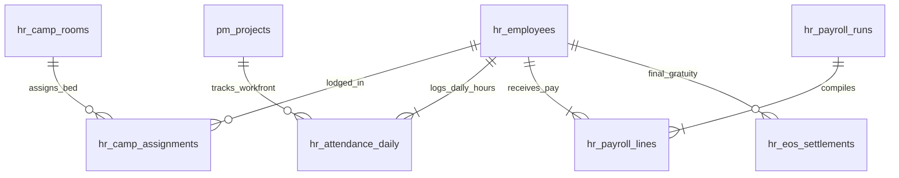

# Module 11: Human Resources, Camp Management & Payroll (HRMS)

## 1. Purpose
The Human Resources, Camp Management & Payroll module of MimarERP v7 is an enterprise-grade workforce management platform engineered specifically for the construction and contracting industry in the Kingdom of Saudi Arabia. It unifies corporate personnel, project site labor forces, camp accommodations, daily timekeeping, statutory compliance, and payroll computation. The module fully embeds the Saudi Labor Law, GOSI statutory contributions, Wage Protection System (WPS / Mudad), Nitaqat Saudization quotas, Qiwa contract digital alignment, Muqeem Iqama/visa tracking, and Article 84/85 End-of-Service (EOS) gratuity calculations.

---

## 2. Business Objectives
1. **100% Saudi Labor Law & Regulatory Compliance**: Enforce statutory requirements across working hours (8 hrs/day, 48 hrs/week, reduced to 6 hrs/36 hrs during Ramadan), overtime rates (1.5x basic + allowances), and statutory annual leaves (21 days for <5 years service, increasing to 30 days after 5 continuous years).
2. **Automated WPS & GOSI Governance**: Generate compliant Wage Protection System (WPS) sif-files for Mudad / central banking channels and compute accurate GOSI deductions (Saudi nationals: 9% employee + 9% employer annuity, plus 2% employer occupational hazard for all nationalities).
3. **Multi-Nationality Workforce & Iqama Security**: Protect enterprise legal standing by preventing document expirations for Iqamas, Saudi Council of Engineers (SCE) memberships, medical insurances, and exit re-entry visas across multinational workforces (Saudi, Egyptian, Pakistani, Indian, Filipino, etc.).
4. **Labor Camp & Facility Optimization**: Track camp room assignments, bed space occupancy, utility consumption, catering allocations, and camp maintenance across remote site compounds.
5. **Real-Time Project Biometric Timekeeping**: Capture site attendance via ruggedized facial recognition/biometric terminals and GPS-geofenced mobile check-ins, seamlessly debiting labor hours to project WBS cost codes.
6. **Compliant End-of-Service (EOS) & Disciplinary Handling**: Automate statutory severance indemnity calculations based on separation type (resignation vs. termination under Article 84/85) and formalize disciplinary actions strictly aligned with Saudi Labor Law Article 66.

---

## 3. User Roles & Permissions
| Role Name | Scope / Access Level | Core Responsibilities |
| :--- | :--- | :--- |
| **HR Director / VP Human Capital**| Enterprise-wide | HR policies, executive hiring, Saudization/Nitaqat strategy, final payroll release, EOS final settlements. |
| **Payroll Manager** | Enterprise-wide | Monthly payroll run execution, bank WPS sif file generation, GOSI reporting, deduction verification. |
| **Government Relations Officer (GRO / Muqeem Admin)** | Corporate / Regional | Iqama renewals, Qiwa contract authentication, Ajeer permits, visas, labor office disputes. |
| **Project Site Timekeeper** | Project Site | Biometric logs review, manual attendance overrides, daily site muster roll reconciliation, shift assignments. |
| **Camp Boss / Accommodation Supervisor**| Site Camp | Bed allocation, room occupancy audits, meal distribution rosters, camp asset management, disciplinary incident logging. |
| **Employee / Site Worker** | Mobile Self-Service (ESS)| Punching attendance via mobile geofence, viewing payslips, requesting leaves, tracking Iqama validity, raising grievances. |

---

## 4. Database Tables

### `hr_employees`
| Column Name | Data Type | Constraints | Description |
| :--- | :--- | :--- | :--- |
| `id` | UUID | PRIMARY KEY, DEFAULT gen_random_uuid() | Unique employee identifier |
| `tenant_id` | UUID | NOT NULL | Multi-tenant isolation |
| `employee_number` | VARCHAR(50) | NOT NULL, UNIQUE | Staff badge number |
| `name_en` | VARCHAR(255) | NOT NULL | Full name in English |
| `name_ar` | VARCHAR(255) | NOT NULL | Full name in Arabic (as per National ID/Iqama) |
| `nationality_code` | VARCHAR(3) | NOT NULL | ISO country code (SAU, EGY, PAK, IND, etc.) |
| `national_id_iqama` | VARCHAR(20) | NOT NULL, UNIQUE | 10-digit Saudi National ID or Iqama number |
| `iqama_expiry_hijri`| VARCHAR(10) | NULL | Hijri expiration date |
| `iqama_expiry_greg` | DATE | NOT NULL | Gregorian expiration date |
| `passport_number` | VARCHAR(50) | NULL | Passport number |
| `passport_expiry` | DATE | NULL | Passport expiry date |
| `sce_accreditation_no`| VARCHAR(50) | NULL | Saudi Council of Engineers membership no. |
| `sce_expiry_date` | DATE | NULL | SCE validity date |
| `employment_type` | VARCHAR(30) | NOT NULL | 'DIRECT_HIRE', 'SUBCONTRACT_AJEER', 'HEAD_OFFICE_STAFF' |
| `job_title_en` | VARCHAR(100) | NOT NULL | Designation |
| `job_title_ar` | VARCHAR(100) | NOT NULL | Official Qiwa/MOL designation |
| `department_id` | UUID | NOT NULL | Department reference |
| `current_project_id`| UUID | NULL, REFERENCES `pm_projects` | Active assigned site project |
| `hire_date` | DATE | NOT NULL | Date joined company |
| `probation_end_date`| DATE | NOT NULL | 90 or 180-day probation end date |
| `contract_type` | VARCHAR(20) | NOT NULL DEFAULT 'SPECIFIED_TERM' | 'SPECIFIED_TERM', 'UNSPECIFIED_TERM' |
| `contract_end_date` | DATE | NULL | Expiry date of fixed contract |
| `basic_salary_sar` | NUMERIC(12,2) | NOT NULL | Basic monthly pay |
| `housing_allowance` | NUMERIC(12,2) | NOT NULL DEFAULT 0.00 | Housing allowance (cash or provided) |
| `transport_allowance`| NUMERIC(12,2)| NOT NULL DEFAULT 0.00 | Transport allowance |
| `food_allowance` | NUMERIC(12,2) | NOT NULL DEFAULT 0.00 | Food stipend |
| `site_allowance` | NUMERIC(12,2) | NOT NULL DEFAULT 0.00 | Project hardship/remote allowance |
| `gosi_eligible` | BOOLEAN | NOT NULL DEFAULT FALSE | True for Saudi nationals (annuity) |
| `bank_iban` | VARCHAR(34) | NOT NULL | Saudi IBAN for WPS compliance |
| `bank_code` | VARCHAR(10) | NOT NULL | Saudi local bank identifier (e.g. RJHI, NCBK) |
| `camp_room_id` | UUID | NULL | Assigned bed in labor camp |
| `status` | VARCHAR(30) | NOT NULL DEFAULT 'ACTIVE' | 'ACTIVE', 'ON_LEAVE', 'SUSPENDED', 'TERMINATED', 'RESIGNED' |
| `created_at` | TIMESTAMPTZ | NOT NULL DEFAULT NOW() | Timestamp |

### `hr_camp_rooms`
| Column Name | Data Type | Constraints | Description |
| :--- | :--- | :--- | :--- |
| `id` | UUID | PRIMARY KEY, DEFAULT gen_random_uuid() | Unique identifier |
| `tenant_id` | UUID | NOT NULL | Multi-tenant isolation |
| `camp_name` | VARCHAR(100) | NOT NULL | e.g. "Al-Kharj Central Camp", "Neom Site Camp B" |
| `block_building` | VARCHAR(50) | NOT NULL | Building block designation |
| `room_number` | VARCHAR(20) | NOT NULL | Room number |
| `capacity_beds` | INT | NOT NULL CHECK (capacity_beds > 0) | Total bed spaces |
| `current_occupancy`| INT | NOT NULL DEFAULT 0 | Currently assigned workers |
| `air_conditioned` | BOOLEAN | NOT NULL DEFAULT TRUE | Saudi labor welfare requirement |
| `status` | VARCHAR(20) | NOT NULL DEFAULT 'AVAILABLE' | 'AVAILABLE', 'FULL', 'MAINTENANCE' |

### `hr_camp_assignments`
| Column Name | Data Type | Constraints | Description |
| :--- | :--- | :--- | :--- |
| `id` | UUID | PRIMARY KEY, DEFAULT gen_random_uuid() | Unique identifier |
| `tenant_id` | UUID | NOT NULL | Multi-tenant isolation |
| `employee_id` | UUID | NOT NULL, REFERENCES `hr_employees` | Resident worker |
| `room_id` | UUID | NOT NULL, REFERENCES `hr_camp_rooms` | Assigned room |
| `bed_number` | VARCHAR(10) | NOT NULL | Assigned bed identifier |
| `check_in_date` | DATE | NOT NULL | Occupancy start date |
| `check_out_date` | DATE | NULL | Departure date |
| `deduct_housing_allowance`| BOOLEAN | NOT NULL DEFAULT TRUE | Whether housing allowance is withheld for camp |

### `hr_attendance_daily`
| Column Name | Data Type | Constraints | Description |
| :--- | :--- | :--- | :--- |
| `id` | UUID | PRIMARY KEY, DEFAULT gen_random_uuid() | Unique identifier |
| `tenant_id` | UUID | NOT NULL | Multi-tenant isolation |
| `employee_id` | UUID | NOT NULL, REFERENCES `hr_employees` | Worker reference |
| `project_id` | UUID | NOT NULL, REFERENCES `pm_projects` | Site attended |
| `cost_code_id` | UUID | NOT NULL | Project WBS cost code debited |
| `work_date` | DATE | NOT NULL | Attendance date |
| `check_in_time` | TIMESTAMPTZ | NULL | First biometric timestamp |
| `check_out_time` | TIMESTAMPTZ | NULL | Last biometric timestamp |
| `regular_hours` | NUMERIC(4,2) | NOT NULL DEFAULT 8.00 | Normal working hours |
| `overtime_hours` | NUMERIC(4,2) | NOT NULL DEFAULT 0.00 | Overtime hours (charged at 1.5x) |
| `attendance_status`| VARCHAR(20) | NOT NULL DEFAULT 'PRESENT' | 'PRESENT', 'ABSENT', 'REST_DAY', 'PUBLIC_HOLIDAY', 'SICK_LEAVE', 'ANNUAL_LEAVE' |
| `is_ramadan_timing`| BOOLEAN | NOT NULL DEFAULT FALSE | Whether 6-hr Ramadan cap applies |
| `biometric_device_id`| VARCHAR(50)| NULL | Hardware terminal reference |
| `manual_override_by`| UUID | NULL, REFERENCES `sys_users` | Supervisor who adjusted record |

### `hr_payroll_runs`
| Column Name | Data Type | Constraints | Description |
| :--- | :--- | :--- | :--- |
| `id` | UUID | PRIMARY KEY, DEFAULT gen_random_uuid() | Unique identifier |
| `tenant_id` | UUID | NOT NULL | Multi-tenant isolation |
| `payroll_month` | INT | NOT NULL CHECK (payroll_month BETWEEN 1 AND 12) | Payroll cycle month |
| `payroll_year` | INT | NOT NULL | Payroll cycle year |
| `period_start_date`| DATE | NOT NULL | Start date |
| `period_end_date` | DATE | NOT NULL | End date |
| `total_gross_sar` | NUMERIC(15,2) | NOT NULL DEFAULT 0.00 | Total gross compensation |
| `total_deductions_sar`| NUMERIC(15,2)| NOT NULL DEFAULT 0.00 | Total GOSI, loans, disciplinary deductions |
| `total_net_sar` | NUMERIC(15,2) | NOT NULL DEFAULT 0.00 | Net payable to employees |
| `wps_file_generated`| BOOLEAN | NOT NULL DEFAULT FALSE | Mudad/WPS sif file created |
| `wps_file_hash` | VARCHAR(128) | NULL | Cryptographic SHA-256 hash of bank file |
| `status` | VARCHAR(30) | NOT NULL DEFAULT 'DRAFT' | 'DRAFT', 'CALCULATED', 'AUDITED', 'APPROVED', 'DISBURSED' |

### `hr_payroll_lines`
| Column Name | Data Type | Constraints | Description |
| :--- | :--- | :--- | :--- |
| `id` | UUID | PRIMARY KEY, DEFAULT gen_random_uuid() | Unique identifier |
| `tenant_id` | UUID | NOT NULL | Multi-tenant isolation |
| `payroll_run_id` | UUID | NOT NULL, REFERENCES `hr_payroll_runs` | Payroll run reference |
| `employee_id` | UUID | NOT NULL, REFERENCES `hr_employees` | Worker reference |
| `basic_earned` | NUMERIC(12,2) | NOT NULL | Prorated basic pay |
| `housing_allowance` | NUMERIC(12,2) | NOT NULL DEFAULT 0.00 | Housing benefit |
| `transport_allowance`| NUMERIC(12,2)| NOT NULL DEFAULT 0.00 | Transport benefit |
| `other_allowances` | NUMERIC(12,2) | NOT NULL DEFAULT 0.00 | Project/food/special allowances |
| `overtime_pay` | NUMERIC(12,2) | NOT NULL DEFAULT 0.00 | Hours * 1.5 * Hourly Rate |
| `gosi_employee_deduction`| NUMERIC(12,2)| NOT NULL DEFAULT 0.00 | 9% basic+housing for Saudis |
| `gosi_employer_cost`| NUMERIC(12,2)| NOT NULL DEFAULT 0.00 | 9% annuity + 2% hazard |
| `disciplinary_deductions`| NUMERIC(12,2)| NOT NULL DEFAULT 0.00 | Penalties under Labor Law Art. 66 |
| `loan_installments` | NUMERIC(12,2) | NOT NULL DEFAULT 0.00 | Company advance deductions |
| `net_salary` | NUMERIC(12,2) | NOT NULL | Take-home pay |

### `hr_eos_settlements` (End of Service)
| Column Name | Data Type | Constraints | Description |
| :--- | :--- | :--- | :--- |
| `id` | UUID | PRIMARY KEY, DEFAULT gen_random_uuid() | Unique identifier |
| `tenant_id` | UUID | NOT NULL | Multi-tenant isolation |
| `employee_id` | UUID | NOT NULL, REFERENCES `hr_employees` | Terminated/resigned staff |
| `termination_date` | DATE | NOT NULL | Last working day |
| `service_years` | NUMERIC(5,2) | NOT NULL | Total tenure calculated |
| `separation_reason`| VARCHAR(30) | NOT NULL | 'CONTRACT_COMPLETION', 'EMPLOYER_TERMINATION', 'RESIGNATION', 'ARTICLE_80_DISMISSAL' |
| `last_drawn_salary`| NUMERIC(12,2) | NOT NULL | Base for gratuity (Basic + Housing) |
| `gratuity_amount` | NUMERIC(12,2) | NOT NULL | Computed Saudi Article 84/85 indemnity |
| `leave_balance_pay`| NUMERIC(12,2) | NOT NULL DEFAULT 0.00 | Encashment of accrued unutilized annual leave |
| `deductions_due` | NUMERIC(12,2) | NOT NULL DEFAULT 0.00 | Outstanding loans or asset recoveries |
| `final_settlement_net`| NUMERIC(12,2)| NOT NULL | Net clearance amount |
| `status` | VARCHAR(30) | NOT NULL DEFAULT 'DRAFT' | 'DRAFT', 'AUDITED', 'APPROVED', 'SETTLED' |

---

## 5. Entity Relationships (Mermaid)



---

## 6. Business Workflow (Workforce & Payroll Cycle)

### Step-by-Step Payroll & Timekeeping Cycle:
1. **Daily Biometric Attendance & Cost Allocation**:
   - Site workers punch at biometric facial scanners located at turnstiles.
   - System validates daily hours against the 8-hour cap (6 hours during holy month of Ramadan).
   - Overtime hours are tracked automatically ($1.5 \times \text{hourly rate}$).
   - System posts labor hours directly to project WBS cost codes.
2. **Monthly Payroll Run Initialization**:
   - On the 24th of each month, Payroll Manager triggers `hr_payroll_runs`.
   - Engine aggregates regular hours, approved overtime, unexcused absences, and approved annual leaves.
   - If worker resides in corporate camp and `deduct_housing_allowance` is true, cash housing is neutralized.
3. **Statutory GOSI & Saudi Labor Law Deductions**:
   - For Saudi Nationals: System computes 9% employee annuity deduction and 9% employer contribution (based on Basic + Housing capped at SAR 45,000). Adds 2% employer occupational hazard.
   - For Expatriate Staff: Computes 2% employer occupational hazard; employee deduction is zero.
   - Disciplinary deductions are capped strictly per Article 66 (max 5 days pay per incident, max 5 days total deduction per single month).
4. **WPS / Mudad Sif File Generation**:
   - System runs pre-validation for missing IBANs, negative net salaries, or salary variances $> 20\%$ compared to previous month.
   - Produces official WPS `.sif` file formatted per Saudi Central Bank (SAMA) standards.
   - CFO authorizes batch; file uploaded to Mudad / corporate bank portal.
5. **End-of-Service (EOS) Gratuity Computation**:
   - When employment terminates, system computes service duration per Article 84:
     - First 5 years: Half-month salary per year.
     - Beyond 5 years: One full month salary per year.
   - If Resignation (Article 85 applied):
     - Service $< 2\text{ years}$: 0% gratuity.
     - Service $2 - 5\text{ years}$: $1/3$ of statutory gratuity.
     - Service $5 - 10\text{ years}$: $2/3$ of statutory gratuity.
     - Service $> 10\text{ years}$: $100\%$ full gratuity.
   - Unused leave encashed at last drawn wage. Final clearance signed.

---

## 7. UI Screens
- **HR-01: Employee 360 & National Profile**: Master record display with Saudi ID/Iqama cards, SCE registration badge, Qiwa contract status, active project assignment, and dependent records.
- **HR-02: Site Biometric Muster & Timekeeping Console**: Real-time project workfront grid showing daily punches, facial recognition logs, manual exceptions, and overtime approval queue.
- **HR-03: Camp Allocation & Bed Space Manager**: Interactive graphical visualizer of camp blocks, showing room occupancy color-coded (Green=Vacant Bed, Amber=Single Vacant, Red=Full), and camp asset inventory.
- **HR-04: Monthly Payroll Processing & WPS Hub**: Step-by-step wizard for payroll calculation, salary variance analysis, GOSI breakdown, WPS sif generator, and bank approval audit trail.
- **HR-05: Saudi Labor Law Gratuity & EOS Calculator**: Interactive calculator displaying exact tenure breakdown, Article 84/85 selection rules, accrued leave payout, company asset clearance, and settlement voucher.

---

## 8. Dashboard
- **Executive Human Capital & Saudization Overview**:
  - Live Nitaqat Saudization Tier gauge (Platinum, High Green, Mid Green, Low Green, Red).
  - Total Monthly Labor Payroll (SAR) split into Direct Project Labor vs Overhead Staff.
  - Active site workforce headcount by nationality and project location.
  - Average overtime hours per site worker.
- **Statutory Risk & Expiry Alert Center**:
  - Iqamas expiring within 30, 60, and 90 days.
  - Expiring Saudi Council of Engineers (SCE) accreditations.
  - Expiring commercial driver / heavy operator licenses.
  - Camp bed capacity utilization rate.

---

## 9. Reports
1. **WPS Bank Disbursement & Mudad Compliance SIF Audit**: Official payroll register matched with SAMA/Mudad bank response codes.
2. **GOSI Monthly Contribution Reconciliation**: Detailed breakdown of employee/employer shares for Saudi and non-Saudi workers.
3. **Nitaqat Saudization Compliance Tracker**: Daily calculated Saudi-to-Expat ratios and Nitaqat color status.
4. **Iqama, Visa & Statutory Document Expiry Register**: Chronological schedule of expiring Iqamas, passports, and work permits.
5. **Labor Camp Room & Bed Occupancy Audit**: Occupancy levels, vacant bed counts, and accommodation cost per worker.
6. **Project Direct Labor Cost Allocation by Cost Code**: Detailed hours and loaded payroll expenses charged to project WBS items.
7. **Overtime Variance & Labor Welfare Report**: Hours worked beyond standard 48 hours to ensure compliance with Saudi working hour limits.
8. **End-of-Service Gratuity Liability Reserve Ledger**: Actuarial/accrued EOS liabilities across the enterprise.
9. **Disciplinary & Grievance Actions Register**: Formal record of warnings, investigation hearings, and deductions under Article 66.
10. **Ajeer Temporary Work Permit Tracker**: Compliance report for subcontracted and seconded labor deployed on site.

---

## 10. Key Performance Indicators (KPIs)
| KPI Code | KPI Name | Formula | Target | Red (Critical) | Amber (Warning) | Green (Healthy) |
| :--- | :--- | :--- | :--- | :--- | :--- | :--- |
| **KPI-HR-01** | Saudization (Nitaqat) | $(\text{Weighted Saudi Employees} / \text{Total Equivalent Workforce}) \times 100$ | $\ge \text{High Green}$ | Red / Low Green | Mid Green | Platinum / High Green |
| **KPI-HR-02** | WPS Compliance Rate | $(\text{Salaries Disbursed on Time via WPS} / \text{Total Active Employees}) \times 100$ | $100\%$ | $< 90\%$ | $90\% - 99.9\%$ | $100\%$ |
| **KPI-HR-03** | Iqama Renewal Delay Rate| $(\text{Expired Iqamas Past Due} / \text{Total Expat Staff}) \times 100$ | $0\%$ | $> 0.5\%$ | $0.1\% - 0.5\%$ | $0\%$ |
| **KPI-HR-04** | Payroll Processing Time | $\text{Days from Period End to Bank SIF Release}$ | $\le 3\text{ days}$ | $> 5\text{ days}$ | $4 - 5\text{ days}$ | $\le 3\text{ days}$ |
| **KPI-HR-05** | Camp Bed Utilization | $(\text{Occupied Beds} / \text{Total Camp Bed Capacity}) \times 100$ | $85\% - 92\%$ | $> 98\%\text{ (Overcrowded)}$ | $< 70\%\text{ or } 93\%-97\%$| $85\% - 92\%$ |

---

## 11. API Endpoints
- `GET /api/v1/hr/employees`: Search workforce directory with filters for project, nationality, trade, and status.
- `POST /api/v1/hr/attendance/biometric-push`: Ingestion webhook for on-site facial recognition / biometric terminals.
- `POST /api/v1/hr/payroll/calculate`: Run payroll engine for specified month and project scope.
- `GET /api/v1/hr/payroll/{id}/wps-sif`: Download authenticated SAMA/Mudad compliant WPS text file.
- `POST /api/v1/hr/camp/assign-bed`: Assign worker to camp room bed space with housing allowance adjustment.
- `POST /api/v1/hr/eos/calculate`: Compute Article 84/85 EOS gratuity and generate clearance form.
- `GET /api/v1/hr/compliance/nitaqat`: Retrieve current Saudization points and Nitaqat band status.
- `GET /api/v1/hr/compliance/expirations`: Fetch workers with Iqamas or visas expiring within $N$ days.

---

## 12. Required Permissions
- `hr:employee:manage`: Create and update personal, financial, and contractual records.
- `hr:attendance:override`: Timekeeper permission to manually adjust missing biometric punches.
- `hr:payroll:execute`: Run monthly payroll calculations and review salary lines.
- `hr:payroll:release_wps`: Executive permission to sign off and download bank WPS payment files.
- `hr:camp:manage`: Allocate beds, transfer workers between camps, and inspect facilities.
- `hr:eos:approve`: HR Director sign-off for end-of-service final settlement checks.
- `hr:gro:manage`: Update Iqama, Qiwa, Muqeem, and government portal renewals.

---

## 13. Approval Workflows & SLA Matrix
```
[Timekeeper Finalizes Monthly Site Timesheet] (23rd of Month)
       │
       ▼
[Project Manager Verification] (SLA: 24 hrs) ── Approve Site Hours & Overtime
       │
       ▼
[Payroll Engine Calculates Gross to Net & GOSI] (25th of Month)
       │
       ▼
[Internal Financial Auditor Review] (SLA: 24 hrs) ── Check Variances & WPS Format
       │
       ▼
[HR Director Approval] (SLA: 12 hrs)
       │
       ▼
[CFO / Managing Director Sign-off] (SLA: 12 hrs) ── WPS SIF Released to Bank
```

---

## 14. AI Features
1. **Saudization Predictor & Nitaqat Scenario Simulator**: Prescriptive AI model that simulates future hiring, resignations, and project demobilizations to forecast Nitaqat band shifts 6 months in advance, recommending exact Saudi hiring quotas.
2. **Biometric Anomaly & "Buddy-Punching" Detection**: Visual AI analyzing face-match confidence scores and consecutive rapid punches across biometric terminals to flag ghost workers and fraudulent attendance entries.
3. **Turnover & Labor Attrition Forecaster**: Machine learning model analyzing site conditions, overtime intensity, camp satisfaction, and delayed wage queries to identify flight-risk talent and trades before contract expiration.

---

## 15. Automations
1. **Automated Iqama & Document Renewal Alerts**: 90, 60, 30, and 15-day automated task triggers dispatched to the Government Relations Office (GRO) in Muqeem / Qiwa queue.
2. **Automatic Daily Cost Code Labor Allocation**: Midnight scheduled job calculates hourly wage rates (Basic + Allowances / 240 hrs) and debits project WIP cost codes for every verified biometric hour.
3. **WPS Variance Auto-Validator**: Automatically halts payroll release if any employee's salary differs by $> 20\%$ without an attached approved overtime sheet or disciplinary order, ensuring zero WPS non-compliance fines.

---

## 16. Integration Requirements
- **Project Management & Cost Control**: Instant debiting of daily labor costs against project WBS cost codes.
- **Biometric Hardware Vendors**: Native SDK/Webhook connectivity with ZKTeco, Suprema, and Hikvision site facial recognition turnstiles.
- **Saudi Government Platforms (Qiwa, Muqeem, Mudad, GOSI)**: API and standard data-interchange formats for employee contracts, visa status, WPS wage files, and GOSI monthly declarations.
- **Finance & General Ledger**: Automatic payroll journal voucher posting (Debit: Labor Expense / WIP, Credit: Accrued Salaries, GOSI Payable, Withholding Deductions).
