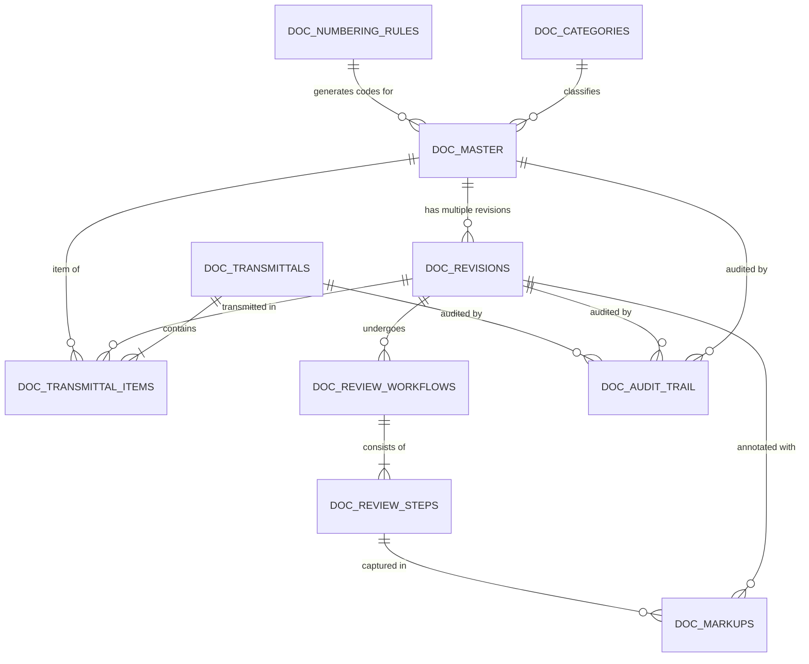
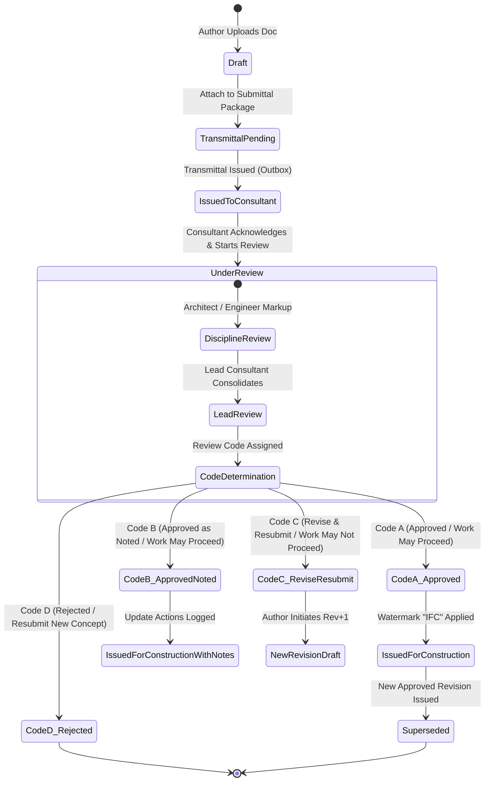

# Module 12: Document Control & Common Data Environment (CDE)

## 1. Purpose
The **Document Control & CDE Module** in MimarERP v7 is an enterprise-grade electronic document management system engineered specifically for mega-construction projects and capital programs. Designed to match and exceed the capabilities of platforms like Oracle Aconex, Autodesk Construction Cloud, and Procore, this module enforces rigorous ISO 19650 metadata standards, strict revision governance, secure multi-organization transmittals, contractual review workflows (Codes A, B, C, D), and an immutable forensic audit trail. It functions as the single source of truth for all contractual, technical, commercial, and operational documentation across the project lifecycle.

---

## 2. Business Objectives
- **Standardized Numbering & Classification:** Eliminate document chaos by enforcing customizable, project-specific naming conventions compliant with ISO 19650 and client codification structures.
- **Flawless Version Control & Superseding:** Ensure site and office personnel always access the latest approved revisions, eliminating rework caused by working off superseded drawings.
- **Contractual Transmittal Integrity:** Provide legally defensible, verifiable transmission of documents between Client, Consultant, Main Contractor, and Subcontractors with proof of delivery and acknowledgment.
- **Streamlined Review & Approval Cycles:** Accelerate formal document reviews with predefined workflows, parallel and sequential review stages, electronic markup annotations, and SLA tracking.
- **Forensic Auditability & Compliance:** Maintain an unalterable log of every view, download, revision, markup, and distribution to support dispute avoidance and claim substantiation.
- **Zero Data Loss & High Security:** Enforce multi-tier role-based and document-level security with digital watermarking, role-scoped confidentiality, and tamper-evident storage.

---

## 3. User Roles & Permissions

| Role Name | Scope & Responsibilities | Key Capabilities |
|---|---|---|
| **Lead Document Controller (LDC)** | Project / Organization Level | Full administrative control over document registers, numbering schemas, taxonomy, workflow templates, distribution matrices, and bulk metadata updates. |
| **Project Document Controller (PDC)** | Project Level | Day-to-day registration, transmittal issuance, distribution, expediting overdue reviews, maintaining logs, and issuing document release packages. |
| **Package / Subcontract Document Controller** | Subcontractor / Package Level | Submission of submittals, receiving transmittals, viewing package-specific documents, uploading vendor data packages. |
| **Technical Reviewer / Engineer** | Technical Team | Viewing assigned documents, adding online markups/comments, selecting review disposition (Code A/B/C/D), signing off review steps. |
| **Lead Consultant / Engineer of Record** | Supervising Consultant | Final endorsement of technical and contractual submissions, issuing formal Consultant Review Transmittals (CRT). |
| **Project Manager / Commercial Manager** | Executive / Commercial | Approval of contractual letters, claims documents, variation transmittals, high-level audit view. |
| **Site Engineer / Inspector (Field View)** | Site Operations | Read-only access to "Approved for Construction" (IFC / Code A) drawings and specifications via mobile or web viewer. |
| **Auditor / Claims Specialist** | Forensic / Quality Audit | Read-only access to historical versions, superseded revisions, audit logs, and transmission timelines. |

---

## 4. Database Tables (Complete Schemas with Types)

```sql
-- 1. Document Categories & Taxonomies
CREATE TABLE doc_categories (
    category_id UUID PRIMARY KEY DEFAULT gen_random_uuid(),
    tenant_id UUID NOT NULL,
    category_code VARCHAR(30) NOT NULL,
    category_name_en VARCHAR(150) NOT NULL,
    category_name_ar VARCHAR(150),
    parent_category_id UUID REFERENCES doc_categories(category_id),
    iso_classification_code VARCHAR(50), -- ISO 12068 / Uniclass 2015
    retention_period_months INT DEFAULT 120,
    is_confidential BOOLEAN DEFAULT FALSE,
    created_at TIMESTAMPTZ DEFAULT CURRENT_TIMESTAMP,
    created_by UUID NOT NULL,
    CONSTRAINT uq_tenant_cat_code UNIQUE (tenant_id, category_code)
);

-- 2. Document Numbering Templates (ISO 19650 compliant segment builder)
CREATE TABLE doc_numbering_rules (
    rule_id UUID PRIMARY KEY DEFAULT gen_random_uuid(),
    tenant_id UUID NOT NULL,
    project_id UUID NOT NULL,
    rule_name VARCHAR(100) NOT NULL,
    delimiter CHAR(1) DEFAULT '-',
    -- JSON structure defining segments: [Project, Originator, Zone, Level, Type, Role, Number]
    segments_config JSONB NOT NULL,
    current_sequence INT DEFAULT 0,
    is_active BOOLEAN DEFAULT TRUE,
    created_at TIMESTAMPTZ DEFAULT CURRENT_TIMESTAMP
);

-- 3. Master Document Register (MDR)
CREATE TABLE doc_master (
    document_id UUID PRIMARY KEY DEFAULT gen_random_uuid(),
    tenant_id UUID NOT NULL,
    project_id UUID NOT NULL,
    document_number VARCHAR(100) NOT NULL,
    title VARCHAR(300) NOT NULL,
    title_ar VARCHAR(300),
    category_id UUID REFERENCES doc_categories(category_id),
    discipline VARCHAR(50) NOT NULL, -- ARC, STR, MEP, CIV, PM, COM
    originator_org_id UUID NOT NULL,
    recipient_org_id UUID,
    wbs_id UUID,
    zone_code VARCHAR(30),
    level_code VARCHAR(30),
    current_revision VARCHAR(10) DEFAULT '00',
    current_status VARCHAR(40) DEFAULT 'DRAFT', -- DRAFT, UNDER_REVIEW, ISSUED, APPROVED, REJECTED, SUPERSEDED, CANCELLED
    confidentiality_level VARCHAR(20) DEFAULT 'INTERNAL', -- PUBLIC, INTERNAL, RESTRICTED, CONFIDENTIAL
    is_superseded BOOLEAN DEFAULT FALSE,
    latest_transmittal_id UUID,
    created_at TIMESTAMPTZ DEFAULT CURRENT_TIMESTAMP,
    created_by UUID NOT NULL,
    updated_at TIMESTAMPTZ DEFAULT CURRENT_TIMESTAMP,
    CONSTRAINT uq_project_doc_num UNIQUE (project_id, document_number)
);

-- 4. Document Revisions History
CREATE TABLE doc_revisions (
    revision_id UUID PRIMARY KEY DEFAULT gen_random_uuid(),
    document_id UUID NOT NULL REFERENCES doc_master(document_id) ON DELETE CASCADE,
    revision_code VARCHAR(10) NOT NULL, -- 01, 02, A, B, C, P01, C01
    suitability_code VARCHAR(10) NOT NULL, -- S0, S1, S2, S3, S4, S7 (ISO 19650 Suitability)
    issue_purpose VARCHAR(50) NOT NULL, -- FOR_INFORMATION, FOR_REVIEW, FOR_APPROVAL, FOR_CONSTRUCTION, AS_BUILT
    file_name VARCHAR(255) NOT NULL,
    file_storage_path VARCHAR(500) NOT NULL,
    file_size_bytes BIGINT NOT NULL,
    file_sha256_hash VARCHAR(64) NOT NULL,
    mime_type VARCHAR(100) NOT NULL,
    review_status_code VARCHAR(10), -- CODE_A, CODE_B, CODE_C, CODE_D
    review_comments_summary TEXT,
    is_current BOOLEAN DEFAULT TRUE,
    created_at TIMESTAMPTZ DEFAULT CURRENT_TIMESTAMP,
    uploaded_by UUID NOT NULL,
    CONSTRAINT uq_doc_revision UNIQUE (document_id, revision_code)
);

-- 5. Transmittal Packages (Incoming / Outgoing / Internal)
CREATE TABLE doc_transmittals (
    transmittal_id UUID PRIMARY KEY DEFAULT gen_random_uuid(),
    tenant_id UUID NOT NULL,
    project_id UUID NOT NULL,
    transmittal_number VARCHAR(100) NOT NULL,
    transmittal_type VARCHAR(30) NOT NULL, -- OUTGOING, INCOMING, INTERNAL
    sender_org_id UUID NOT NULL,
    sender_contact_id UUID NOT NULL,
    recipient_org_id UUID NOT NULL,
    recipient_contact_id UUID NOT NULL,
    subject VARCHAR(300) NOT NULL,
    transmittal_date DATE NOT NULL,
    due_date DATE,
    action_required VARCHAR(50) NOT NULL, -- FOR_REVIEW_APPROVAL, FOR_INFORMATION, FOR_CONSTRUCTION, AS_REQUESTED
    status VARCHAR(30) DEFAULT 'ISSUED', -- DRAFT, ISSUED, ACKNOWLEDGED, UNDER_REVIEW, CLOSED, REJECTED
    acknowledgment_date TIMESTAMPTZ,
    acknowledged_by UUID,
    digital_signature_hash VARCHAR(128),
    created_at TIMESTAMPTZ DEFAULT CURRENT_TIMESTAMP,
    created_by UUID NOT NULL,
    CONSTRAINT uq_project_transmittal_num UNIQUE (project_id, transmittal_number)
);

-- 6. Transmittal Line Items (Association with Document Revisions)
CREATE TABLE doc_transmittal_items (
    item_id UUID PRIMARY KEY DEFAULT gen_random_uuid(),
    transmittal_id UUID NOT NULL REFERENCES doc_transmittals(transmittal_id) ON DELETE CASCADE,
    document_id UUID NOT NULL REFERENCES doc_master(document_id),
    revision_id UUID NOT NULL REFERENCES doc_revisions(revision_id),
    purpose_of_issue VARCHAR(50) NOT NULL,
    review_code_returned VARCHAR(10), -- CODE_A, CODE_B, CODE_C, CODE_D
    return_comments TEXT,
    return_date TIMESTAMPTZ,
    copies_electronic INT DEFAULT 1,
    copies_hardcopy INT DEFAULT 0
);

-- 7. Review & Approval Workflows
CREATE TABLE doc_review_workflows (
    workflow_id UUID PRIMARY KEY DEFAULT gen_random_uuid(),
    tenant_id UUID NOT NULL,
    project_id UUID NOT NULL,
    revision_id UUID NOT NULL REFERENCES doc_revisions(revision_id),
    workflow_template_name VARCHAR(100) NOT NULL,
    initiated_by UUID NOT NULL,
    start_date TIMESTAMPTZ DEFAULT CURRENT_TIMESTAMP,
    target_end_date TIMESTAMPTZ NOT NULL,
    actual_end_date TIMESTAMPTZ,
    final_status VARCHAR(30) DEFAULT 'IN_PROGRESS', -- IN_PROGRESS, APPROVED, APPROVED_AS_NOTED, REJECTED, ABORTED
    final_code VARCHAR(10) -- CODE_A, CODE_B, CODE_C, CODE_D
);

-- 8. Review Workflow Steps & Reviewers
CREATE TABLE doc_review_steps (
    step_id UUID PRIMARY KEY DEFAULT gen_random_uuid(),
    workflow_id UUID NOT NULL REFERENCES doc_review_workflows(workflow_id) ON DELETE CASCADE,
    step_order INT NOT NULL,
    step_name VARCHAR(100) NOT NULL,
    reviewer_user_id UUID NOT NULL,
    reviewer_role VARCHAR(50) NOT NULL,
    is_mandatory BOOLEAN DEFAULT TRUE,
    sla_hours INT DEFAULT 48,
    status VARCHAR(30) DEFAULT 'PENDING', -- PENDING, IN_REVIEW, COMPLETED, DELEGATED, OVERDUE
    review_code VARCHAR(10), -- CODE_A (Approved), CODE_B (Approved as Noted), CODE_C (Revise & Resubmit), CODE_D (Rejected)
    reviewer_comments TEXT,
    completed_at TIMESTAMPTZ,
    delegated_to_user_id UUID
);

-- 9. Electronic Markups & Annotations
CREATE TABLE doc_markups (
    markup_id UUID PRIMARY KEY DEFAULT gen_random_uuid(),
    revision_id UUID NOT NULL REFERENCES doc_revisions(revision_id) ON DELETE CASCADE,
    step_id UUID REFERENCES doc_review_steps(step_id),
    page_number INT NOT NULL,
    author_id UUID NOT NULL,
    markup_data_json JSONB NOT NULL, -- Vector paths, bounding boxes, cloud polygons, pin coordinates
    comment_text TEXT,
    status VARCHAR(20) DEFAULT 'OPEN', -- OPEN, RESOLVED, REJECTED
    created_at TIMESTAMPTZ DEFAULT CURRENT_TIMESTAMP
);

-- 10. Immutable Audit Trail (Forensic Log)
CREATE TABLE doc_audit_trail (
    audit_id BIGSERIAL PRIMARY KEY,
    tenant_id UUID NOT NULL,
    project_id UUID NOT NULL,
    document_id UUID REFERENCES doc_master(document_id),
    revision_id UUID REFERENCES doc_revisions(revision_id),
    transmittal_id UUID REFERENCES doc_transmittals(transmittal_id),
    action_type VARCHAR(50) NOT NULL, -- UPLOAD, VIEW, DOWNLOAD, TRANSMIT, REVIEW_SUBMIT, CODE_CHANGE, SUPERSEDE, REDACT
    user_id UUID NOT NULL,
    user_ip VARCHAR(45) NOT NULL,
    user_agent TEXT,
    event_timestamp TIMESTAMPTZ DEFAULT CURRENT_TIMESTAMP,
    details_json JSONB
);
```

---

## 5. Entity Relationships (Mermaid)



---

## 6. Business Workflows & Status Transitions

### 6.1 Formal Document Review & Code Assignment Cycle


### 6.2 Review Disposition Definitions
- **Code A (Approved / No Exceptions Taken):** The document complies with the project specifications and contractual requirements. Construction work may proceed immediately.
- **Code B (Approved as Noted / Revise & Proceed):** Minor non-conformances or clarifications noted. Contractor may proceed with site works incorporating the notes, with revised drawings submitted within 14 calendar days.
- **Code C (Revise & Resubmit):** Significant discrepancies with contract scope or design criteria. Work on site is strictly prohibited until a new revision is submitted and assigned Code A or Code B.
- **Code D (Rejected):** Not compliant, incorrect submittal, or violates design basis. Entire package must be re-engineered.

---

## 7. UI Screens

1. **Master Document Register (MDR) Grid:**
   - Multi-column data grid with instant search, tree-view by ISO 19650 containers/zones, filter by discipline, status, originator, and review code.
   - Action buttons: "Upload New Revision", "Create Transmittal", "Export Register (Excel/PDF)", "Compare Revisions".
2. **Document Detail & Version History Panel:**
   - Metadata header with current code, status badges, lock indicators, and linked transmittals.
   - Chronological revision tab showing every revision file, upload date, uploader, file size, SHA256 checksum, and review code badge.
3. **Interactive PDF/DWG Markup Viewer:**
   - High-performance vector canvas supporting side-by-side revision comparison (visual diff with green/red overlay highlighting changes).
   - Markup toolbar: Callout boxes, revision clouds, text boxes, measurement calibration, stamp applicator (Code A/B/C/D stamps with digital signatures).
4. **Transmittal Builder Wizard:**
   - Step 1: Select recipient organization and distribution list (TO, CC).
   - Step 2: Add documents from MDR with multi-select checkboxes (auto-attaches current approved revisions).
   - Step 3: Set purpose of issue, required action, contractual response SLA (e.g., 14 days FIDIC standard).
   - Step 4: Digital sign-off and dispatch.
5. **Transmittal Inbox / Outbox:**
   - Split view of all Incoming, Outgoing, and Internal transmittals with real-time status (Sent, Delivered, Acknowledged, Overdue, Closed).

---

## 8. Dashboards

- **Document Control Executive Dashboard:**
  - KPI Cards: Total Documents in MDR, Pending Consultant Reviews, Overdue Submittals (>14 days), Approved for Construction (IFC) count, Rejection Rate (% Code C & D).
  - Review Status Distribution Chart (Donut: Code A, B, C, D, Under Review).
  - Submittal Aging Chart (Bar chart: 0-7 days, 8-14 days, 15-21 days, >21 days overdue).
  - Outgoing vs. Incoming Transmittal Velocity (Trend line showing weekly exchange rates).
  - Consultant Turnaround Time vs Contractual SLA gauge.

---

## 9. Reports (10+ Detailed Reports)

1. **Master Document Register (MDR) Comprehensive Report:** Complete register of all drawings, specifications, and reports with current revision and status.
2. **Transmittal In/Out Log:** Forensic record of every transmittal sent/received within a date range with delivery timestamps.
3. **Consultant Review Turnaround Time (TAT) Report:** Analysis of time taken by the consultant to respond to submittals versus contractually stipulated SLA (e.g., 14 days FIDIC Cl. 1.9 / 4.4).
4. **Overdue Submittals & Review Action List:** Itemized report of all documents currently pending action past their due date, grouped by responsible reviewer.
5. **Document Revision History & Superseded Register:** Full genealogy of a specific document number showing all historical versions, changes, and review notes.
6. **Code C & D Rejection Analysis Report:** Root-cause breakdown of rejected documents grouped by discipline, package, and subcontractor.
7. **Issued For Construction (IFC) Drawing Manifest:** Certified list of current valid construction drawings authorized for physical work on site.
8. **Drawing Revision Discrepancy & Site Re-work Risk Report:** Identifies drawing numbers where site activities exist but the current revision is still unapproved.
9. **Document Distribution & Transmittal Acknowledgment Log:** Tracks who received physical/electronic copies and whether formal receipt acknowledgment was logged.
10. **Document Security & Audit Trail Extract:** Detailed chronological log of all access, download, view, and deletion events for compliance audits.
11. **Subcontractor Document Compliance Matrix:** Percentage of mandatory submittals completed vs total required by contract baseline.

---

## 10. KPIs & RAG Thresholds

| KPI Code | KPI Description | Calculation Formula | Green (Target) | Amber (Warning) | Red (Critical) |
|---|---|---|---|---|---|
| **KPI-DC-01** | Consultant Review SLA Compliance | `(Reviews Completed within SLA / Total Reviews Completed) * 100` | $\ge 90\%$ | $75\% - 89\%$ | $< 75\%$ |
| **KPI-DC-02** | First-Time Approval Rate | `(Submittals with Code A or B on Rev 00 / Total Rev 00 Submittals) * 100` | $\ge 80\%$ | $65\% - 79\%$ | $< 65\%$ |
| **KPI-DC-03** | Average Review Turnaround (Days) | `Sum(Actual Days to Return Review) / Total Completed Reviews` | $\le 10$ Days | $11 - 14$ Days | $> 14$ Days |
| **KPI-DC-04** | Overdue Submittals Ratio | `(Current Overdue Submittals / Active Submittals Under Review) * 100` | $\le 5\%$ | $6\% - 15\%$ | $> 15\%$ |
| **KPI-DC-05** | Transmittal Acknowledgment Rate | `(Transmittals Acknowledged within 48h / Total Transmittals Sent) * 100` | $\ge 95\%$ | $85\% - 94\%$ | $< 85\%$ |
| **KPI-DC-06** | Superseded Drawing Site Recall Latency | `Avg Hours between new IFC approval and mobile site cache invalidation` | $\le 1$ Hour | $1 - 4$ Hours | $> 4$ Hours |

---

## 11. API Endpoints

- `GET /api/v1/projects/:projectId/documents` - Fetch MDR with pagination, filtering, and sorting.
- `POST /api/v1/projects/:projectId/documents` - Register a new document entry in the MDR.
- `POST /api/v1/documents/:documentId/revisions` - Upload and commit a new revision with multipart file stream and checksum.
- `GET /api/v1/documents/:documentId/revisions/:revisionId/download` - Stream document binary with dynamic watermarking.
- `POST /api/v1/projects/:projectId/transmittals` - Create and dispatch an incoming/outgoing transmittal package.
- `GET /api/v1/transmittals/:transmittalId` - Retrieve transmittal details with attached document revision manifest.
- `POST /api/v1/transmittals/:transmittalId/acknowledge` - Formally record recipient acknowledgment and signature.
- `POST /api/v1/revisions/:revisionId/review-workflow` - Initiate review workflow for a specific revision.
- `POST /api/v1/review-steps/:stepId/action` - Submit reviewer feedback, assigned review code (A/B/C/D), and comments.
- `POST /api/v1/revisions/:revisionId/markups` - Save or update vector markups and annotations.
- `GET /api/v1/documents/:documentId/audit-trail` - Query forensic audit history for a document.

---

## 12. Required Permissions

- `DOC_REGISTER_CREATE` - Permission to define new document records in the MDR.
- `DOC_REVISION_UPLOAD` - Permission to upload new revision binaries and initiate checks.
- `DOC_TRANSMITTAL_ISSUE` - Permission to officially issue transmittals to external organizations.
- `DOC_TRANSMITTAL_ACKNOWLEDGE` - Permission to accept and sign off incoming transmittals.
- `DOC_REVIEW_PARTICIPATE` - Permission to provide engineering comments on review steps.
- `DOC_REVIEW_DETERMINE_CODE` - Exclusive authority to sign off final review Code (A/B/C/D).
- `DOC_IFC_RELEASE` - Authorization to release documents into the "Approved for Construction" site repository.
- `DOC_ADMIN_OVERRIDE` - Administrative right to modify locked metadata or cancel corrupt submissions.
- `DOC_AUDIT_VIEW` - Access to view security, forensic, and IP-access logs.

---

## 13. Approval Workflows & SLA Matrices

```
+--------------------------------------------------------------------------------------------------+
|                            CONSULTANT FORMAL REVIEW WORKFLOW MATRIX                              |
+--------------------------+-----------------------+---------------------+-------------------------+
| Workflow Stage           | Responsible Role      | SLA Limit (Hours)   | Escalation Threshold    |
+--------------------------+-----------------------+---------------------+-------------------------+
| 1. Receipt & Screening   | Consultant Doc Control| 24 Hours            | Escalate to Lead Admin  |
| 2. Discipline Review     | Senior Specialist Eng | 72 Hours            | Notify Resident Eng     |
| 3. Multi-Discipline Check| MEP/STR/ARC Lead Eng  | 48 Hours            | Auto-alert Project Dir  |
| 4. Final Disposition Code| Resident Engineer / CRE| 48 Hours           | Contractual Breach Flag |
+--------------------------+-----------------------+---------------------+-------------------------+
| Total Turnaround Time    | Max 14 Calendar Days  | (FIDIC Clause 1.9 & 4.4 Default Standard)       |
+--------------------------+-----------------------+---------------------+-------------------------+
```

---

## 14. AI Features

1. **Intelligent Drawing & Document Title Block OCR:** Automatically extracts Document Number, Title, Revision Code, Zone, Discipline, and Scale from DWG/PDF title blocks during bulk ingest, eliminating manual data entry.
2. **Duplicate & Stale Content Detection:** Machine learning visual comparison model scans newly submitted drawings against the existing repository to flag identical duplicates or detect unintentional omission of revisions.
3. **Contractual Notice & Dispute Risk Detector:** Scans incoming transmittal text and cover letters for contentious keywords (e.g., "delay", "variation", "site instruction", "obstruction", "claim", "force majeure") and alerts the Commercial and Claims teams immediately.
4. **Smart Redaction & Confidentiality Enforcer:** Automatically detects and redacts personal identifiable information (PII), proprietary vendor pricing, or bank details when issuing documents to unauthorized sub-tiers.

---

## 15. Automations

- **Auto-Watermarking Engine:** On download, the system dynamically applies a bold watermark across drawings (e.g., "FOR REVIEW ONLY", "APPROVED FOR CONSTRUCTION", or "SUPERSEDED - DO NOT USE") based on the real-time status and viewer identity.
- **Auto-Notification of Superseded Documents:** When a new revision receives Code A/B, the engine automatically notifies all site engineers and subcontractors holding copies of the prior revision, invalidating offline caches.
- **SLA Breach Escalation Daemon:** Background job runs every 30 minutes, checking review steps approaching SLA deadline; at 75% elapsed time, warning SMS/email is dispatched; at 100%, incident is escalated to Project Director.
- **Daily Transmittal In/Out Summary Dispatch:** Automated 07:00 AM email to Project Managers summarizing all transmittals received, dispatched, and pending action.

---

## 16. Integration Requirements

- **Module 13 (Technical Office):** Direct linkage between document revisions and RFIs, Shop Drawings, Material Submittals (MAR), and Method Statements.
- **Module 14 (Contract Management):** Synchronizes transmittals issued under formal contract clauses (e.g., Clause 13 Variations and Clause 20 Claims).
- **Module 18 (BIM Integration):** ISO 19650 CDE synchronization; links 2D drawing extractions directly to IFC/Revit 3D model containers.
- **Module 23 (Mobile Field App):** Offline-first synchronization of "Approved for Construction" drawings with instant field cache invalidation upon superseding.
- **Storage Subsystems:** Connectors for AWS S3 / Azure Blob / MinIO enterprise storage with server-side AES-256 encryption, bucket versioning, and geographic replication.
- **Communication Gateways:** Direct SMTP / SendGrid outbound dispatch with signed cryptographic transmittal PDF attachments.
