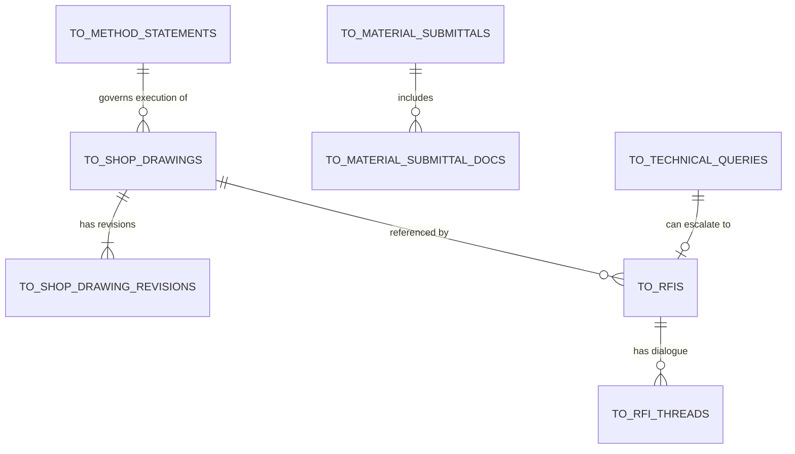
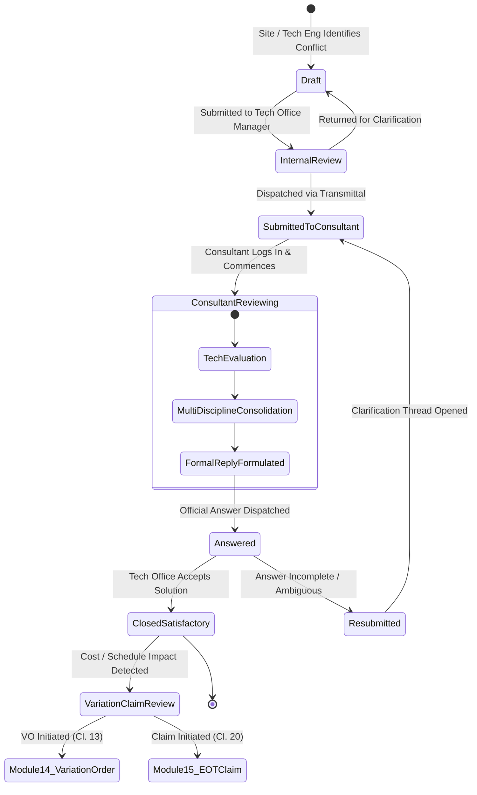
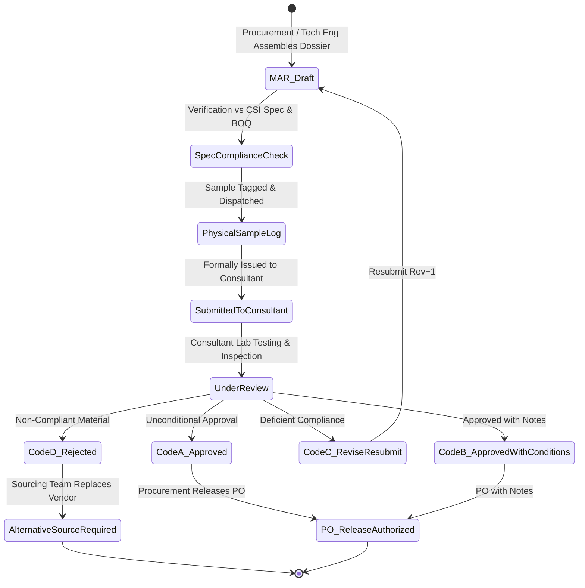

# Module 13: Technical Office Management

## 1. Purpose
The **Technical Office Management Module** in MimarERP v7 is the central engineering nervous system of the construction project. It governs the entire pre-construction and construction engineering lifecycle, orchestrating the creation, review, coordination, and approval of **Shop Drawings**, **Material Submittals / Material Approval Requests (MAR)**, **Requests for Information (RFI)**, **Technical Queries (TQ)**, and **Method Statements**. Built to enforce strict consultant review cycles and prevent design discrepancies from reaching the site, this module bridges the gap between design consultants, the technical office engineering team, procurement, and site execution.

---

## 2. Business Objectives
- **Zero Work on Unapproved Engineering:** Ensure that no physical site construction proceeds without an approved Shop Drawing (Code A or Code B) and an approved Material Submittal.
- **RFI Turnaround Acceleration:** Minimize costly site delays and potential contractor claims by enforcing rapid, structured RFI processing with defined SLAs and cost/time impact tracking.
- **Strict Consultant Submittal Cycle:** Formalize the submittal submission, review, commentary, and re-submission workflows with comprehensive version histories and code disposition.
- **Seamless Specification Compliance:** Link Material Submittals directly to CSI MasterFormat specifications, client vendor lists, and Bill of Quantities (BOQ) line items to prevent unauthorized substitutions.
- **Drawing Coordination & Clash Resolution:** Track drawing preparation schedules, interdisciplinary clash checks (Architectural, Structural, MEP), and monitor drawing progress from IFC to As-Built.
- **Comprehensive Claims Substantiation:** Capture every design clarification, late consultant response, or engineering conflict with forensic precision to defend or substantiate contractual claims.

---

## 3. User Roles & Permissions

| Role Name | Scope & Responsibilities | Key Capabilities |
|---|---|---|
| **Technical Office Manager (TOM)** | Project Level Engineering Lead | Manages technical office registers, approves outgoing submittals/RFIs, assigns engineering packages, monitors consultant performance against contract schedules. |
| **Senior Discipline Engineer (Arch/Str/MEP)** | Discipline Specific | Prepares shop drawing packages, drafts RFIs, reviews subcontractor submittals, evaluates compliance with design drawings and specifications. |
| **Drafting / BIM Coordinator** | CAD & BIM Modeling | Prepares and uploads shop drawings, manages drawing revisions, coordinates composite drawings, updates BIM coordination models. |
| **Material / Procurement Engineer** | Materials & Samples | Prepares Material Approval Requests (MAR), coordinates vendor sample deliveries, verifies compliance with project specifications and approved vendor lists. |
| **Supervising Consultant Engineer (RE/ARE)** | Consultant Supervision | Reviews shop drawings, MARs, and RFIs; issues engineering comments and official approval codes (Code A, B, C, D); responds to technical queries. |
| **Site Engineer / Construction Manager** | Field Operations | Raises field technical queries, initiates draft RFIs based on site conditions, views approved shop drawings and material submittals on mobile/tablet. |
| **Quality Control (QC) Inspector** | Quality Assurance | Verifies that materials delivered on site match the approved MAR, checks that installed work strictly follows the latest approved shop drawings. |

---

## 4. Database Tables (Complete Schemas with Types)

```sql
-- 1. Shop Drawing Register (SDR) Master
CREATE TABLE to_shop_drawings (
    drawing_id UUID PRIMARY KEY DEFAULT gen_random_uuid(),
    tenant_id UUID NOT NULL,
    project_id UUID NOT NULL,
    drawing_number VARCHAR(100) NOT NULL,
    title VARCHAR(300) NOT NULL,
    discipline VARCHAR(50) NOT NULL, -- ARCHITECTURAL, STRUCTURAL, HVAC, PLUMBING, ELECTRICAL, FIRE_FIGHTING
    wbs_id UUID NOT NULL,
    activity_id UUID, -- Linked P6 schedule activity
    boq_item_id UUID,
    zone_code VARCHAR(50),
    level_code VARCHAR(50),
    grid_reference VARCHAR(100),
    scale VARCHAR(30) DEFAULT '1:50',
    current_revision VARCHAR(10) DEFAULT '00',
    current_status VARCHAR(40) DEFAULT 'SCHEDULED', -- SCHEDULED, IN_PREPARATION, INTERNAL_REVIEW, SUBMITTED, APPROVED_CODE_A, APPROVED_CODE_B, REVISE_CODE_C, REJECTED_CODE_D, AS_BUILT
    target_submission_date DATE NOT NULL,
    actual_submission_date DATE,
    consultant_approval_date DATE,
    lead_engineer_id UUID NOT NULL,
    draftsman_id UUID,
    created_at TIMESTAMPTZ DEFAULT CURRENT_TIMESTAMP,
    created_by UUID NOT NULL,
    CONSTRAINT uq_proj_shop_draw_num UNIQUE (project_id, drawing_number)
);

-- 2. Shop Drawing Submittals & Revisions
CREATE TABLE to_shop_drawing_revisions (
    revision_id UUID PRIMARY KEY DEFAULT gen_random_uuid(),
    drawing_id UUID NOT NULL REFERENCES to_shop_drawings(drawing_id) ON DELETE CASCADE,
    revision_number VARCHAR(10) NOT NULL, -- 00, 01, 02, etc.
    transmittal_id UUID, -- Transmittal link
    submission_date DATE NOT NULL,
    consultant_due_date DATE NOT NULL,
    consultant_return_date DATE,
    review_status_code VARCHAR(10), -- CODE_A, CODE_B, CODE_C, CODE_D
    consultant_remarks TEXT,
    consultant_reviewer_id UUID,
    cad_file_path VARCHAR(500),
    pdf_file_path VARCHAR(500) NOT NULL,
    is_latest BOOLEAN DEFAULT TRUE,
    created_at TIMESTAMPTZ DEFAULT CURRENT_TIMESTAMP,
    created_by UUID NOT NULL,
    CONSTRAINT uq_shop_draw_rev UNIQUE (drawing_id, revision_number)
);

-- 3. Material Approval Requests (MAR / MAS)
CREATE TABLE to_material_submittals (
    mar_id UUID PRIMARY KEY DEFAULT gen_random_uuid(),
    tenant_id UUID NOT NULL,
    project_id UUID NOT NULL,
    mar_number VARCHAR(100) NOT NULL,
    title VARCHAR(300) NOT NULL,
    spec_section_number VARCHAR(50) NOT NULL, -- CSI MasterFormat (e.g. 03 30 00)
    spec_description TEXT,
    boq_item_id UUID,
    discipline VARCHAR(50) NOT NULL,
    supplier_vendor_id UUID,
    manufacturer_name VARCHAR(200) NOT NULL,
    country_of_origin VARCHAR(100) NOT NULL,
    local_agent_name VARCHAR(200),
    lead_time_days INT,
    delivery_date_required DATE,
    compliance_statement_status VARCHAR(30) DEFAULT 'FULL_COMPLIANCE', -- FULL_COMPLIANCE, COMPLIANCE_WITH_DEVIATION, ALTERNATIVE
    deviation_justification TEXT,
    physical_sample_submitted BOOLEAN DEFAULT FALSE,
    sample_received_by_consultant BOOLEAN DEFAULT FALSE,
    current_revision VARCHAR(10) DEFAULT '00',
    current_status VARCHAR(40) DEFAULT 'DRAFT', -- DRAFT, SUBMITTED, APPROVED_CODE_A, APPROVED_CODE_B, REVISE_CODE_C, REJECTED_CODE_D
    submission_date DATE,
    consultant_due_date DATE,
    consultant_action_date DATE,
    engineer_in_charge UUID NOT NULL,
    created_at TIMESTAMPTZ DEFAULT CURRENT_TIMESTAMP,
    created_by UUID NOT NULL,
    CONSTRAINT uq_proj_mar_num UNIQUE (project_id, mar_number)
);

-- 4. Material Submittal Attachments & Technical Data
CREATE TABLE to_material_submittal_docs (
    doc_id UUID PRIMARY KEY DEFAULT gen_random_uuid(),
    mar_id UUID NOT NULL REFERENCES to_material_submittals(mar_id) ON DELETE CASCADE,
    doc_type VARCHAR(50) NOT NULL, -- TECH_DATA_SHEET, COMPLIANCE_SHEET, TEST_CERTIFICATE, ISO_CERTIFICATE, MILL_CERTIFICATE, PREVIOUS_APPROVAL, WARRANTY
    file_name VARCHAR(255) NOT NULL,
    file_path VARCHAR(500) NOT NULL,
    uploaded_at TIMESTAMPTZ DEFAULT CURRENT_TIMESTAMP
);

-- 5. Requests for Information (RFI)
CREATE TABLE to_rfis (
    rfi_id UUID PRIMARY KEY DEFAULT gen_random_uuid(),
    tenant_id UUID NOT NULL,
    project_id UUID NOT NULL,
    rfi_number VARCHAR(100) NOT NULL,
    title VARCHAR(300) NOT NULL,
    discipline VARCHAR(50) NOT NULL,
    wbs_id UUID NOT NULL,
    zone_code VARCHAR(50),
    level_code VARCHAR(50),
    grid_location VARCHAR(100),
    spec_reference VARCHAR(200),
    drawing_reference VARCHAR(200),
    question_text TEXT NOT NULL,
    contractor_proposed_solution TEXT,
    cost_impact_indicated BOOLEAN DEFAULT FALSE,
    estimated_cost_impact DECIMAL(15, 2) DEFAULT 0.00,
    schedule_impact_indicated BOOLEAN DEFAULT FALSE,
    estimated_schedule_delay_days INT DEFAULT 0,
    rfi_priority VARCHAR(20) DEFAULT 'MEDIUM', -- LOW, MEDIUM, HIGH, CRITICAL
    status VARCHAR(30) DEFAULT 'DRAFT', -- DRAFT, SUBMITTED_TO_CONSULTANT, UNDER_CONSULTANT_REVIEW, ANSWERED, RESUBMITTED, CLOSED, DISPUTED
    date_raised DATE NOT NULL,
    due_date DATE NOT NULL,
    date_answered DATE,
    raised_by_user_id UUID NOT NULL,
    assigned_to_consultant_id UUID NOT NULL,
    official_response_text TEXT,
    is_claim_candidate BOOLEAN DEFAULT FALSE,
    created_at TIMESTAMPTZ DEFAULT CURRENT_TIMESTAMP,
    CONSTRAINT uq_proj_rfi_num UNIQUE (project_id, rfi_number)
);

-- 6. RFI Revisions / Clarification Follow-ups
CREATE TABLE to_rfi_threads (
    thread_id UUID PRIMARY KEY DEFAULT gen_random_uuid(),
    rfi_id UUID NOT NULL REFERENCES to_rfis(rfi_id) ON DELETE CASCADE,
    sender_type VARCHAR(30) NOT NULL, -- CONTRACTOR, CONSULTANT, CLIENT
    sender_user_id UUID NOT NULL,
    message_text TEXT NOT NULL,
    attachment_paths JSONB,
    created_at TIMESTAMPTZ DEFAULT CURRENT_TIMESTAMP
);

-- 7. Method Statements (MS)
CREATE TABLE to_method_statements (
    ms_id UUID PRIMARY KEY DEFAULT gen_random_uuid(),
    tenant_id UUID NOT NULL,
    project_id UUID NOT NULL,
    ms_number VARCHAR(100) NOT NULL,
    title VARCHAR(300) NOT NULL,
    discipline VARCHAR(50) NOT NULL,
    activity_id UUID,
    wbs_id UUID NOT NULL,
    scope_of_work TEXT NOT NULL,
    plant_equipment_required TEXT,
    manpower_crew_matrix TEXT,
    health_safety_risk_assessment_ref VARCHAR(100),
    quality_control_plan_ref VARCHAR(100),
    current_status VARCHAR(40) DEFAULT 'DRAFT', -- DRAFT, SUBMITTED, APPROVED_CODE_A, APPROVED_CODE_B, REVISE_CODE_C, REJECTED_CODE_D
    submission_date DATE,
    approval_date DATE,
    prepared_by UUID NOT NULL,
    created_at TIMESTAMPTZ DEFAULT CURRENT_TIMESTAMP,
    CONSTRAINT uq_proj_ms_num UNIQUE (project_id, ms_number)
);

-- 8. Technical Queries (Internal Site-to-Technical Office)
CREATE TABLE to_technical_queries (
    tq_id UUID PRIMARY KEY DEFAULT gen_random_uuid(),
    tenant_id UUID NOT NULL,
    project_id UUID NOT NULL,
    tq_number VARCHAR(100) NOT NULL,
    site_location VARCHAR(200) NOT NULL,
    query_description TEXT NOT NULL,
    raised_by_site_engineer_id UUID NOT NULL,
    assigned_to_technical_engineer_id UUID NOT NULL,
    resolution_type VARCHAR(50), -- RESOLVED_INTERNALLY, ESCALATED_TO_RFI, VARIATION_POTENTIAL
    escalated_rfi_id UUID REFERENCES to_rfis(rfi_id),
    status VARCHAR(30) DEFAULT 'OPEN', -- OPEN, IN_REVIEW, RESOLVED, CANCELLED
    target_date DATE NOT NULL,
    resolved_date DATE,
    resolution_text TEXT,
    created_at TIMESTAMPTZ DEFAULT CURRENT_TIMESTAMP
);
```

---

## 5. Entity Relationships (Mermaid)



---

## 6. Business Workflows & Status Transitions

### 6.1 RFI Lifecycle & Cost/Delay Impact Escalation


### 6.2 Material Submittal (MAR) Review Workflow


---

## 7. UI Screens

1. **Shop Drawing Log & Tracking Workbench:**
   - Interactive spreadsheet-style data grid showing all planned vs submitted vs approved shop drawings.
   - Column filters: Discipline, Zone, Level, Review Code, Submission Due Date, Consultant Aging (Days).
   - Instant actions: "Upload New Revision", "Generate SDR Package", "Link to Schedule Activity".
2. **Material Approval Request (MAR) Dossier Builder:**
   - Multi-tab form:
     - *General Info:* Spec section, BOQ line, manufacturer, supplier details.
     - *Compliance Statement:* Item-by-item comparison table against technical specifications (Parameter, Required Value, Offered Value, Deviation Y/N).
     - *Attachment Manager:* Drag-and-drop compliance sheets, test certificates, catalog cuts.
     - *Sample Tracking:* Physical sample tracking barcode/QR code generator.
3. **Interactive RFI Central Console:**
   - High-priority Kanban and tabular views (Critical, High, Medium, Low).
   - Dedicated "Impact Assessment Panel" with toggles for Time Impact (Days) and Cost Impact (SAR) with justification notes.
   - Conversation stream displaying the back-and-forth dialogue between Contractor and Consultant with embedded image annotations.
4. **Drawing Revision Diff & Viewer:**
   - Integrated DWG/PDF viewer with side-by-side split screen and digital overlay (redline comparison) showing changes between Rev 00 and Rev 01.
5. **Technical Query (TQ) Quick Capture Mobile Screen:**
   - Streamlined mobile interface for site engineers to snap a photo of a site obstruction, dictate a query, pin the grid location, and submit to the technical office within 60 seconds.

---

## 8. Dashboards

- **Technical Office Engineering Command Center:**
  - KPI Cards: Total Shop Drawings Approved vs Total Required, MAR Overall Approval Rate, Open RFIs, Critical Path Overdue RFIs, Average Consultant Response Latency.
  - Shop Drawing Progress S-Curve: Planned Submissions vs Actual Submissions vs Approved Drawings over project timeline.
  - RFI Aging Distribution Chart: <7 days, 7-14 days, 15-28 days, >28 days (Contractual Breach Warning).
  - Material Approval Status per Discipline: Architectural, Structural, Mechanical, Electrical breakdown.
  - Submittal Delay Heatmap: Highlighting disciplines with highest rejection rates and review bottlenecks.

---

## 9. Reports (10+ Detailed Reports)

1. **Master Shop Drawing Status Report (SDR):** Complete project drawing list with planned, submitted, and approved dates and current review codes.
2. **Material Approval Request (MAR) Tracking Register:** Comprehensive log of all material submittals with manufacturer, compliance status, and consultant code.
3. **RFI Master Log & Impact Analysis Report:** Full history of all RFIs with identified time delays, cost implications, and response durations.
4. **Consultant Review Performance & Delay Analysis:** Quantifies consultant turnaround times vs contractual response periods (substantiating claim records under FIDIC 1.9).
5. **Method Statement Log & Status Schedule:** Inventory of all method statements required for upcoming site activities and their current approval status.
6. **Discipline Submittal Approval Velocity Report:** Monthly velocity of drawing approvals by discipline to forecast construction site readiness.
7. **Shop Drawing Revision Growth & Rejection Report:** Identifies drawings undergoing 3 or more revisions (Code C/D), pinpointing design coordination issues.
8. **Material Procurement Readiness Report:** Matches approved MARs against upcoming procurement schedule dates to highlight long-lead material risks.
9. **Technical Query (TQ) to RFI Escalation Summary:** Tracks internal site queries and monitors the conversion rate into formal client RFIs.
10. **As-Built Drawing Handover Readiness Register:** Compares Code A shop drawings against site modifications to track preparation of final As-Built sets.
11. **Site Inspection vs Approved Drawing Audit Log:** Cross-checks whether Work Inspection Requests (WIR) reference valid Code A/B drawings.

---

## 10. KPIs & RAG Thresholds

| KPI Code | KPI Description | Calculation Formula | Green (Target) | Amber (Warning) | Red (Critical) |
|---|---|---|---|---|---|
| **KPI-TO-01** | Shop Drawing Approval Rate | `(Approved Drawings [Code A+B] / Total Submitted) * 100` | $\ge 85\%$ | $70\% - 84\%$ | $< 70\%$ |
| **KPI-TO-02** | RFI Response SLA Adherence | `(RFIs Answered within Contract SLA / Total RFIs Answered) * 100` | $\ge 90\%$ | $75\% - 89\%$ | $< 75\%$ |
| **KPI-TO-03** | Material Submittal First-Time Pass | `(MARs with Code A/B on Rev 00 / Total Rev 00 MARs) * 100` | $\ge 80\%$ | $65\% - 79\%$ | $< 65\%$ |
| **KPI-TO-04** | Critical Path RFI Bottlenecks | `Count of Open RFIs affecting Critical Path Activities past SLA` | $0$ | $1 - 2$ | $\ge 3$ |
| **KPI-TO-05** | Average RFI Resolution Time | `Sum(Days to Answer RFI) / Total RFIs Answered` | $\le 7$ Days | $8 - 14$ Days | $> 14$ Days |
| **KPI-TO-06** | Engineering Schedule Variance (Drawing SPI) | `Earned Value of Approved Drawings / Planned Value of Drawings` | $\ge 1.0$ | $0.90 - 0.99$ | $< 0.90$ |

---

## 11. API Endpoints

- `GET /api/v1/projects/:projectId/shop-drawings` - Fetch shop drawing register with multi-criteria filtering.
- `POST /api/v1/projects/:projectId/shop-drawings` - Create new shop drawing record in the schedule.
- `POST /api/v1/shop-drawings/:drawingId/revisions` - Submit a new revision package with CAD and PDF binaries.
- `POST /api/v1/shop-drawings/revisions/:revisionId/review` - Record consultant review code and comments.
- `GET /api/v1/projects/:projectId/material-submittals` - Retrieve material submittals with compliance details.
- `POST /api/v1/projects/:projectId/material-submittals` - Submit a new MAR dossier with technical sheets.
- `POST /api/v1/material-submittals/:marId/action` - Record consultant determination code for material submittal.
- `GET /api/v1/projects/:projectId/rfis` - Query RFI register with impact indicators.
- `POST /api/v1/projects/:projectId/rfis` - Issue a new RFI to the supervising consultant.
- `POST /api/v1/rfis/:rfiId/response` - Submit formal consultant response or contractor clarification follow-up.
- `POST /api/v1/projects/:projectId/technical-queries` - Log field technical query from mobile site application.

---

## 12. Required Permissions

- `TO_SHOP_DRAWING_CREATE` - Ability to define drawing records and schedule requirements.
- `TO_SHOP_DRAWING_SUBMIT` - Authority to issue drawing revisions for consultant review.
- `TO_SHOP_DRAWING_APPROVE` - Authority to record or sign off consultant approval codes.
- `TO_MAR_CREATE` - Permission to prepare material submittal packages.
- `TO_MAR_SUBMIT` - Authority to officially submit MARs to the engineer of record.
- `TO_RFI_CREATE` - Permission to raise and draft RFIs.
- `TO_RFI_SUBMIT` - Authorization to officially issue contractual RFIs.
- `TO_RFI_RESPOND` - Authority for consultant engineers to record official binding answers.
- `TO_METHOD_STATEMENT_MANAGE` - Ability to author and maintain site method statements.

---

## 13. Approval Workflows & SLA Matrices

```
+--------------------------------------------------------------------------------------------------+
|                            TECHNICAL OFFICE SUBMITTAL SLA MATRIX                                 |
+--------------------------+-----------------------+---------------------+-------------------------+
| Submittal Type           | Reviewing Authority   | Contract SLA (Days) | Escalation Threshold    |
+--------------------------+-----------------------+---------------------+-------------------------+
| Shop Drawing (Normal)    | Consultant Discipline | 14 Calendar Days    | Day 10 Reminder / Day 14|
| Shop Drawing (Critical)  | Resident Engineer     | 7 Calendar Days     | Day 5 Alert / Day 7 Cl. |
| Material Submittal (MAR) | Consultant Materials  | 14 Calendar Days    | Day 11 Urgent Notice    |
| Request for Info (RFI)   | Consultant Discipline | 7 Calendar Days     | Day 5 Notice / Day 7 Cl.|
| Critical Path RFI        | Project Director      | 3 Calendar Days     | Day 2 High Alert        |
| Method Statement (MS)    | Consultant QA/HSE     | 10 Calendar Days    | Day 8 Notice            |
+--------------------------+-----------------------+---------------------+-------------------------+
```

---

## 14. AI Features

1. **Automated Specification Compliance Verification (SpecMatcher AI):** Natural language processing model parses uploaded manufacturer technical datasheets and automatically benchmarks every technical parameter against the project specification (e.g., concrete compressive strength, tensile strength, thermal conductivity), highlighting deviations before submission.
2. **Predictive RFI Resolver & Duplicate Blocker:** When an engineer types an RFI question, vector search queries the historic database of all past project RFIs and design specs, instantly suggesting approved solutions or flagging duplicate questions.
3. **Drawing Clash & Coordination Risk Scanner:** Computer vision and semantic models analyze multi-discipline drawing sets (Architectural, Structural, MEP) to identify missing dimensions, conflicting elevation levels, and uncoordinated penetrations prior to formal transmittal.
4. **Consultant Delay & Claim Merit Assessment:** Automatically tracks consultant response delays on RFIs and drawing reviews against the baseline schedule critical path, generating pre-drafted contractual notices under FIDIC Clause 1.9 (Delayed Drawings or Instructions).

---

## 15. Automations

- **Critical Path RFI Linkage & Auto-Notification:** When an RFI is linked to an active CPM schedule activity, any delay in consultant response automatically calculates the forecasted project completion slip and emails the Resident Engineer with contractual notice warnings.
- **Auto-Generation of Re-Submission Packages:** Upon receiving a Code C (Revise & Resubmit) or Code D (Rejected) code, the system automatically schedules a new revision in the drawing register with an updated due date and notifies the lead draftsman.
- **Procurement Gatekeeper Lock:** Procurement modules are automatically prevented from releasing Purchase Orders (POs) for materials whose Material Submittal has not received a valid Code A or Code B approval.
- **Weekly Submittal Expediting Dossier:** Automated generation of Sunday morning expediting packages delivered to the consultant, highlighting upcoming submittals and overdue items.

---

## 16. Integration Requirements

- **Module 10 (Planning & Scheduling):** Bi-directional synchronization with Primavera P6 / MS Project; links drawing submission and approval dates directly to schedule activities and predecessor/successor logic.
- **Module 11 (Procurement & SCM):** Real-time gatekeeping preventing purchase order creation without approved MAR; passes approved technical specs directly to RFQ.
- **Module 12 (Document Control):** All formal submissions, drawing sets, and transmittals are routed through the CDE with automated revision management and watermarking.
- **Module 14 (Contract Management):** Direct feed from unaddressed RFIs and delayed drawing approvals into formal Variation Orders and contractual correspondence.
- **Module 15 (Claims Management):** Automated data feed of consultant review turnaround delays into Time Impact Analysis (TIA) and As-Planned vs As-Built delay matrices.
- **Module 16 (QA/QC):** Work Inspection Requests (WIR) and Material Inspection Requests (MIR) mandate selection of approved shop drawings and approved MARs.
