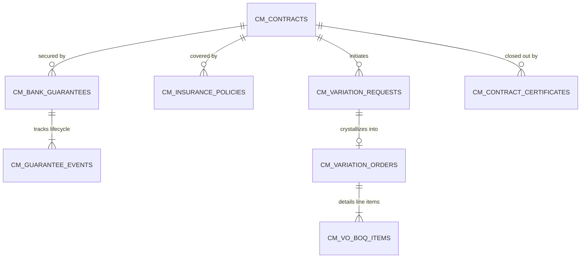
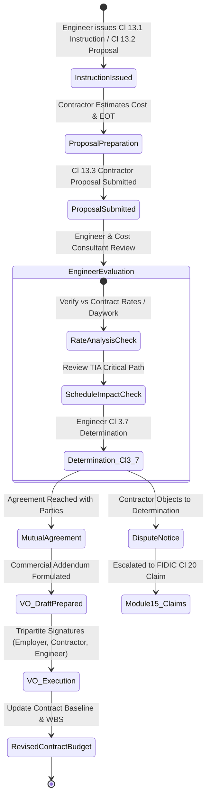
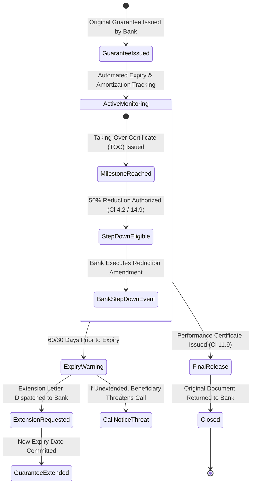

# Module 14: Contract Management & Administration (FIDIC Framework)

## 1. Purpose
The **Contract Management & Administration Module** in MimarERP v7 is an enterprise-class contractual governance platform engineered specifically for heavy civil, infrastructure, and commercial construction contracts. Grounded natively in the **FIDIC standard forms of contract**—specifically the **FIDIC Red Book 2017** (Conditions of Contract for Construction) and **FIDIC Yellow Book 2017** (Conditions of Contract for Plant and Design-Build), alongside EPC/Turnkey (Silver Book) and bespoke standard government conditions (such as the Saudi Government Tender and Procurement Law - GTPL)—this module digitizes the entire contractual lifecycle. It manages Contract Agreements, Letters of Acceptance, Commencement Notices, Securities & Guarantees (Performance Bonds, Advance Payment Guarantees, Retention Bonds), Insurance Policies (CAR, Third-Party Liability, Workmen's Compensation), Variation Orders (VO / Clause 13), Daywork records, and contractual milestone certificates (Taking-Over Certificate / Defects Notification Period).

---

## 2. Business Objectives
- **Standardized FIDIC Contract Governance:** Enforce strict compliance with contract clauses, notice timelines, engineer determinations, and statutory obligations across all project stakeholders.
- **Variation Order (VO) Lifecycle Optimization:** Capture, evaluate, price, negotiate, and execute Variations under Clause 13 with full traceability from Engineer's Instruction to signed Variation Agreement.
- **Guarantee & Bond Risk Mitigation:** Eliminate financial exposure and prevent forfeiture or lapses by proactively managing bank guarantees, expiry dates, conditional release rules, and step-downs.
- **Comprehensive Insurance Oversight:** Monitor Contractor's All Risks (CAR), Professional Indemnity (PI), Third-Party Liability (TPL), and Decennial Liability coverage to ensure zero uninsured site operational periods.
- **Contractual Milestone Integrity:** Track critical contractual dates (Commencement Date, Time for Completion, Sectional Completion, Taking-Over, Defect Notification Period, Performance Certificate).
- **Interim Payment Certificate (IPC) Certification Control:** Enforce FIDIC Clause 14 billing protocols, tracking advance payment amortization, retention deductions, statutory withholdings, and engineer certification timelines.

---

## 3. User Roles & Permissions

| Role Name | Scope & Responsibilities | Key Capabilities |
|---|---|---|
| **Commercial Director / Contracts Director** | Corporate / Multi-Project Level | Full oversight of all upstream (Employer-Contractor) and downstream (Contractor-Subcontractor) contracts, dispute negotiations, and VO approvals. |
| **Contracts Manager / Administrator** | Project Commercial Team | Day-to-day contract administration, drafting formal contractual notices, managing Variation Requests (VR), tracking engineer determinations, maintaining the Contract Register. |
| **Quantity Surveyor / Cost Estimator** | Commercial & Valuation | Prices variation orders, compiles rate breakdowns (labor, material, plant, overheads), substantiates new rate proposals under Clause 12/13. |
| **Treasury & Finance Officer** | Corporate Finance / Banking | Manages bank guarantee issuances, extensions, releases, letter of credit monitoring, tracking bank commission costs and collateral margins. |
| **Risk & Insurance Officer** | Corporate Governance | Manages insurance policy renewals, endorsements, claims for site damages under CAR policies, deductible tracking. |
| **Employer's Representative / Engineer** | Supervising Consultant | Issues Engineer's Instructions (EI), requests variation proposals, conducts determinations under Clause 3.7, recommends approval of VOs and certificates. |
| **Subcontract Administrator** | Package Commercial | Manages back-to-back subcontracts, issues subcontractor variation orders, monitors subcontractor securities and retentions. |

---

## 4. Database Tables (Complete Schemas with Types)

```sql
-- 1. Main Contract Master (Upstream & Downstream)
CREATE TABLE cm_contracts (
    contract_id UUID PRIMARY KEY DEFAULT gen_random_uuid(),
    tenant_id UUID NOT NULL,
    project_id UUID NOT NULL,
    contract_number VARCHAR(100) NOT NULL,
    contract_title VARCHAR(300) NOT NULL,
    contract_type VARCHAR(50) NOT NULL, -- FIDIC_RED_2017, FIDIC_YELLOW_2017, FIDIC_SILVER_2017, SAUDI_GTPL, BESPOKE_SUBCONTRACT
    contract_model VARCHAR(50) NOT NULL, -- MEASUREMENT_UNIT_PRICE, LUMP_SUM, COST_PLUS, TARGET_PRICE
    client_employer_org_id UUID NOT NULL,
    contractor_org_id UUID NOT NULL,
    engineer_consultant_org_id UUID NOT NULL,
    currency CHAR(3) DEFAULT 'SAR',
    original_contract_value DECIMAL(18, 2) NOT NULL,
    revised_contract_value DECIMAL(18, 2) NOT NULL,
    letter_of_acceptance_date DATE NOT NULL,
    agreement_signing_date DATE,
    commencement_date DATE NOT NULL,
    original_time_for_completion_days INT NOT NULL,
    original_completion_date DATE NOT NULL,
    revised_completion_date DATE NOT NULL,
    defect_notification_period_days INT DEFAULT 365,
    advance_payment_percentage DECIMAL(5, 2) DEFAULT 10.00,
    advance_payment_recovery_percentage DECIMAL(5, 2) DEFAULT 10.00,
    retention_percentage DECIMAL(5, 2) DEFAULT 10.00,
    retention_cap_percentage DECIMAL(5, 2) DEFAULT 5.00,
    performance_security_percentage DECIMAL(5, 2) DEFAULT 10.00,
    delay_damages_per_day DECIMAL(15, 2) NOT NULL,
    delay_damages_cap_percentage DECIMAL(5, 2) DEFAULT 10.00,
    contract_status VARCHAR(40) DEFAULT 'ACTIVE', -- DRAFT, SIGNED, ACTIVE, SUSPENDED, SUBSTANTIALLY_COMPLETED, CLOSED_OUT, TERMINATED
    created_at TIMESTAMPTZ DEFAULT CURRENT_TIMESTAMP,
    created_by UUID NOT NULL,
    CONSTRAINT uq_proj_contract_num UNIQUE (project_id, contract_number)
);

-- 2. Bank Guarantees & Securities Register
CREATE TABLE cm_bank_guarantees (
    guarantee_id UUID PRIMARY KEY DEFAULT gen_random_uuid(),
    tenant_id UUID NOT NULL,
    contract_id UUID NOT NULL REFERENCES cm_contracts(contract_id) ON DELETE CASCADE,
    guarantee_number VARCHAR(100) NOT NULL,
    guarantee_type VARCHAR(50) NOT NULL, -- PERFORMANCE_BOND, ADVANCE_PAYMENT_GUARANTEE, RETENTION_GUARANTEE, TENDER_BOND, MAINTENANCE_BOND
    issuing_bank_name VARCHAR(200) NOT NULL,
    issuing_branch VARCHAR(100),
    beneficiary_name VARCHAR(200) NOT NULL,
    applicant_name VARCHAR(200) NOT NULL,
    currency CHAR(3) DEFAULT 'SAR',
    original_amount DECIMAL(18, 2) NOT NULL,
    current_amount DECIMAL(18, 2) NOT NULL,
    issue_date DATE NOT NULL,
    effective_date DATE NOT NULL,
    initial_expiry_date DATE NOT NULL,
    extended_expiry_date DATE,
    release_condition_description TEXT NOT NULL,
    status VARCHAR(30) DEFAULT 'ACTIVE', -- ACTIVE, EXTENSION_REQUESTED, REDUCED, RELEASED, CLAIMED_CALLED, EXPIRED
    collateral_margin_percentage DECIMAL(5, 2) DEFAULT 0.00,
    bank_commission_rate DECIMAL(5, 3),
    physical_document_location VARCHAR(200),
    created_at TIMESTAMPTZ DEFAULT CURRENT_TIMESTAMP,
    created_by UUID NOT NULL,
    CONSTRAINT uq_guarantee_num UNIQUE (contract_id, guarantee_number)
);

-- 3. Guarantee Reduction & Extension Events
CREATE TABLE cm_guarantee_events (
    event_id UUID PRIMARY KEY DEFAULT gen_random_uuid(),
    guarantee_id UUID NOT NULL REFERENCES cm_bank_guarantees(guarantee_id) ON DELETE CASCADE,
    event_type VARCHAR(40) NOT NULL, -- EXTENSION, REDUCTION_STEP_DOWN, RELEASE, CALL_NOTICE
    event_date DATE NOT NULL,
    amount_change DECIMAL(18, 2) DEFAULT 0.00,
    new_balance DECIMAL(18, 2) NOT NULL,
    previous_expiry_date DATE,
    new_expiry_date DATE,
    bank_reference_number VARCHAR(100),
    justification_remarks TEXT,
    supporting_doc_path VARCHAR(500),
    recorded_by UUID NOT NULL,
    created_at TIMESTAMPTZ DEFAULT CURRENT_TIMESTAMP
);

-- 4. Insurance Policies Register
CREATE TABLE cm_insurance_policies (
    policy_id UUID PRIMARY KEY DEFAULT gen_random_uuid(),
    tenant_id UUID NOT NULL,
    contract_id UUID NOT NULL REFERENCES cm_contracts(contract_id) ON DELETE CASCADE,
    policy_number VARCHAR(100) NOT NULL,
    policy_type VARCHAR(50) NOT NULL, -- CONTRACTOR_ALL_RISKS_CAR, THIRD_PARTY_LIABILITY_TPL, WORKMENS_COMPENSATION, PROFESSIONAL_INDEMNITY_PI, DECENNIAL_LIABILITY, PLANT_EQUIPMENT
    insurance_company_name VARCHAR(200) NOT NULL,
    broker_name VARCHAR(200),
    insured_parties TEXT NOT NULL, -- Employer, Contractor, Subcontractors, Consultant
    insured_sum DECIMAL(18, 2) NOT NULL,
    deductible_amount DECIMAL(15, 2) NOT NULL,
    effective_from DATE NOT NULL,
    effective_to DATE NOT NULL,
    extended_to DATE,
    premium_amount DECIMAL(15, 2) NOT NULL,
    policy_status VARCHAR(30) DEFAULT 'ACTIVE', -- ACTIVE, PENDING_RENEWAL, EXPIRED, CANCELLED
    copy_file_path VARCHAR(500) NOT NULL,
    created_at TIMESTAMPTZ DEFAULT CURRENT_TIMESTAMP,
    created_by UUID NOT NULL,
    CONSTRAINT uq_policy_num UNIQUE (contract_id, policy_number)
);

-- 5. Variation Requests & Proposals (FIDIC Clause 13.1 / 13.2 / 13.3)
CREATE TABLE cm_variation_requests (
    vr_id UUID PRIMARY KEY DEFAULT gen_random_uuid(),
    tenant_id UUID NOT NULL,
    contract_id UUID NOT NULL REFERENCES cm_contracts(contract_id) ON DELETE CASCADE,
    vr_number VARCHAR(100) NOT NULL,
    originator_type VARCHAR(30) NOT NULL, -- EMPLOYER_INSTRUCTION, CONTRACTOR_PROPOSAL_VALUE_ENG, ENGINEER_REQUEST
    engineer_instruction_ref VARCHAR(100),
    title VARCHAR(300) NOT NULL,
    description TEXT NOT NULL,
    clause_reference VARCHAR(50) DEFAULT '13.3',
    reason_code VARCHAR(50) NOT NULL, -- DESIGN_CHANGE, CLIENT_SCOPE_ADDITION, STATUTORY_CHANGE, SITE_CONDITION, VALUE_ENGINEERING, ERROR_OMISSION
    submission_date DATE NOT NULL,
    cost_impact_estimated DECIMAL(18, 2) NOT NULL,
    time_impact_days_estimated INT DEFAULT 0,
    status VARCHAR(40) DEFAULT 'SUBMITTED', -- DRAFT, SUBMITTED, UNDER_ENGINEER_EVALUATION, DETERMINATION_ISSUED, APPROVED_AS_VO, REJECTED, WITHDRAWN
    engineer_evaluation_date DATE,
    engineer_recommended_amount DECIMAL(18, 2),
    engineer_recommended_days INT,
    created_at TIMESTAMPTZ DEFAULT CURRENT_TIMESTAMP,
    created_by UUID NOT NULL,
    CONSTRAINT uq_contract_vr_num UNIQUE (contract_id, vr_number)
);

-- 6. Executed Variation Orders (VO / Clause 13 Binding Addendum)
CREATE TABLE cm_variation_orders (
    vo_id UUID PRIMARY KEY DEFAULT gen_random_uuid(),
    tenant_id UUID NOT NULL,
    contract_id UUID NOT NULL REFERENCES cm_contracts(contract_id) ON DELETE CASCADE,
    vr_id UUID REFERENCES cm_variation_requests(vr_id),
    vo_number VARCHAR(100) NOT NULL,
    title VARCHAR(300) NOT NULL,
    official_scope_description TEXT NOT NULL,
    approved_cost_amount DECIMAL(18, 2) NOT NULL,
    approved_time_extension_days INT DEFAULT 0,
    revised_contract_price_cumulative DECIMAL(18, 2) NOT NULL,
    revised_completion_date DATE NOT NULL,
    effective_date DATE NOT NULL,
    employer_signature_date DATE,
    contractor_signature_date DATE,
    engineer_signature_date DATE,
    status VARCHAR(30) DEFAULT 'EXECUTED', -- PENDING_SIGNATURE, EXECUTED, CANCELLED
    signed_document_path VARCHAR(500) NOT NULL,
    created_at TIMESTAMPTZ DEFAULT CURRENT_TIMESTAMP,
    created_by UUID NOT NULL,
    CONSTRAINT uq_contract_vo_num UNIQUE (contract_id, vo_number)
);

-- 7. Variation Order BOQ Breakdown Lines
CREATE TABLE cm_vo_boq_items (
    vo_item_id UUID PRIMARY KEY DEFAULT gen_random_uuid(),
    vo_id UUID NOT NULL REFERENCES cm_variation_orders(vo_id) ON DELETE CASCADE,
    boq_item_code VARCHAR(50),
    description TEXT NOT NULL,
    uom VARCHAR(20) NOT NULL,
    quantity DECIMAL(15, 3) NOT NULL,
    unit_rate DECIMAL(15, 2) NOT NULL,
    total_amount DECIMAL(18, 2) NOT NULL,
    rate_basis VARCHAR(50) NOT NULL, -- EXISTING_CONTRACT_RATE, PRO-RATA_STAR_RATE, NEW_NEGOTIATED_RATE, DAYWORK_SCHEDULE
    wbs_id UUID NOT NULL,
    cost_code_id UUID
);

-- 8. Contractual Milestone & Completion Certificates
CREATE TABLE cm_contract_certificates (
    cert_id UUID PRIMARY KEY DEFAULT gen_random_uuid(),
    tenant_id UUID NOT NULL,
    contract_id UUID NOT NULL REFERENCES cm_contracts(contract_id) ON DELETE CASCADE,
    certificate_type VARCHAR(50) NOT NULL, -- COMMENCEMENT_CERTIFICATE, SECTIONAL_COMPLETION_CERTIFICATE, TAKING_OVER_CERTIFICATE_TOC, DEFECTS_NOTIFICATION_EXPIRY, PERFORMANCE_CERTIFICATE, FINAL_PAYMENT_CERTIFICATE
    certificate_number VARCHAR(100) NOT NULL,
    section_scope_description TEXT,
    effective_milestone_date DATE NOT NULL,
    snag_list_reference VARCHAR(100),
    outstanding_works_description TEXT,
    engineer_signed_date DATE NOT NULL,
    employer_accepted_date DATE,
    status VARCHAR(30) DEFAULT 'ISSUED',
    document_attachment_path VARCHAR(500) NOT NULL,
    created_at TIMESTAMPTZ DEFAULT CURRENT_TIMESTAMP,
    CONSTRAINT uq_contract_cert UNIQUE (contract_id, certificate_number)
);
```

---

## 5. Entity Relationships (Mermaid)



---

## 6. Business Workflows & Status Transitions

### 6.1 Variation Order Lifecycle (FIDIC Clause 13)


### 6.2 Bank Guarantee Lifecycle & Step-Down


---

## 7. UI Screens

1. **Enterprise Contract Workspace:**
   - Contract summary banner: Original Value, Approved VOs, Current Revised Contract Price, Time Elapsed (%), Financial Completion (%).
   - Tab navigation: Overview, Bill of Quantities (BOQ), Variations (VO), Guarantees & Bonds, Insurances, Certificates, Contract Notices.
2. **FIDIC Variation Order (VO) Management Studio:**
   - Dual split-pane view: Left pane shows Variation Requests (VR) categorized by status; Right pane shows detailed cost breakdown, rate justification matrix, schedule impact analysis, and linked Engineer's Instructions.
   - Interactive rate builder for "Star Rates" (Rate breakdown calculator: Material + Plant + Labor + Indirects + Markup).
3. **Guarantees & Securities Dashboard Grid:**
   - Multi-asset table listing all Active Performance Bonds, Advance Payment Guarantees, and Retention Guarantees.
   - Visual progress bars showing Advance Payment Amortization vs Remaining Guarantee Value.
   - Automated color-coded expiry countdown timers (Green >60 days, Amber 30-60 days, Red <30 days).
4. **Insurance Policy Compliance Console:**
   - Matrix showing compliance status across all project packages.
   - Policy detail drawer: Coverage sums, deductibles, endorsements list, claims against policy, renewal alert triggers.
5. **Contract Milestone & Certificate Issuance Wizard:**
   - Step-by-step workflow to register Taking-Over Certificates (TOC) or Performance Certificates with snag list attachments, punch list liability values, and retention release percentages.

---

## 8. Dashboards

- **Commercial Director & Contract Executive Cockpit:**
  - KPI Cards: Revised Contract Value, Cumulative VO Value (% of Original Contract), Outstanding VO Claims, Active Guarantees Total Exposure (SAR), Uninsured Operational Days (0 Target).
  - Contract Value Growth Waterfall Chart: Original Contract -> VO 01 -> VO 02 -> Approved Claims -> Current Contract Value.
  - Guarantee Expiry Timeline & Exposure Heatmap.
  - Variation Distribution by Cause (Pie Chart: Client Request, Design Defect, Site Condition, Value Engineering).
  - Time for Completion vs Approved EOT S-Curve.

---

## 9. Reports (10+ Detailed Reports)

1. **Executive Contract Status Summary Report:** High-level executive brief containing original/revised values, completion dates, and overall commercial exposure.
2. **Master Variation Order (VO) Register:** Full audit log of all issued VOs with original requests, approved sums, granted EOT days, and status.
3. **Variation Requests Pending Determination Log:** Itemized list of all unresolved contractor proposals under Clause 13.3 awaiting Engineer evaluation.
4. **Bank Guarantees & Securities Exposure Report:** Complete inventory of all active bonds, current values, issuing institutions, and upcoming expiry dates.
5. **Advance Payment Amortization & Recovery Schedule:** Reconciles original advance payment, cumulative recovery through IPCs, and remaining balance vs guarantee.
6. **Retention Money Deductions & Release Log:** Details cumulative retention withheld, retention bond substitutions, and 50% release status at Taking-Over.
7. **Insurance Policies Compliance & Expiry Register:** Audits all active policies, ensuring mandatory coverages comply with contract requirements.
8. **FIDIC Milestone & Completion Certificates Log:** Record of all Letters of Acceptance, Commencement, Taking-Over, and Performance Certificates.
9. **Delay Damages (Liquidated Damages) Exposure Forecast:** Potential liability assessment calculating daily delay damages against current schedule slippage.
10. **Subcontract Back-to-Back Contractual Alignment Audit:** Compares main contract terms (retention, payment terms, delay damages) against downstream subcontracts.
11. **Contractual Notices Register (Clause 1.3 / 8.3 / 13.7 / 20.1):** Formal chronicle of all legal letters and notices exchanged between parties.

---

## 10. KPIs & RAG Thresholds

| KPI Code | KPI Description | Calculation Formula | Green (Target) | Amber (Warning) | Red (Critical) |
|---|---|---|---|---|---|
| **KPI-CM-01** | Variation Value Growth Ratio | `(Total Approved VO Value / Original Contract Value) * 100` | $\le 10\%$ | $10.1\% - 15\%$ | $> 15\%$ |
| **KPI-CM-02** | Guarantee Expiry Safety Window | `Minimum days remaining before any active guarantee expires unrenewed` | $> 45$ Days | $30 - 45$ Days | $< 30$ Days |
| **KPI-CM-03** | VO Determination Latency | `Avg days from Cl 13.3 submission to Cl 3.7 Engineer Determination` | $\le 28$ Days | $29 - 42$ Days | $> 42$ Days |
| **KPI-CM-04** | Unapproved Work Site Exposure | `Estimated value of site work executed under verbal instruction without VO` | $0$ SAR | $\le 100k$ SAR | $> 100k$ SAR |
| **KPI-CM-05** | Insurance Coverage Continuity | `Uncovered operational days between policy expiry and renewal endorsement` | $0$ Days | $0$ (Warning) | $\ge 1$ Day |
| **KPI-CM-06** | Advance Payment Recovery Rate | `Actual Cumulative Recovery / Scheduled Cumulative Recovery` | $\ge 1.0$ | $0.90 - 0.99$ | $< 0.90$ |

---

## 11. API Endpoints

- `GET /api/v1/projects/:projectId/contracts` - Fetch contract particulars and commercial terms.
- `PUT /api/v1/contracts/:contractId/commercial-terms` - Update revised contract value and completion milestone dates.
- `GET /api/v1/contracts/:contractId/variation-requests` - Query list of all Variation Requests (VRs).
- `POST /api/v1/contracts/:contractId/variation-requests` - Submit a new Contractor Variation Proposal under Clause 13.3.
- `POST /api/v1/contracts/:contractId/variation-orders` - Execute and sign a formal Variation Order.
- `GET /api/v1/contracts/:contractId/bank-guarantees` - List all bank guarantees and bonds with amortization state.
- `POST /api/v1/contracts/:contractId/bank-guarantees` - Register a new bank guarantee with digital document copy.
- `POST /api/v1/bank-guarantees/:guaranteeId/events` - Record a guarantee extension, reduction step-down, or release.
- `GET /api/v1/contracts/:contractId/insurances` - Query active insurance policies and endorsement dates.
- `POST /api/v1/contracts/:contractId/certificates` - Issue a Taking-Over or Performance Certificate.

---

## 12. Required Permissions

- `CONTRACT_VIEW_COMMERCIAL` - Ability to view contract values, pricing rates, and financial terms.
- `CONTRACT_TERMS_UPDATE` - Authority to amend core contract milestone dates or baseline terms.
- `VARIATION_PROPOSAL_SUBMIT` - Authority to submit formal Clause 13 variation proposals to the client.
- `VARIATION_ORDER_SIGN` - High-level legal authorization to execute binding Variation Orders.
- `GUARANTEE_ADMIN_MANAGE` - Authority to manage bank guarantee data, request extensions, or log releases.
- `INSURANCE_ADMIN_MANAGE` - Ability to register and maintain project insurance policies.
- `CERTIFICATE_ISSUE_EXECUTE` - Authority to formally record Taking-Over or Defect Liability release certificates.

---

## 13. Approval Workflows & SLA Matrices

```
+--------------------------------------------------------------------------------------------------+
|                            VARIATION ORDER (VO) APPROVAL MATRIX                                  |
+--------------------------+-----------------------+---------------------+-------------------------+
| VO Value Threshold (SAR) | Required Approvers    | SLA Limit (Days)    | Escalation Authority    |
+--------------------------+-----------------------+---------------------+-------------------------+
| Up to 100,000 SAR        | Contracts Mgr + PM    | 7 Calendar Days     | Commercial Director     |
| 100,001 to 1,000,000 SAR | Commercial Dir + PD   | 14 Calendar Days    | VP Operations           |
| 1,000,001 to 5,000,000   | VP Operations + CFO   | 21 Calendar Days    | Chief Executive Officer |
| Over 5,000,000 SAR       | CEO + Board Committee | 30 Calendar Days    | Board of Directors      |
+--------------------------+-----------------------+---------------------+-------------------------+
```

---

## 14. AI Features

1. **FIDIC Contract Clause Intelligence & Risk Extractor:** Natural Language Understanding engine ingests executed contract documents, scanned PDFs, and Particular Conditions, automatically extracting key commercial risk parameters (e.g., notice deadlines, time-bar clauses, delay damages caps, advance payment recovery formulas, and unamended FIDIC deviation clauses).
2. **Variation Order Rate Estimator & Benchmark AI:** Recommends fair and reasonable unit prices for newly introduced variation items by analyzing historical procurement costs, current regional market price indices, and nearby project actual rates.
3. **Guarantee Expiry & Cash-Call Predictive Alert:** Machine learning model evaluates project schedule delay trajectories against guarantee expiry dates, predicting when the Employer is statistically likely to issue a conditional "Extend or Pay" demand and alerting Treasury 60 days in advance.
4. **Site Instruction Scope Creep Detector:** Continuously compares incoming site engineer memos and consultant emails against the baseline BOQ and specification scope, automatically flagging unpriced scope expansions that require immediate Clause 13.1 Variation notices.

---

## 15. Automations

- **Automated Guarantee Expiry Warning Sequence:** Automated notification engine dispatches alerts at 90, 60, 45, 30, and 15 days prior to guarantee expiry to the Commercial Director, Treasury, and Legal Counsel.
- **Advance Payment Guarantee Auto-Amortization:** On approval of each Interim Payment Certificate (IPC), the system calculates the amortized advance payment deduction and automatically drafts a guarantee reduction request letter to the bank.
- **Post-Taking Over Retention Step-Down Trigger:** Issuance of the Taking-Over Certificate (TOC) automatically triggers a workflow to release 50% of the accumulated retention money or adjust the Retention Guarantee value.
- **Contract Price Synchronization with Cost Control:** Execution of a signed VO automatically updates the revised budget in Module 2 (Cost Control) and creates new WBS line items.

---

## 16. Integration Requirements

- **Module 1 (Project Management):** Syncs contract milestones, commencement dates, and sectional completion targets.
- **Module 2 (Cost Control & EVM):** Pushes approved VO sums to revise the Budget at Completion (BAC) and baseline cost codes.
- **Module 10 (Planning & Scheduling):** Pushes approved Extension of Time (EOT) days into the master schedule to establish new baseline finish dates.
- **Module 12 (Document Control):** Archives all signed contract documents, legal notices, and certificates with tamper-proof checksums.
- **Module 15 (Claims Management):** Direct handoff of disputed variation proposals and rejected Clause 13 determinations into formal Clause 20 claims.
- **Module 19 (Financial Management & GL):** Feeds contract retention releases, advance payment amortization schedules, and revised contract values to financial ledgers.
