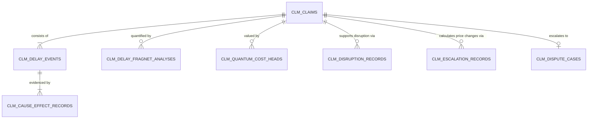
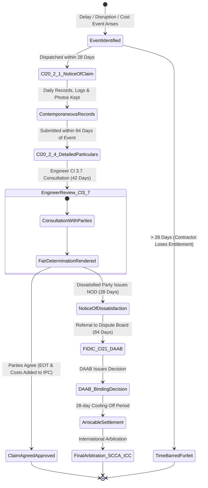
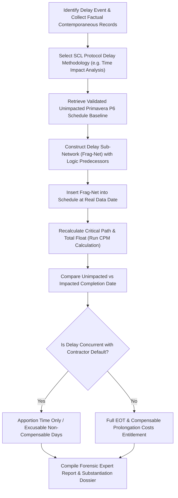

# Module 15: Claims Management & Forensic Delay Analysis

## 1. Purpose
The **Claims Management & Forensic Delay Analysis Module** in MimarERP v7 is an advanced commercial, contractual, and forensic engineering subsystem designed to manage, substantiate, defend, and resolve construction claims. Built strictly around international construction standards including the **FIDIC Conditions of Contract (Clause 20: Employer's and Contractor's Claims, Clause 21: Dispute Avoidance/Adjudication Board & Arbitration)**, the **Society of Construction Law (SCL) Delay and Disruption Protocol (2nd Edition)**, and **AACE International Recommended Practice 29R-03 (Forensic Schedule Analysis)**, this module governs:
- Contractual Notice of Claim tracking (strict 28-day FIDIC time-bar enforcement).
- Comprehensive Claim Particulars submission (42-day rule).
- Extension of Time (EOT) delay methodologies (Time Impact Analysis, As-Planned vs As-Built, Window Analysis, Collapsed As-Built).
- Disruption Claims (Measured Mile calculation, modified total cost, loss of productivity).
- Cost Escalation, Prolongation Costs, and Head Office Overheads (Hudson, Emden, Eichleay formulas).
- Cause-and-Effect linkage matrices and formal Dispute Board (DAAB) escalation.

---

## 2. Business Objectives
- **Zero Forfeiture to Time-Bar Provisions:** Eliminate loss of claim entitlement caused by late notifications through real-time monitoring of the strict 28-day notice rule under FIDIC Clause 20.2.1.
- **Forensic Schedule Analysis Precision:** Provide legally defensible Extension of Time (EOT) calculations using SCL-compliant methodologies directly linked to Primavera P6 / CPM project schedules.
- **Accurate Quantification of Prolongation & Disruption:** Transform abstract delay events into empirical, verifiable financial damages (direct site overheads, plant idling, labor disruption, escalation, and head office overheads).
- **Dynamic Cause-and-Effect Traceability:** Create an unbreakable chain of evidence linking contemporaneous project records (site diaries, weather logs, RFIs, consultant inspection delays, variation instructions) to schedule activity delays.
- **Strategic Dispute Avoidance:** Enable early warning identification and structured dispute adjudication before conflicts escalate to costly litigation or arbitration.
- **Claims Portfolio Visibility:** Deliver real-time executive visibility into net claim exposure, recovery probabilities, cash-flow impacts, and claim settlement negotiations.

---

## 3. User Roles & Permissions

| Role Name | Scope & Responsibilities | Key Capabilities |
|---|---|---|
| **Head of Claims & Dispute Resolution** | Enterprise / Portfolio Level | Approves final claim dossiers, leads negotiations with Employers/Consultants, manages DAAB and arbitration representations. |
| **Senior Forensic Delay Analyst** | Planning & Forensic Specialist | Conducts schedule delay fragnet modeling, window delay analyses, critical path concurrency evaluations, and calculates net EOT entitlements. |
| **Claims & Quantum Surveyor** | Commercial & Financial | Quantifies prolongation costs, head office overhead formulas, calculates plant idling costs, and compiles financial claim schedules. |
| **Project Contracts Administrator** | Project Commercial Team | Monitors triggering delay events, drafts and dispatches 28-day formal notices, tracks 42-day submission deadlines, maintains the Project Claim Register. |
| **Project Director / Construction Manager** | Field Executive | Verifies contemporaneous site records, signs off factual statements of events, participates in dispute negotiation sessions. |
| **Dispute Adjudication Board Member / Arbitrator** | External Independent Legal Body | Read-only access to compiled evidence bundles, expert reports, contemporaneous project documents, and timeline reconstructions. |

---

## 4. Database Tables (Complete Schemas with Types)

```sql
-- 1. Master Claims Register
CREATE TABLE clm_claims (
    claim_id UUID PRIMARY KEY DEFAULT gen_random_uuid(),
    tenant_id UUID NOT NULL,
    contract_id UUID NOT NULL,
    project_id UUID NOT NULL,
    claim_reference VARCHAR(100) NOT NULL,
    claim_title VARCHAR(300) NOT NULL,
    claim_type VARCHAR(50) NOT NULL, -- EXTENSION_OF_TIME_EOT, PROLONGATION_COSTS, DISRUPTION_LOSS_PRODUCTIVITY, COST_ESCALATION, UNFORESEEN_PHYSICAL_CONDITIONS, EMPLOYER_SUSPENSION, TERMINATION_DAMAGES
    contract_basis_clause VARCHAR(100) NOT NULL, -- FIDIC 2017: 20.2, 8.5, 1.9, 4.12, 13.7, 16.1
    claimant_party VARCHAR(30) NOT NULL, -- CONTRACTOR, EMPLOYER (Cross-Claim)
    status VARCHAR(40) DEFAULT 'NOTICE_STAGE', -- EVENT_IDENTIFIED, NOTICE_SERVED, PARTICULARS_DRAFTING, SUBMITTED_TO_ENGINEER, UNDER_ENGINEER_DETERMINATION, DETERMINATION_ISSUED, REJECTED, ESCALATED_TO_DAAB, AMICABLY_SETTLED, ARBITRATION
    event_awareness_date DATE NOT NULL,
    notice_due_date DATE NOT NULL, -- Strictly 28 days from awareness date (FIDIC 20.2.1)
    notice_served_date DATE,
    is_time_barred BOOLEAN DEFAULT FALSE,
    particulars_due_date DATE NOT NULL, -- Strictly 84 days from awareness / 42 days from notice (FIDIC 20.2.4)
    particulars_submitted_date DATE,
    eot_days_claimed INT DEFAULT 0,
    cost_amount_claimed DECIMAL(18, 2) DEFAULT 0.00,
    currency CHAR(3) DEFAULT 'SAR',
    eot_days_determined INT,
    cost_amount_determined DECIMAL(18, 2),
    determination_date DATE,
    lead_claims_consultant_id UUID NOT NULL,
    created_at TIMESTAMPTZ DEFAULT CURRENT_TIMESTAMP,
    created_by UUID NOT NULL,
    CONSTRAINT uq_proj_claim_ref UNIQUE (project_id, claim_reference)
);

-- 2. Claim Delay Events Register
CREATE TABLE clm_delay_events (
    event_id UUID PRIMARY KEY DEFAULT gen_random_uuid(),
    claim_id UUID NOT NULL REFERENCES clm_claims(claim_id) ON DELETE CASCADE,
    event_code VARCHAR(50) NOT NULL,
    event_title VARCHAR(300) NOT NULL,
    event_description TEXT NOT NULL,
    delay_type VARCHAR(40) NOT NULL, -- EXCUSABLE_COMPENSABLE, EXCUSABLE_NON_COMPENSABLE, NON_EXCUSABLE_CONTRACTOR_DELAY, CONCURRENT_DELAY
    delay_category VARCHAR(50) NOT NULL, -- LATE_DESIGN_DRAWINGS, ACCESS_DENIAL, VARIATION_CHANGE, ADVERSE_WEATHER, UNFORESEEN_GROUND_CONDITIONS, FORCE_MAJEURE, UTILITY_OBSTRUCTION
    event_start_date DATE NOT NULL,
    event_end_date DATE,
    is_ongoing BOOLEAN DEFAULT FALSE,
    critical_path_affected BOOLEAN DEFAULT TRUE,
    created_at TIMESTAMPTZ DEFAULT CURRENT_TIMESTAMP
);

-- 3. Cause and Effect Evidence Matrix
CREATE TABLE clm_cause_effect_records (
    ce_id UUID PRIMARY KEY DEFAULT gen_random_uuid(),
    event_id UUID NOT NULL REFERENCES clm_delay_events(event_id) ON DELETE CASCADE,
    cause_narrative TEXT NOT NULL,
    effect_narrative TEXT NOT NULL,
    affected_wbs_id UUID NOT NULL,
    affected_schedule_activity_ids JSONB NOT NULL, -- Array of P6 Activity IDs: ["ACT-1020", "ACT-1030"]
    planned_start_date DATE NOT NULL,
    planned_finish_date DATE NOT NULL,
    actual_start_date DATE,
    actual_finish_date DATE,
    total_float_consumed_days INT DEFAULT 0,
    critical_delay_days INT DEFAULT 0,
    contemporaneous_doc_references JSONB -- Array of Doc IDs: RFIs, Site Memos, Transmittals, Weather Records
);

-- 4. Delay Frag-Net Schedule Analyses
CREATE TABLE clm_delay_fragnet_analyses (
    analysis_id UUID PRIMARY KEY DEFAULT gen_random_uuid(),
    claim_id UUID NOT NULL REFERENCES clm_claims(claim_id) ON DELETE CASCADE,
    methodology VARCHAR(50) NOT NULL, -- TIME_IMPACT_ANALYSIS_TIA, AS_PLANNED_VS_AS_BUILT, WINDOW_ANALYSIS, COLLAPSED_AS_BUILT
    baseline_schedule_name VARCHAR(100) NOT NULL, -- e.g. Approved Baseline Rev 02
    unimpacted_data_date DATE NOT NULL,
    impacted_data_date DATE NOT NULL,
    calculated_project_delay_days INT NOT NULL,
    contractor_concurrency_days INT DEFAULT 0,
    employer_concurrency_days INT DEFAULT 0,
    net_entitlement_days INT NOT NULL,
    analysis_report_path VARCHAR(500) NOT NULL,
    analyzed_by UUID NOT NULL,
    analyzed_at TIMESTAMPTZ DEFAULT CURRENT_TIMESTAMP
);

-- 5. Quantum & Prolongation Cost Breakdown Lines
CREATE TABLE clm_quantum_cost_heads (
    quantum_id UUID PRIMARY KEY DEFAULT gen_random_uuid(),
    claim_id UUID NOT NULL REFERENCES clm_claims(claim_id) ON DELETE CASCADE,
    cost_head_category VARCHAR(50) NOT NULL, -- SITE_OVERHEADS_PROLONGATION, PLANT_IDLE_STANDING, LABOR_DISRUPTION, PRICE_ESCALATION, HEAD_OFFICE_OVERHEAD, FINANCING_COSTS
    item_description TEXT NOT NULL,
    basis_formula VARCHAR(100), -- EICHLEAY, HUDSON, EMDEN, SPREADSHEET_DIRECT_COST, FIDIC_13.7_FORMULA
    quantity_days_or_units DECIMAL(15, 3) NOT NULL,
    unit_rate DECIMAL(15, 2) NOT NULL,
    total_cost_claimed DECIMAL(18, 2) NOT NULL,
    verified_amount_engineer DECIMAL(18, 2),
    supporting_audit_reference VARCHAR(200)
);

-- 6. Disruption & Productivity Analysis (Measured Mile)
CREATE TABLE clm_disruption_records (
    disruption_id UUID PRIMARY KEY DEFAULT gen_random_uuid(),
    claim_id UUID NOT NULL REFERENCES clm_claims(claim_id) ON DELETE CASCADE,
    activity_code VARCHAR(50) NOT NULL,
    unimpacted_period_start DATE NOT NULL,
    unimpacted_period_end DATE NOT NULL,
    unimpacted_productivity_rate DECIMAL(10, 4) NOT NULL, -- Units produced per man-hour
    impacted_period_start DATE NOT NULL,
    impacted_period_end DATE NOT NULL,
    impacted_productivity_rate DECIMAL(10, 4) NOT NULL,
    productivity_loss_percentage DECIMAL(5, 2) NOT NULL, -- ((Unimpacted - Impacted) / Unimpacted) * 100
    wasted_manhours DECIMAL(15, 2) NOT NULL,
    labor_rate_per_hour DECIMAL(10, 2) NOT NULL,
    total_disruption_cost DECIMAL(18, 2) NOT NULL,
    cause_narrative TEXT NOT NULL
);

-- 7. Material & Labor Cost Escalation Claims (FIDIC Clause 13.7)
CREATE TABLE clm_escalation_records (
    escalation_id UUID PRIMARY KEY DEFAULT gen_random_uuid(),
    claim_id UUID NOT NULL REFERENCES clm_claims(claim_id) ON DELETE CASCADE,
    resource_type VARCHAR(50) NOT NULL, -- REBAR_STEEL, READYMIX_CONCRETE, DIESEL_FUEL, STRUCTURAL_STEEL, COPPER_CABLES, UNSKILLED_LABOR
    base_date_index DECIMAL(10, 4) NOT NULL, -- Published statutory index at Tender Base Date (e.g. GASTAT Saudi Arabia)
    current_date_index DECIMAL(10, 4) NOT NULL,
    index_source_organization VARCHAR(100) NOT NULL, -- General Authority for Statistics (GASTAT)
    contract_base_rate DECIMAL(15, 2) NOT NULL,
    actual_paid_rate DECIMAL(15, 2) NOT NULL,
    consumed_quantity DECIMAL(15, 3) NOT NULL,
    total_escalation_claimed DECIMAL(18, 2) NOT NULL,
    invoice_verification_batch_id UUID
);

-- 8. Dispute Adjudication Board (DAAB) & Arbitration Case Log
CREATE TABLE clm_dispute_cases (
    dispute_id UUID PRIMARY KEY DEFAULT gen_random_uuid(),
    tenant_id UUID NOT NULL,
    claim_id UUID NOT NULL REFERENCES clm_claims(claim_id),
    case_number VARCHAR(100) NOT NULL,
    tribunal_type VARCHAR(50) NOT NULL, -- DAAB_FIDIC_2017, ARBITRATION_SCCA, ARBITRATION_ICC, UNCITRAL, LOCAL_COURT
    dispute_referral_date DATE NOT NULL,
    panel_members_json JSONB NOT NULL, -- [{name: "Dr. Ahmed", role: "Chairman"}, {name: "John Smith", role: "Party Appointee"}]
    disputed_amount DECIMAL(18, 2) NOT NULL,
    disputed_eot_days INT NOT NULL,
    hearing_date DATE,
    decision_due_date DATE NOT NULL, -- Strictly 84 days under FIDIC 21.4.3
    decision_rendered_date DATE,
    decision_summary TEXT,
    is_notice_of_dissatisfaction_served BOOLEAN DEFAULT FALSE, -- FIDIC 21.4.4 (NOD within 28 days)
    created_at TIMESTAMPTZ DEFAULT CURRENT_TIMESTAMP
);
```

---

## 5. Entity Relationships (Mermaid)



---

## 6. Business Workflows & Status Transitions

### 6.1 FIDIC 2017 Clause 20.2 Strict Claims Lifecycle & Time-Bar Engine


### 6.2 Delay Analysis Frag-Net Modeling Workflow


---

## 7. UI Screens

1. **Claims Portfolio Command Cockpit:**
   - Visual summary of all project claims organized in a status Kanban: *Notice Stage, Particulars Assembly, Engineer Review, DAAB Referral, Settled*.
   - Flashing red countdown timers for active notices (e.g., "14 Days Remaining to submit Cl 20.2.1 Notice" or "Time-Bar Imminent!").
2. **FIDIC Clause 20 Time-Bar Compliance Guard:**
   - Dedicated timeline view displaying delay event awareness dates, 28-day statutory notice deadlines, and 84-day full particulars submission deadlines with digital receipt stamps.
3. **Forensic Delay Analysis & Frag-Net Studio:**
   - Gantt chart timeline interface displaying baseline CPM schedule alongside the impacted schedule.
   - Interactive Frag-Net builder: Allows delay analysts to drop delay activities, assign predecessor/successor links, and simulate time slippage in real time.
4. **Quantum & Prolongation Cost Calculator:**
   - Multi-tab pricing worksheet:
     - *Site Overheads:* On-site staff salaries, site cabins, utilities, crane rentals calculated per day of prolongation.
     - *Head Office Overheads (HOOH):* Native calculators for **Eichleay Formula**, **Hudson Formula**, and **Emden Formula**.
     - *Plant Idling:* Standing charges vs operating rates based on verified site equipment logs.
5. **Measured Mile Disruption Workbench:**
   - Visual productivity curve comparing man-hours per unit achieved during the unimpacted "mile" vs the disrupted phase with automatic cost conversion.
6. **Statutory Price Escalation Engine (FIDIC 13.7 / GASTAT):**
   - Direct integration with published material price indexes (Saudi General Authority for Statistics) with automated formula calculation for steel, concrete, and fuel.

---

## 8. Dashboards

- **Executive Claims & Dispute Cockpit:**
  - KPI Cards: Total Value Claimed (SAR), Total Approved / Determined (SAR), Net Win-Loss Ratio (%), Total EOT Days Claimed, Days Granted, Claims at Risk of Time-Bar.
  - Claims Aging Waterfall Chart (Days elapsed in negotiation without determination).
  - Cause of Delay Breakdown: Donut chart (Late Engineering, Scope Changes, Site Obstructions, Weather, Employer Payment Default).
  - Prolongation vs Disruption Cost Exposure comparison bar chart.
  - Active DAAB / Arbitration Probability Index.

---

## 9. Reports (10+ Detailed Reports)

1. **Master Claims Register & Entitlement Schedule:** Complete dossier of all claims with references, claimed vs awarded values, and current legal status.
2. **FIDIC Clause 20.2 Time-Bar Compliance & Notice Audit:** Chronological verification report proving timely submission of notices within the statutory 28-day window.
3. **Forensic Time Impact Analysis (TIA) Report:** Comprehensive schedule delay report detailing baseline schedule, inserted frag-nets, and resulting critical path slippage.
4. **As-Planned vs As-Built Window Delay Analysis:** Period-by-period forensic analysis detailing critical path variance and concurrency evaluation.
5. **Prolongation Cost Audit & Substantiation Bundle:** Itemized breakdown of direct site general expenses and equipment costs incurred during compensable delay periods.
6. **Head Office Overhead (Eichleay Formula) Calculation Sheet:** Defensible audit of unabsorbed corporate overhead allocations during project delay.
7. **Measured Mile Labor Disruption & Productivity Loss Study:** Empirical analysis comparing unimpacted productivity to disrupted periods with loss calculations.
8. **Statutory Material Price Escalation Summary (FIDIC 13.7):** Price index tracking report showing published index variations and certified compensation sums.
9. **Contemporaneous Event-to-Document Cause & Effect Matrix:** Exhaustive evidence bundle linking every day of claimed delay to site logs, weather reports, and RFIs.
10. **DAAB Referral Dossier & Dispute Defense Pack:** Consolidated binder containing claims, engineer determinations, rebuttal notices, and contractual arguments.
11. **Subcontractor Back-to-Back Claim Reconciliation Log:** Evaluates downstream subcontractor claims passed through to the Employer vs contractor-risk claims.

---

## 10. KPIs & RAG Thresholds

| KPI Code | KPI Description | Calculation Formula | Green (Target) | Amber (Warning) | Red (Critical) |
|---|---|---|---|---|---|
| **KPI-CLM-01** | Time-Bar Notice Compliance Rate | `(Notices Served within 28 Days / Total Claim Events) * 100` | $100\%$ | $95\% - 99\%$ | $< 95\%$ |
| **KPI-CLM-02** | Claim Particulars Timeliness | `(Particulars Submitted within 84 Days / Total Notices) * 100` | $\ge 90\%$ | $80\% - 89\%$ | $< 80\%$ |
| **KPI-CLM-03** | EOT Days Realization Rate | `(Approved EOT Days / Claimed EOT Days) * 100` | $\ge 70\%$ | $50\% - 69\%$ | $< 50\%$ |
| **KPI-CLM-04** | Quantum Financial Recovery Rate | `(Settled Claim Value SAR / Claimed Quantum Value SAR) * 100` | $\ge 65\%$ | $45\% - 64\%$ | $< 45\%$ |
| **KPI-CLM-05** | Average Claims Resolution Latency | `Avg months from Cl 20.2 notice to final agreement or determination` | $\le 4$ Months | $4 - 6$ Months | $> 6$ Months |
| **KPI-CLM-06** | Liquidated Damages Neutralization | `(Approved EOT Days / Total Project Critical Path Slippage Days) * 100` | $\ge 90\%$ | $75\% - 89\%$ | $< 75\%$ |

---

## 11. API Endpoints

- `GET /api/v1/projects/:projectId/claims` - Fetch master claims register with current legal status and financials.
- `POST /api/v1/projects/:projectId/claims` - Initiate a new claim record upon occurrence of a delay/disruption event.
- `POST /api/v1/claims/:claimId/notice` - Formally record and dispatch the FIDIC Clause 20.2.1 28-day notice letter.
- `POST /api/v1/claims/:claimId/particulars` - Submit the comprehensive 84-day claim particulars dossier.
- `POST /api/v1/claims/:claimId/delay-events` - Register detailed delay events with start/end dates and classifications.
- `POST /api/v1/delay-events/:eventId/cause-effect` - Link schedule activities and contemporaneous documentation.
- `POST /api/v1/claims/:claimId/fragnet-analysis` - Upload and commit a Time Impact Analysis (TIA) schedule calculation.
- `POST /api/v1/claims/:claimId/quantum-heads` - Add prolongation, disruption, or overhead line items.
- `POST /api/v1/claims/:claimId/dispute-referral` - Escalate an unresolved claim to the DAAB or Arbitration tribunal.
- `GET /api/v1/claims/:claimId/evidence-pack` - Generate and download a consolidated, indexed PDF evidence bundle.

---

## 12. Required Permissions

- `CLAIM_REGISTER_MANAGE` - Ability to create and maintain entries in the project claim register.
- `CLAIM_NOTICE_SERVE` - High-level authority to formally dispatch legal notices under FIDIC Clause 20.
- `CLAIM_PARTICULARS_SUBMIT` - Authority to finalize and submit official EOT and quantum claim submissions.
- `FORENSIC_ANALYSIS_EDIT` - Permission to build, run, and modify CPM frag-net and delay models.
- `QUANTUM_VALUATION_EDIT` - Permission to author prolongation, disruption, and overhead financial models.
- `DISPUTE_ESCALATION_AUTHORITY` - Exclusive authority to refer matters to DAAB or initiate arbitration proceedings.
- `CLAIM_LEGAL_AUDIT_VIEW` - Access for legal counsel and expert witnesses to review all project correspondence and logs.

---

## 13. Approval Workflows & SLA Matrices

```
+--------------------------------------------------------------------------------------------------+
|                            FIDIC CLAIMS ESCALATION & SLA MATRIX                                  |
+--------------------------+-----------------------+---------------------+-------------------------+
| Milestone / Action       | Responsible Role      | Statutory Deadline  | Escalation Protocol     |
+--------------------------+-----------------------+---------------------+-------------------------+
| 1. Notice of Claim       | Contracts Manager     | 28 Calendar Days    | Day 14 Alert / Day 21   |
| 2. Full Particulars      | Lead Claims Analyst   | 84 Calendar Days    | Day 56 Review / Day 70  |
| 3. Interim Claim Updates | Senior Planner / QS   | Monthly (28 Days)   | Monthly IPC Integration |
| 4. Engineer Determination| Supervising Engineer  | 42 Calendar Days    | Day 35 Reminder Notice  |
| 5. Notice of Dissatisfact| Commercial Director   | 28 Calendar Days    | Day 14 Legal Briefing   |
| 6. DAAB Decision Period  | Dispute Board (DAAB)  | 84 Calendar Days    | Day 70 Hearing Review   |
+--------------------------+-----------------------+---------------------+-------------------------+
```

---

## 14. AI Features

1. **Autonomous Delay Event & Claim Signal Detector (ClaimScanner AI):** Continuously crawls daily site reports, weather meteorological feeds, consultant transmittal delays, and RFI logs using NLP, automatically identifying latent delay events and warning the commercial team to issue Clause 20 notices before time-bar expiration.
2. **AI-Powered Schedule Concurrency & Float Evaluator:** Machine learning engine analyzes revised Primavera P6 schedule updates, identifying hidden owner vs contractor concurrency, float hijacking, and improper schedule pacing to validate true critical path delays.
3. **Disruption & Lost Productivity Neural Estimator:** Compares site labor productivity against weather, temperature, humidity, congestion, and RFI frequency, generating automated Measured Mile calculations that meet judicial standards of proof.
4. **Legal Precedent & Contract Interpretation Copilot:** Trained on FIDIC case law, SCL protocol principles, and international arbitration awards, the AI assists in drafting robust contractual narratives and recommends specific legal authorities to rebut consultant rejections.

---

## 15. Automations

- **Strict 28-Day Time-Bar Countdown Daemon:** Real-time background job that monitors delay event discovery dates; automatically triggers urgent desktop, SMS, and email alerts at 7, 14, 21, and 25 days, preventing any claim from lapsing unnotified.
- **Automated Evidence Bundler (Contemporaneous Dossier Assembler):** Upon defining a delay period, the system automatically pulls all linked RFIs, transmittals, site photos, daily diaries, inspection requests, and weather logs into an indexed, bookmarked PDF bundle.
- **IPC Financial Claim Integration:** When an EOT or prolongation cost determination is agreed, the system automatically inserts the awarded valuation into the next cycle of the Interim Payment Certificate (Module 14 / Module 19).
- **Weekly Claims Exposure Broadcast to Board:** Generates an automated Sunday morning executive briefing summarizing project risk profiles, active time-bars, and current litigation exposure.

---

## 16. Integration Requirements

- **Module 1 (Project Management):** Daily site diary logs and site photos automatically serve as contemporaneous factual evidence.
- **Module 10 (Planning & Scheduling):** Direct synchronization with Primavera P6 (.XER / API) to pull activity baselines, actual dates, and run CPM forward/backward passes for Time Impact Analysis.
- **Module 12 (Document Control):** Instant retrieval and linking of transmittals, consultant letters, and drawing revisions to support the Cause-and-Effect matrix.
- **Module 13 (Technical Office):** Unanswered RFIs and delayed Material Submittals (MAR) feed directly into delay event frag-nets.
- **Module 14 (Contract Management):** Disputed Variation Orders (Clause 13) seamlessly transition into formal Clause 20 claims.
- **Module 17 & 18 (HSE & Site Operations):** Weather extremes (sandstorms, excessive heat stop-work orders), labor strikes, and safety shut-downs provide tamper-proof source records for Force Majeure and excusable delay claims.
