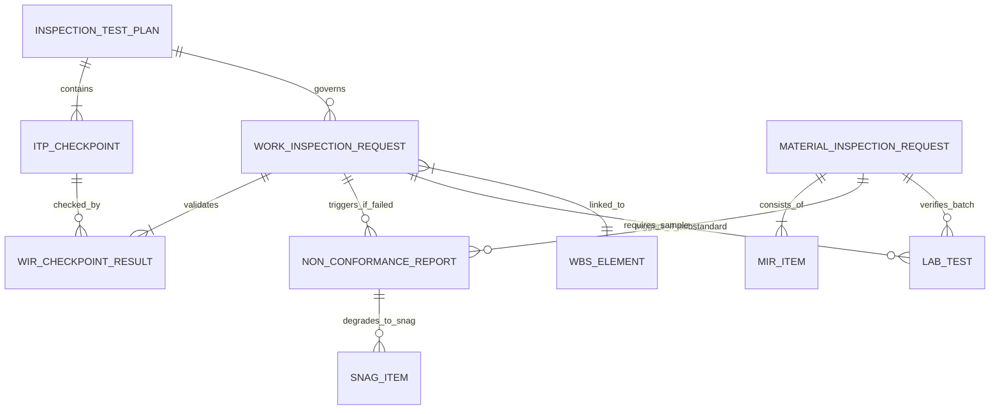

# MimarERP v7 — Module 16: Quality Assurance & Quality Control (QA/QC) Specification

**System Designation:** `MimarERP v7 / Quality Assurance & Quality Control Subsystem`  
**Standard Compliance:** ISO 9001:2015 (Quality Management Systems), FIDIC Red/Yellow Books (Clauses 4.9, 7.3, 7.4), ACI 301/318, BS EN 12390, ASTM Standards, CSI MasterFormat  
**Document Classification:** Tier-1 Enterprise Construction Engineering Specification  
**File Reference:** `d:\ERP sys\docs\modules\16-qaqc.md`

---

## 1. Module Purpose

The Quality Assurance and Quality Control (QA/QC) Module provides an end-to-end, audit-proof, and mobile-enabled quality governance framework for Tier-1 construction operations. It enforces zero-compromise adherence to ISO 9001:2015 standards, contract specifications, and statutory building codes. 

The module digitizes all quality management workflows—from early Inspection & Test Plan (ITP) formulation, through on-site Work Inspection Requests (WIR/IR) and Material Inspection Requests (MIR), to rigorous Non-Conformance Reporting (NCR) with structured Root Cause Analysis (RCA), third-party lab testing logs, and multi-tier mobile snagging and commissioning handover dossiers.

---

## 2. Business Objectives

1. **Zero-Defect Quality Culture:** Eliminate structural and architectural rework by embedding Hold, Witness, Surveillance, and Review points into daily operations.
2. **Accelerated Inspection Lifecycles:** Reduce average inspection cycle time from 72 hours to under 8 hours through automated mobile dispatch, geolocation stamping, and digital consultant portals.
3. **Traceability & Material Authenticity:** Ensure 100% digital traceability from raw mill test certificates and delivery notes to batch sampling, cube crushing, and permanent element installation.
4. **Direct Financial Risk Control:** Enforce automated payment gatekeepers that halt Interim Payment Certificate (IPC) processing and subcontractor disbursements when critical NCRs or unresolved inspections remain open.
5. **Subcontractor Quality Accountability:** Quantify subcontractor performance with automated Quality Performance Indices (QPI) that feed directly into prequalification and tendering decisions.

---

## 3. User Roles & Permissions

| Role Code | Role Name | Primary Responsibilities | Access Level |
|---|---|---|---|
| `QAQC_DIR` | QA/QC Director | Corporate quality governance, ISO policy, global audit compliance | Full Corporate Access |
| `QAQC_MGR` | Project QA/QC Manager | Project ITP baseline approval, major NCR issuance, consultant liaising | Project Level Admin |
| `QC_ENG_CIV` | QC Engineer (Civil/Structural) | Civil inspection execution, concrete testing verification, WIR review | Project Level Write |
| `QC_ENG_MEP` | QC Engineer (MEP) | HVAC, plumbing, electrical testing, hydro-testing, commissioning logs | Project Level Write |
| `QC_ENG_ARC` | QC Engineer (Finishes/Arch) | Mock-up approvals, architectural snagging, waterproofing inspections | Project Level Write |
| `SITE_ENG` | Construction Site Engineer | Raising WIRs/MIRs, requesting re-inspections, closing snag items | Field Level Create/Update |
| `CONSULTANT`| Supervising Consultant / RE | Official inspection witnessing, WIR/MIR approval or rejection, NCR sign-off | External Portal Witness/Sign |
| `SUBCON_QC` | Subcontractor QC Rep | Rectification updates on snag lists and minor NCRs | Restricted Partner Portal |
| `LAB_TECH` | Third-Party Lab Technician | Inputting concrete cube break, soil compaction, and tensile test results | Field Test Entry |

---

## 4. Database Tables (Complete Schemas with Types)

```sql
-- Schema: qaqc

CREATE TYPE qaqc_checkpoint_level AS ENUM ('HOLD', 'WITNESS', 'SURVEILLANCE', 'REVIEW');
CREATE TYPE qaqc_wir_status AS ENUM ('DRAFT', 'SUBMITTED_INTERNAL', 'APPROVED_INTERNAL', 'SUBMITTED_CONSULTANT', 'UNDER_INSPECTION', 'APPROVED_A', 'APPROVED_B_COMMENTS', 'REVISE_RESUBMIT_C', 'REJECTED_D', 'CANCELLED');
CREATE TYPE qaqc_ncr_severity AS ENUM ('CRITICAL', 'MAJOR', 'MINOR', 'INCIDENTAL');
CREATE TYPE qaqc_ncr_status AS ENUM ('ISSUED', 'DISPOSITION_PROPOSED', 'DISPOSITION_APPROVED', 'RECTIFICATION_IN_PROGRESS', 'REINSPECTION_REQUESTED', 'CLOSED_VERIFIED', 'VOIDED');
CREATE TYPE qaqc_snag_status AS ENUM ('OPEN', 'IN_RECTIFICATION', 'READY_FOR_INSPECTION', 'VERIFIED_CLOSED', 'CONTESTED');

-- 1. Inspection and Test Plans (ITP)
CREATE TABLE qaqc.inspection_test_plans (
    itp_id UUID PRIMARY KEY DEFAULT gen_random_uuid(),
    tenant_id UUID NOT NULL,
    project_id UUID NOT NULL,
    wbs_node_id UUID NOT NULL,
    itp_code VARCHAR(50) NOT NULL UNIQUE,
    title VARCHAR(255) NOT NULL,
    discipline VARCHAR(50) NOT NULL, -- Civil, Structural, MEP, Architectural, Geotechnical
    specification_reference VARCHAR(255) NOT NULL,
    revision_number INT DEFAULT 0 NOT NULL,
    status VARCHAR(30) DEFAULT 'DRAFT' CHECK (status IN ('DRAFT', 'SUBMITTED', 'APPROVED', 'SUPERSEDED')),
    approved_by UUID,
    approved_at TIMESTAMPTZ,
    created_by UUID NOT NULL,
    created_at TIMESTAMPTZ DEFAULT clock_timestamp() NOT NULL,
    updated_at TIMESTAMPTZ DEFAULT clock_timestamp() NOT NULL
);

-- 2. ITP Checkpoints
CREATE TABLE qaqc.itp_checkpoints (
    checkpoint_id UUID PRIMARY KEY DEFAULT gen_random_uuid(),
    itp_id UUID NOT NULL REFERENCES qaqc.inspection_test_plans(itp_id) ON DELETE CASCADE,
    sequence_order INT NOT NULL,
    activity_description TEXT NOT NULL,
    controlling_document VARCHAR(255) NOT NULL, -- Spec section, method statement reference
    acceptance_criteria TEXT NOT NULL,
    contractor_qc_action qaqc_checkpoint_level NOT NULL DEFAULT 'WITNESS',
    consultant_qc_action qaqc_checkpoint_level NOT NULL DEFAULT 'HOLD',
    third_party_action qaqc_checkpoint_level DEFAULT 'REVIEW',
    record_type VARCHAR(100) NOT NULL, -- Check sheet, Lab Report, Survey Data, Certificate
    created_at TIMESTAMPTZ DEFAULT clock_timestamp() NOT NULL
);

-- 3. Work Inspection Requests (WIR / IR)
CREATE TABLE qaqc.work_inspection_requests (
    wir_id UUID PRIMARY KEY DEFAULT gen_random_uuid(),
    tenant_id UUID NOT NULL,
    project_id UUID NOT NULL,
    itp_id UUID REFERENCES qaqc.inspection_test_plans(itp_id),
    wir_number VARCHAR(60) NOT NULL UNIQUE,
    revision INT DEFAULT 0 NOT NULL,
    wbs_element_id UUID NOT NULL,
    bim_element_guid UUID,
    discipline VARCHAR(50) NOT NULL,
    zone VARCHAR(100) NOT NULL,
    level VARCHAR(50) NOT NULL,
    grid_lines VARCHAR(100),
    description_of_work TEXT NOT NULL,
    scheduled_datetime TIMESTAMPTZ NOT NULL,
    status qaqc_wir_status DEFAULT 'DRAFT' NOT NULL,
    contractor_qc_engineer_id UUID NOT NULL,
    internal_qc_signoff_at TIMESTAMPTZ,
    consultant_representative_id UUID,
    consultant_verdict_at TIMESTAMPTZ,
    consultant_comments TEXT,
    consultant_code_status VARCHAR(10), -- Code A, Code B, Code C, Code D
    requires_reinspection BOOLEAN DEFAULT FALSE,
    previous_wir_id UUID REFERENCES qaqc.work_inspection_requests(wir_id),
    created_at TIMESTAMPTZ DEFAULT clock_timestamp() NOT NULL,
    updated_at TIMESTAMPTZ DEFAULT clock_timestamp() NOT NULL
);

-- 4. WIR Checkpoint Execution Logs
CREATE TABLE qaqc.wir_checkpoint_results (
    result_id UUID PRIMARY KEY DEFAULT gen_random_uuid(),
    wir_id UUID NOT NULL REFERENCES qaqc.work_inspection_requests(wir_id) ON DELETE CASCADE,
    checkpoint_id UUID NOT NULL REFERENCES qaqc.itp_checkpoints(checkpoint_id),
    is_compliant BOOLEAN NOT NULL,
    actual_measurement_value VARCHAR(100),
    tolerance_deviation VARCHAR(100),
    inspector_notes TEXT,
    photo_evidence_urls JSONB DEFAULT '[]',
    inspected_at TIMESTAMPTZ DEFAULT clock_timestamp() NOT NULL,
    inspected_by UUID NOT NULL
);

-- 5. Material Inspection Requests (MIR)
CREATE TABLE qaqc.material_inspection_requests (
    mir_id UUID PRIMARY KEY DEFAULT gen_random_uuid(),
    tenant_id UUID NOT NULL,
    project_id UUID NOT NULL,
    mir_number VARCHAR(60) NOT NULL UNIQUE,
    purchase_order_id UUID NOT NULL,
    goods_receipt_note_id UUID NOT NULL,
    supplier_id UUID NOT NULL,
    material_submittal_approved_ref VARCHAR(100) NOT NULL,
    delivery_date DATE NOT NULL,
    delivery_note_number VARCHAR(100) NOT NULL,
    storage_location VARCHAR(150) NOT NULL,
    status VARCHAR(30) DEFAULT 'PENDING_INSPECTION' CHECK (status IN ('PENDING_INSPECTION', 'APPROVED', 'APPROVED_WITH_COMMENTS', 'REJECTED', 'QUARANTINED')),
    inspector_id UUID NOT NULL,
    consultant_id UUID,
    consultant_stamp VARCHAR(50),
    quarantine_notice_issued BOOLEAN DEFAULT FALSE,
    created_at TIMESTAMPTZ DEFAULT clock_timestamp() NOT NULL,
    updated_at TIMESTAMPTZ DEFAULT clock_timestamp() NOT NULL
);

-- 6. MIR Line Items with Heat/Batch Traceability
CREATE TABLE qaqc.mir_items (
    mir_item_id UUID PRIMARY KEY DEFAULT gen_random_uuid(),
    mir_id UUID NOT NULL REFERENCES qaqc.material_inspection_requests(mir_id) ON DELETE CASCADE,
    material_id UUID NOT NULL,
    heat_number VARCHAR(100),
    batch_lot_number VARCHAR(100),
    quantity_delivered NUMERIC(15, 3) NOT NULL,
    unit_of_measure VARCHAR(20) NOT NULL,
    mill_certificate_url VARCHAR(500),
    visual_inspection_passed BOOLEAN NOT NULL,
    dimensional_check_passed BOOLEAN NOT NULL,
    lab_sampling_required BOOLEAN DEFAULT FALSE,
    item_status VARCHAR(30) DEFAULT 'ACCEPTED' CHECK (item_status IN ('ACCEPTED', 'REJECTED', 'HOLD_FOR_TESTING'))
);

-- 7. Non-Conformance Reports (NCR)
CREATE TABLE qaqc.non_conformance_reports (
    ncr_id UUID PRIMARY KEY DEFAULT gen_random_uuid(),
    tenant_id UUID NOT NULL,
    project_id UUID NOT NULL,
    ncr_number VARCHAR(60) NOT NULL UNIQUE,
    originator_type VARCHAR(20) NOT NULL CHECK (originator_type IN ('INTERNAL_QC', 'CONSULTANT', 'CLIENT', 'THIRD_PARTY')),
    wir_id UUID REFERENCES qaqc.work_inspection_requests(wir_id),
    mir_id UUID REFERENCES qaqc.material_inspection_requests(mir_id),
    severity qaqc_ncr_severity NOT NULL,
    discipline VARCHAR(50) NOT NULL,
    defect_location TEXT NOT NULL,
    bim_element_guid UUID,
    specification_clause VARCHAR(100) NOT NULL,
    non_conformance_description TEXT NOT NULL,
    photo_attachments JSONB DEFAULT '[]',
    root_cause_analysis_type VARCHAR(50) DEFAULT 'FIVE_WHYS', -- FIVE_WHYS, FISHBONE, FAULT_TREE
    root_cause_summary TEXT,
    corrective_action_plan TEXT,
    preventive_action_plan TEXT,
    subcontractor_id UUID,
    estimated_rework_cost NUMERIC(15, 2) DEFAULT 0.00,
    actual_rework_cost NUMERIC(15, 2) DEFAULT 0.00,
    cost_deducted_from_ipc BOOLEAN DEFAULT FALSE,
    target_rectification_date DATE NOT NULL,
    actual_rectification_date DATE,
    status qaqc_ncr_status DEFAULT 'ISSUED' NOT NULL,
    issued_by UUID NOT NULL,
    closed_by UUID,
    closed_at TIMESTAMPTZ,
    created_at TIMESTAMPTZ DEFAULT clock_timestamp() NOT NULL,
    updated_at TIMESTAMPTZ DEFAULT clock_timestamp() NOT NULL
);

-- 8. Snag / Punch List Items
CREATE TABLE qaqc.snag_items (
    snag_id UUID PRIMARY KEY DEFAULT gen_random_uuid(),
    tenant_id UUID NOT NULL,
    project_id UUID NOT NULL,
    snag_number VARCHAR(60) NOT NULL UNIQUE,
    unit_area_id VARCHAR(100) NOT NULL,
    floor_plan_pin_x NUMERIC(8, 4),
    floor_plan_pin_y NUMERIC(8, 4),
    floor_plan_id UUID,
    bim_element_guid UUID,
    trade VARCHAR(50) NOT NULL, -- Carpentry, Tiling, Painting, MEP Fix, Glazing
    subcontractor_id UUID NOT NULL,
    defect_description TEXT NOT NULL,
    severity VARCHAR(20) DEFAULT 'MINOR' CHECK (severity IN ('CRITICAL_HANDOVER_STOPPER', 'MAJOR', 'MINOR', 'COSMETIC')),
    photo_before_url VARCHAR(500) NOT NULL,
    photo_after_url VARCHAR(500),
    rectification_due_date DATE NOT NULL,
    status qaqc_snag_status DEFAULT 'OPEN' NOT NULL,
    raised_by UUID NOT NULL,
    remedied_by UUID,
    verified_by UUID,
    verified_at TIMESTAMPTZ,
    created_at TIMESTAMPTZ DEFAULT clock_timestamp() NOT NULL
);

-- 9. Third-Party Laboratory Testing Registry
CREATE TABLE qaqc.lab_tests (
    test_id UUID PRIMARY KEY DEFAULT gen_random_uuid(),
    tenant_id UUID NOT NULL,
    project_id UUID NOT NULL,
    test_type VARCHAR(100) NOT NULL, -- Concrete Compressive Strength, Soil Proctors, Rebar Tensile, Asphalt Density
    sample_id VARCHAR(100) NOT NULL UNIQUE,
    source_wir_id UUID REFERENCES qaqc.work_inspection_requests(wir_id),
    source_mir_id UUID REFERENCES qaqc.material_inspection_requests(mir_id),
    testing_agency_name VARCHAR(150) NOT NULL,
    pour_casting_date TIMESTAMPTZ,
    test_due_date DATE NOT NULL,
    actual_test_date DATE,
    required_strength_mpa NUMERIC(8, 2),
    achieved_strength_mpa NUMERIC(8, 2),
    result_status VARCHAR(30) DEFAULT 'PENDING' CHECK (result_status IN ('PENDING', 'PASSED', 'FAILED', 'INCONCLUSIVE')),
    lab_certificate_url VARCHAR(500),
    verified_by_qc_mgr UUID,
    created_at TIMESTAMPTZ DEFAULT clock_timestamp() NOT NULL
);
```

---

## 5. Entity Relationships (Mermaid)



---

## 6. Business Workflows & Status Transitions

### 6.1 Work Inspection Request (WIR/IR) Lifecycle
1. **Creation:** Site Engineer creates a WIR tied to a pre-approved ITP and 3D BIM/WBS element. Mandatory attachments: As-built check-sheets and surveyor level logs.
2. **Internal Verification:** Contractor QC Engineer reviews on mobile within 2 hours.
   - *Status Transition:* `DRAFT` $\rightarrow$ `SUBMITTED_INTERNAL` $\rightarrow$ `APPROVED_INTERNAL`.
3. **Consultant Submission:** The request is locked and transmitted via the Consultant Gateway. Status: `SUBMITTED_CONSULTANT`.
4. **Joint Physical Inspection:** Field QC and Consultant inspect on site using the mobile tablet app. Checkpoints logged with GPS-verified photos.
5. **Verdict Issuance:** Consultant issues official verdict within 24 hours SLA:
   - **Code A (Approved):** Status becomes `APPROVED_A`. Work is released for the next activity (e.g., concrete pour permitted).
   - **Code B (Approved with Comments):** Work proceeds; minor snags auto-logged. Status: `APPROVED_B_COMMENTS`.
   - **Code C (Revise & Resubmit):** Work stopped. Corrective action required. Status: `REVISE_RESUBMIT_C`.
   - **Code D (Rejected):** Formal NCR automatically generated. Status: `REJECTED_D`.

### 6.2 Non-Conformance Report (NCR) & CAPA Workflow
1. **Generation:** Raised upon Code D inspection, lab test failure, or unauthorized deviation. Status: `ISSUED`.
2. **Containment & Tagging:** Physical warning tape/barricades applied. Digital flag halts payment for related BOQ items.
3. **RCA & Disposition:** Project QC Manager and Subcontractor submit a structured Root Cause Analysis (5-Whys) and propose disposition: *Rework*, *Repair*, *Scrap*, or *Use As-Is (requires Engineer of Record approval)*. Status: `DISPOSITION_PROPOSED`.
4. **Consultant Endorsement:** Consultant reviews and approves disposition. Status: `DISPOSITION_APPROVED`.
5. **Rectification & Re-inspection:** Rectification executed on site, verified by Site QC, and presented to the Consultant. Status: `REINSPECTION_REQUESTED` $\rightarrow$ `CLOSED_VERIFIED`.

---

## 7. UI Screens

1. **ITP Library & Interactive Matrix Builder:** Drag-and-drop checkpoint builder with CSI MasterFormat linking and Hold/Witness matrix toggles.
2. **WIR Live Dispatch & Board View:** Kanban board divided by disciplines (Civil, Mechanical, Electrical, Architectural) showing live inspection countdowns and inspector locations.
3. **MIR Material Receiving & Batch Dossier:** Barcode/QR scanning interface for incoming trucks, digital heat-number recording, and instant PO/GRN matching.
4. **NCR Command Center:** Interactive 5-Whys visual tree builder, cost-impact tracker, and contractor backcharge calculator.
5. **Mobile Snagging Floorplan Navigator:** Interactive 2D drawing / 3D BIM viewer allowing tap-to-pin defect logging with voice-to-text notes and before/after photo sliders.
6. **Concrete Pouring & Testing Matrix:** Real-time pour monitoring tracking transit time, slump test values, batching plant tickets, and scheduled 7/14/28-day break alerts.

---

## 8. Dashboards

1. **Executive Quality Cockpit:** High-level metrics tracking Corporate First-Time Pass Rate (FTPR), Total Active NCRs, Cost of Quality (Prevention vs Appraisal vs Failure), and Client Handover Progress.
2. **Site QC Operations Dashboard:** Live operational tracker showing daily WIR completion rates, consultant response SLA adherence, and open Hold points blocking the critical path.
3. **Materials & Laboratory Dashboard:** Real-time Gauss distribution curves for concrete compressive strength (target vs achieved), rebar yield strength, and quarantined material alerts.

---

## 9. Reports (11 Standard Reports)

1. **Master ITP Compliance & Verification Matrix:** Detailed audit summary of all project checkpoints vs executed inspections.
2. **Daily Work Inspection Request (WIR) Status Log:** Full listing of all WIRs submitted, inspected, and their respective code verdicts.
3. **Material Inspection Request (MIR) & Heat/Batch Log:** Traceability register tracking steel heats, cement deliveries, and compliance certs.
4. **NCR Register & Ageing Severity Analysis:** Active and closed NCRs grouped by discipline, root cause, days overdue, and financial liability.
5. **Root Cause & Corrective Action (CAPA) Effectiveness Report:** Longitudinal review evaluating whether corrective actions prevented recurrence.
6. **Concrete Pour & Compressive Strength Statistical Analysis (ACI 214R / BS EN 12390):** Mean strength, standard deviation, and coefficient of variation for every mix design.
7. **Subcontractor Quality Index (SQI) Card:** Defect frequency, first-time pass rates, and penalty backcharge summaries per contractor.
8. **Punch List / Snag De-snagging Velocity Report:** Open vs closed snags by unit, trade, and room to calculate handover readiness.
9. **Third-Party Lab Testing & Calibration Compliance Report:** Audit of independent lab testing dates, cylinder breaks, and equipment calibration certificates.
10. **Pre-Commissioning Quality Clearance Dossier:** Consolidated sign-off certificates required before MEP testing and energization.
11. **ISO 9001 Internal Quality Audit Findings Register:** Internal audit observations, non-conformities, and preventive improvements.

---

## 10. Key Performance Indicators (KPIs)

| KPI Name | Formula | Green (Target) | Amber (Warning) | Red (Critical) |
|---|---|---|---|---|
| **First-Time Pass Rate (FTPR)** | $\frac{\text{WIRs Approved Code A on 1st Submission}}{\text{Total First Submissions}} \times 100$ | $\ge 90\%$ | $80\% - 89.9\%$ | $< 80\%$ |
| **NCR Resolution Cycle Time** | $\text{Avg}(\text{Date Closed} - \text{Date Issued})$ (Days) | $\le 7\text{ days}$ | $8 - 14\text{ days}$ | $> 14\text{ days}$ |
| **Cost of Poor Quality (COPQ)** | $\frac{\text{Total Rework Cost + Scrap Costs}}{\text{Total Cumulative Certified Billing}} \times 100$ | $< 0.8\%$ | $0.8\% - 1.8\%$ | $> 1.8\%$ |
| **Consultant Response SLA Adherence** | $\frac{\text{WIRs Answered within 24 Hours}}{\text{Total WIRs Submitted}} \times 100$ | $\ge 95\%$ | $85\% - 94.9\%$ | $< 85\%$ |
| **De-Snagging Velocity** | $\frac{\text{Verified Closed Snags}}{\text{Total Snags Raised in Period}} \times 100$ | $\ge 92\%$ | $75\% - 91.9\%$ | $< 75\%$ |
| **Concrete Compliance Factor** | $\frac{\text{Test Breaks Exceeding Characteristic Strength } (f_{ck})}{\text{Total Break Tests}} \times 100$ | $100\%$ | $98\% - 99.9\%$ | $< 98\%$ |

---

## 11. API Endpoints

```
# Inspection & Test Plans
GET    /api/v7/qaqc/itp                  qaqc.itp.read
POST   /api/v7/qaqc/itp                  qaqc.itp.create
PUT    /api/v7/qaqc/itp/{id}             qaqc.itp.update

# Work Inspection Requests
GET    /api/v7/qaqc/wir                  qaqc.wir.read
POST   /api/v7/qaqc/wir                  qaqc.wir.create
GET    /api/v7/qaqc/wir/{id}             qaqc.wir.read
PATCH  /api/v7/qaqc/wir/{id}/status      qaqc.wir.status_update
POST   /api/v7/qaqc/wir/{id}/verdict     qaqc.wir.verdict_sign

# Material Inspections
GET    /api/v7/qaqc/mir                  qaqc.mir.read
POST   /api/v7/qaqc/mir                  qaqc.mir.create
POST   /api/v7/qaqc/mir/{id}/items       qaqc.mir.items_batch_add

# Non-Conformance Reports
GET    /api/v7/qaqc/ncr                  qaqc.ncr.read
POST   /api/v7/qaqc/ncr                  qaqc.ncr.create
PUT    /api/v7/qaqc/ncr/{id}/capa        qaqc.ncr.capa_update
POST   /api/v7/qaqc/ncr/{id}/close       qaqc.ncr.close_verify

# Snagging & Punch Lists
GET    /api/v7/qaqc/snags                qaqc.snag.read
POST   /api/v7/qaqc/snags                qaqc.snag.create
PATCH  /api/v7/qaqc/snags/{id}/remedy    qaqc.snag.remedy
PATCH  /api/v7/qaqc/snags/{id}/verify    qaqc.snag.verify
```

---

## 12. Required Permissions

- `qaqc:itp:author`: Create and edit draft ITP templates and checkpoints.
- `qaqc:itp:approve`: Formal corporate approval of project ITP.
- `qaqc:wir:submit`: Site engineers raising inspection requests.
- `qaqc:wir:inspect`: QC engineers completing check-sheets on mobile.
- `qaqc:wir:consultant_sign`: Digital signature of external consultant for Code A/B/C/D.
- `qaqc:ncr:issue`: Formal issuance of non-conformance reports.
- `qaqc:ncr:disposition`: Propose and approve structural repair methodologies.
- `qaqc:financial_lock:override`: QA/QC Director authority to bypass billing holds.

---

## 13. Approval Workflows & SLA Matrices

| Workflow Name | Step 1 | Step 2 | Step 3 | Step 4 | SLA Escalation Rule |
|---|---|---|---|---|---|
| **ITP Approval** | Lead QC Engineer (24h) | Project QC Manager (24h) | Project Director (24h) | Consultant Lead (72h) | After 72h overdue, auto-escalates to Executive VP |
| **WIR Field Sign-Off** | Site Engineer Pre-Check (2h) | Contractor QC Pass (4h) | Consultant Field Insp. (24h) | — | If consultant >24h, marked 'Deemed Approved' per contract |
| **Critical NCR Disposition** | Project QC Mgr (12h) | Technical Office Mgr (24h) | Structural Consultant (48h) | Project Director (24h) | Direct SMS/Push alert to Regional Ops Director |

---

## 14. AI Features

1. **Computer Vision Concrete Defect & Honeycomb Analyzer:** Automated scanning of uploaded strip-formwork inspection photos to detect honeycombs, cold joints, rebar exposure, or excessive bug holes with pixel-level severity sizing.
2. **Defect-to-Spec Matcher & Semantic RCA:** Natural Language Processing (NLP) parses incident descriptions, identifies corresponding ASTM/CSI specification clauses, and drafts automated 5-Why root-cause trees based on historical project logs.
3. **Smart Snag Categorizer & Auto-Assignment:** Classifies mobile photos taken during handover inspections into trade categories (paint touch-up, hollow tile, silicone seal) and routes work orders to the responsible subcontractor.
4. **Predictive Rework Risk Engine:** Machine learning model evaluates subcontractor history, crew turnover, temperature fluctuations, and inspection velocity to forecast high-risk pours and inspection failure hotspots.

---

## 15. Automations

1. **Auto-Halt Subcontractor Progress Billing:** When a Major or Critical NCR is logged against a subcontractor, the system automatically places an immediate financial hold on their monthly payment application for the affected BOQ items.
2. **Curing Cycle Auto-Scheduler:** Upon successful WIR approval for concrete casting (Code A), the system calculates curing durations (e.g., 7 days continuous wet burlap), sets automatic daily curing check tasks, and prevents stripping formwork WIRs from being raised early.
3. **WIR Auto-Resubmission Generator:** If a WIR receives Code C or D, a linked revision clone (e.g., `WIR-STR-0104-Rev1`) is auto-created with the consultant's rejection notes prepopulated into the corrective action field.

---

## 16. Integration Requirements

- **Project Planning (Module 02):** WIR Code A approvals automatically mark linked Primavera P6 / WBS activities as complete; open hold points block subsequent predecessor activities.
- **BIM Integration (Module 18):** 3D BIM objects change visual status colors based on WIR clearance (Grey = Not Started, Yellow = Under Inspection, Green = Approved, Red = Active NCR).
- **Subcontractor Management & Procurement (Modules 05 & 07):** Material Inspection Requests validate directly against Purchase Orders and Goods Receipt Notes (GRN).
- **Cost Control & Financial Ledgers (Modules 03 & 04):** Backcharge recovery accounts debit subcontractor retentions automatically when rework is executed by in-house emergency crews.
