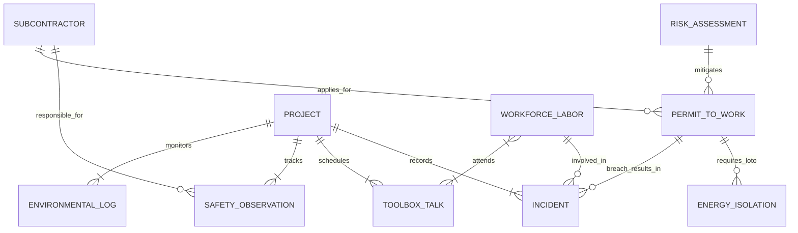

# MimarERP v7 — Module 17: Health, Safety & Environment (HSE) Specification

**System Designation:** `MimarERP v7 / Health, Safety & Environment Subsystem`  
**Standard Compliance:** ISO 45001:2018 (Occupational Health & Safety), ISO 14001:2015 (Environmental Management), OSHA 1926 (Construction Safety Standards), NEBOSH International General Certificate Framework, FIDIC Red Book (Clause 4.8 Safety Procedures & Clause 6.7 Health & Safety)  
**Document Classification:** Tier-1 Enterprise Construction Engineering Specification  
**File Reference:** `d:\ERP sys\docs\modules\17-hse.md`

---

## 1. Module Purpose

The Health, Safety, and Environment (HSE) Module establishes a rigorous, proactive safety management ecosystem engineered to achieve **Zero Harm** across all megaproject jobsites. The module guarantees absolute compliance with international occupational health standards (ISO 45001) and environmental conservation mandates (ISO 14001).

Through automated Permit to Work (PTW) isolation management, continuous Hazard Identification and Risk Assessment (HIRA), instant mobile incident and near-miss reporting, daily digital Toolbox Talks (TBT), and comprehensive environmental emissions and hazardous waste manifests, MimarERP v7 transforms HSE compliance from reactive documentation into real-time operational defense.

---

## 2. Business Objectives

1. **Zero Fatalities & Zero Lost Time Injuries (LTI):** Enforce systematic risk mitigation and uncompromised digital safety stop-work protocols before hazardous activities begin.
2. **100% Digital Permit to Work (PTW) Control:** Eliminate hazardous miscommunication through geofenced, synchronized multi-party sign-offs and Lockout/Tagout (LOTO) verification.
3. **Leading Indicator-Driven Safety Culture:** Elevate proactive reporting (near-misses, unsafe acts, unsafe conditions, daily safety audits) to identify and eliminate catastrophic risk vectors before an incident occurs.
4. **Environmental Stewardship & Circularity:** Enforce real-time accounting of hazardous waste, carbon footprint metrics, construction water recycling, and environmental noise/dust monitoring.
5. **Regulatory & Audit Immunity:** Maintain tamper-proof, timestamped, GPS-verified safety audit trails ready for municipal authorities, labor ministries, and ISO certifiers.

---

## 3. User Roles & Permissions

| Role Code | Role Name | Primary Responsibilities | Access Level |
|---|---|---|---|
| `HSE_DIR` | Corporate HSE Director | Enterprise safety policy, executive incident review, global ESG compliance | Enterprise Admin |
| `HSE_MGR` | Project HSE Manager | Site safety plans, major incident investigation, PTW final approval, authority reporting | Project HSE Admin |
| `HSE_OFFICER`| Field HSE Officer | Daily safety inspections, issuing Stop Work notices, verifying PTW isolations, conducting TBTs | Site Operations Write |
| `PERMIT_APPLICANT`| Site Supervisor / Foreman | Applying for high-risk work permits (Hot Work, Confined Space, Heavy Lift) | Field Request Entry |
| `ISOLATION_AUTH`| Competent Electrical/Mech Engineer | Verifying energy isolation, zero-energy state, and applying physical LOTO padlocks | Specialized Sign-off |
| `ENV_ENG` | Environmental Engineer | Waste disposal tracking, air quality monitoring, hazardous spill containment logs | Environmental Write |
| `SITE_MEDIC` | Occupational Nurse / Site Doctor | First-aid logs, medical treatment recording, fitness-to-work fitness clearances | Medical Record Confidential |
| `SUBCON_HSE` | Subcontractor HSE Coordinator | Daily manpower induction logs, subcontractor near-miss submission, tool inspection logs | External Subcontractor Portal |

---

## 4. Database Tables (Complete Schemas with Types)

```sql
-- Schema: hse

CREATE TYPE hse_incident_severity AS ENUM ('FATALITY', 'LOST_TIME_INJURY', 'RESTRICTED_WORK_CASE', 'MEDICAL_TREATMENT', 'FIRST_AID', 'NEAR_MISS', 'PROPERTY_DAMAGE', 'ENVIRONMENTAL_SPILL');
CREATE TYPE hse_ptw_type AS ENUM ('HOT_WORK', 'CONFINED_SPACE', 'WORKING_AT_HEIGHT', 'DEEP_EXCAVATION', 'HEAVY_LIFTING', 'HIGH_VOLTAGE_ELECTRICAL', 'RADIOGRAPHY', 'DEMOLITION');
CREATE TYPE hse_ptw_status AS ENUM ('DRAFT', 'SUBMITTED', 'ASSESSED', 'ISOLATION_VERIFIED', 'ISSUED_ACTIVE', 'SUSPENDED', 'CLOSED_OUT', 'CANCELLED');
CREATE TYPE hse_risk_level AS ENUM ('LOW', 'MEDIUM', 'HIGH', 'EXTREME');
CREATE TYPE hse_waste_category AS ENUM ('HAZARDOUS_CHEMICAL', 'CONTAMINATED_SOIL', 'CONSTRUCTION_DEBRIS', 'SCRAP_METAL', 'TIMBER_RECYCLABLE', 'WASTE_OIL', 'SEWAGE_EFFLUENT');

-- 1. Hazard Identification & Risk Assessment (HIRA / JSA)
CREATE TABLE hse.risk_assessments (
    hira_id UUID PRIMARY KEY DEFAULT gen_random_uuid(),
    tenant_id UUID NOT NULL,
    project_id UUID NOT NULL,
    activity_name VARCHAR(255) NOT NULL,
    wbs_node_id UUID NOT NULL,
    location_area VARCHAR(150) NOT NULL,
    method_statement_ref VARCHAR(100),
    initial_severity INT NOT NULL CHECK (initial_severity BETWEEN 1 AND 5),
    initial_likelihood INT NOT NULL CHECK (initial_likelihood BETWEEN 1 AND 5),
    initial_risk_score INT GENERATED ALWAYS AS (initial_severity * initial_likelihood) STORED,
    initial_risk_level hse_risk_level NOT NULL,
    control_measures_hierarchy JSONB NOT NULL, -- Elimination, Substitution, Engineering, Admin, PPE
    residual_severity INT NOT NULL CHECK (residual_severity BETWEEN 1 AND 5),
    residual_likelihood INT NOT NULL CHECK (residual_likelihood BETWEEN 1 AND 5),
    residual_risk_score INT GENERATED ALWAYS AS (residual_severity * residual_likelihood) STORED,
    residual_risk_level hse_risk_level NOT NULL,
    approved_by UUID,
    approved_at TIMESTAMPTZ,
    created_at TIMESTAMPTZ DEFAULT clock_timestamp() NOT NULL,
    updated_at TIMESTAMPTZ DEFAULT clock_timestamp() NOT NULL
);

-- 2. Permit to Work (PTW) Master
CREATE TABLE hse.permits_to_work (
    permit_id UUID PRIMARY KEY DEFAULT gen_random_uuid(),
    tenant_id UUID NOT NULL,
    project_id UUID NOT NULL,
    permit_number VARCHAR(60) NOT NULL UNIQUE,
    permit_type hse_ptw_type NOT NULL,
    hira_id UUID REFERENCES hse.risk_assessments(hira_id),
    subcontractor_id UUID,
    exact_location_details TEXT NOT NULL,
    geofence_polygon JSONB, -- GeoJSON bounding area where permit is valid
    valid_from TIMESTAMPTZ NOT NULL,
    valid_until TIMESTAMPTZ NOT NULL,
    applicant_id UUID NOT NULL,
    authorized_gas_tester_id UUID,
    gas_test_results JSONB, -- O2%, LEL%, CO, H2S PPM levels
    emergency_rescue_plan_attached BOOLEAN DEFAULT FALSE NOT NULL,
    status hse_ptw_status DEFAULT 'DRAFT' NOT NULL,
    issued_by_hse_mgr UUID,
    issued_at TIMESTAMPTZ,
    closed_by_applicant UUID,
    closed_at TIMESTAMPTZ,
    handback_verified_by_hse UUID,
    created_at TIMESTAMPTZ DEFAULT clock_timestamp() NOT NULL,
    updated_at TIMESTAMPTZ DEFAULT clock_timestamp() NOT NULL
);

-- 3. Lockout / Tagout (LOTO) Energy Isolations
CREATE TABLE hse.energy_isolations (
    isolation_id UUID PRIMARY KEY DEFAULT gen_random_uuid(),
    permit_id UUID NOT NULL REFERENCES hse.permits_to_work(permit_id) ON DELETE CASCADE,
    energy_source_type VARCHAR(50) NOT NULL, -- 415V Electrical, High Pressure Steam, Pneumatic, Hydraulic, Chemical Line
    equipment_tag_number VARCHAR(100) NOT NULL,
    isolation_point_description TEXT NOT NULL,
    padlock_number VARCHAR(50) NOT NULL,
    danger_tag_id VARCHAR(50) NOT NULL,
    isolated_by UUID NOT NULL,
    zero_energy_verified_at TIMESTAMPTZ NOT NULL,
    de_isolation_date TIMESTAMPTZ,
    de_isolated_by UUID
);

-- 4. Incident & Near Miss Management
CREATE TABLE hse.incidents (
    incident_id UUID PRIMARY KEY DEFAULT gen_random_uuid(),
    tenant_id UUID NOT NULL,
    project_id UUID NOT NULL,
    incident_number VARCHAR(60) NOT NULL UNIQUE,
    incident_datetime TIMESTAMPTZ NOT NULL,
    reported_datetime TIMESTAMPTZ NOT NULL,
    severity hse_incident_severity NOT NULL,
    location_zone VARCHAR(100) NOT NULL,
    gps_latitude NUMERIC(10, 7),
    gps_longitude NUMERIC(10, 7),
    injured_person_id UUID, -- References workforce labor or subcontractor
    injured_person_trade VARCHAR(50),
    injury_nature VARCHAR(150), -- Fracture, Laceration, Heat Stroke, Chemical Burn
    body_part_affected VARCHAR(100),
    days_lost INT DEFAULT 0 NOT NULL,
    direct_causes TEXT NOT NULL,
    root_causes TEXT,
    immediate_actions_taken TEXT NOT NULL,
    corrective_actions JSONB DEFAULT '[]',
    statutory_authority_notified BOOLEAN DEFAULT FALSE,
    investigation_lead_id UUID,
    investigation_status VARCHAR(30) DEFAULT 'UNDER_INVESTIGATION' CHECK (investigation_status IN ('UNDER_INVESTIGATION', 'COMMITTEE_REVIEW', 'CLOSED_VERIFIED')),
    photo_attachments JSONB DEFAULT '[]',
    created_at TIMESTAMPTZ DEFAULT clock_timestamp() NOT NULL,
    updated_at TIMESTAMPTZ DEFAULT clock_timestamp() NOT NULL
);

-- 5. Toolbox Talks (TBT)
CREATE TABLE hse.toolbox_talks (
    tbt_id UUID PRIMARY KEY DEFAULT gen_random_uuid(),
    tenant_id UUID NOT NULL,
    project_id UUID NOT NULL,
    tbt_date DATE NOT NULL,
    topic_title VARCHAR(255) NOT NULL,
    topic_category VARCHAR(100) NOT NULL, -- Heat Stress, Working at Height, Scaffolding Safety, Electrical Hazard
    conducted_by UUID NOT NULL,
    subcontractor_id UUID,
    zone VARCHAR(100) NOT NULL,
    duration_minutes INT DEFAULT 15 NOT NULL,
    total_attendees INT NOT NULL,
    attendance_records JSONB NOT NULL, -- Array of {worker_badge_id, worker_name, signature_timestamp}
    photo_evidence_url VARCHAR(500) NOT NULL,
    created_at TIMESTAMPTZ DEFAULT clock_timestamp() NOT NULL
);

-- 6. Safety Audits, Observations & Stop Work Notices
CREATE TABLE hse.safety_observations (
    observation_id UUID PRIMARY KEY DEFAULT gen_random_uuid(),
    tenant_id UUID NOT NULL,
    project_id UUID NOT NULL,
    observation_type VARCHAR(30) NOT NULL CHECK (observation_type IN ('UNSAFE_ACT', 'UNSAFE_CONDITION', 'POSITIVE_BEHAVIOR', 'STOP_WORK_NOTICE')),
    discipline VARCHAR(50) NOT NULL,
    location VARCHAR(150) NOT NULL,
    subcontractor_id UUID,
    description TEXT NOT NULL,
    photo_url VARCHAR(500) NOT NULL,
    risk_level hse_risk_level NOT NULL,
    rectification_action_required TEXT,
    deadline_datetime TIMESTAMPTZ,
    status VARCHAR(30) DEFAULT 'OPEN' CHECK (status IN ('OPEN', 'RECTIFIED', 'VERIFIED_CLOSED')),
    reported_by UUID NOT NULL,
    verified_by UUID,
    created_at TIMESTAMPTZ DEFAULT clock_timestamp() NOT NULL
);

-- 7. Environmental Waste & Emissions Register
CREATE TABLE hse.environmental_logs (
    env_log_id UUID PRIMARY KEY DEFAULT gen_random_uuid(),
    tenant_id UUID NOT NULL,
    project_id UUID NOT NULL,
    log_date DATE NOT NULL,
    waste_category hse_waste_category NOT NULL,
    quantity_metric_tons NUMERIC(12, 3) NOT NULL,
    disposal_method VARCHAR(100) NOT NULL, -- Recycling Center, Certified Hazardous Landfill, Incineration, Reused on Site
    authorized_waste_hauler VARCHAR(150) NOT NULL,
    waste_manifest_number VARCHAR(100) NOT NULL UNIQUE,
    manifest_document_url VARCHAR(500) NOT NULL,
    carbon_equivalent_kg NUMERIC(12, 2) DEFAULT 0.00,
    spill_incident_occurred BOOLEAN DEFAULT FALSE,
    spill_details TEXT,
    logged_by UUID NOT NULL,
    created_at TIMESTAMPTZ DEFAULT clock_timestamp() NOT NULL
);
```

---

## 5. Entity Relationships (Mermaid)



---

## 6. Business Workflows & Status Transitions

### 6.1 Permit to Work (PTW) Lifecycle & LOTO Verification
1. **Application:** Site Supervisor submits a PTW 24 hours prior to work commencement. The system cross-references the activity against the pre-approved HIRA. Mandatory attachments: Certified Gas Tester results (for Confined Space) and Lifting Plans (for Cranes).
   - *Status Transition:* `DRAFT` $\rightarrow$ `SUBMITTED`.
2. **Technical Hazard Assessment:** Field HSE Officer verifies physical barriers, fire watch appointments, and personal safety equipment. Status: `ASSESSED`.
3. **Energy Isolation (LOTO):** Authorized Competent Engineer isolates electrical breakers, valves, and bleeds residual pressure. Padlock and tag IDs logged. Status: `ISOLATION_VERIFIED`.
4. **Permit Authorization:** Project HSE Manager grants digital approval. Valid for maximum 12-hour shift. Geofence fence activated. Status: `ISSUED_ACTIVE`.
5. **Suspension Trigger:** If an alarm sounds, environmental threshold breached (e.g., wind speed > 38 km/h for cranes), or unsafe condition logged, permit automatically moves to `SUSPENDED`.
6. **Shift Closeout & De-isolation:** Site cleaned, workers cleared, locks removed, permit closed out jointly. Status: `CLOSED_OUT`.

### 6.2 Incident Management, LTI & Statutory Reporting
1. **Flash Immediate Notification:** Within 15 minutes of occurrence, a high-severity alert (`FATALITY`, `LOST_TIME_INJURY`, `MAJOR_FIRE`) triggers automated SMS/Push broadcasts to Executive Leadership.
2. **Site Quarantine & Evidence Preservation:** Immediate stop-work order generated for the zone. GPS coordinates and photos captured.
3. **Formal Investigation:** Safety Committee initiated within 24 hours. Root cause analysis using TapRooT / BowTie methodology.
4. **Statutory Submission:** Regulatory report auto-compiled per Ministry of Human Resources / OSHA formats.
5. **Corrective Action & Closeout:** Preventive controls integrated into site HIRA library.

---

## 7. UI Screens

1. **PTW Live Operations Map & Geofence Monitor:** Interactive satellite GIS map showing all active high-risk permits, live crane radii, confined spaces, and worker heatmaps.
2. **Incident Intake & Fast-Logging Mobile Interface:** Voice-to-text enabled incident logger with body map selector for injury tracking and instant camera upload.
3. **Daily Toolbox Talk (TBT) Digital Roster:** NFC/QR-code badge scanner for scanning worker badges, verifying worker inductions, and logging biometric signatures in the field.
4. **HIRA Interactive Risk Matrix:** Dynamic $5 \times 5$ risk matrix editor linking hazards directly to CSI MasterFormat activities and PPE requirements.
5. **Hazardous Waste Manifest & Disposal Tracker:** Chain-of-custody tracking interface recording waste truck weights, transport licenses, and environmental tipping receipts.
6. **Environmental IoT Telemetry Dashboard:** Real-time gauges streaming PM2.5/PM10 dust levels, ambient decibels, and wet-bulb globe temperature (WBGT) heat-stress indexes.

---

## 8. Dashboards

1. **Executive HSE Cockpit:** Strategic enterprise dashboard tracking Safe Man-Hours Worked without LTI, Lost Time Injury Frequency Rate (LTIFR), Total Recordable Incident Rate (TRIR), and Stop Work frequency.
2. **Operational Safety Command Center:** Daily site overview showing active PTWs by type, pending isolation releases, open high-risk safety observations, and TBT completion rates.
3. **Sustainability & Environmental Governance Cockpit:** ESG tracker displaying monthly carbon emissions, diversion of construction waste from landfills (%), diesel consumption, and water conservation metrics.

---

## 9. Reports (11 Standard Reports)

1. **Executive Monthly HSE Performance Report:** Safe man-hours, LTIFR, TRIR, near-miss ratios, and regulatory compliance status.
2. **Permit to Work (PTW) Compliance & Violation Log:** Active, expired, and suspended permits with isolation audit findings.
3. **Lost Time Injury (LTI) & Severity Rate Statistical Audit:** Detailed analysis of lost workdays, medical costs, and OSHA recordable incidents.
4. **Near-Miss & Proactive Observation Frequency Analysis:** Categorization of unsafe acts vs unsafe conditions across subcontractors.
5. **Daily Toolbox Talk (TBT) Attendance & Topic Matrix:** Audit log verifying that 100% of site workforce attended mandatory daily safety briefings.
6. **Safety Stop Work Notice & Rectification Log:** Register of work stoppages, root causes, contractor rectification time, and financial impacts.
7. **Hazardous Waste Manifest & Chain-of-Custody Register:** Full documentation of all chemical, fuel, and dangerous waste disposals.
8. **Environmental Noise, Dust (PM10/PM2.5) & Emission Telemetry Report:** Statutory environmental impact reports for local environmental agencies.
9. **Subcontractor Safety Rating & Penalty Ledger:** Quantitative scoring of subcontractor safety breaches and associated financial penalties.
10. **Site Emergency Drill & Evacuation Performance Record:** Timed response records for fire, confined space rescue, and chemical spill drills.
11. **Site Clinic Medical & Occupational Health Log:** Daily heat stress, dehydration, minor cuts, and fitness-to-work examinations.

---

## 10. Key Performance Indicators (KPIs)

| KPI Name | Formula | Green (Target) | Amber (Warning) | Red (Critical) |
|---|---|---|---|---|
| **Lost Time Injury Frequency Rate (LTIFR)** | $\frac{\text{LTI Count} \times 1,000,000}{\text{Total Man-Hours Worked}}$ | $0.00$ | $0.01 - 0.50$ | $> 0.50$ |
| **Total Recordable Incident Rate (TRIR)** | $\frac{(\text{LTI + RWC + MTC}) \times 200,000}{\text{Total Man-Hours Worked}}$ | $< 0.80$ | $0.80 - 1.50$ | $> 1.50$ |
| **Near-Miss to Incident Ratio** | $\frac{\text{Near Miss Reports}}{\text{Total Recordable Incidents}}$ | $\ge 25 : 1$ | $10:1 - 24:1$ | $< 10 : 1$ |
| **PTW Audit Compliance Rate** | $\frac{\text{Audited PTWs with Zero Violations}}{\text{Total PTWs Audited}} \times 100$ | $\ge 98\%$ | $90\% - 97.9\%$ | $< 90\%$ |
| **Daily TBT Workforce Coverage** | $\frac{\text{Workers Logged in TBT Daily}}{\text{Total Site Manpower at Gate Turnstiles}} \times 100$ | $\ge 95\%$ | $85\% - 94.9\%$ | $< 85\%$ |
| **Waste Diversion from Landfill** | $\frac{\text{Recycled + Reused Waste (Tons)}}{\text{Total Waste Generated (Tons)}} \times 100$ | $\ge 65\%$ | $50\% - 64.9\%$ | $< 50\%$ |

---

## 11. API Endpoints

```
# Hazard Identification & Risk Assessment
GET    /api/v7/hse/hira                  hse.hira.read
POST   /api/v7/hse/hira                  hse.hira.create
PUT    /api/v7/hse/hira/{id}             hse.hira.update

# Permits to Work
GET    /api/v7/hse/ptw                   hse.ptw.read
POST   /api/v7/hse/ptw                   hse.ptw.create
POST   /api/v7/hse/ptw/{id}/isolate      hse.ptw.isolate
POST   /api/v7/hse/ptw/{id}/authorize    hse.ptw.authorize
POST   /api/v7/hse/ptw/{id}/close        hse.ptw.close

# Incident & Near Miss Management
GET    /api/v7/hse/incidents             hse.incident.read
POST   /api/v7/hse/incidents             hse.incident.create
POST   /api/v7/hse/incidents/{id}/notify-authorities  hse.incident.notify

# Toolbox Talks
GET    /api/v7/hse/tbt                   hse.tbt.read
POST   /api/v7/hse/tbt                   hse.tbt.create
POST   /api/v7/hse/tbt/{id}/attendance   hse.tbt.log_attendance

# Environmental Logs
GET    /api/v7/hse/environmental         hse.env.read
POST   /api/v7/hse/environmental         hse.env.create
```

---

## 12. Required Permissions

- `hse:ptw:apply`: Site supervisors requesting high-risk work permits.
- `hse:ptw:authorize`: Project HSE Managers granting active permit status.
- `hse:loto:execute`: Authorized electrical/mechanical engineers logging tagouts.
- `hse:incident:report`: All site staff allowed to submit initial incident flashes.
- `hse:incident:investigate`: Safety managers modifying root-cause analyses.
- `hse:stop_work:issue`: HSE officers empowered to enforce mandatory site work halts.
- `hse:environmental:certify`: Environmental engineers validating hazardous waste shipments.

---

## 13. Approval Workflows & SLA Matrices

| Workflow Name | Step 1 | Step 2 | Step 3 | Step 4 | SLA Escalation Rule |
|---|---|---|---|---|---|
| **Hot Work PTW** | Site Supervisor (1h) | Safety Officer (1h) | Fire Watch Lead (30m) | Project HSE Mgr (1h) | If unapproved within 3h, alert to Project Director |
| **Confined Space PTW** | Site Supervisor (1h) | Certified Gas Tester (30m) | Rescue Team Leader (1h) | Project HSE Mgr (1h) | Mandatory stop; cannot start without all 4 approvals |
| **LTI Incident Escalation** | Field Officer (15m flash) | HSE Manager (2h report) | Project Director (4h) | Executive VP (12h) | Statutory notification deadline (24h) enforced |

---

## 14. AI Features

1. **Computer Vision PPE & Safe Zone Detection:** Automated live analysis of site CCTV feeds to detect missing hard hats, high-visibility vests, safety harnesses, or unauthorized entry into crane swing zones.
2. **Thermal Heat Stress & Dehydration Warning:** Combines on-site ambient weather station feeds (temperature, relative humidity, WBGT) with biometric smartwatch vitals to trigger automated mandatory rest break alarms.
3. **Incident Narrative NLP Cluster & Root-Cause Predictor:** Analyzes thousands of historical safety observations and near-miss free-text notes across all projects to identify high-probability systemic hazards.
4. **Smart Lifting Plan Collision Checker:** Analyzes 3D crane boom trajectories, load weights, and ground pressure against BIM models to simulate heavy-lift clearances.

---

## 15. Automations

1. **Environmental Weather Stop-Work Interlock:** Automated integration with on-site IoT anemometers immediately revokes active Crane and High-Altitude PTWs if sustained winds exceed 38 km/h.
2. **Access Control Turnstile Lockout:** Workers who have not attended that morning's mandatory Toolbox Talk (TBT) or whose annual safety induction has expired are automatically denied turnstile entry.
3. **Subcontractor Automatic Penalty Deduction:** Approved Stop Work notices or critical safety violations automatically generate a financial debit memo on the subcontractor's monthly IPC account.

---

## 16. Integration Requirements

- **HR & Workforce Management (Module 08):** Worker biometric IDs, trade qualifications, and safety induction certifications feed turnstile access gates.
- **BIM Integration (Module 18):** Visualizes 3D hazard zones, active PTW spheres, and incident cluster coordinates directly inside the digital twin.
- **Plant & Equipment Management (Module 06):** Verifies third-party crane inspection certificates, boom maintenance records, and equipment operator licenses before issuing lifting permits.
- **Subcontractor Claims & Cost Control (Modules 04 & 07):** Automatically computes backcharges and contractual safety penalties against monthly progress billings.
