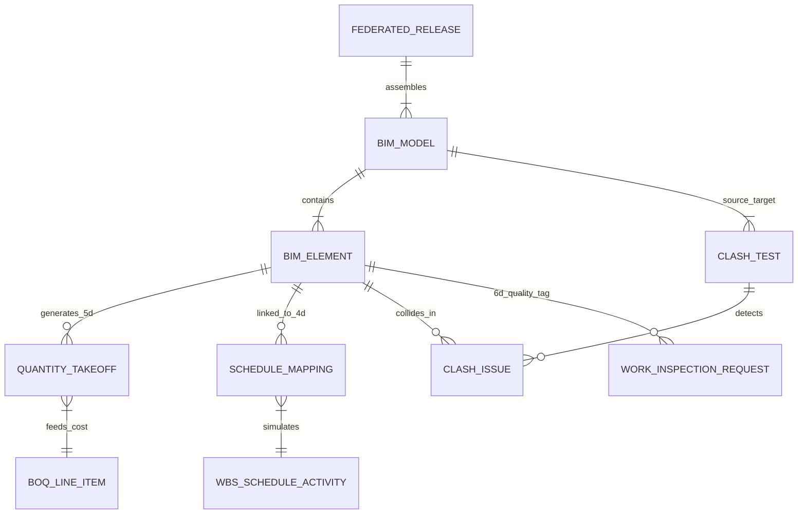

# MimarERP v7 — Module 18: Building Information Modeling (BIM) Integration Specification

**System Designation:** `MimarERP v7 / Building Information Modeling (BIM) Subsystem`  
**Standard Compliance:** ISO 19650 (Organization and digitization of information about buildings and civil engineering works, including BIM), buildingSMART OpenBIM Standards (IFC2x3, IFC4, IFC4.3, BCF 2.1 / 3.0, bSDD), Autodesk Platform Services (APS / Forge API), COBie 2.4, OGC CityGML  
**Document Classification:** Tier-1 Enterprise Construction Engineering Specification  
**File Reference:** `d:\ERP sys\docs\modules\18-bim-integration.md`

---

## 1. Module Purpose

The BIM Integration Module establishes a real-time, bidirectional digital thread connecting design geometry, project schedules (4D), cost estimation / quantity takeoffs (5D), site quality/inspections (6D), and asset lifecycle operations (7D). It transitions MimarERP v7 from a traditional database application into an interactive 3D Visual Construction Operating System.

By ingesting OpenBIM IFC and proprietary CAD/BIM models (Autodesk Revit, Navisworks, Tekla), the module automates automated model federation, Clash Detection & Resolution workflows via BCF, automated 5D Quantity Take-Off (QTO) extraction directly into the Bill of Quantities (BOQ), and real-time visual progress monitoring comparing Planned vs Actual physical installation.

---

## 2. Business Objectives

1. **Integrated 5D Quantity Take-Off (QTO):** Eliminate manual estimation errors by linking 3D geometrical parameters (volumes, areas, linear lengths, counts) directly to BOQ unit rates.
2. **Unified 4D Schedule Simulation:** Visualize construction staging, crane logistics, and temporary works sequences by mapping Primavera P6 / WBS activities to 3D building elements.
3. **Collaborative Clash Resolution via BCF:** Reduce field design clashes and costly rework by orchestrating multi-discipline clash detection (Architectural vs Structural vs MEP) with standardized BCF tracking.
4. **Visual Common Data Environment (ISO 19650):** Manage model versions, revisions, information delivery plans (IDP), and level of development (LOD 100 through LOD 500) within an audit-compliant CDE.
5. **Field-to-Office As-Built Verification:** Streamline on-site quality checks, Work Inspection Requests (WIR), and snagging by allowing site teams to click on 3D elements to view inspection history, mill certs, and live status.

---

## 3. User Roles & Permissions

| Role Code | Role Name | Primary Responsibilities | Access Level |
|---|---|---|---|
| `BIM_DIR` | Corporate BIM Director | BIM Execution Plan (BEP) governance, ISO 19650 compliance, enterprise CDE protocols | Enterprise BIM Admin |
| `BIM_MGR` | Project BIM Manager | Model federation, clash matrix rules, model version baselines, BCF issue assignment | Project BIM Admin |
| `BIM_COORD` | BIM Coordinator (Trade) | Multi-discipline coordination (MEP/Civil/Arch), clash resolution, LOD audits | Coordination Lead |
| `EST_ENG` | 5D Cost Estimator | Automated QTO extraction, mapping IFC quantities to BOQ line items and resource recipes | 5D Commercial Access |
| `PLAN_ENG` | 4D Planning Engineer | Linking WBS schedule activities to 3D elements, running construction sequence simulations | 4D Planning Access |
| `FIELD_ENG` | Site / Field Engineer | Viewing 3D models on tablets, logging snag items, attaching WIRs to BIM elements | Mobile Viewer & Linker |
| `DES_CONSULT`| Design Consultant / Architect | Uploading design model revisions, responding to BCF clash issues and RFIs | External Consultant Portal |

---

## 4. Database Tables (Complete Schemas with Types)

```sql
-- Schema: bim

CREATE TYPE bim_model_format AS ENUM ('IFC2X3', 'IFC4', 'IFC4X3', 'REVIT_RVT', 'NAVISWORKS_NWD', 'DWG_3D', 'GLTF');
CREATE TYPE bim_lod_level AS ENUM ('LOD_100', 'LOD_200', 'LOD_300', 'LOD_350', 'LOD_400', 'LOD_500');
CREATE TYPE bim_clash_status AS ENUM ('NEW', 'ACTIVE', 'REVIEWED', 'APPROVED', 'RESOLVED', 'CLOSED');
CREATE TYPE bim_clash_severity AS ENUM ('CRITICAL', 'MAJOR', 'MODERATE', 'MINOR', 'CLEARANCE');

-- 1. BIM Models & Common Data Environment (CDE) Container
CREATE TABLE bim.models (
    model_id UUID PRIMARY KEY DEFAULT gen_random_uuid(),
    tenant_id UUID NOT NULL,
    project_id UUID NOT NULL,
    model_code VARCHAR(60) NOT NULL UNIQUE,
    model_name VARCHAR(255) NOT NULL,
    discipline VARCHAR(50) NOT NULL, -- Architectural, Structural, HVAC, Plumbing, Electrical, Infrastructure
    source_format bim_model_format NOT NULL,
    original_file_name VARCHAR(255) NOT NULL,
    storage_path VARCHAR(500) NOT NULL,
    file_size_bytes BIGINT NOT NULL,
    current_revision INT DEFAULT 1 NOT NULL,
    lod_level bim_lod_level DEFAULT 'LOD_300' NOT NULL,
    iso19650_suitability VARCHAR(10) DEFAULT 'S0' CHECK (iso19650_suitability IN ('S0', 'S1', 'S2', 'S3', 'S4', 'A1', 'B1')),
    spatial_offset_x NUMERIC(12, 4) DEFAULT 0.0000,
    spatial_offset_y NUMERIC(12, 4) DEFAULT 0.0000,
    spatial_offset_z NUMERIC(12, 4) DEFAULT 0.0000,
    uploaded_by UUID NOT NULL,
    uploaded_at TIMESTAMPTZ DEFAULT clock_timestamp() NOT NULL,
    is_federated_baseline BOOLEAN DEFAULT FALSE NOT NULL
);

-- 2. Federated Model Releases
CREATE TABLE bim.federated_releases (
    release_id UUID PRIMARY KEY DEFAULT gen_random_uuid(),
    tenant_id UUID NOT NULL,
    project_id UUID NOT NULL,
    release_tag VARCHAR(50) NOT NULL UNIQUE, -- e.g., FED-REV-2026-11
    description TEXT,
    included_model_ids JSONB NOT NULL, -- Array of model_id with specific revision numbers
    viewer_manifest_url VARCHAR(500) NOT NULL, -- Optimized streamable web-viewer tiles / SVF2 / glTF bundle
    published_by UUID NOT NULL,
    published_at TIMESTAMPTZ DEFAULT clock_timestamp() NOT NULL
);

-- 3. Ingested BIM Elements
CREATE TABLE bim.elements (
    element_id UUID PRIMARY KEY DEFAULT gen_random_uuid(),
    tenant_id UUID NOT NULL,
    project_id UUID NOT NULL,
    model_id UUID NOT NULL REFERENCES bim.models(model_id) ON DELETE CASCADE,
    ifc_global_id VARCHAR(64) NOT NULL, -- 22-character GUID (e.g., 3y5bQG2y18wvh0r7$5yZ3k)
    element_name VARCHAR(255) NOT NULL,
    ifc_type VARCHAR(100) NOT NULL, -- IfcBeam, IfcColumn, IfcWallStandardCase, IfcPipeSegment
    category VARCHAR(100) NOT NULL,
    storey_level VARCHAR(50) NOT NULL,
    zone_space VARCHAR(100),
    bounding_box JSONB, -- {min: [x,y,z], max: [x,y,z]}
    property_sets JSONB NOT NULL, -- All IFC psets, materials, thermal properties, manufacturer data
    created_at TIMESTAMPTZ DEFAULT clock_timestamp() NOT NULL,
    CONSTRAINT uq_model_ifc_guid UNIQUE (model_id, ifc_global_id)
);

-- 4. 5D Quantity Take-Off (QTO) Mapping
CREATE TABLE bim.quantity_takeoffs (
    qto_id UUID PRIMARY KEY DEFAULT gen_random_uuid(),
    tenant_id UUID NOT NULL,
    project_id UUID NOT NULL,
    element_id UUID NOT NULL REFERENCES bim.elements(element_id) ON DELETE CASCADE,
    boq_item_id UUID NOT NULL, -- Linked to Module 03 Cost Control / BOQ
    extracted_quantity_type VARCHAR(50) NOT NULL, -- NetVolume, NetArea, GrossArea, Length, Count
    extracted_value NUMERIC(15, 4) NOT NULL,
    unit_of_measure VARCHAR(20) NOT NULL,
    formula_expression VARCHAR(255), -- E.g., 'IfcQuantityNetVolume * 1.05 (waste factor)'
    calculated_cost NUMERIC(15, 2) NOT NULL,
    last_synced_at TIMESTAMPTZ DEFAULT clock_timestamp() NOT NULL
);

-- 5. 4D Schedule Simulation Mapping
CREATE TABLE bim.schedule_mappings (
    mapping_id UUID PRIMARY KEY DEFAULT gen_random_uuid(),
    tenant_id UUID NOT NULL,
    project_id UUID NOT NULL,
    element_id UUID NOT NULL REFERENCES bim.elements(element_id) ON DELETE CASCADE,
    wbs_activity_id UUID NOT NULL, -- Linked to Module 02 Planning / P6 Activity
    installation_type VARCHAR(50) DEFAULT 'CONSTRUCT' CHECK (installation_type IN ('CONSTRUCT', 'DEMOLISH', 'TEMPORARY', 'MAINTAIN')),
    planned_start_date DATE NOT NULL,
    planned_end_date DATE NOT NULL,
    actual_start_date DATE,
    actual_end_date DATE,
    physical_percent_complete NUMERIC(5, 2) DEFAULT 0.00 CHECK (physical_percent_complete BETWEEN 0 AND 100),
    visual_color_override VARCHAR(20) -- Hex code or RGBA for 4D simulation playback
);

-- 6. Clash Detection Tests & Matrix Rules
CREATE TABLE bim.clash_tests (
    test_id UUID PRIMARY KEY DEFAULT gen_random_uuid(),
    tenant_id UUID NOT NULL,
    project_id UUID NOT NULL,
    test_name VARCHAR(150) NOT NULL,
    source_model_id UUID NOT NULL REFERENCES bim.models(model_id),
    target_model_id UUID NOT NULL REFERENCES bim.models(model_id),
    tolerance_millimeters NUMERIC(8, 2) DEFAULT 10.00 NOT NULL,
    clearance_distance_mm NUMERIC(8, 2) DEFAULT 0.00 NOT NULL,
    clash_type VARCHAR(30) DEFAULT 'HARD_CLASH' CHECK (clash_type IN ('HARD_CLASH', 'SOFT_CLEARANCE', 'DUPLICATE')),
    last_run_at TIMESTAMPTZ,
    total_clashes_found INT DEFAULT 0
);

-- 7. Clash Issues (BCF 2.1 / 3.0 Compatible)
CREATE TABLE bim.clash_issues (
    issue_id UUID PRIMARY KEY DEFAULT gen_random_uuid(),
    tenant_id UUID NOT NULL,
    project_id UUID NOT NULL,
    test_id UUID REFERENCES bim.clash_tests(test_id),
    bcf_topic_guid UUID DEFAULT gen_random_uuid() NOT NULL UNIQUE,
    title VARCHAR(255) NOT NULL,
    description TEXT,
    severity bim_clash_severity NOT NULL,
    status bim_clash_status DEFAULT 'NEW' NOT NULL,
    element_a_id UUID NOT NULL REFERENCES bim.elements(element_id),
    element_b_id UUID NOT NULL REFERENCES bim.elements(element_id),
    clash_point_x NUMERIC(12, 4) NOT NULL,
    clash_point_y NUMERIC(12, 4) NOT NULL,
    clash_point_z NUMERIC(12, 4) NOT NULL,
    camera_viewpoint JSONB NOT NULL, -- BCF Camera viewpoint: position, target, up vector
    snapshot_png_url VARCHAR(500) NOT NULL,
    assigned_to UUID NOT NULL,
    assigned_trade VARCHAR(50) NOT NULL,
    due_date DATE NOT NULL,
    resolved_in_revision INT,
    created_at TIMESTAMPTZ DEFAULT clock_timestamp() NOT NULL,
    updated_at TIMESTAMPTZ DEFAULT clock_timestamp() NOT NULL
);
```

---

## 5. Entity Relationships (Mermaid)



---

## 6. Business Workflows & Status Transitions

### 6.1 Clash Detection & BCF Coordination Lifecycle
1. **Model Ingestion & Federation:** Discipline models (Architecture, Structural, MEP) are uploaded into the ISO 19650 CDE. Automated parsing runs geometry tessellation and spatial indexing.
2. **Automated Clash Run:** The clash matrix runs overnight. Rule checks include Hard Clashes (e.g., HVAC duct piercing structural concrete beam) and Clearance Clashes (e.g., minimum 50mm fire-lagging gap around chilled pipes).
3. **Clash Triaging & Clustering:** BIM Coordinator reviews raw clash groups. False positives (e.g., penetration sleeves intentionally embedded) are marked as `APPROVED` or `CLOSED`. True clashes are grouped into BCF Topics.
   - *Status Transition:* `NEW` $\rightarrow$ `ACTIVE`.
4. **Assignment via BCF:** The issue is assigned to the Lead MEP Engineer with exact camera coordinates and 3D viewpoints.
5. **Design Revision & Re-federation:** Consultant updates the Revit model, re-routes the duct, and uploads Revision 2.
6. **Automated Verification:** The clash engine re-analyzes the exact coordinate. If resolved, status automatically transitions to `RESOLVED` and subsequently `CLOSED`.

### 6.2 5D QTO Extraction to BOQ Reconciliation
1. **Model Property Extraction:** Ingested elements are parsed for standard IFC quantities (`IfcElementQuantity`, `Qto_WallBaseQuantities`, etc.).
2. **Auto-Mapping Rules:** The system applies CSI MasterFormat recipe rules:
   - For every `IfcWallStandardCase` where `Description` contains `200mm Concrete Blockwork`, map `NetSideArea` to BOQ Item `04-200-01`.
3. **Variance Analysis:** The system generates a variance report comparing the original Tender BOQ quantity against the BIM QTO extracted quantity.
4. **Cost Baseline Lock:** Confirmed QTO quantities are locked into the Commercial Baseline (Module 03).

---

## 7. UI Screens

1. **High-Performance WebGL 3D/BIM Viewer:** Full-browser Three.js / WebAssembly model viewer supporting streaming of multi-gigabyte models, sectioning planes, walk-through mode, measurement tools, and element property inspector.
2. **4D Schedule Simulation Playback Console:** Interactive Gantt chart synchronised with the 3D model viewer. Allows timeline scrub, play/pause, delta visualization (Planned in blue vs Actual in green vs Delayed in red).
3. **5D QTO Extraction & BOQ Rule Mapper:** Split-screen interface showing the 3D model on the left and the BOQ hierarchy on the right, allowing click-to-bind mapping of geometric properties to cost items.
4. **BCF Issue Coordination & Live Clash Matrix:** Kanban board of open design clashes with 3D viewpoint thumbnails, comment threads, markup sketches, and BCF import/export buttons.
5. **CDE Model Version & ISO 19650 Metadata Explorer:** File browser tracking WIP, Shared, Published, and Archived models with cryptographic file checksums (SHA-256) and revision logs.

---

## 8. Dashboards

1. **Executive BIM & Digital Twin Cockpit:** Multi-project view tracking Model Health Index, Total Resolved vs Outstanding Clashes, 5D QTO Cost Coverage (%), and 4D Schedule Integration Completeness.
2. **Discipline Coordination Clash Matrix:** Heatmap matrix displaying clash densities (e.g., MEP vs Structural, Firefighting vs Electrical) and average turnaround time for clash resolution.
3. **Field 6D Quality & Installation Dashboard:** 3D thematic rendering of the building colored by on-site physical installation status and approved WIR inspections.

---

## 9. Reports (11 Standard Reports)

1. **Master Model Coordination & Clash Summary Report:** Executive summary of clash counts, critical blockers, and open BCF topics per discipline.
2. **BCF Open Issues & Responsibility Matrix:** Actionable log of design issues assigned to consultants with overdue aging metrics.
3. **5D BIM Quantity Take-Off (QTO) vs Tender BOQ Reconciliation:** Granular comparison highlighting volumetric surpluses or deficits across all trades.
4. **4D Schedule Variance & Visual Deviation Audit:** Activity dates vs 3D element installation timelines identifying critical path delays.
5. **Model Health & ISO 19650 Compliance Audit:** Audit report tracking missing property sets, unassigned IFC classes, and coordinate alignment errors.
6. **BIM Level of Development (LOD) Delivery Matrix:** Breakdown of model components by LOD 100, 200, 300, 350, 400, and 500 readiness.
7. **MEP Penetration Sleeve & Builder’s Work Verification Log:** Approved architectural/structural openings vs required MEP pipe/duct penetrations.
8. **Field Quality (6D) BIM Element Sign-Off Dossier:** Report listing all building elements with their attached WIRs, MIRs, and consultant approvals.
9. **COBie Asset Handover & FM Commissioning Schedule:** Standardized Construction Operations Building Information Exchange tables for facility managers.
10. **Carbon Embodied Emissions Material Schedule:** Automatic calculation of embodied carbon ($kg CO_2e$) derived from BIM material volumes and densities.
11. **Design Change Impact & Cost Differential Report:** Financial delta analysis tracking cost impacts when a revised model is uploaded.

---

## 10. Key Performance Indicators (KPIs)

| KPI Name | Formula | Green (Target) | Amber (Warning) | Red (Critical) |
|---|---|---|---|---|
| **Clash Resolution Velocity** | $\frac{\text{Clashes Closed in Period}}{\text{Total New Clashes Identified}} \times 100$ | $\ge 90\%$ | $75\% - 89.9\%$ | $< 75\%$ |
| **5D QTO Cost Coverage** | $\frac{\text{BOQ Value Linked Directly to BIM Elements}}{\text{Total Direct BOQ Budget}} \times 100$ | $\ge 85\%$ | $70\% - 84.9\%$ | $< 70\%$ |
| **4D Schedule Mapping Rate** | $\frac{\text{Critical Path Schedule Activities Linked to 3D Elements}}{\text{Total Critical Path Activities}} \times 100$ | $\ge 95\%$ | $80\% - 94.9\%$ | $< 80\%$ |
| **Model Data Integrity Score** | $\frac{\text{Elements with Full Required Pset Data}}{\text{Total Ingested Elements}} \times 100$ | $\ge 95\%$ | $85\% - 94.9\%$ | $< 85\%$ |
| **Average BCF Turnaround Time** | $\text{Avg}(\text{Date Resolved} - \text{Date Logged})$ (Days) | $\le 5\text{ days}$ | $6 - 10\text{ days}$ | $> 10\text{ days}$ |
| **Site Rework Attributable to Clashes**| $\frac{\text{NCRs Caused by Spatial Clash Breaches}}{\text{Total Issued Project NCRs}} \times 100$ | $< 2\%$ | $2\% - 5\%$ | $> 5\%$ |

---

## 11. API Endpoints

```
# Model Management & Ingestion
GET    /api/v7/bim/models                bim.model.read
POST   /api/v7/bim/models/upload         bim.model.upload
POST   /api/v7/bim/models/{id}/parse     bim.model.parse
GET    /api/v7/bim/models/{id}/manifest  bim.model.manifest

# Elements & Metadata
GET    /api/v7/bim/elements              bim.element.read
GET    /api/v7/bim/elements/{guid}       bim.element.details
PATCH  /api/v7/bim/elements/{guid}/props bim.element.update_props

# 5D QTO & 4D Schedule
GET    /api/v7/bim/qto/extract           bim.qto.extract
POST   /api/v7/bim/qto/map-to-boq        bim.qto.map
POST   /api/v7/bim/schedule/link-4d      bim.schedule.link

# Clash Detection & BCF
POST   /api/v7/bim/clash/run-test        bim.clash.execute
GET    /api/v7/bim/bcf/topics            bim.bcf.read
POST   /api/v7/bim/bcf/topics            bim.bcf.create
PATCH  /api/v7/bim/bcf/topics/{id}/status bim.bcf.status_update
POST   /api/v7/bim/bcf/export-zip        bim.bcf.export
```

---

## 12. Required Permissions

- `bim:model:upload`: Upload new model revisions into the CDE.
- `bim:model:publish`: Formal release of federated baseline models.
- `bim:qto:execute`: Extract geometrical quantities and write to BOQ.
- `bim:clash:run`: Configure and execute clash detection rules.
- `bim:bcf:assign`: Assign clash remediation tasks to consultants.
- `bim:4d:simulate`: Link schedule activities and author 4D timeline sequences.
- `bim:element:inspect`: Field engineers attaching WIR/snag records to elements.

---

## 13. Approval Workflows & SLA Matrices

| Workflow Name | Step 1 | Step 2 | Step 3 | Step 4 | SLA Escalation Rule |
|---|---|---|---|---|---|
| **CDE Model Publication** | Trade BIM Coord (12h) | Project BIM Mgr (24h) | Lead Design Consultant (48h) | Project Director (24h) | If unapproved within 4 days, flags risk on Milestone baseline |
| **Critical Clash Closure** | Assigned Engineer (48h) | BIM Coordinator (24h) | Lead Consultant (24h) | Project BIM Mgr (12h) | If overdue > 7 days, auto-escalates to Technical Director |
| **QTO Budget Reconciliation** | 5D Estimator (24h) | Cost Control Mgr (24h) | Commercial Director (24h) | — | Holds procurement package release until resolved |

---

## 14. AI Features

1. **Automated IFC Class & CSI Classification:** Machine learning parses CAD geometry, dimensions, and free-text names to automatically classify unassigned geometry into correct IFC classes (`IfcBeam`, `IfcColumn`) and CSI MasterFormat codes.
2. **Intelligent Clash Clustering & Noise Filtering:** Uses spatial clustering algorithms (DBSCAN) to group hundreds of individual clash points caused by a single misaligned duct into one actionable master clash issue.
3. **Automated 4D Schedule Linker:** Semantic NLP matches Primavera P6 activity names (e.g., "Level 4 Slab Pour Zone B") with BIM spatial levels and element names, generating 90%+ accurate 4D schedule links automatically.
4. **Generative Spatial Clearance Optimizer:** Recommends optimal duct and pipe routing adjustments to resolve clashes while preserving required gravity-flow slopes and headroom clearance.

---

## 15. Automations

1. **Auto-Nightly Clash Engine:** Automatically triggers cloud-based multi-discipline clash runs whenever a new model revision is committed to the CDE shared folder.
2. **Inspection Colorization Sync:** When a WIR is marked `APPROVED_A` in Module 16, the corresponding 3D BIM elements automatically turn solid green in the visual model for all project viewers.
3. **BOQ Variance Warning:** Automatically flags an alert to the Commercial Manager if a newly uploaded model revision increases the required concrete volume or rebar tonnage by more than 2% over the approved budget.

---

## 16. Integration Requirements

- **Cost Control & BOQ (Module 03):** Direct data pipeline transferring extracted QTO dimensions to unit-rate cost recipes and tender budgets.
- **Project Planning & Scheduling (Module 02):** Bidirectional sync with Primavera P6 / MS Project XML to drive 4D animation of baseline vs actual progress.
- **QA/QC & Mobile Inspections (Module 16):** 3D element GUIDs embedded into Work Inspection Requests (WIR), Snags, and Material approvals.
- **Procurement & Inventory (Module 05):** Visualizes supply chain material delivery status (e.g., Blue = In Transit, Yellow = At Site Yard, Green = Installed).
