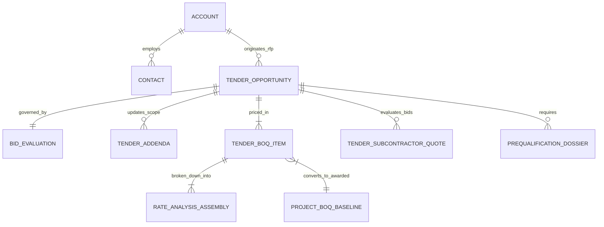

# MimarERP v7 — Module 19: CRM & Tendering Specification

**System Designation:** `MimarERP v7 / Customer Relationship Management & Tendering Subsystem`  
**Standard Compliance:** FIDIC Procurement Procedures Guide, World Bank Procurement Guidelines, RICS Guidance Notes (Tendering Strategies & Order of Cost Estimating), ISO 9001:2015, ZATCA / Regional Tax Regulations  
**Document Classification:** Tier-1 Enterprise Construction Engineering Specification  
**File Reference:** `d:\ERP sys\docs\modules\19-crm-tendering.md`

---

## 1. Module Purpose

The CRM & Tendering Module powers the commercial front-end of MimarERP v7, driving business development from early client and consultant engagement through formal Pre-Qualification (PQ), systematic Bid/No-Bid gatekeeping, detailed multi-resource cost estimation, BOQ pricing, and automated tender submission packaging.

The module bridges commercial sales intelligence and technical estimating rigor. It eliminates bid calculation errors, accelerates RFP response turnarounds, tracks all tender addenda and clarifications with immutable revision histories, and seamlessly converts awarded tenders into live project budgets, contracts, and baseline Work Breakdown Structures (WBS).

---

## 2. Business Objectives

1. **Strategic Pipeline Conversion:** Maximize win rates by prioritizing high-margin, low-risk opportunities through an algorithmic Bid/No-Bid scoring matrix.
2. **Precision Cost Estimating:** Build defensible direct and indirect cost estimates utilizing dynamic multi-resource assemblies (Labor, Plant, Material, Subcontractor, Risk Contingency).
3. **Flawless Addenda Management:** Instantly reconcile consultant circulars, scope revisions, and tender bulletins against active estimate sheets without version confusion.
4. **Automated Submission Production:** Generate compliant technical and commercial tender bid books, compliance statements, tender bond requests, and prequalification packages in minutes.
5. **Post-Award Budget Handover:** Automatically transfer the final priced tender estimate into the operational Project Budget (Module 03) and Procurement Schedule (Module 05) with zero re-keying.

---

## 3. User Roles & Permissions

| Role Code | Role Name | Primary Responsibilities | Access Level |
|---|---|---|---|
| `BD_DIR` | Chief Commercial / BD Director | Market strategy, client relations, final tender pricing review, executive bid approval | Executive Commercial Admin |
| `BD_MGR` | Business Development Manager | Lead generation, client qualification, PQ submissions, consultant networking | BD Pipeline Write |
| `CHIEF_EST` | Chief Estimator | Estimating team allocation, bid pricing strategy, markup & margin application | Estimating Lead Admin |
| `SENIOR_EST` | Senior Estimator (Civil/MEP) | Detailed first-principles cost buildup, subcontractor quote evaluation, BOQ pricing | Full Estimating Write |
| `BID_COORD` | Bid / Proposal Coordinator | Document assembly, RFP compliance matrices, addenda logging, bond requests | Bid Coordination Write |
| `LEGAL_CNSL` | Commercial / Legal Counsel | Contract review, FIDIC clause risk markup, bonding conditions, joint venture terms | Commercial Review & Legal Sign |
| `CLIENT_REP` | External Client / Employer | Direct RFP portal interaction, clarification exchanges, tender interview scheduling | External Client Portal |

---

## 4. Database Tables (Complete Schemas with Types)

```sql
-- Schema: crm_tendering

CREATE TYPE crm_lead_stage AS ENUM ('LEAD_IDENTIFIED', 'PRE_QUALIFICATION', 'RFP_ISSUED', 'BID_NO_BID_EVAL', 'ESTIMATING_IN_PROGRESS', 'PRICING_REVIEW', 'SUBMITTED', 'UNDER_EVALUATION', 'AWARDED', 'LOST', 'ABANDONED');
CREATE TYPE crm_contract_type AS ENUM ('LUMP_SUM_FIDIC_RED', 'MEASURED_UNIT_PRICE', 'DESIGN_BUILD_YELLOW', 'EPC_TURNKEY_SILVER', 'COST_PLUS_PERCENT', 'CONSTRUCTION_MANAGEMENT');
CREATE TYPE crm_tender_bond_status AS ENUM ('NOT_REQUIRED', 'REQUESTED', 'ISSUED_BY_BANK', 'SUBMITTED_TO_CLIENT', 'RETURNED_DISCHARGED', 'CALLED_FORFEITED');
CREATE TYPE crm_rate_resource_type AS ENUM ('LABOR', 'PLANT_EQUIPMENT', 'RAW_MATERIAL', 'SPECIALIST_SUBCONTRACTOR', 'PRELIMINARY_OVERHEAD');

-- 1. Accounts & Stakeholders (Clients, Developers, Master Planners, Consultants)
CREATE TABLE crm_tendering.accounts (
    account_id UUID PRIMARY KEY DEFAULT gen_random_uuid(),
    tenant_id UUID NOT NULL,
    account_code VARCHAR(50) NOT NULL UNIQUE,
    account_name VARCHAR(255) NOT NULL,
    account_type VARCHAR(50) NOT NULL CHECK (account_type IN ('CLIENT_OWNER', 'GOVERNMENT_AUTHORITY', 'CONSULTING_ENGINEER', 'PROJECT_MANAGER_PMO', 'JOINT_VENTURE_PARTNER')),
    industry_segment VARCHAR(100) NOT NULL, -- Commercial, Residential, Healthcare, Infrastructure, Industrial
    commercial_registration_number VARCHAR(100),
    vat_tax_number VARCHAR(100),
    credit_rating VARCHAR(10) DEFAULT 'A',
    payment_reliability_score NUMERIC(5, 2) DEFAULT 85.00, -- Historical payment behavior metric
    headquarters_address TEXT,
    website_url VARCHAR(255),
    created_at TIMESTAMPTZ DEFAULT clock_timestamp() NOT NULL,
    updated_at TIMESTAMPTZ DEFAULT clock_timestamp() NOT NULL
);

-- 2. Contact Directory
CREATE TABLE crm_tendering.contacts (
    contact_id UUID PRIMARY KEY DEFAULT gen_random_uuid(),
    tenant_id UUID NOT NULL,
    account_id UUID NOT NULL REFERENCES crm_tendering.accounts(account_id) ON DELETE CASCADE,
    first_name VARCHAR(100) NOT NULL,
    last_name VARCHAR(100) NOT NULL,
    job_title VARCHAR(150) NOT NULL,
    email VARCHAR(255) NOT NULL,
    phone_number VARCHAR(50),
    is_key_decision_maker BOOLEAN DEFAULT FALSE,
    relationship_strength VARCHAR(20) DEFAULT 'WARM' CHECK (relationship_strength IN ('CHAMPION', 'WARM', 'NEUTRAL', 'COLD', 'ADVERSARIAL')),
    created_at TIMESTAMPTZ DEFAULT clock_timestamp() NOT NULL
);

-- 3. Tender Opportunities Pipeline
CREATE TABLE crm_tendering.tender_opportunities (
    opportunity_id UUID PRIMARY KEY DEFAULT gen_random_uuid(),
    tenant_id UUID NOT NULL,
    opportunity_code VARCHAR(60) NOT NULL UNIQUE, -- e.g. TND-2026-0042
    title VARCHAR(255) NOT NULL,
    client_id UUID NOT NULL REFERENCES crm_tendering.accounts(account_id),
    consultant_id UUID REFERENCES crm_tendering.accounts(account_id),
    contract_type crm_contract_type NOT NULL,
    project_location VARCHAR(150) NOT NULL,
    estimated_project_value NUMERIC(18, 2) NOT NULL,
    currency VARCHAR(10) DEFAULT 'USD' NOT NULL,
    bid_stage crm_lead_stage DEFAULT 'LEAD_IDENTIFIED' NOT NULL,
    rfp_receipt_date DATE,
    clarification_deadline DATE,
    submission_deadline TIMESTAMPTZ NOT NULL,
    tender_validity_days INT DEFAULT 90 NOT NULL,
    tender_bond_amount NUMERIC(15, 2),
    tender_bond_status crm_tender_bond_status DEFAULT 'NOT_REQUIRED' NOT NULL,
    bid_manager_id UUID NOT NULL,
    lead_estimator_id UUID,
    win_probability_percent NUMERIC(5, 2) DEFAULT 50.00,
    bid_no_bid_score NUMERIC(5, 2),
    created_at TIMESTAMPTZ DEFAULT clock_timestamp() NOT NULL,
    updated_at TIMESTAMPTZ DEFAULT clock_timestamp() NOT NULL
);

-- 4. Bid / No-Bid Decision Criteria Matrix
CREATE TABLE crm_tendering.bid_evaluations (
    evaluation_id UUID PRIMARY KEY DEFAULT gen_random_uuid(),
    opportunity_id UUID NOT NULL REFERENCES crm_tendering.tender_opportunities(opportunity_id) ON DELETE CASCADE,
    client_financial_strength_score INT NOT NULL CHECK (client_financial_strength_score BETWEEN 1 AND 10),
    project_technical_fit_score INT NOT NULL CHECK (project_technical_fit_score BETWEEN 1 AND 10),
    contract_risk_terms_score INT NOT NULL CHECK (contract_risk_terms_score BETWEEN 1 AND 10),
    resource_availability_score INT NOT NULL CHECK (resource_availability_score BETWEEN 1 AND 10),
    margin_potential_score INT NOT NULL CHECK (margin_potential_score BETWEEN 1 AND 10),
    competition_intensity_score INT NOT NULL CHECK (competition_intensity_score BETWEEN 1 AND 10),
    weighted_composite_score NUMERIC(5, 2) NOT NULL,
    executive_recommendation VARCHAR(20) NOT NULL CHECK (executive_recommendation IN ('BID', 'NO_BID', 'BID_WITH_QUALIFICATIONS')),
    evaluator_notes TEXT,
    approved_by UUID NOT NULL,
    approved_at TIMESTAMPTZ DEFAULT clock_timestamp() NOT NULL
);

-- 5. Tender Addenda & Circular Bulletins
CREATE TABLE crm_tendering.tender_addenda (
    addendum_id UUID PRIMARY KEY DEFAULT gen_random_uuid(),
    opportunity_id UUID NOT NULL REFERENCES crm_tendering.tender_opportunities(opportunity_id) ON DELETE CASCADE,
    bulletin_number VARCHAR(50) NOT NULL,
    receipt_date DATE NOT NULL,
    summary_of_changes TEXT NOT NULL,
    scope_change_detected BOOLEAN DEFAULT FALSE NOT NULL,
    boq_revision_required BOOLEAN DEFAULT FALSE NOT NULL,
    deadline_extended BOOLEAN DEFAULT FALSE NOT NULL,
    revised_submission_deadline TIMESTAMPTZ,
    document_attachment_url VARCHAR(500) NOT NULL,
    acknowledged_by_client BOOLEAN DEFAULT FALSE,
    logged_by UUID NOT NULL,
    created_at TIMESTAMPTZ DEFAULT clock_timestamp() NOT NULL
);

-- 6. Tender Bill of Quantities (Priced BOQ Master)
CREATE TABLE crm_tendering.tender_boq_items (
    boq_item_id UUID PRIMARY KEY DEFAULT gen_random_uuid(),
    opportunity_id UUID NOT NULL REFERENCES crm_tendering.tender_opportunities(opportunity_id) ON DELETE CASCADE,
    bill_number VARCHAR(50) NOT NULL,
    item_code VARCHAR(50) NOT NULL,
    description TEXT NOT NULL,
    csi_masterformat_code VARCHAR(50),
    quantity NUMERIC(15, 3) NOT NULL,
    unit_of_measure VARCHAR(20) NOT NULL,
    direct_cost_labor NUMERIC(15, 2) DEFAULT 0.00 NOT NULL,
    direct_cost_plant NUMERIC(15, 2) DEFAULT 0.00 NOT NULL,
    direct_cost_material NUMERIC(15, 2) DEFAULT 0.00 NOT NULL,
    direct_cost_subcontractor NUMERIC(15, 2) DEFAULT 0.00 NOT NULL,
    net_direct_unit_rate NUMERIC(15, 2) GENERATED ALWAYS AS (direct_cost_labor + direct_cost_plant + direct_cost_material + direct_cost_subcontractor) STORED,
    allocated_indirect_cost NUMERIC(15, 2) DEFAULT 0.00 NOT NULL,
    markup_contingency_percent NUMERIC(5, 2) DEFAULT 5.00 NOT NULL,
    markup_head_office_percent NUMERIC(5, 2) DEFAULT 7.00 NOT NULL,
    markup_profit_percent NUMERIC(5, 2) DEFAULT 10.00 NOT NULL,
    final_tender_unit_rate NUMERIC(15, 2) NOT NULL,
    final_tender_total_amount NUMERIC(18, 2) GENERATED ALWAYS AS (quantity * final_tender_unit_rate) STORED,
    created_at TIMESTAMPTZ DEFAULT clock_timestamp() NOT NULL,
    updated_at TIMESTAMPTZ DEFAULT clock_timestamp() NOT NULL
);

-- 7. Resource Cost Buildup Assemblies (Rate Analysis Recipes)
CREATE TABLE crm_tendering.rate_analysis_assemblies (
    assembly_id UUID PRIMARY KEY DEFAULT gen_random_uuid(),
    boq_item_id UUID NOT NULL REFERENCES crm_tendering.tender_boq_items(boq_item_id) ON DELETE CASCADE,
    resource_type crm_rate_resource_type NOT NULL,
    resource_description VARCHAR(255) NOT NULL,
    consumption_rate NUMERIC(12, 4) NOT NULL, -- e.g., 0.25 man-hours per m3
    unit_cost_rate NUMERIC(15, 2) NOT NULL, -- e.g., $35 per man-hour
    total_resource_cost NUMERIC(15, 2) GENERATED ALWAYS AS (consumption_rate * unit_cost_rate) STORED,
    vendor_quote_ref VARCHAR(100)
);

-- 8. Tender Subcontractor RFQ Package Quotes
CREATE TABLE crm_tendering.tender_subcontractor_quotes (
    quote_id UUID PRIMARY KEY DEFAULT gen_random_uuid(),
    opportunity_id UUID NOT NULL REFERENCES crm_tendering.tender_opportunities(opportunity_id) ON DELETE CASCADE,
    trade_package_name VARCHAR(150) NOT NULL, -- e.g. Piling, Structural Steel, Curtain Wall, Fire Suppression
    subcontractor_id UUID NOT NULL,
    quoted_amount NUMERIC(18, 2) NOT NULL,
    currency VARCHAR(10) DEFAULT 'USD' NOT NULL,
    is_technically_compliant BOOLEAN NOT NULL,
    exceptions_clarifications TEXT,
    is_selected_plug_figure BOOLEAN DEFAULT FALSE NOT NULL,
    evaluated_by UUID NOT NULL,
    created_at TIMESTAMPTZ DEFAULT clock_timestamp() NOT NULL
);
```

---

## 5. Entity Relationships (Mermaid)



---

## 6. Business Workflows & Status Transitions

### 6.1 Tender Opportunity & Estimating Lifecycle
1. **Lead Intake & Pre-Qualification:** BD identifies opportunity; submits structured pre-qualification dossier (PQ) covering financials, plant capability, and ISO certificates. Status: `LEAD_IDENTIFIED` $\rightarrow$ `PRE_QUALIFICATION`.
2. **RFP Issuance & Bid/No-Bid Decision:** Formal tender documents received. Estimating and Commercial teams run the $5 \times 5$ scoring algorithm. If score $\ge 70$, opportunity moves to active bidding.
   - *Status Transition:* `RFP_ISSUED` $\rightarrow$ `BID_NO_BID_EVAL` $\rightarrow$ `ESTIMATING_IN_PROGRESS`.
3. **Direct Cost Buildup & RFQ Packages:** Trade estimators break down BOQ items into first-principles labor crews, equipment cycles, and bulk material quotes. Specialist packages (Elevators, Piling, Façade) dispatched to market for quotes.
4. **Indirects & Preliminaries Costing:** Estimator models time-related overheads (Site offices, Tower cranes, Project staff, Insurance, Tender bonds).
5. **Addenda Scope Reconciliation:** Incoming client circulars update drawing sets and BOQ revisions. System highlights affected rate items.
6. **Executive Pricing Review:** Chief Estimator and Commercial Director conduct margin analysis, stress-test inflation/currency risks, and apply final overhead and profit markups. Status: `PRICING_REVIEW`.
7. **Submission & Post-Tender Negotiations:** Tender book compiled, tender bond posted, and bid delivered. Status: `SUBMITTED` $\rightarrow$ `UNDER_EVALUATION`.
8. **Award & Project Handover:** Upon Letter of Award (LOA), the estimate automatically branches into the live Project Budget and Contract Baseline. Status: `AWARDED`.

---

## 7. UI Screens

1. **CRM Pipeline & Opportunity Stage Board:** High-impact Kanban board visualizing tender values across conversion stages with win-probability weighted totals.
2. **Interactive Bid/No-Bid Scorecard:** Multi-criteria weighted matrix with financial solvency flags and automated go/no-go recommendations.
3. **First-Principles Estimating Worksheet:** High-performance tabular spreadsheet editor with autocomplete for resource assemblies, productivity crews, and unit rates.
4. **Subcontractor RFQ Comparison & Plug-Figure Matrix:** Side-by-side trade quote comparison tool normalizing scope exclusions, payment terms, and technical compliance.
5. **Addenda Circular Impact Tracker:** Document comparison view detecting modified scope clauses, new line items, and schedule changes between revisions.
6. **Executive Markup, Cash Flow & Margin Simulator:** Scenario modeling tool testing gross margin shifts, cash flow curve implications, and currency hedge options.

---

## 8. Dashboards

1. **Executive Commercial & BD Cockpit:** Enterprise view tracking Total Active Bid Pipeline Value, Cumulative Won Contracts YTD, Hit Rate (Win/Loss Ratio), and Bid Margin Averages.
2. **Estimating Operations Command Center:** Live department workload tracker showing active bids by deadline, estimator bandwidth allocation, and subcontractor quote return rates.
3. **Win/Loss & Competitor Intelligence Board:** Analytics revealing pricing variance against winning competitors, client-specific hit rates, and primary loss factors (Price, Technical Score, Commercial Terms).

---

## 9. Reports (11 Standard Reports)

1. **Master Commercial Pipeline & Forecast Report:** Weighted pipeline summary categorizing opportunities by client, sector, probability, and projected award date.
2. **Bid/No-Bid Governance Audit Record:** Formal historical record of all evaluated tenders and the rationale behind bidding decisions.
3. **Comprehensive Tender Cost Estimate & Rate Buildup Book:** Full technical rate analysis detailing labor, plant, material, and sub-tier costs per BOQ item.
4. **Project Indirects & General Preliminary Cost Breakdown:** Detailed monthly expenditure plan for staff, temporary utilities, site offices, and plant rentals.
5. **Subcontractor Commercial Bid Evaluation Summary:** Multi-vendor quote comparison sheets justifying selected trade subcontractor plug-figures.
6. **Tender Addenda & Clarifications Revisions Log:** Complete register of all client bulletins, questionnaires, and resulting cost modifications.
7. **Tender Bond & Guarantee Liability Schedule:** Bank guarantee exposure report detailing active bid bonds, expiry dates, and commission fees.
8. **Tender Submission Compliance & Exceptions Register:** Clause-by-clause contract departure list submitted with the tender package.
9. **Tender-to-Award Handover & Budget Reconciliation Dossier:** The formal commercial transition document locking the initial execution budget.
10. **Competitor Pricing Intelligence & Benchmark Analysis:** Historical review of competitor pricing spreads and market winning margins.
11. **Client & Consultant Relationship Health Matrix:** Multi-year tracking of client revenue generation, dispute frequency, and repeat bidding invitations.

---

## 10. Key Performance Indicators (KPIs)

| KPI Name | Formula | Green (Target) | Amber (Warning) | Red (Critical) |
|---|---|---|---|---|
| **Tender Win Rate (By Value)** | $\frac{\text{Value of Contracts Awarded}}{\text{Total Value of Tenders Submitted}} \times 100$ | $\ge 25\%$ | $15\% - 24.9\%$ | $< 15\%$ |
| **Bid-to-Award Ratio (By Count)** | $\frac{\text{Number of Won Tenders}}{\text{Total Tenders Submitted}} \times 100$ | $\ge 20\%$ | $12\% - 19.9\%$ | $< 12\%$ |
| **Estimation Accuracy Index** | $1 - \left|\frac{\text{Actual Final Project Cost} - \text{Tender Base Cost}}{\text{Tender Base Cost}}\right|$ | $\ge 95\%$ | $90\% - 94.9\%$ | $< 90\%$ |
| **Subcontractor Quote Coverage** | $\frac{\text{Specialist BOQ Value Supported by } \ge 3 \text{ Quotes}}{\text{Total Specialist BOQ Value}} \times 100$ | $\ge 90\%$ | $75\% - 89.9\%$ | $< 75\%$ |
| **Bid Assembly Turnaround Time** | $\text{Avg}(\text{Days from RFP to Submission})$ vs RFP Allowance | $\le 85\%\text{ of time}$ | $86\% - 99\%$ | $> 100\%\text{ (Late)}$ |
| **Tender Margin Retention** | $\frac{\text{Projected Gross Margin at Contract Signing}}{\text{Target Margin at Pricing Review}} \times 100$ | $\ge 98\%$ | $92\% - 97.9\%$ | $< 92\%$ |

---

## 11. API Endpoints

```
# Accounts & Opportunities
GET    /api/v7/crm/accounts              crm.account.read
POST   /api/v7/crm/accounts              crm.account.create
GET    /api/v7/crm/opportunities         crm.opportunity.read
POST   /api/v7/crm/opportunities         crm.opportunity.create
PATCH  /api/v7/crm/opportunities/{id}/stage crm.opportunity.update_stage

# Bid / No-Bid
POST   /api/v7/crm/opportunities/{id}/evaluate crm.opportunity.evaluate

# Tender BOQ & Estimating
GET    /api/v7/tendering/boq             tendering.boq.read
POST   /api/v7/tendering/boq/batch       tendering.boq.batch_create
POST   /api/v7/tendering/boq/{id}/assembly tendering.boq.add_assembly
POST   /api/v7/tendering/boq/apply-markups tendering.boq.markups

# Addenda & Circulars
GET    /api/v7/tendering/addenda         tendering.addenda.read
POST   /api/v7/tendering/addenda         tendering.addenda.create

# Award & Handover
POST   /api/v7/tendering/opportunities/{id}/award-to-project tendering.award
```

---

## 12. Required Permissions

- `crm:opportunity:create`: Register new prospective tender leads.
- `crm:bid_no_bid:approve`: Authorize bidding on projects exceeding threshold values.
- `tendering:boq:estimate`: Develop first-principles rate analysis and input unit costs.
- `tendering:subcontractor:evaluate`: Compare and select trade subcontractor bids.
- `tendering:pricing:finalize`: Executive authority to apply corporate markups and margins.
- `tendering:bond:request`: Request Treasury to issue tender bank guarantees.
- `tendering:handover:execute`: Convert awarded tender estimate into live operational ERP project.

---

## 13. Approval Workflows & SLA Matrices

| Workflow Name | Step 1 | Step 2 | Step 3 | Step 4 | SLA Escalation Rule |
|---|---|---|---|---|---|
| **Bid / No-Bid Gate** | Business Dev Mgr (24h) | Chief Estimator (24h) | Technical Director (24h) | Chief Executive (24h) | Must finalize $\ge 14$ days before submission date |
| **Subcontractor Selection** | Trade Estimator (12h) | Senior Estimator (24h) | Chief Estimator (12h) | — | Unresolved plugs flag commercial risk |
| **Final Tender Pricing** | Chief Estimator (24h) | Commercial Director (24h) | Chief Financial Officer (24h) | CEO / Board (48h) | Hard lock 48h prior to client submission deadline |

---

## 14. AI Features

1. **Automated RFP & Specification Scraper:** Generative AI extracts key commercial terms (Liquidated Damages caps, retention percentages, defect liability periods, advance payment bonds) directly from PDF tender documents.
2. **Predictive Win-Probability Scoring:** Machine learning model evaluates historical win/loss outcomes against client identity, consultant tendencies, project type, contract size, and planned profit margins.
3. **Smart BOQ Rate Matcher & Assembly Auto-Populator:** Semantic search automatically suggests historical unit cost recipes and supplier quote benchmarks for newly imported client BOQ descriptions.
4. **Unbalanced Bidding Strategy Optimizer:** Mathematical model optimizes early-stage BOQ rate loadings (front-loading) while keeping the aggregate bid sum competitive, maximizing project cash flow.

---

## 15. Automations

1. **Addenda Scope Variance Highlighter:** Ingested Excel or PDF addenda are automatically diffed against the previous baseline, highlighting modified quantities, deleted items, or revised specifications.
2. **Instant Tender Bond Request Dispatch:** Setting the tender bond status to `REQUESTED` automatically formats and dispatches the bank guarantee application package to the Treasury department.
3. **Auto-Transition to Operational ERP:** When marked `AWARDED`, the system automatically provisions the new Project Master record, maps the Tender BOQ directly to the baseline Cost Breakdown Structure (CBS), and generates initial procurement requisition schedules.

---

## 16. Integration Requirements

- **BIM Integration (Module 18):** Ingests 5D Quantity Take-Off (QTO) models directly into the tender BOQ items to calculate direct materials and labor.
- **Cost Control & Budgeting (Module 03):** Direct data transfer converts approved tender assemblies into project control budgets without manual manipulation.
- **Procurement & Vendor Directory (Module 05):** Pulls live material price indices, vendor credit histories, and approved subcontractor rosters.
- **Document Management & CDE (Module 15):** Archives all tender submissions, RFP specifications, legal risk markups, and formal client correspondences in a compliant CDE.
