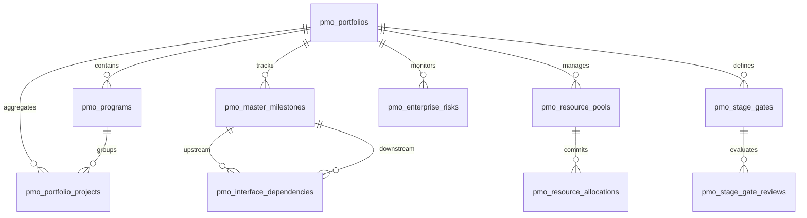

# Module 20: PMO & Portfolio Management

## 1. Purpose
The PMO & Portfolio Management module in MimarERP v7 serves as the strategic nervous system for multi-project construction enterprises, mega-program developers (e.g., PIF giga-projects, Red Sea Global, Diriyah Gate, NEOM, Aramco Capital Programs), and large-scale EPC contractors. It aggregates dispersed operational, schedule, cost, and contractual telemetry across dozens or hundreds of concurrent projects into a consolidated portfolio governance framework. The module provides multi-project health scoring, cross-project resource optimization and leveling, master milestone scheduling, enterprise risk and opportunity tracking, and stage-gate capital approval governance.

---

## 2. Business Objectives
1. **Multi-Project Health Visibility**: Synthesize schedule variance, cost performance, contractual exposure, and safety indices into a standardized Composite Project Health Index (CPHI) across the entire corporate portfolio.
2. **Cross-Project Resource Optimization**: Prevent equipment idle time and specialized labor bottlenecks by simulating and executing dynamic cross-project resource leveling across projects within a geographic cluster.
3. **Master Program Scheduling**: Consolidate individual Primavera P6 / Mimar schedule networks into an overarching Master Program Milestone Schedule with cross-project interface milestones and external dependencies.
4. **Enterprise Risk & Issue Governance (ERM)**: Standardize qualitative and quantitative risk registers (aligned with ISO 31000 and PMI-RMP), tracking pre-mitigation and post-mitigation Monte Carlo risk exposure against portfolio contingency reserves.
5. **Stage-Gate Capital Governance**: Enforce rigorous stage-gate reviews (Concept, Feasibility, Design, Tender, Execution, Handover, Closeout) with mandatory deliverables and financial commitment thresholds.
6. **Strategic Alignment & Capex Prioritization**: Align capital allocation and project selection with strategic enterprise goals, return on invested capital (ROIC), and corporate capacity constraints.

---

## 3. User Roles & Permissions
| Role Name | Scope / Access Level | Core Responsibilities |
| :--- | :--- | :--- |
| **Chief Projects Officer (CPO) / Head of PMO** | Enterprise / Global Portfolio | Portfolio strategy, capital allocation, stage-gate sign-off, corporate risk tolerance, resource priority policies. |
| **PMO Program Director** | Program / Multi-Project Sector | Governance of specific programs (e.g., Infrastructure, High-Rise, Industrial), interface milestone enforcement, cross-project dispute arbitration. |
| **Portfolio Planning Manager** | Portfolio Level | Master schedule integration, cross-project Critical Path Method (CPM) dependency analysis, program-level baseline revisions. |
| **Enterprise Risk Manager (CRO / RMP)**| Portfolio / Program | Quantitative risk modeling (Monte Carlo), risk mitigation oversight, contingency reserve management. |
| **Resource Allocation Coordinator** | Enterprise / Regional Hub | Equipment and specialized labor leveling across projects, inter-project transfer approvals, plant utilization auditing. |
| **Project Controls Manager** | Project Assigned | Project-level reporting to PMO, monthly CVR submissions, variance justification, milestone progress attestation. |
| **Stage-Gate Review Auditor** | Independent / Enterprise | Independent peer-review of gate deliverables, compliance validation before phase gate release. |

---

## 4. Database Tables

### `pmo_portfolios`
| Column Name | Data Type | Constraints | Description |
| :--- | :--- | :--- | :--- |
| `id` | UUID | PRIMARY KEY, DEFAULT gen_random_uuid() | Unique identifier |
| `tenant_id` | UUID | NOT NULL | Multi-tenant isolation |
| `code` | VARCHAR(50) | NOT NULL, UNIQUE | Portfolio code (e.g., PORT-GIGA-2026) |
| `name_en` | VARCHAR(255) | NOT NULL | Portfolio name in English |
| `name_ar` | VARCHAR(255) | NOT NULL | Portfolio name in Arabic |
| `description` | TEXT | NULL | Strategic mandate and scope |
| `director_id` | UUID | NOT NULL | FK to `sys_users` (PMO Director) |
| `currency` | VARCHAR(3) | NOT NULL DEFAULT 'SAR' | Reporting currency |
| `total_budget_sar` | NUMERIC(18,2) | NOT NULL DEFAULT 0.00 | Aggregate approved budget |
| `planned_start_date` | DATE | NOT NULL | Portfolio inception date |
| `planned_end_date` | DATE | NOT NULL | Target completion date |
| `status` | VARCHAR(30) | NOT NULL DEFAULT 'ACTIVE' | 'PLANNING', 'ACTIVE', 'ON_HOLD', 'CLOSED' |
| `created_at` | TIMESTAMPTZ | NOT NULL DEFAULT NOW() | Audit timestamp |
| `updated_at` | TIMESTAMPTZ | NOT NULL DEFAULT NOW() | Audit timestamp |

### `pmo_programs`
| Column Name | Data Type | Constraints | Description |
| :--- | :--- | :--- | :--- |
| `id` | UUID | PRIMARY KEY, DEFAULT gen_random_uuid() | Unique identifier |
| `tenant_id` | UUID | NOT NULL | Multi-tenant isolation |
| `portfolio_id` | UUID | NOT NULL, REFERENCES `pmo_portfolios` | Parent portfolio |
| `code` | VARCHAR(50) | NOT NULL | Program code (e.g., PROG-INFRA-01) |
| `name_en` | VARCHAR(255) | NOT NULL | Program name in English |
| `name_ar` | VARCHAR(255) | NOT NULL | Program name in Arabic |
| `program_manager_id`| UUID | NOT NULL | FK to `sys_users` |
| `target_ebitda_pct` | NUMERIC(5,2) | NULL | Target EBITDA percentage |
| `status` | VARCHAR(30) | NOT NULL DEFAULT 'ACTIVE' | Program lifecycle status |
| `created_at` | TIMESTAMPTZ | NOT NULL DEFAULT NOW() | Audit timestamp |

### `pmo_portfolio_projects`
| Column Name | Data Type | Constraints | Description |
| :--- | :--- | :--- | :--- |
| `id` | UUID | PRIMARY KEY, DEFAULT gen_random_uuid() | Unique identifier |
| `tenant_id` | UUID | NOT NULL | Multi-tenant isolation |
| `portfolio_id` | UUID | NOT NULL, REFERENCES `pmo_portfolios` | Portfolio reference |
| `program_id` | UUID | NULL, REFERENCES `pmo_programs` | Optional program reference |
| `project_id` | UUID | NOT NULL | FK to `pm_projects` |
| `strategic_weight` | NUMERIC(5,2) | NOT NULL DEFAULT 1.00 | Strategic weighting (0.10 to 10.00) |
| `current_gate_code` | VARCHAR(20) | NOT NULL DEFAULT 'GATE_03' | Current stage-gate stage |
| `health_score` | NUMERIC(5,2) | NOT NULL DEFAULT 100.00 | Composite score (0-100) |
| `cpi_cached` | NUMERIC(6,3) | NOT NULL DEFAULT 1.000 | Current Cost Performance Index |
| `spi_cached` | NUMERIC(6,3) | NOT NULL DEFAULT 1.000 | Current Schedule Performance Index |
| `risk_rating` | VARCHAR(20) | NOT NULL DEFAULT 'LOW' | 'LOW', 'MEDIUM', 'HIGH', 'CRITICAL' |
| `inclusion_date` | DATE | NOT NULL DEFAULT CURRENT_DATE | Date enrolled into portfolio |

### `pmo_master_milestones`
| Column Name | Data Type | Constraints | Description |
| :--- | :--- | :--- | :--- |
| `id` | UUID | PRIMARY KEY, DEFAULT gen_random_uuid() | Unique identifier |
| `tenant_id` | UUID | NOT NULL | Multi-tenant isolation |
| `portfolio_id` | UUID | NOT NULL, REFERENCES `pmo_portfolios` | Portfolio reference |
| `project_id` | UUID | NOT NULL | FK to `pm_projects` |
| `external_activity_id`| VARCHAR(50)| NULL | Activity ID in P6/Project WBS |
| `milestone_code` | VARCHAR(50) | NOT NULL | e.g., MS-TAKEOVER-S01 |
| `title` | VARCHAR(255) | NOT NULL | Milestone description |
| `baseline_date` | DATE | NOT NULL | Original approved baseline date |
| `forecast_date` | DATE | NOT NULL | Current forecast completion date |
| `actual_date` | DATE | NULL | Actual attainment date |
| `variance_days` | INTEGER | GENERATED ALWAYS AS (forecast_date - baseline_date) STORED | Delay in calendar days |
| `is_contractual_kd` | BOOLEAN | NOT NULL DEFAULT FALSE | True if Key Date with LD liability |
| `liquidated_damages_per_day`| NUMERIC(12,2)| DEFAULT 0.00 | Potential LD exposure per day (SAR) |
| `status` | VARCHAR(30) | NOT NULL DEFAULT 'PLANNED' | 'PLANNED', 'ON_TRACK', 'DELAYED', 'ACHIEVED' |

### `pmo_interface_dependencies`
| Column Name | Data Type | Constraints | Description |
| :--- | :--- | :--- | :--- |
| `id` | UUID | PRIMARY KEY, DEFAULT gen_random_uuid() | Unique identifier |
| `tenant_id` | UUID | NOT NULL | Multi-tenant isolation |
| `portfolio_id` | UUID | NOT NULL, REFERENCES `pmo_portfolios` | Portfolio scope |
| `predecessor_project_id` | UUID | NOT NULL | Upstream delivering project |
| `predecessor_milestone_id`| UUID | NOT NULL, REFERENCES `pmo_master_milestones` | Handover milestone |
| `successor_project_id` | UUID | NOT NULL | Downstream dependent project |
| `successor_milestone_id` | UUID | NOT NULL, REFERENCES `pmo_master_milestones` | Dependent milestone |
| `dependency_type` | VARCHAR(10) | NOT NULL DEFAULT 'FS' | 'FS', 'SS', 'FF', 'SF' |
| `lag_days` | INTEGER | NOT NULL DEFAULT 0 | Required lag between packages |
| `critical_interface`| BOOLEAN | NOT NULL DEFAULT TRUE | Impacts cross-package critical path |

### `pmo_resource_pools`
| Column Name | Data Type | Constraints | Description |
| :--- | :--- | :--- | :--- |
| `id` | UUID | PRIMARY KEY, DEFAULT gen_random_uuid() | Unique identifier |
| `tenant_id` | UUID | NOT NULL | Multi-tenant isolation |
| `portfolio_id` | UUID | NOT NULL, REFERENCES `pmo_portfolios` | Portfolio reference |
| `resource_type` | VARCHAR(30) | NOT NULL | 'HEAVY_EQUIPMENT', 'CRITICAL_LABOR', 'SURVEY_CREW', 'SPECIALIST_STAFF' |
| `resource_name` | VARCHAR(150) | NOT NULL | Asset / Role designation |
| `total_capacity_qty`| NUMERIC(10,2) | NOT NULL | Total available units or FTEs |
| `current_allocation_qty`| NUMERIC(10,2)| NOT NULL DEFAULT 0.00 | Currently assigned units |
| `uom` | VARCHAR(20) | NOT NULL DEFAULT 'UNITS' | 'UNITS', 'HOURS', 'HEADCOUNT' |
| `hourly_cost_sar` | NUMERIC(10,2) | NOT NULL DEFAULT 0.00 | Standard charge-out rate |

### `pmo_resource_allocations`
| Column Name | Data Type | Constraints | Description |
| :--- | :--- | :--- | :--- |
| `id` | UUID | PRIMARY KEY, DEFAULT gen_random_uuid() | Unique identifier |
| `tenant_id` | UUID | NOT NULL | Multi-tenant isolation |
| `resource_pool_id` | UUID | NOT NULL, REFERENCES `pmo_resource_pools` | Pool reference |
| `project_id` | UUID | NOT NULL | Target project |
| `allocated_qty` | NUMERIC(10,2) | NOT NULL | Allocated units / headcount |
| `start_date` | DATE | NOT NULL | Commitment start date |
| `end_date` | DATE | NOT NULL | Commitment end date |
| `priority_score` | INTEGER | NOT NULL DEFAULT 5 | Project priority weighting (1-10) |
| `approval_status` | VARCHAR(30) | NOT NULL DEFAULT 'APPROVED' | 'REQUESTED', 'APPROVED', 'REJECTED', 'TRANSFERRED' |

### `pmo_enterprise_risks`
| Column Name | Data Type | Constraints | Description |
| :--- | :--- | :--- | :--- |
| `id` | UUID | PRIMARY KEY, DEFAULT gen_random_uuid() | Unique identifier |
| `tenant_id` | UUID | NOT NULL | Multi-tenant isolation |
| `portfolio_id` | UUID | NOT NULL, REFERENCES `pmo_portfolios` | Portfolio reference |
| `project_id` | UUID | NULL | Optional project FK (NULL = enterprise wide) |
| `risk_code` | VARCHAR(50) | NOT NULL, UNIQUE | Risk ID (e.g., RSK-ENT-042) |
| `category` | VARCHAR(50) | NOT NULL | 'STATUTORY', 'FINANCIAL', 'COMMERCIAL', 'LOGISTICS', 'GEOTECHNICAL', 'FORCE_MAJEURE' |
| `title` | VARCHAR(255) | NOT NULL | Risk title |
| `cause` | TEXT | NOT NULL | Root cause |
| `impact_description`| TEXT | NOT NULL | Potential consequence |
| `pre_probability` | INTEGER | NOT NULL CHECK (pre_probability BETWEEN 1 AND 5) | Likelihood scale 1 to 5 |
| `pre_impact` | INTEGER | NOT NULL CHECK (pre_impact BETWEEN 1 AND 5) | Severity scale 1 to 5 |
| `pre_score` | INTEGER | GENERATED ALWAYS AS (pre_probability * pre_impact) STORED | Pre-mitigation score |
| `post_probability`| INTEGER | NOT NULL CHECK (post_probability BETWEEN 1 AND 5) | Residual likelihood |
| `post_impact` | INTEGER | NOT NULL CHECK (post_impact BETWEEN 1 AND 5) | Residual severity |
| `post_score` | INTEGER | GENERATED ALWAYS AS (post_probability * post_impact) STORED | Post-mitigation score |
| `estimated_cost_exposure_sar`| NUMERIC(15,2)| NOT NULL DEFAULT 0.00 | Monetary exposure |
| `mitigation_strategy` | TEXT | NOT NULL | Action plan |
| `owner_id` | UUID | NOT NULL | Risk owner user ID |
| `status` | VARCHAR(30) | NOT NULL DEFAULT 'OPEN' | 'IDENTIFIED', 'OPEN', 'MITIGATED', 'OCCURRED', 'CLOSED' |

### `pmo_stage_gates`
| Column Name | Data Type | Constraints | Description |
| :--- | :--- | :--- | :--- |
| `id` | UUID | PRIMARY KEY, DEFAULT gen_random_uuid() | Unique identifier |
| `tenant_id` | UUID | NOT NULL | Multi-tenant isolation |
| `portfolio_id` | UUID | NOT NULL, REFERENCES `pmo_portfolios` | Portfolio reference |
| `gate_code` | VARCHAR(20) | NOT NULL | 'GATE_01', 'GATE_02', 'GATE_03', 'GATE_04', 'GATE_05' |
| `gate_name` | VARCHAR(100) | NOT NULL | e.g., 'Concept', 'Tender Award', 'Site Mobilization' |
| `sequence_order` | INTEGER | NOT NULL | Progression order (1 to N) |
| `required_deliverables`| JSONB | NOT NULL | Checklist of mandatory submittals |
| `governance_quorum` | JSONB | NOT NULL | Required approver roles |

### `pmo_stage_gate_reviews`
| Column Name | Data Type | Constraints | Description |
| :--- | :--- | :--- | :--- |
| `id` | UUID | PRIMARY KEY, DEFAULT gen_random_uuid() | Unique identifier |
| `tenant_id` | UUID | NOT NULL | Multi-tenant isolation |
| `project_id` | UUID | NOT NULL | Target project |
| `stage_gate_id` | UUID | NOT NULL, REFERENCES `pmo_stage_gates` | Gate definition |
| `submission_date`| DATE | NOT NULL | Gate review submission date |
| `review_date` | DATE | NULL | Date committee met |
| `verdict` | VARCHAR(30) | NOT NULL DEFAULT 'UNDER_REVIEW'| 'UNDER_REVIEW', 'PASSED', 'CONDITIONAL_PASS', 'FAILED' |
| `conditions` | TEXT | NULL | Corrective stipulations |
| `approved_by_quorum`| JSONB | NULL | Digital signatures of board/PMO |

---

## 5. Entity Relationships (Mermaid)



---

## 6. Business Workflows

### Multi-Project Health Aggregation & RAG Determination
```
[Projects Post Operational Data]
(Schedule Progress, Actual Cost, NCRs, Lost Time Incidents)
           │
           ▼
[Nightly Batch Calculation Engine (TimescaleDB + Worker)]
   - Calculate Schedule Variance: SV = EV - PV
   - Calculate Cost Variance: CV = EV - AC
   - Compute CPI & SPI
   - Query Pending FIDIC Claims & Critical NCRs
           │
           ▼
[Compute Composite Project Health Index (CPHI)]
CPHI = (SPI * 0.35) + (CPI * 0.35) + (Safety_Factor * 0.15) + (Quality_Factor * 0.15)
           │
           ├─ CPHI >= 0.95 and SPI >= 0.95 and CPI >= 0.95 ──► Green (Healthy)
           ├─ 0.85 <= CPHI < 0.95 or SPI < 0.90 ──────────────► Amber (Warning)
           └─ CPHI < 0.85 or Critical Milestone Delayed > 14d ─► Red (Critical Escalation)
           │
           ▼
[Automated PMO Intervention Trigger]
- Red status triggers mandatory PMO corrective action plan within 72 hours
- Automatic SMS & Email notification to CPO and Regional Operations Director
```

### Cross-Project Resource Leveling Workflow
```
[Project A Requests Heavy Crawler Crane]
           │
           ▼
[PMO Resource Coordinator Review]
   - Checks `pmo_resource_pools` for regional availability
   - Detects Crawler Crane 300T idle in Project B starting in 12 days
           │
           ▼
[Simulate Multi-Project Schedule Impact]
   - Evaluates Project B demobilization schedule vs Project A mobilization need
   - Verifies heavy equipment transport permit lead time (Ministry of Transport / KSA)
           │
           ▼
[Issue Resource Transfer Authorization (RTA)]
   - System updates `pmo_resource_allocations`
   - Generates Plant Inter-Site Transfer Note
   - Re-allocates internal hire rate debit/credit across Project Cost Centers
```

---

## 7. UI Screens
1. **Portfolio Cockpit & Geographical Map**: Interactive GIS view of all active projects in the Kingdom (Riyadh, Jeddah, NEOM, Eastern Province, Red Sea) with color-coded RAG status pins, total committed capex, and active headcount.
2. **Master Milestone Gantt & Interface Matrix**: Cross-project Gantt chart showing milestone dependencies between separate EPC packages, interface milestones, and contract Key Dates.
3. **Multi-Project Resource Heatmap**: Visual grid showing resource utilization percentages by week/month across all projects, highlighting over-allocations in red and under-utilization in blue.
4. **Enterprise Risk Matrix (Heatmap 5x5)**: ISO 31000 compliant probability-impact grid with drill-down capability into pre-mitigation and post-mitigation risk bubbles.
5. **Stage-Gate Review Board**: Kanban board showing projects arranged by gate stages (Gate 1 to 5) with deliverable checklists, audit scorecards, and approval voting interface.
6. **Project Comparative Benchmarking Screen**: Side-by-side radar and bar charts comparing projects across CPI, SPI, Safety Frequency Rate, QA/QC First-Time Pass Rate, and Procurement Lead Times.

---

## 8. Dashboards
- **PMO Executive Summary Dashboard**: Portfolio Total Value, Invoiced-to-date, Projected Final Cost, Aggregate CPI/SPI, Portfolio Burn Rate (SAR/Day), and Number of Critical Projects in Red Status.
- **Milestone Slippage & Liquidated Damages Exposure**: Table of contract Key Dates delayed past baseline with cumulative LD liability calculation and days to critical takeover.
- **Equipment & Heavy Plant Fleet Distribution**: Utilization percentage of corporate cranes, batching plants, excavators, and generators across all operational sites.
- **Enterprise Stage-Gate Governance Dashboard**: Pipeline of upcoming stage-gate reviews, overdue deliverable submissions, and gate audit compliance scores.

---

## 9. Reports
1. **Monthly Portfolio Performance Report (MPPR)**: Comprehensive 50-page executive summary covering financial, schedule, procurement, QA/QC, and HSE metrics across all packages.
2. **Master Key Date & Milestone Variance Report**: Detailed log of all client contractual milestones, current forecast dates, variance in days, and critical path impact.
3. **Cross-Project Interface Dependency Register**: Audit of inter-package handovers (e.g., Civil Handover to MEP Contractor) with interface delay liability attribution.
4. **Portfolio Earned Value Analysis (EVM) Report**: Aggregate PV, EV, AC, BAC, EAC, VAC, CPI, and SPI across all active contracts and subsidiaries.
5. **Enterprise Risk & Opportunity Register**: Comprehensive listing of corporate risks, monetary valuation of exposures, contingency reserve burn-down, and planned mitigations.
6. **Cross-Project Resource Utilization & Idleness Report**: Analysis of corporate plant and labor utilization, highlighting idle equipment costing internal demurrage.
7. **Stage-Gate Compliance & Audit Scorecard**: Review of gate progression status, conditional approvals, and outstanding deliverables across all active projects.
8. **Cash Demand & Portfolio Disbursement Forecast**: 12-month forward-looking rolling cash requirement projection based on individual project cost-loaded schedules.
9. **Contractual Claims & Dispute Exposure Summary**: Portfolio-wide compilation of pending Contractor Claims, Owner Counter-Claims, and potential dispute payouts under FIDIC clauses.
10. **Subcontractor Performance Benchmark Report**: Historical cross-project evaluation of subcontractor speed, quality compliance, and claims propensity.

---

## 10. Key Performance Indicators (KPIs)
| KPI Code | Name | Calculation Formula | Target | Red (Critical) | Amber (Warning) | Green (Healthy) |
| :--- | :--- | :--- | :--- | :--- | :--- | :--- |
| **KPI-PMO-01** | Portfolio Composite Health | $\frac{1}{N} \sum (\text{CPHI}_i)$ | $\ge 0.95$ | $< 0.85$ | $0.85 - 0.94$ | $\ge 0.95$ |
| **KPI-PMO-02** | Milestone On-Time Rate | $(\frac{\text{Milestones Achieved on/before Baseline}}{\text{Total Planned Milestones}}) \times 100$ | $\ge 90\%$ | $< 75\%$ | $75\% - 89\%$ | $\ge 90\%$ |
| **KPI-PMO-03** | Portfolio CPI | $\frac{\sum \text{EV}}{\sum \text{AC}}$ | $\ge 1.00$ | $< 0.92$ | $0.92 - 0.99$ | $\ge 1.00$ |
| **KPI-PMO-04** | Portfolio SPI | $\frac{\sum \text{EV}}{\sum \text{PV}}$ | $\ge 1.00$ | $< 0.90$ | $0.90 - 0.99$ | $\ge 1.00$ |
| **KPI-PMO-05** | Heavy Fleet Utilization Rate | $(\frac{\text{Operational Engine Hours}}{\text{Available Calendar Working Hours}}) \times 100$ | $\ge 82\%$ | $< 65\%$ | $65\% - 81\%$ | $\ge 82\%$ |
| **KPI-PMO-06** | LD Exposure Ratio | $(\frac{\sum \text{Active Liquidated Damages Risk (SAR)}}{\text{Total Portfolio Margin}}) \times 100$ | $\le 2.0\%$ | $> 5.0\%$ | $2.1\% - 5.0\%$ | $\le 2.0\%$ |

---

## 11. API Endpoints
- `GET /api/v1/pmo/portfolios`: List all corporate portfolios with high-level budget, spent, and health indicators.
- `GET /api/v1/pmo/portfolios/{id}/health-summary`: Retrieve multi-project RAG breakdown and EVM aggregates.
- `GET /api/v1/pmo/master-milestones`: Query cross-project milestones with filtering by variance, contractual status, and project cluster.
- `POST /api/v1/pmo/interface-dependencies`: Define new inter-project dependency relationship between packages.
- `GET /api/v1/pmo/resource-pools/utilization`: Fetch multi-project resource demand vs capacity curves.
- `POST /api/v1/pmo/resource-allocations/transfer`: Execute cross-project plant or crew reallocation.
- `GET /api/v1/pmo/risks/monte-carlo-simulation`: Run portfolio Monte Carlo risk engine and return P50, P80, and P90 cost/schedule contingency requirements.
- `POST /api/v1/pmo/stage-gates/{id}/review-verdict`: Submit committee voting and gate pass/fail decision.

---

## 12. Required Permissions
- `pmo:portfolio:view`: Access portfolio views, reports, and dashboards.
- `pmo:portfolio:manage`: Create and modify portfolio structures, budgets, and strategic weightings.
- `pmo:milestones:baseline_edit`: Authority to approve Master Baseline schedule revisions.
- `pmo:resources:level_reallocate`: Reallocate equipment and labor across projects.
- `pmo:risk:evaluate`: Edit enterprise risk severity scores and monetary exposures.
- `pmo:stage_gate:audit_signoff`: Cast formal vote and sign off on project stage-gate progression.

---

## 13. Approval Workflows & SLA Matrix
```
[Stage Gate Review Request Submitted by Project Manager]
                     │
                     ▼
[PMO Controls Auditor] (SLA: 48 hrs) ── Checks Deliverable Completeness
                     │
         Deliverables Verified?
         ├── No ──► [Return for Rectification]
         └── Yes
               │
               ▼
[Multi-Disciplinary Technical & Commercial Committee] (SLA: 5 Days)
   - Technical Office Director (Engineering Submittals)
   - Commercial Director (Cost & Contract Baselines)
   - HSE & Quality Corporate Heads (Audit Compliance)
               │
               ▼
[CPO / Portfolio Director Final Gate Verdict]
   ├── PASS ──────────────► Release next funding tranche & authorize site phase
   ├── CONDITIONAL PASS ──► Release 50% mobilization funds; 30-day cure period
   └── FAIL ──────────────► Project freeze; mandatory executive recovery plan
```

---

## 14. AI Features
1. **Cross-Project Milestone Delay Predictor**: Machine learning model analyzes upstream contractor velocity, RFQ lead times, and weather trends to forecast interface milestone delays 60 days in advance.
2. **AI Resource Leveling Optimization**: Genetic algorithm simulates thousands of equipment allocation combinations across active projects to minimize total mobilization/demobilization costs and eliminate critical path idle time.
3. **Enterprise Risk Sentiment & Anomaly Scanner**: Natural Language Processing (NLP) agent scans weekly site minutes, RFI logs, and consultant correspondence across all projects to identify emerging unlogged contractual risks.

---

## 15. Automations
1. **Automated Inter-Project Delay Propagation**: When an upstream project milestone slips by $> 5$ days, the downstream project manager is automatically alerted and their lookahead schedule reflects the interface constraint.
2. **Automatic LD Liability Accrual Alert**: When a contractual Key Date enters the critical path and forecast completion exceeds the contractual deadline, an automated alert routes to Finance and Commercial Directors with projected LD deductions.
3. **Nightly Health Index Recalculation**: Automated cron job synchronizes updated progress from scheduling, cost, quality, and safety tables every midnight, regenerating all portfolio RAG flags.

---

## 16. Integration Requirements
- **Planning & Scheduling (Module 03)**: Real-time synchronization of project WBS, activity actuals, and P6 XER imports into the PMO master milestone schema.
- **Cost Control & EVM (Module 02 / 15)**: Continuous roll-up of project-level Budget at Completion (BAC), Actual Cost (AC), and Earned Value (EV) into portfolio ledgers.
- **Contract Administration & FIDIC (Module 10 / 14)**: Live tracking of Extension of Time (EOT) claims and contractor dispute notices that impact portfolio completion dates.
- **Plant & Equipment Management (Module 09)**: Direct telematics and asset availability sync for regional fleet reallocation.
