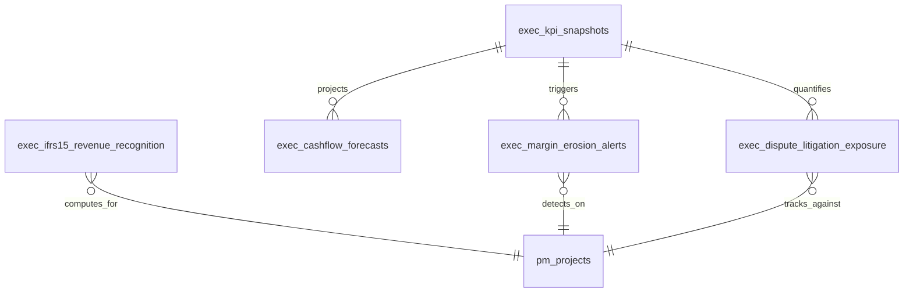

# Module 21: Executive Dashboard & C-Suite Cockpit

## 1. Purpose
The Executive Dashboard module in MimarERP v7 delivers a mission-critical, real-time command center for Chief Executive Officers (CEOs), Chief Financial Officers (CFOs), Chief Operating Officers (COOs), and Board Members of construction conglomerates. Operating at the apex of the enterprise data pyramid, it aggregates high-volume transactional data from procurement, site progress, subcontract billing, and general ledgers into strategic executive intelligence. It provides audited IFRS 15 revenue recognition (Percentage of Completion), 12-month rolling cash flow forecasting, EBITDA and net margin tracking, automated early warnings for project margin erosion, corporate bonding and liquidity limits, and FIDIC dispute/litigation exposure.

---

## 2. Business Objectives
1. **Board-Level Strategic Clarity**: Provide immediate, board-ready visibility into corporate revenue, gross profit, EBITDA, project backlog, and return on capital employed across all entities and joint ventures.
2. **Strict IFRS 15 Compliance**: Automate revenue recognition calculations under the cost-to-cost input method (Percentage of Completion - PoC), balancing contract assets (Unbilled Revenue / Work in Progress) and contract liabilities (Billings in Excess of Costs).
3. **Proactive Margin Erosion Detection**: Detect slippage in project gross margin $> 1.5\%$ compared to tender baselines early through real-time predictive cost-to-complete (CTC) telemetry.
4. **Liquidity & Working Capital Governance**: Monitor liquidity buffers, bank overdraft facilities, letters of credit (LC), bank guarantees (Performance, Advance Payment, Retention Bonds), and cash burn rates.
5. **FIDIC Dispute & Legal Exposure Oversight**: Quantify contingent liabilities, unresolved claims (Clause 20.1 / 20.2), and DAB/Arbitration exposure across all active contracts.
6. **Multi-Entity Financial Consolidation**: Consolidate multi-subsidiary financials with automatic elimination of inter-company transactions and multi-currency conversion to Saudi Riyals (SAR).

---

## 3. User Roles & Permissions
| Role Name | Scope / Access Level | Core Responsibilities |
| :--- | :--- | :--- |
| **Chief Executive Officer (CEO)** | Enterprise Wide (Unrestricted) | Corporate strategy, final executive decisions, capital authorization, board reporting. |
| **Chief Financial Officer (CFO)** | Enterprise Wide (Financial) | IFRS 15 sign-off, treasury liquidity oversight, banking facility negotiations, financial risk governance. |
| **Chief Operating Officer (COO)** | Enterprise Wide (Operations) | Operational delivery, resource mobilization velocity, cross-project critical path interventions. |
| **Board Member / Audit Committee** | Read-Only High-Level | Corporate governance review, compliance verification, financial audit trail inspection. |
| **Corporate Commercial Director** | Enterprise Commercial | Contractual dispute tracking, margin erosion analysis, claim risk provisioning. |
| **Corporate Treasurer** | Enterprise Treasury | Bank bonding capacity monitoring, cash pooling, debt service coverage, foreign exchange risk. |

---

## 4. Database Tables

### `exec_kpi_snapshots`
| Column Name | Data Type | Constraints | Description |
| :--- | :--- | :--- | :--- |
| `id` | UUID | PRIMARY KEY, DEFAULT gen_random_uuid() | Unique snapshot identifier |
| `tenant_id` | UUID | NOT NULL | Multi-tenant isolation |
| `snapshot_date` | DATE | NOT NULL | Effective calculation date |
| `snapshot_period` | VARCHAR(20) | NOT NULL | 'DAILY', 'WEEKLY', 'MONTHLY_CLOSE' |
| `total_order_backlog_sar`| NUMERIC(18,2)| NOT NULL DEFAULT 0.00 | Unbilled awarded contract value |
| `ytd_revenue_sar` | NUMERIC(18,2)| NOT NULL DEFAULT 0.00 | Year-to-date recognized revenue |
| `ytd_gross_profit_sar`| NUMERIC(18,2)| NOT NULL DEFAULT 0.00 | Year-to-date gross profit |
| `ytd_ebitda_sar` | NUMERIC(18,2)| NOT NULL DEFAULT 0.00 | Year-to-date EBITDA |
| `operating_cash_flow_sar`| NUMERIC(18,2)| NOT NULL DEFAULT 0.00 | Net operational cash flow |
| `cash_and_equivalents_sar`| NUMERIC(18,2)| NOT NULL DEFAULT 0.00 | Unrestricted liquid treasury cash |
| `total_bonding_utilized_sar`| NUMERIC(18,2)| NOT NULL DEFAULT 0.00 | Active bank guarantees issued |
| `total_bonding_limit_sar`| NUMERIC(18,2)| NOT NULL DEFAULT 0.00 | Total corporate bank bonding line |
| `active_dispute_exposure_sar`| NUMERIC(18,2)| NOT NULL DEFAULT 0.00 | Disputed claims exposure under FIDIC |
| `average_cpi` | NUMERIC(6,3) | NOT NULL DEFAULT 1.000 | Corporate-wide weighted CPI |
| `average_spi` | NUMERIC(6,3) | NOT NULL DEFAULT 1.000 | Corporate-wide weighted SPI |
| `created_at` | TIMESTAMPTZ | NOT NULL DEFAULT NOW() | Timestamp |

### `exec_ifrs15_revenue_recognition`
| Column Name | Data Type | Constraints | Description |
| :--- | :--- | :--- | :--- |
| `id` | UUID | PRIMARY KEY, DEFAULT gen_random_uuid() | Unique identifier |
| `tenant_id` | UUID | NOT NULL | Multi-tenant isolation |
| `project_id` | UUID | NOT NULL | FK to `pm_projects` |
| `period_year` | INTEGER | NOT NULL | Financial year (e.g., 2026) |
| `period_month` | INTEGER | NOT NULL CHECK (period_month BETWEEN 1 AND 12) | Accounting month |
| `contract_price_sar` | NUMERIC(18,2)| NOT NULL | Total revised contract price (inc. approved VOs) |
| `estimated_total_cost_sar`| NUMERIC(18,2)| NOT NULL | Revised Budget at Completion (BAC/EAC) |
| `actual_cost_to_date_sar`| NUMERIC(18,2)| NOT NULL | Cumulative actual cost incurred (AC) |
| `poc_percentage` | NUMERIC(6,4)| GENERATED ALWAYS AS (CASE WHEN estimated_total_cost_sar > 0 THEN LEAST(1.0000, actual_cost_to_date_sar / estimated_total_cost_sar) ELSE 0 END) STORED | Percentage of Completion (0.0000 to 1.0000) |
| `cumulative_revenue_sar`| NUMERIC(18,2)| GENERATED ALWAYS AS (ROUND(contract_price_sar * (CASE WHEN estimated_total_cost_sar > 0 THEN LEAST(1.0000, actual_cost_to_date_sar / estimated_total_cost_sar) ELSE 0 END), 2)) STORED | Earned revenue to date |
| `prior_revenue_recognized_sar`| NUMERIC(18,2)| NOT NULL DEFAULT 0.00 | Revenue recognized in prior periods |
| `period_revenue_sar` | NUMERIC(18,2)| NOT NULL | Revenue for the current period |
| `cumulative_billed_sar`| NUMERIC(18,2)| NOT NULL DEFAULT 0.00 | Total approved IPCs billed to client |
| `unbilled_contract_asset_sar`| NUMERIC(18,2)| NOT NULL DEFAULT 0.00 | Cumulative Revenue > Cumulative Billed |
| `excess_billing_liability_sar`| NUMERIC(18,2)| NOT NULL DEFAULT 0.00 | Cumulative Billed > Cumulative Revenue |
| `cfo_approved` | BOOLEAN | NOT NULL DEFAULT FALSE | Sign-off flag for ledger posting |
| `approved_at` | TIMESTAMPTZ | NULL | Timestamp of posting |

### `exec_margin_erosion_alerts`
| Column Name | Data Type | Constraints | Description |
| :--- | :--- | :--- | :--- |
| `id` | UUID | PRIMARY KEY, DEFAULT gen_random_uuid() | Unique identifier |
| `tenant_id` | UUID | NOT NULL | Multi-tenant isolation |
| `project_id` | UUID | NOT NULL | FK to `pm_projects` |
| `baseline_gross_margin_pct`| NUMERIC(5,2)| NOT NULL | Original tender baseline margin % |
| `current_forecast_margin_pct`| NUMERIC(5,2)| NOT NULL | Current EAC margin % |
| `erosion_delta_pct` | NUMERIC(5,2)| GENERATED ALWAYS AS (baseline_gross_margin_pct - current_forecast_margin_pct) STORED | Margin slippage percentage |
| `financial_impact_sar`| NUMERIC(15,2)| NOT NULL | Net profit loss in SAR |
| `primary_cause` | VARCHAR(100)| NOT NULL | 'REBAR_ESCALATION', 'SUBCONTRACTOR_DEFAULT', 'UNAPPROVED_VO', 'SITE_REWORK', 'LD_PENALTY' |
| `severity` | VARCHAR(20) | NOT NULL DEFAULT 'HIGH' | 'MEDIUM', 'HIGH', 'CRITICAL' |
| `remediation_plan` | TEXT | NULL | Action plan submitted by PM/Commercial Dir |
| `status` | VARCHAR(30) | NOT NULL DEFAULT 'ACTIVE' | 'ACTIVE', 'MITIGATED', 'ACCEPTED_WRITE_OFF' |
| `detected_at` | TIMESTAMPTZ | NOT NULL DEFAULT NOW() | Trigger timestamp |

### `exec_cashflow_forecasts`
| Column Name | Data Type | Constraints | Description |
| :--- | :--- | :--- | :--- |
| `id` | UUID | PRIMARY KEY, DEFAULT gen_random_uuid() | Unique identifier |
| `tenant_id` | UUID | NOT NULL | Multi-tenant isolation |
| `forecast_run_date` | DATE | NOT NULL | Date forecast was executed |
| `horizon_month` | DATE | NOT NULL | Target calendar month (e.g., 2026-12-01) |
| `projected_collections_sar`| NUMERIC(18,2)| NOT NULL DEFAULT 0.00 | Expected IPC receipts & retention releases |
| `projected_disbursements_sar`| NUMERIC(18,2)| NOT NULL DEFAULT 0.00| Payroll, Subcontractor, Supplier, Capex |
| `net_cash_flow_sar` | NUMERIC(18,2)| GENERATED ALWAYS AS (projected_collections_sar - projected_disbursements_sar) STORED | Net monthly surplus/deficit |
| `opening_cash_balance_sar`| NUMERIC(18,2)| NOT NULL DEFAULT 0.00 | Forecasted opening cash position |
| `closing_cash_balance_sar`| NUMERIC(18,2)| NOT NULL DEFAULT 0.00 | Forecasted closing position |
| `required_credit_facility_draw_sar`| NUMERIC(18,2)| NOT NULL DEFAULT 0.00 | Overdraft requirement if balance negative |

### `exec_dispute_litigation_exposure`
| Column Name | Data Type | Constraints | Description |
| :--- | :--- | :--- | :--- |
| `id` | UUID | PRIMARY KEY, DEFAULT gen_random_uuid() | Unique identifier |
| `tenant_id` | UUID | NOT NULL | Multi-tenant isolation |
| `project_id` | UUID | NOT NULL | Associated contract |
| `dispute_reference` | VARCHAR(100)| NOT NULL, UNIQUE | Case/Claim reference |
| `forum` | VARCHAR(50) | NOT NULL | 'ENGINEER_DETERMINATION', 'DAB', 'SAUDI_SCCA_ARBITRATION', 'COMMERCIAL_COURT' |
| `counterparty` | VARCHAR(255)| NOT NULL | Employer, Subcontractor, or Joint Venture Partner |
| `claimant_type` | VARCHAR(30) | NOT NULL | 'CONTRACTOR_AGAINST_EMPLOYER', 'EMPLOYER_COUNTERCLAIM', 'SUBCONTRACTOR_CLAIM' |
| `disputed_amount_sar`| NUMERIC(18,2)| NOT NULL | Total nominal claim amount |
| `legal_counsel_assessment`| VARCHAR(50)| NOT NULL | 'HIGH_MERIT', 'BALANCED', 'LOW_MERIT', 'DEFENSIVE' |
| `expected_settlement_sar`| NUMERIC(18,2)| NOT NULL | Probabilistic exposure |
| `statutory_contingency_reserve_sar`| NUMERIC(18,2)| NOT NULL DEFAULT 0.00 | P&L provision set aside |
| `status` | VARCHAR(30) | NOT NULL DEFAULT 'ACTIVE' | 'ACTIVE', 'SETTLED', 'DISMISSED' |

---

## 5. Entity Relationships (Mermaid)



---

## 6. Business Workflows

### Monthly IFRS 15 Revenue Recognition & Close
```
[Month-End Commercial Close Completed in Projects]
(Approved Site Measurements, CVR Certified, Actual Costs Locked)
                 │
                 ▼
[Automated IFRS 15 Engine Execution]
   - Fetch Cumulative Direct Costs incurred (AC)
   - Fetch Latest Approved Budget at Completion (EAC)
   - Calculate Input PoC % = (Cumulative AC / EAC)
   - Calculate Cumulative Recognized Revenue = Contract Sum * PoC %
   - Calculate Period Revenue = Cumulative Revenue - Prior Recognized Revenue
                 │
                 ▼
[Contract Asset vs Contract Liability Valuation]
   - Cumulative Recognized Revenue > Cumulative Invoiced to Client
     ──► Post to Balance Sheet: Account 1240 (Contract Asset / Work-in-Progress)
   - Cumulative Invoiced to Client > Cumulative Recognized Revenue
     ──► Post to Balance Sheet: Account 2240 (Contract Liability / Billings in Excess)
                 │
                 ▼
[CFO Review & Digital Attestation]
   - CFO signs off electronically via ZATCA/OIDC authenticated token
   - Automated posting of Revenue Journal Vouchers to General Ledger
```

### Margin Erosion Early Warning & Mitigation Protocol
```
[Daily Cost & Commitment Ingestion]
(Subcontract PO awarded above budget or Schedule critical delay logged)
                 │
                 ▼
[EAC Forecast Re-evaluation]
   - New Estimated At Completion (EAC) exceeds baseline
   - Forecast Gross Margin % drops by >= 1.50% from Approved Baseline
                 │
                 ▼
[Generate `exec_margin_erosion_alerts`]
   - System flags Project Status to "MARGIN_WATCH"
   - Automated High-Priority Notice pushed to CEO, COO, and Commercial Director
                 │
                 ▼
[Executive Remediation Session Workflow]
   - Project Manager and Commercial Director must submit formal recovery action:
     Option A: Value Engineering / Procurement renegotiation
     Option B: Formal FIDIC Clause 13 Variation submission to Client
     Option C: Subcontractor Contra-Charge enforcement
     Option D: Management P&L write-down provisioning
```

---

## 7. UI Screens
1. **Executive Cockpit (Dark Mode / High Contrast)**: Single-pane-of-glass executive overview with real-time tickers: Total Backlog (SAR), YTD Revenue, EBITDA %, Operating Cash, Net Working Capital, and Active Headcount.
2. **IFRS 15 Revenue & Margin Matrix**: Grid listing all operational projects, displaying Contract Value, EAC, PoC %, Recognized Revenue, Invoiced Revenue, and Contract Assets/Liabilities with one-click drill-down to CVR.
3. **12-Month Rolling Cash Flow Waterfall**: Interactive financial waterfall chart visualizing projected monthly collections vs disbursements, debt service obligations, and net cash balances.
4. **Project Margin Erosion Radar**: Heatmap of all projects sorting by margin slippage delta, with root-cause categorization tags (material inflation, rework, LDs).
5. **Treasury & Bank Facilities Tracker**: Interactive gauges showing bank-by-bank utilization of Letter of Credit (LC) caps, Performance Bond headroom, and Cash Overdraft lines.
6. **Corporate Legal & FIDIC Dispute Map**: Real-time risk register of outstanding arbitration cases, disputed variation claims, and contingent liabilities by client.

---

## 8. Dashboards
- **CEO Strategic Overview Dashboard**: Multi-company consolidated financial indicators, top 5 high-performing projects, bottom 3 troubled projects requiring intervention.
- **CFO Working Capital & Liquidity Dashboard**: Days Sales Outstanding (DSO), Days Payable Outstanding (DPO), Retentions Receivable vs Retentions Payable, Cash Burn Rate.
- **COO Project Velocity & Milestone Dashboard**: Schedule Performance Index (SPI), critical milestone adherence rate, and equipment fleet efficiency.
- **Board Risk & Governance Dashboard**: Total contingent liabilities, safety lost-time incident frequency (LTIFR), and regulatory statutory compliance status (ZATCA, GOSI, Saudization).

---

## 9. Reports
1. **Board of Directors Quarterly Performance Pack**: Automated, high-resolution 60-page PDF presentation detailing group financial results, operational highlights, and forward forecasts.
2. **IFRS 15 Revenue Recognition & PoC Audit Schedule**: Detailed compliance report with auditor-grade proof of cost-to-cost input percentages and contract balance movements.
3. **Executive 12-Month Cash Flow Projection**: Detailed monthly cash forecast categorized by project clusters, general overheads, capex, and financing costs.
4. **Project Profitability & Margin Erosion Analysis**: Variance audit between baseline tender margins and latest forecast margins across all business units.
5. **Corporate Bank Guarantee & Bonding Exposure Report**: Audit of all active Bid Bonds, Advance Payment Guarantees, Performance Bonds, and Maintenance Bonds with expiry dates and margin cash blockages.
6. **Accounts Receivable Aging & Unbilled Revenue Report**: Aging matrix (Current, 30, 60, 90, 120+ days) of certified IPCs and uncertified contract assets.
7. **FIDIC Claims & Dispute Exposure Evaluation**: Comprehensive analysis of contractual dispute values, expected recovery rates, and legal expense provisions.
8. **EBITDA & Overhead Absorption Report**: Corporate SG&A expenditure analysis vs direct project overhead recoveries.
9. **Executive Subcontractor & Vendor Concentration Risk**: Identifies top suppliers by spend volume and highlights single-source dependencies.
10. **Geographical Business Unit Performance Summary**: Comparative financial report across regional operations (Central, Western, Eastern, International).

---

## 10. Key Performance Indicators (KPIs)
| KPI Code | Name | Calculation Formula | Target | Red (Critical) | Amber (Warning) | Green (Healthy) |
| :--- | :--- | :--- | :--- | :--- | :--- | :--- |
| **KPI-EXEC-01**| Corporate EBITDA Margin | $(\frac{\text{EBITDA}}{\text{Total Recognized Revenue}}) \times 100$ | $\ge 12.0\%$ | $< 8.0\%$ | $8.0\% - 11.9\%$ | $\ge 12.0\%$ |
| **KPI-EXEC-02**| Days Sales Outstanding (DSO) | $(\frac{\text{Accounts Receivable + Unbilled WIP}}{\text{Total Revenue}}) \times 365$ | $\le 65 \text{ Days}$| $> 90 \text{ Days}$| $66 - 90 \text{ Days}$ | $\le 65 \text{ Days}$ |
| **KPI-EXEC-03**| Project Margin Erosion Rate| $\frac{\sum (\text{Baseline Margin} - \text{EAC Margin})}{\text{Total Backlog}}$ | $\le 0.5\%$ | $> 2.0\%$ | $0.6\% - 2.0\%$ | $\le 0.5\%$ |
| **KPI-EXEC-04**| Bonding Headroom Ratio | $(\frac{\text{Available Bonding Line}}{\text{Total Bank Facility Limit}}) \times 100$ | $\ge 25\%$ | $< 10\%$ | $10\% - 24\%$ | $\ge 25\%$ |
| **KPI-EXEC-05**| Current Liquidity Ratio | $\frac{\text{Cash + Short Term Receivables}}{\text{Current Liabilities + AP due in 30d}}$ | $\ge 1.35$ | $< 1.05$ | $1.05 - 1.34$ | $\ge 1.35$ |
| **KPI-EXEC-06**| FIDIC Dispute Exposure | $(\frac{\sum \text{Contingent Dispute Exposure}}{\text{Total Net Equity}}) \times 100$ | $\le 5.0\%$ | $> 12.0\%$ | $5.1\% - 12.0\%$ | $\le 5.0\%$ |

---

## 11. API Endpoints
- `GET /api/v1/executive/cockpit-summary`: Retrieve high-level corporate revenue, backlog, EBITDA, and liquidity metrics.
- `GET /api/v1/executive/ifrs15-matrix`: Fetch real-time Percentage of Completion revenue recognition schedule.
- `POST /api/v1/executive/ifrs15/post-ledger`: Execute month-end IFRS 15 journal voucher posting to General Ledger.
- `GET /api/v1/executive/margin-erosion`: List all flagged projects experiencing margin degradation with root-cause tags.
- `GET /api/v1/executive/cashflow/rolling-forecast`: Return 12-month projected cash receipts, disbursements, and credit facility needs.
- `GET /api/v1/executive/banking/bonding-capacity`: Retrieve bank guarantee facility utilization and available headroom.
- `GET /api/v1/executive/disputes/summary`: Aggregate active litigation, arbitration, and DAB exposure numbers.
- `GET /api/v1/executive/reports/board-pack`: Stream compiled Board Pack PDF document with digital signatures.

---

## 12. Required Permissions
- `exec:cockpit:view`: Access CEO and Executive Dashboard views and high-level charts.
- `exec:financials:full_confidential`: Access sensitive P&L, EBITDA, net margin, and partner drawdowns.
- `exec:ifrs15:approve`: CFO authorization to post IFRS 15 revenue recognition journals.
- `exec:dispute:manage`: Edit legal risk exposure estimates and arbitration provisions.
- `exec:cashflow:run_forecast`: Run rolling cash flow simulations and adjust facility assumptions.

---

## 13. Approval Workflows & SLA Matrix
```
[Month-End IFRS 15 Calculations Completed]
                     │
                     ▼
[Corporate Controller] (SLA: 24 hrs) ── Reviews PoC calculations & CVR reconciliation
                     │
         Verified? ── No ──► [Return to Project Controls]
         │ Yes
         ▼
[Chief Financial Officer (CFO)] (SLA: 24 hrs) ── Final Attestation
         │
         ▼
[Automated GL Integration] ── Generates Balancing Journal Entries (ZATCA / IFRS compliant)
```

---

## 14. AI Features
1. **Predictive Project Margin Erosion Warning Engine**: Multi-variable machine learning algorithm monitors sub-tier procurement commitment velocity, labor overtime trends, and consultant rejection rates to predict project margin collapse 90 days before it appears in accounting books.
2. **AI Treasury & Cash Flow Optimizer**: Evaluates variable vendor payment terms against projected client milestone certification dates to suggest optimal payment schedules, saving financing fees and avoiding overdraft charges.
3. **Executive Voice & Natural Language Query Assistant**: Allows the CEO to ask: *"What is our projected cash position in SAR by end of Q3 if Project Red Sea suffers a 45-day milestone delay?"* and produces immediate simulated charts.

---

## 15. Automations
1. **Daily Bank Bonding Utilization Threshold Alert**: Sends emergency SMS and encrypted email to CFO and Treasurer whenever bank guarantee utilization crosses 85% of total corporate bonding ceiling.
2. **Automated Early Loss Provisioning Alert**: When a project's EAC indicates a net loss, the system immediately drafts an onerous contract provision (IAS 37) alert for CFO review.
3. **Scheduled Board Pack Compilation**: Automatically generates, indexes, and encrypts the 60-page PDF Executive Board Pack on the 3rd business day of each month.

---

## 16. Integration Requirements
- **Financial Management & General Ledger (Module 19)**: Direct posting of monthly IFRS 15 revenue, contract assets, contract liabilities, and bad debt provisions.
- **Cost Control & EVM (Module 15)**: Continuous ingestion of live Cost Value Reconciliation (CVR) and Estimate at Completion (EAC) data.
- **Contract Administration & Claims (Module 10 / 14)**: Live connection to FIDIC claim registers, variation order logs, and bank guarantee validity ledgers.
- **Treasury & Cash Flow (Module 20 / Treasury)**: Real-time synchronization with commercial bank accounts via Open Banking APIs (Saudi Central Bank SAMA Open Banking standard).
