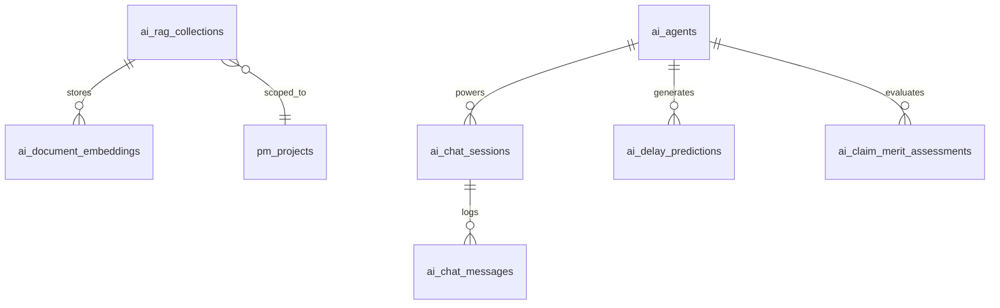

# Module 22: AI Construction Copilot & Multi-Agent Intelligence

## 1. Purpose
The AI Construction Copilot module in MimarERP v7 delivers a state-of-the-art, domain-specialized artificial intelligence ecosystem purpose-built for enterprise construction, EPC contracting, and infrastructure development. Built on Google Gemini 1.5 Pro/Flash and custom fine-tuned models running in a high-security sovereign cloud, it deploys nine autonomous specialist agents: Planning, Cost Control, Quantity Surveying (QS), Procurement, QA/QC, HSE, Contracts, Claims, and BIM. Supported by an enterprise-grade Retrieval-Augmented Generation (RAG) architecture powered by `pgvector` and hybrid semantic/lexical search, the Copilot automates complex technical documentation, predicts schedule delays, evaluates FIDIC claim merits, parses multi-thousand-page tender specs, and generates instant meeting minutes and contractual site notices.

---

## 2. Business Objectives
1. **Domain-Specific Cognitive Automation**: Eliminate up to 70% of routine technical office administration through autonomous specialist AI agents with deep knowledge of FIDIC, PMI PMBOK, CSI MasterFormat, Saudi Building Code (SBC), and Aramco standards.
2. **FIDIC Cl. 20.1 Claim Merit & Time-Bar Protection**: Safeguard commercial rights through automated contractual analysis that verifies notice time-bars (e.g., 28-day notice rule) and scores entitlement probability based on contemporaneous site records.
3. **Predictive Schedule Delay Forecasting**: Apply probabilistic machine learning and Monte Carlo simulation over historical baseline schedules and current lookaheads to forecast critical path delays 30 to 90 days before they manifest on site.
4. **Autonomous Site Correspondence Generation**: Instantly draft legally compliant Site Memos, Notices of Dissatisfaction, Non-Conformance Reports (NCR), and Requests for Information (RFI) from field notes or audio recordings.
5. **Instant Project Document RAG Intelligence**: Allow project engineers to query hundreds of thousands of drawings, specifications, submittals, and contract addenda with zero hallucination via strictly cited page/paragraph references.
6. **BIM & Quantity Take-Off (QTO) Extraction**: Automatically cross-reference 3D IFC/Revit models against 2D shop drawings and BOQ descriptions to detect scope discrepancies and missing quantity items.

---

## 3. User Roles & Permissions
| Role Name | Scope / Access Level | Core Responsibilities |
| :--- | :--- | :--- |
| **Enterprise AI Administrator** | Platform / Global | Managing LLM API keys, model routing rules, vector index governance, fine-tuning datasets, prompt guardrails. |
| **Project AI Lead / Superuser** | Project Assigned | Vectorizing project documentation, setting project-specific context prompts, auditing agent query logs. |
| **Technical Office Engineer** | Technical Office | Interacting with Planning, QS, and BIM agents; running automated RFI drafting and specification queries. |
| **Commercial & Contracts Manager** | Commercial / Legal | Utilizing Contracts and Claims agents for clause interpretation, time-bar audits, and claim merit defense. |
| **Site Engineer / Inspector** | Mobile / Site Field | Voice-to-memo generation, safety hazard image analysis, QA/QC checklist auto-completion via Copilot. |
| **Corporate Legal Counsel** | Enterprise Legal | Reviewing AI-drafted dispute submissions, arbitration briefs, and formal contractual notices. |

---

## 4. Database Tables

### `ai_agents`
| Column Name | Data Type | Constraints | Description |
| :--- | :--- | :--- | :--- |
| `id` | UUID | PRIMARY KEY, DEFAULT gen_random_uuid() | Unique identifier |
| `tenant_id` | UUID | NOT NULL | Multi-tenant isolation |
| `agent_code` | VARCHAR(50) | NOT NULL, UNIQUE | e.g., 'AGENT_PLANNING', 'AGENT_CLAIMS' |
| `name_en` | VARCHAR(100) | NOT NULL | Agent designation (e.g., 'Planning Copilot') |
| `name_ar` | VARCHAR(100) | NOT NULL | Arabic designation |
| `domain_specialty` | VARCHAR(50) | NOT NULL | 'PLANNING', 'COST_CONTROL', 'QS', 'PROCUREMENT', 'QAQC', 'HSE', 'CONTRACTS', 'CLAIMS', 'BIM' |
| `system_prompt` | TEXT | NOT NULL | Domain persona, regulatory rules, and instruction set |
| `base_model` | VARCHAR(50) | NOT NULL DEFAULT 'gemini-1.5-pro' | Underlying foundation model |
| `temperature` | NUMERIC(3,2) | NOT NULL DEFAULT 0.20 | Creativity vs deterministic precision |
| `is_active` | BOOLEAN | NOT NULL DEFAULT TRUE | Operational status |
| `created_at` | TIMESTAMPTZ | NOT NULL DEFAULT NOW() | Audit timestamp |

### `ai_rag_collections`
| Column Name | Data Type | Constraints | Description |
| :--- | :--- | :--- | :--- |
| `id` | UUID | PRIMARY KEY, DEFAULT gen_random_uuid() | Unique identifier |
| `tenant_id` | UUID | NOT NULL | Multi-tenant isolation |
| `project_id` | UUID | NOT NULL | Project boundary |
| `collection_name`| VARCHAR(100) | NOT NULL | e.g., 'Project Specifications Div 01-50', 'FIDIC Contract' |
| `source_type` | VARCHAR(50) | NOT NULL | 'CONTRACT', 'SPECIFICATION', 'DRAWING_REGISTER', 'P6_SCHEDULE', 'SITE_DIARY' |
| `total_chunks` | INTEGER | NOT NULL DEFAULT 0 | Number of embedded vector passages |
| `embedding_model`| VARCHAR(50) | NOT NULL DEFAULT 'text-embedding-004' | Vector embedding model |
| `last_synced_at`| TIMESTAMPTZ | NULL | Timestamp of last document ingestion |

### `ai_document_embeddings`
| Column Name | Data Type | Constraints | Description |
| :--- | :--- | :--- | :--- |
| `id` | UUID | PRIMARY KEY, DEFAULT gen_random_uuid() | Unique identifier |
| `tenant_id` | UUID | NOT NULL | Multi-tenant isolation |
| `collection_id` | UUID | NOT NULL, REFERENCES `ai_rag_collections` | Parent collection |
| `document_id` | UUID | NOT NULL | FK to `dms_documents` |
| `document_title`| VARCHAR(255) | NOT NULL | Original filename or document reference |
| `page_number` | INTEGER | NULL | Page number for citation |
| `chunk_index` | INTEGER | NOT NULL | Position within document |
| `chunk_text` | TEXT | NOT NULL | Passaged text payload |
| `embedding` | VECTOR(768) | NOT NULL | `pgvector` embedding representation |
| `metadata_jsonb`| JSONB | NULL | Metadata (author, division, revision, date) |
| `created_at` | TIMESTAMPTZ | NOT NULL DEFAULT NOW() | Ingestion timestamp |

### `ai_chat_sessions`
| Column Name | Data Type | Constraints | Description |
| :--- | :--- | :--- | :--- |
| `id` | UUID | PRIMARY KEY, DEFAULT gen_random_uuid() | Unique identifier |
| `tenant_id` | UUID | NOT NULL | Multi-tenant isolation |
| `project_id` | UUID | NOT NULL | Project context |
| `agent_id` | UUID | NOT NULL, REFERENCES `ai_agents` | Interacting specialist agent |
| `user_id` | UUID | NOT NULL | Initiating engineer |
| `session_title` | VARCHAR(255) | NOT NULL | Auto-generated session topic |
| `context_window_tokens`| INTEGER | NOT NULL DEFAULT 0 | Active token count |
| `is_pinned` | BOOLEAN | NOT NULL DEFAULT FALSE | Saved for reference |
| `created_at` | TIMESTAMPTZ | NOT NULL DEFAULT NOW() | Session start timestamp |

### `ai_chat_messages`
| Column Name | Data Type | Constraints | Description |
| :--- | :--- | :--- | :--- |
| `id` | UUID | PRIMARY KEY, DEFAULT gen_random_uuid() | Unique identifier |
| `session_id` | UUID | NOT NULL, REFERENCES `ai_chat_sessions` | Parent session |
| `sender_type` | VARCHAR(20) | NOT NULL | 'USER', 'AGENT', 'SYSTEM' |
| `content` | TEXT | NOT NULL | Message text or generated response |
| `citations_jsonb`| JSONB | NULL | Array of source document links and page numbers |
| `prompt_tokens` | INTEGER | NOT NULL DEFAULT 0 | Inbound token count |
| `completion_tokens`| INTEGER | NOT NULL DEFAULT 0| Outbound token count |
| `latency_ms` | INTEGER | NOT NULL DEFAULT 0 | Inference execution time |
| `feedback_rating`| INTEGER | NULL CHECK (feedback_rating BETWEEN 1 AND 5) | User quality rating |
| `created_at` | TIMESTAMPTZ | NOT NULL DEFAULT NOW() | Timestamp |

### `ai_delay_predictions`
| Column Name | Data Type | Constraints | Description |
| :--- | :--- | :--- | :--- |
| `id` | UUID | PRIMARY KEY, DEFAULT gen_random_uuid() | Unique identifier |
| `tenant_id` | UUID | NOT NULL | Multi-tenant isolation |
| `project_id` | UUID | NOT NULL | Associated project |
| `schedule_id` | UUID | NOT NULL | Analyzed schedule baseline |
| `milestone_code` | VARCHAR(50) | NOT NULL | At-risk milestone |
| `contract_due_date`| DATE | NOT NULL | Contractual deadline |
| `ai_forecast_date` | DATE | NOT NULL | Predicted completion date |
| `predicted_delay_days`| INTEGER | NOT NULL | Forecasted slippage |
| `confidence_score`| NUMERIC(5,2)| NOT NULL | Prediction confidence (0-100%) |
| `primary_risk_drivers`| JSONB | NOT NULL | Factors (e.g., Concrete supply lead time, RFI latency) |
| `recommended_mitigation`| TEXT| NOT NULL | Actionable corrective advice |
| `created_at` | TIMESTAMPTZ | NOT NULL DEFAULT NOW() | Prediction timestamp |

### `ai_claim_merit_assessments`
| Column Name | Data Type | Constraints | Description |
| :--- | :--- | :--- | :--- |
| `id` | UUID | PRIMARY KEY, DEFAULT gen_random_uuid() | Unique identifier |
| `tenant_id` | UUID | NOT NULL | Multi-tenant isolation |
| `project_id` | UUID | NOT NULL | Contract project |
| `claim_reference` | VARCHAR(100)| NOT NULL | Claim notice ID |
| `fidic_clause` | VARCHAR(50) | NOT NULL | e.g., 'Clause 20.1', 'Clause 13.7', 'Clause 17.4' |
| `event_date` | DATE | NOT NULL | Date delay event originated |
| `notice_date` | DATE | NOT NULL | Date formal notice submitted |
| `days_elapsed` | INTEGER | GENERATED ALWAYS AS (notice_date - event_date) STORED | Elapsed days for time-bar test |
| `is_time_barred` | BOOLEAN | NOT NULL | True if elapsed > contractual notice limit (e.g. 28 days) |
| `legal_entitlement_score`| NUMERIC(5,2)| NOT NULL | Probability of entitlement (0-100%) |
| `supporting_evidence_count`| INTEGER| NOT NULL | Number of valid linked site records |
| `quantum_claimed_sar`| NUMERIC(15,2)| NOT NULL | Claimed financial amount |
| `quantum_justified_sar`| NUMERIC(15,2)| NOT NULL | AI-assessed defensible quantum |
| `executive_briefing`| TEXT | NOT NULL | Legal summary & recommended stance |

---

## 5. Entity Relationships (Mermaid)



---

## 6. Business Workflows

### The 9 Specialist Copilot Agents Architecture
```
                               ┌────────────────────────────────────────────────────────┐
                               │           ENTERPRISE AI ORCHESTRATOR & ROUTER           │
                               │        (Intent Recognition & Guardrail Security)       │
                               └──────────────────────────┬─────────────────────────────┘
                                                          │
          ┌───────────────┬────────────────┬──────────────┼──────────────┬───────────────┬───────────────┐
          ▼               ▼                ▼              ▼              ▼               ▼               ▼
     [Planning]     [Cost Control]        [QS]      [Procurement]     [QA/QC]          [HSE]        [Contracts]
      Schedule       EVM Trends,      Measurement     RFQ Bids,      WIRs, NCRs,    PTWs, Safety   FIDIC Clauses,
    Delays & CPM     EAC Forecast     BOQ Anomalies   Lead Times     Material Specs  Hazards, TBT   Claims & VOs
          │               │                │              │              │               │               │
          └───────────────┴────────────────┴──────┬───────┴──────────────┴───────────────┴───────────────┘
                                                  │
                                                  ▼
                                     ┌─────────────────────────┐
                                     │      [Claims Agent]     │
                                     │ Time-Bar & Merit Engine │
                                     └─────────────────────────┘
                                                  │
                                                  ▼
                                     ┌─────────────────────────┐
                                     │       [BIM Agent]       │
                                     │ 4D/5D QTO & Clash Recon │
                                     └─────────────────────────┘
```

### RAG Document Ingestion & Query Pipeline
```
[New Project Document Uploaded] (PDF Specs, Addenda, Contracts, P6 Schedule)
                 │
                 ▼
[Document Parsing & Semantic Chunking Engine]
   - Extract text, tables, and drawing title blocks
   - Chunk into 512-token passages with 64-token overlap
   - Enrich chunk with metadata (Document Title, Revision, Division, Date)
                 │
                 ▼
[Vector Embedding Generation]
   - Generate 768-dimensional dense vectors via Google text-embedding-004
   - Store in PostgreSQL `ai_document_embeddings` with HNSW vector index
                 │
                 ▼
[Engineer Enters Query in Chat] -> ("What are the curing requirements for underground concrete?")
                 │
                 ▼
[Hybrid Retrieval (Vector Search + Full-Text BM25)]
   - Perform cosine similarity match in `pgvector`
   - Combine with lexical keyword search over project collection
   - Re-rank top 5 relevant passages
                 │
                 ▼
[Constrained Synthesis & Strict Citation]
   - Prompt LLM with retrieved context + zero-hallucination constraint
   - Output answer with exact document references: "[Project Spec Div 03-3000, Page 14, Rev 2]"
```

---

## 7. UI Screens
1. **Copilot Workspace (Multi-Agent Chat Interface)**: Conversational UI featuring quick-switch pills for all 9 specialist agents, contextual prompt suggestions, markdown formatting, syntax-highlighted code/formulas, and interactive citation badges.
2. **Project Knowledge RAG Management**: Administrative dashboard displaying all indexed project documents, embedding status, chunk count, search latency, and manual re-indexing triggers.
3. **AI Delay Prediction & Monte Carlo Explorer**: Visual schedule risk dashboard showing simulated completion date distribution curves (P50, P80, P90), critical path drivers, and recommended mitigations.
4. **Contractual Claim Merit Evaluator**: Specialized legal interface displaying the claim timeline, automated time-bar compliance badge (PASS / EXPIRED), supporting site evidence checklist, and entitlement probability score.
5. **Autonomous Site Memo & Minutes Generator**: One-click wizard that converts audio transcripts or rough bullet points into formatted, formal contractual letters (FIDIC-aligned) or Site Meeting Minutes (MoM).
6. **BIM & BOQ Discrepancy Inspector**: Side-by-side comparison screen highlighting volume and element discrepancies between 3D model properties and priced BOQ items.

---

## 8. Dashboards
- **Enterprise AI Operations Dashboard**: Total queries processed, token consumption by project, response latency distribution, and user satisfaction ratings.
- **Contractual Claim Risk Heatmap**: Real-time matrix of pending contractor claims, evaluated by AI for time-bar validity and exposure severity.
- **Predictive Schedule Risk Dashboard**: Ranking of projects by AI-predicted milestone slippage risk over the next 90 days.
- **Document Intelligence Coverage Dashboard**: Percentage of project specifications, shop drawings, and RFIs fully indexed in the vector store.

---

## 9. Reports
1. **AI Claim Merit & Entitlement Assessment Report**: Formal 15-page legal briefing evaluating contractual basis, notice validity, cause-and-effect matrix, and justified quantum.
2. **Predictive Schedule Risk & Monte Carlo Report**: Probabilistic schedule forecast report detailing P50/P80 dates and critical path vulnerability.
3. **Automated Site Meeting Minutes (MoM)**: Generated meeting minutes with action items, responsible owners, target completion dates, and audio citation links.
4. **Contract Deviation & Risk Audit**: Analysis of proposed client contract amendments against standard FIDIC Red Book 2017 conditions.
5. **BOQ vs Specification Gap Analysis**: Automated report identifying unpriced items, conflicting tolerances, and ambiguous material grades.
6. **AI Safety Hazard Incident Pattern Analysis**: Monthly trend report predicting recurrent site safety risks based on historic near-miss and toolbox talk logs.
7. **RFI Repetitiveness & Specification Defect Log**: Audit of RFIs caused by ambiguous or conflicting consultant drawings.
8. **Vendor Bid Technical Comparison Summary**: Automated extraction and comparative scoring of multi-vendor equipment specifications against tender criteria.
9. **Copilot Query & Knowledge Utilization Audit**: Corporate report identifying what engineering challenges are most frequently queried across sites.
10. **Site Diary NLP Sentiment & Delay Indicator Report**: Semantic analysis of daily site diary entries flagging latent disputes and contractor delays.

---

## 10. Key Performance Indicators (KPIs)
| KPI Code | Name | Calculation Formula | Target | Red (Critical) | Amber (Warning) | Green (Healthy) |
| :--- | :--- | :--- | :--- | :--- | :--- | :--- |
| **KPI-AI-01** | Technical Response Citation Accuracy| $(\frac{\text{Queries with Valid Source Citations}}{\text{Total RAG Queries}}) \times 100$ | $\ge 98.5\%$ | $< 90\%$ | $90\% - 98.4\%$ | $\ge 98.5\%$ |
| **KPI-AI-02** | Time-Bar Detection Precision | $(\frac{\text{Correctly Flagged Time-Bars}}{\text{Total Claims Audited}}) \times 100$ | $100\%$ | $< 95\%$ | $95\% - 99.9\%$ | $100\%$ |
| **KPI-AI-03** | Schedule Delay Prediction Lead Time| $\text{Average Days Delay Forecasted Prior to Occurrence}$ | $\ge 45 \text{ Days}$| $< 15 \text{ Days}$| $15 - 44 \text{ Days}$| $\ge 45 \text{ Days}$ |
| **KPI-AI-04** | Site Memo Generation Velocity | $\text{Minutes Elapsed from Prompt to Formatted Memo}$ | $\le 2 \text{ Mins}$| $> 10 \text{ Mins}$| $3 - 10 \text{ Mins}$ | $\le 2 \text{ Mins}$ |
| **KPI-AI-05** | Copilot User Satisfaction (CSAT) | $(\frac{\sum \text{Feedback Ratings (1-5)}}{5 \times \text{Total Rated Sessions}}) \times 100$ | $\ge 88\%$ | $< 70\%$ | $70\% - 87\%$ | $\ge 88\%$ |
| **KPI-AI-06** | RAG Query Response Latency | $95\text{th Percentile Inference Latency}$ | $\le 2.5 \text{ Sec}$| $> 6.0 \text{ Sec}$| $2.6 - 6.0 \text{ Sec}$| $\le 2.5 \text{ Sec}$ |

---

## 11. API Endpoints
- `POST /api/v1/ai/chat/completions`: Stream conversational inference from specialist agents with RAG context injection.
- `POST /api/v1/ai/rag/documents/ingest`: Upload and asynchronously vectorize PDF/Word/Excel document into `pgvector`.
- `POST /api/v1/ai/claims/assess-merit`: Run FIDIC time-bar and entitlement scoring over an active claim notice.
- `POST /api/v1/ai/schedule/predict-delays`: Trigger Monte Carlo schedule risk simulation and return P50/P80 dates.
- `POST /api/v1/ai/tools/generate-site-memo`: Generate formal contractual correspondence from raw bullet notes or voice input.
- `POST /api/v1/ai/tools/transcribe-meeting`: Ingest audio file, transcribe via Whisper/Gemini, and structure formal Minutes of Meeting.
- `GET /api/v1/ai/agents`: Retrieve configuration, status, and domain rules for the 9 specialist agents.
- `POST /api/v1/ai/chat/messages/{id}/feedback`: Log user rating (1-5 stars) and correction notes for model alignment.

---

## 12. Required Permissions
- `ai:copilot:use`: General access to chat with domain specialist agents.
- `ai:rag:upload_manage`: Authority to upload and re-index project documents in the vector store.
- `ai:claims:evaluate`: Run legal and commercial merit assessments on active disputes.
- `ai:admin:configure`: Manage model API endpoints, temperature settings, and enterprise system prompts.
- `ai:audit:view`: Access token consumption analytics, latency logs, and engineer query histories.

---

## 13. Approval Workflows & SLA Matrix
```
[AI Drafts Formal Contractual Notice / Site Memo]
                       │
                       ▼
[Senior Contract Administrator] (SLA: 4 hrs) ── Reviews AI citations & legal tone
                       │
           Factual & Legally Sound?
           ├── No ──► [Prompt Copilot for Revision with Specific Guidance]
           └── Yes
                 │
                 ▼
[Project Director] (SLA: 8 hrs) ── Executive Authorization & Digital Signature
                 │
                 ▼
[Automated Dispatch] ── Transmits official PDF via Email & Aconex/Project Portal
```

---

## 14. AI Features
1. **Self-Correcting RAG Multi-Query Expansion**: When an engineer asks a colloquial question, the Copilot automatically generates 3 alternative technical queries (translating trade terminology to CSI MasterFormat) to maximize retrieval recall.
2. **Autonomous Multi-Agent Collaboration**: When analyzing a proposed Variation Order, the Contracts Agent calls the QS Agent to verify quantities, then calls the Planning Agent to calculate schedule impact, synthesizing a unified commercial assessment.
3. **Computer Vision Site Photo Defect Tagger**: Mobile site photos are analyzed via vision models to automatically detect safety violations (missing PPE, missing guardrails) and concrete cracks, auto-populating NCR forms.

---

## 15. Automations
1. **Automatic Contractual Time-Bar Countdown**: When a site delay or force majeure event is recorded in the Site Diary, the Contracts Copilot automatically initiates a 28-day countdown clock and drafts the Clause 20.1 Notice of Claim for the Project Manager.
2. **Auto-Vectorization on Document Release**: When a new drawing or specification revision is approved in Module 22 (DMS), an event triggers immediate background vectorization and index update in `pgvector`.
3. **Daily Executive Briefing Generation**: At 06:00 AM daily, the Copilot aggregates site progress from the previous 24 hours and delivers a concise audio/text briefing to the Project Director.

---

## 16. Integration Requirements
- **Document Management System (DMS)**: Direct read hooks into project document repositories for continuous document embedding and revision tracking.
- **Planning & Scheduling (Module 03)**: Access to P6 XER networks and baseline schedules for Monte Carlo simulation.
- **Contract Administration (Module 10 / 14)**: Live integration with FIDIC correspondence registers, submittals, and claim logs.
- **Mobile Field App (Module 23)**: Real-time voice-to-text transcription and field photo analysis pipelines from mobile devices.
