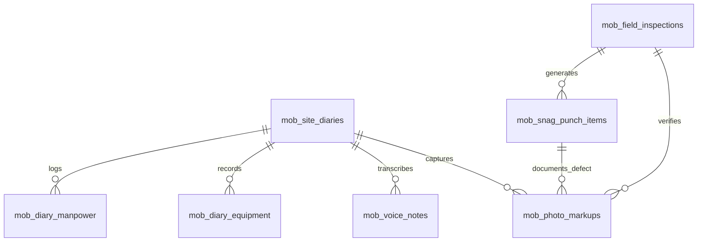

# Module 23: Mobile Field App & Site Operations

## 1. Purpose
The Mobile Field App module in MimarERP v7 delivers a mission-critical, enterprise-grade mobile solution for iOS and Android, engineered using Flutter / React Native with a 100% offline-first architecture. Purpose-built for construction sites, remote desert camps, and underground infrastructure projects across the Kingdom of Saudi Arabia where cellular connectivity is intermittent or non-existent, the app relies on embedded local SQLite / WatermelonDB databases with Conflict-Free Replicated Data Types (CRDTs). It empowers site superintendents, QA/QC inspectors, safety officers, and field engineers to execute Daily Site Diaries, digital Work Inspection Requests (WIR), Material Inspection Requests (MIR), photo markups, voice memo transcriptions, QR-based stock scanning, and biometric attendance with immutable GPS geofencing.

---

## 2. Business Objectives
1. **Uninterrupted 100% Offline Field Capability**: Ensure site engineers can log complete inspection records, snag lists, and equipment hours in zero-connectivity environments with seamless automatic background synchronization upon network reconnection.
2. **Immutable Site Evidence & Fraud Prevention**: Enforce strict cryptographic GPS geofencing and server-verified timestamps on all field photos, signatures, and material delivery logs, eliminating retrospective documentation forgery.
3. **Accelerated Inspection Cycles (WIR / MIR)**: Reduce the average turnaround time for Work Inspection Requests and consultant approvals from 72 hours down to under 8 hours through instant on-site digital sign-offs.
4. **Hands-Free AI Voice Site Reporting**: Allow site supervisors to dictate daily progress and site observations in Arabic or English, automatically transcribed and categorized into formal Site Diary entries via on-device and edge AI.
5. **Real-Time Material & Equipment QR Tracking**: Enable storekeepers and plant supervisors to scan serialized QR codes on equipment and delivery pallets for instant Goods Receipt Notes (GRN) and internal site transfers.
6. **Zero-Conflict Data Synchronization**: Resolve concurrent edits between multiple site engineers using deterministic Conflict-Free Replicated Data Types (CRDTs) and last-write-wins with operational transforms.

---

## 3. User Roles & Permissions
| Role Name | Scope / Access Level | Core Responsibilities |
| :--- | :--- | :--- |
| **Site Superintendent / General Foreman**| Mobile Site Field | Daily site diary logging, manpower count attestation, equipment hours recording, subcontractor work progress. |
| **QA/QC Field Inspector** | Mobile Site Field | Conducting WIR, MIR, concrete pour clearances, snagging/punch-list audits, issuing mobile NCRs. |
| **Consultant Supervising Engineer (RE/ARE)**| External Mobile Portal | Real-time review and on-site digital signing (Approve / Approve as Noted / Reject) of inspection requests. |
| **HSE Field Officer** | Mobile Site Field | Conducting Permit to Work (PTW) audits, recording safety near-misses, running daily Toolbox Talks (TBT). |
| **Site Material Storekeeper** | Site Warehouse | Scanning delivery truck QR codes, issuing mobile GRNs, logging material quarantine and storage bins. |
| **Plant & Equipment Inspector** | Site Fleet | Mobile pre-start equipment checklists, diesel fuel disbursement logging, telematics meter reading. |

---

## 4. Database Tables

### `mob_offline_sync_log`
| Column Name | Data Type | Constraints | Description |
| :--- | :--- | :--- | :--- |
| `id` | UUID | PRIMARY KEY, DEFAULT gen_random_uuid() | Unique sync event identifier |
| `tenant_id` | UUID | NOT NULL | Multi-tenant isolation |
| `user_id` | UUID | NOT NULL | Mobile device user |
| `device_uuid` | VARCHAR(100) | NOT NULL | Unique hardware identifier |
| `app_version` | VARCHAR(20) | NOT NULL | Installed mobile client version |
| `sync_direction` | VARCHAR(20) | NOT NULL | 'UPSTREAM_PUSH', 'DOWNSTREAM_PULL' |
| `entity_type` | VARCHAR(50) | NOT NULL | 'SITE_DIARY', 'WIR_INSPECTION', 'SNAG_ITEM', 'GRN_RECEIPT' |
| `records_count` | INTEGER | NOT NULL DEFAULT 0 | Number of entities synchronized |
| `conflict_resolution`| VARCHAR(30) | NOT NULL DEFAULT 'NONE' | 'NONE', 'AUTO_MERGED_CRDT', 'SERVER_OVERRIDE' |
| `status` | VARCHAR(20) | NOT NULL | 'SUCCESS', 'PARTIAL_FAIL', 'FAILED' |
| `sync_duration_ms` | INTEGER | NOT NULL DEFAULT 0 | Network sync latency |
| `created_at` | TIMESTAMPTZ | NOT NULL DEFAULT NOW() | Timestamp |

### `mob_site_diaries`
| Column Name | Data Type | Constraints | Description |
| :--- | :--- | :--- | :--- |
| `id` | UUID | PRIMARY KEY, DEFAULT gen_random_uuid() | Unique identifier |
| `tenant_id` | UUID | NOT NULL | Multi-tenant isolation |
| `project_id` | UUID | NOT NULL | FK to `pm_projects` |
| `diary_date` | DATE | NOT NULL | Construction working day |
| `shift` | VARCHAR(20) | NOT NULL DEFAULT 'DAY' | 'DAY', 'NIGHT', '24HR' |
| `weather_conditions`| VARCHAR(50) | NOT NULL | 'CLEAR', 'EXTREME_HEAT', 'DUST_STORM', 'RAIN' |
| `ambient_temp_celsius`| NUMERIC(4,1)| NOT NULL | On-site temperature (e.g. 46.5°C) |
| `humidity_pct` | INTEGER | NULL | Relative humidity percentage |
| `total_labor_headcount`| INTEGER| NOT NULL DEFAULT 0 | Direct + Subcontractor workers |
| `work_accomplished`| TEXT | NOT NULL | Detailed work summary |
| `delay_events_logged`| TEXT | NULL | Unforeseen delays (weather, owner hold, RFI) |
| `gps_latitude` | NUMERIC(10,7)| NOT NULL | Device GPS coordinates at submission |
| `gps_longitude` | NUMERIC(10,7)| NOT NULL | Device GPS coordinates at submission |
| `gps_geofence_valid`| BOOLEAN | NOT NULL DEFAULT TRUE | Validates submission within site boundary |
| `created_by` | UUID | NOT NULL | Superintendent user ID |
| `approval_status` | VARCHAR(30) | NOT NULL DEFAULT 'SUBMITTED' | 'DRAFT_LOCAL', 'SUBMITTED', 'CONSULTANT_SIGNED', 'REJECTED' |
| `created_at` | TIMESTAMPTZ | NOT NULL DEFAULT NOW() | Timestamp |

### `mob_diary_manpower`
| Column Name | Data Type | Constraints | Description |
| :--- | :--- | :--- | :--- |
| `id` | UUID | PRIMARY KEY, DEFAULT gen_random_uuid() | Unique identifier |
| `tenant_id` | UUID | NOT NULL | Multi-tenant isolation |
| `diary_id` | UUID | NOT NULL, REFERENCES `mob_site_diaries` | Parent diary |
| `contractor_type` | VARCHAR(30) | NOT NULL | 'MAIN_CONTRACTOR', 'SUBCONTRACTOR' |
| `company_id` | UUID | NOT NULL | FK to `org_entities` or `sub_contractors` |
| `trade_discipline`| VARCHAR(50) | NOT NULL | 'CARPENTER', 'STEEL_FIXER', 'MASON', 'ELECTRICIAN', 'PLUMBER', 'LABORER' |
| `headcount` | INTEGER | NOT NULL CHECK (headcount > 0) | Number of active tradesmen |
| `hours_worked` | NUMERIC(5,2) | NOT NULL DEFAULT 8.00 | Total work hours per person |
| `activity_wbs_id` | UUID | NULL | Associated WBS activity code |

### `mob_diary_equipment`
| Column Name | Data Type | Constraints | Description |
| :--- | :--- | :--- | :--- |
| `id` | UUID | PRIMARY KEY, DEFAULT gen_random_uuid() | Unique identifier |
| `tenant_id` | UUID | NOT NULL | Multi-tenant isolation |
| `diary_id` | UUID | NOT NULL, REFERENCES `mob_site_diaries` | Parent diary |
| `equipment_id` | UUID | NOT NULL | FK to `plant_assets` |
| `working_hours` | NUMERIC(4,1) | NOT NULL CHECK (working_hours >= 0) | Productive operation hours |
| `idle_hours` | NUMERIC(4,1) | NOT NULL DEFAULT 0.0 | Idle standby hours |
| `breakdown_hours`| NUMERIC(4,1) | NOT NULL DEFAULT 0.0 | Maintenance / downtime hours |
| `fuel_liters_issued`| NUMERIC(7,2)| NOT NULL DEFAULT 0.00 | Fuel top-up quantity |
| `operator_id` | UUID | NULL | Machine operator user ID |

### `mob_field_inspections`
| Column Name | Data Type | Constraints | Description |
| :--- | :--- | :--- | :--- |
| `id` | UUID | PRIMARY KEY, DEFAULT gen_random_uuid() | Unique identifier |
| `tenant_id` | UUID | NOT NULL | Multi-tenant isolation |
| `project_id` | UUID | NOT NULL | Project boundary |
| `inspection_type` | VARCHAR(30) | NOT NULL | 'WIR', 'MIR', 'PRE_POUR_CONCRETE', 'SAFETY_AUDIT' |
| `reference_number`| VARCHAR(50) | NOT NULL, UNIQUE | e.g., WIR-STR-LVL02-042 |
| `wbs_node_id` | UUID | NOT NULL | WBS activity location |
| `location_details`| VARCHAR(255) | NOT NULL | e.g., Zone B, Grid line 14-18, Slab L3 |
| `inspection_datetime`| TIMESTAMPTZ | NOT NULL | Scheduled time on site |
| `inspector_id` | UUID | NOT NULL | Main contractor inspector |
| `consultant_id` | UUID | NULL | Supervising consultant engineer |
| `verdict` | VARCHAR(30) | NOT NULL DEFAULT 'PENDING' | 'PENDING', 'CODE_A_APPROVED', 'CODE_B_APPROVED_AS_NOTED', 'CODE_C_REJECTED' |
| `consultant_signature_svg`| TEXT | NULL | Encrypted vector signature path |
| `signature_timestamp`| TIMESTAMPTZ | NULL | Exact time consultant signed |
| `signature_gps` | VARCHAR(100) | NULL | GPS coordinates during signing |
| `status` | VARCHAR(30) | NOT NULL DEFAULT 'SCHEDULED' | Lifecycle status |

### `mob_snag_punch_items`
| Column Name | Data Type | Constraints | Description |
| :--- | :--- | :--- | :--- |
| `id` | UUID | PRIMARY KEY, DEFAULT gen_random_uuid() | Unique identifier |
| `tenant_id` | UUID | NOT NULL | Multi-tenant isolation |
| `project_id` | UUID | NOT NULL | Project reference |
| `inspection_id` | UUID | NULL, REFERENCES `mob_field_inspections` | Optional inspection parent |
| `snag_code` | VARCHAR(50) | NOT NULL, UNIQUE | SNAG-FIN-0891 |
| `discipline` | VARCHAR(30) | NOT NULL | 'ARCHITECTURAL', 'STRUCTURAL', 'MEP_HVAC', 'ELECTRICAL', 'PLUMBING' |
| `severity` | VARCHAR(20) | NOT NULL DEFAULT 'MINOR' | 'CRITICAL', 'MAJOR', 'MINOR' |
| `description` | TEXT | NOT NULL | Detailed defect description |
| `responsible_subcontractor_id`| UUID| NOT NULL | Responsible party |
| `target_closure_date`| DATE | NOT NULL | Rectification deadline |
| `rectification_status`| VARCHAR(30)| NOT NULL DEFAULT 'OPEN' | 'OPEN', 'WORK_IN_PROGRESS', 'READY_FOR_REINSPECTION', 'CLOSED' |
| `created_at` | TIMESTAMPTZ | NOT NULL DEFAULT NOW() | Timestamp |

### `mob_photo_markups`
| Column Name | Data Type | Constraints | Description |
| :--- | :--- | :--- | :--- |
| `id` | UUID | PRIMARY KEY, DEFAULT gen_random_uuid() | Unique identifier |
| `tenant_id` | UUID | NOT NULL | Multi-tenant isolation |
| `entity_type` | VARCHAR(50) | NOT NULL | 'WIR_INSPECTION', 'SNAG_ITEM', 'SITE_DIARY', 'NCR' |
| `entity_id` | UUID | NOT NULL | FK to target entity |
| `original_photo_url`| TEXT | NOT NULL | Raw high-resolution image URL |
| `annotated_photo_url`| TEXT| NOT NULL | Flattened image with arrows/circles/text |
| `annotations_jsonb`| JSONB | NOT NULL | Vector coordinate overlays (SVGs, text boxes) |
| `gps_latitude` | NUMERIC(10,7)| NOT NULL | EXIF extracted GPS latitude |
| `gps_longitude` | NUMERIC(10,7)| NOT NULL | EXIF extracted GPS longitude |
| `captured_at` | TIMESTAMPTZ | NOT NULL | Exact camera capture timestamp |

### `mob_voice_notes`
| Column Name | Data Type | Constraints | Description |
| :--- | :--- | :--- | :--- |
| `id` | UUID | PRIMARY KEY, DEFAULT gen_random_uuid() | Unique identifier |
| `tenant_id` | UUID | NOT NULL | Multi-tenant isolation |
| `user_id` | UUID | NOT NULL | Recording engineer |
| `audio_url` | TEXT | NOT NULL | Stored m4a/opus audio file |
| `duration_seconds`| INTEGER | NOT NULL | Length of recording |
| `language` | VARCHAR(10) | NOT NULL DEFAULT 'ar' | Detected language ('ar', 'en') |
| `raw_transcript` | TEXT | NOT NULL | Transcribed text output |
| `structured_output_jsonb`| JSONB | NULL | AI-extracted fields (weather, labor counts, delays) |
| `target_diary_id`| UUID | NULL, REFERENCES `mob_site_diaries` | Attached diary |
| `created_at` | TIMESTAMPTZ | NOT NULL DEFAULT NOW() | Timestamp |

---

## 5. Entity Relationships (Mermaid)



---

## 6. Business Workflows

### 100% Offline-First Data Capture & CRDT Synchronization
```
[Site Engineer on Remote Site (No Internet / Airplane Mode)]
                 │
                 ▼
[Local App Transaction in SQLite / WatermelonDB]
   - Generates Client-Side UUID v4
   - Records GPS Geolocation via Device Native Sensors
   - Stamps Client Wall-Clock Timestamp & Monotonic Sync Vector
   - Saves Photos & Voice Notes to Local Encrypted Sandboxed Storage
                 │
                 ▼
[Device Reconnects to Cellular / Site Office Wi-Fi]
                 │
                 ▼
[Background Sync Daemon Initiated]
   - Pushes batch payload to `POST /api/v1/mobile/sync/upstream`
   - Checks CRDT conflict matrix (Last-Write-Wins based on Lamport timestamps)
   - Server validates GPS coordinates against Project Boundary Polygon
   - Server returns Downstream Delta (New approved drawings, updated WIR status)
                 │
                 ▼
[Local Database Updated & Clean Status Displayed to User]
```

### Digital WIR Inspection & On-Site Consultant Signing
```
[Main Contractor Engineer Requests Pour Inspection (WIR)]
                 │
                 ▼
[Mobile Push Notification to Resident Consultant Engineer]
                 │
                 ▼
[Joint Site Walkdown at Formwork / Rebar Location]
   - Consultant verifies rebar spacing and cleanliness against Shop Drawing
   - Snags captured via camera with red-line markup & assigned to Subcontractor
                 │
                 ▼
[On-Site Digital Determination by Consultant]
   - Selects Verdict: [Code A: Approved] or [Code B: Approved as Noted]
   - Captures Consultant Stylus/Touch Signature on Mobile Glass
   - System captures instantaneous GPS coordinates and locks timestamp
                 │
                 ▼
[Immediate Clearance Issued]
- Ready-Mix Concrete batching plant receives automated digital release token
```

---

## 7. UI Screens
1. **Field Dashboard & Sync Status**: Clean mobile home screen showing active project name, network connectivity pill (Online / Offline Mode - 14 items pending sync), quick-action buttons (New Diary, New WIR, Scan QR, New Snag).
2. **Site Diary Daily Entry Form**: Multi-tab interface for Weather, Direct Labor, Subcontractor Crews, Heavy Plant Hours, Material Deliveries, and Site Diary Voice Dictation.
3. **Interactive Photo Markup Tool**: Full-screen canvas allowing drawing circles, arrows, dimension text, and defect severity tags over site photos before attachment.
4. **WIR & MIR Digital Inspection Card**: Clean card view showing checklist questions, specification references, attached drawings, verdict selector (Code A/B/C), and digital signature capture modal.
5. **Punch / Snag List Manager**: Fast mobile punch-list logger with priority filtering, location grouping, and before-and-after photo rectification comparison.
6. **QR Code Scanner View**: High-speed camera viewfinder with automatic autofocus and torch toggle, instantly recognizing asset barcodes and delivery consignment labels.

---

## 8. Dashboards
- **Mobile Field Operations Overview**: Mobile-optimized dashboard displaying daily site headcount across all packages, total active equipment, and open WIRs pending inspection today.
- **Snagging Closure Velocity Tracker**: Cumulative snags logged vs snags rectified by subcontractor within 48-hour SLAs.
- **Offline Sync & Latency Health**: IT administrative dashboard tracking pending offline queues, device battery health, and sync failure rates.
- **Concrete Pour Clearance Tracker**: Daily schedule of structural elements cleared for concrete pouring with real-time consultant sign-off timestamps.

---

## 9. Reports
1. **Official Daily Site Diary Report (Consultant Format)**: Comprehensive 5-page PDF compiling weather, labor breakdown, machinery hours, progress photos, and contractor/consultant signatures.
2. **Work Inspection Request (WIR) Record Sheet**: Official signed inspection certificate with embedded annotated photographs and GPS location verification stamps.
3. **Weekly Site Manpower Attendance Summary**: Biometric and manual headcounts logged across all subcontractors with trade classifications.
4. **Site Equipment Utilization & Fuel Burn Report**: Daily engine run hours vs idle hours and diesel consumption per machine.
5. **Snagging / Punch List Defect Schedule**: Photographic register of outstanding defects categorized by room, floor, discipline, and subcontractor.
6. **HSE Daily Toolbox Talk (TBT) & Attendance Sheet**: Mobile safety briefing record with digital sign-offs from participating tradesmen.
7. **Mobile Goods Receipt Note (GRN) Verification Log**: Audit of deliveries scanned on site against approved Purchase Orders.
8. **Consultant WIR Response Latency Report**: Tracking average hours taken by supervising engineers from WIR submission to site inspection.
9. **Concrete Pre-Pour Inspection Checklist Report**: Formwork, rebar, embedded MEP conduit verification record signed before batching.
10. **Site Incident & Hazard Identification Log**: Immediate photographic report of safety near-misses and unsafe conditions reported from the field.

---

## 10. Key Performance Indicators (KPIs)
| KPI Code | Name | Calculation Formula | Target | Red (Critical) | Amber (Warning) | Green (Healthy) |
| :--- | :--- | :--- | :--- | :--- | :--- | :--- |
| **KPI-MOB-01** | Offline Sync Success Rate | $(\frac{\text{Successful Sync Batches}}{\text{Total Sync Attempts}}) \times 100$ | $\ge 99.8\%$ | $< 95.0\%$ | $95.0\% - 99.7\%$ | $\ge 99.8\%$ |
| **KPI-MOB-02** | WIR Inspection Turnaround | $\text{Hours Elapsed from Request to Consultant Verdict}$ | $\le 8.0 \text{ Hrs}$ | $> 24.0 \text{ Hrs}$ | $8.1 - 24.0 \text{ Hrs}$ | $\le 8.0 \text{ Hrs}$ |
| **KPI-MOB-03** | GPS Geofence Compliance | $(\frac{\text{Field Entries Inside Project Boundary}}{\text{Total Submitted Entries}}) \times 100$ | $100\%$ | $< 98.0\%$ | $98.0\% - 99.9\%$ | $100\%$ |
| **KPI-MOB-04** | Snag Closure SLA Adherence | $(\frac{\text{Snags Rectified within 48 Hours}}{\text{Total Logged Snags}}) \times 100$ | $\ge 85\%$ | $< 65\%$ | $65\% - 84\%$ | $\ge 85\%$ |
| **KPI-MOB-05** | Site Diary On-Time Filing | $(\frac{\text{Diaries Submitted before 20:00 Daily}}{\text{Total Working Days}}) \times 100$ | $\ge 95\%$ | $< 80\%$ | $80\% - 94\%$ | $\ge 95\%$ |
| **KPI-MOB-06** | Mobile Crash-Free User Sessions| $(\frac{\text{Sessions without Fatal Crash}}{\text{Total Mobile Sessions}}) \times 100$ | $\ge 99.5\%$ | $< 98.0\%$ | $98.0\% - 99.4\%$ | $\ge 99.5\%$ |

---

## 11. API Endpoints
- `POST /api/v1/mobile/sync/upstream`: Batch ingestion of offline-created diaries, inspections, snags, and voice notes.
- `GET /api/v1/mobile/sync/downstream`: Fetch delta sync package (new drawings, assigned tasks, user permissions).
- `POST /api/v1/mobile/inspections/{id}/sign`: Capture consultant digital signature, verdict, and GPS metadata.
- `POST /api/v1/mobile/media/upload-chunk`: Resumable multipart upload for annotated site photos and audio notes.
- `POST /api/v1/mobile/voice/transcribe-process`: Submit raw audio note for server-side Whisper transcription and field extraction.
- `GET /api/v1/mobile/assets/scan/{qrCode}`: Lookup equipment or inventory stock profile by scanned QR/Barcode.
- `POST /api/v1/mobile/site-diary`: Direct REST submission of Site Diary when device is online.

---

## 12. Required Permissions
- `mob:diary:create_edit`: Create and modify daily site diary entries.
- `mob:inspection:perform`: Conduct field inspections and log contractor-side observations.
- `mob:inspection:consultant_sign`: Authorized signature permission for supervising consultant engineers.
- `mob:snag:create_assign`: Log and assign defects to subcontractors.
- `mob:qr:scan_receive`: Scan and process warehouse delivery receipts and asset transfers.
- `mob:geofence:bypass_override`: Administrative override for logging records outside designated GPS geofence (requires audit justification).

---

## 13. Approval Workflows & SLA Matrix
```
[Site Superintendent Submits Daily Site Diary]
                     │
                     ▼
[Project Manager Review] (SLA: 4 hrs) ── Reviews Manpower Counts & Delays
                     │
         Approved? ── No ──► [Return with Remarks]
         │ Yes
         ▼
[Resident Consultant Engineer (RE)] (SLA: 12 hrs) ── Site Diary Concurrence
         │
         ▼
[Daily Diary Locked & Distributed to PMO] (Immutable Audit Archive)
```

---

## 14. AI Features
1. **AI Voice-to-Diary Structured Extractor**: Converts colloquial voice notes in Arabic (Gulf/Saudi dialects) or English into clean, categorized JSON entries matching exact labor trades, machinery IDs, and weather conditions.
2. **Computer Vision PPE & Safety Hazard Detector**: Automatically flags missing hard hats, safety harnesses, or improper scaffolding in uploaded site photos prior to diary submission.
3. **Smart Snag Categorization**: Automatically detects defect trade (e.g., HVAC insulation vs paint blister) from photo analysis and assigns it to the pre-contracted subcontractor.

---

## 15. Automations
1. **Automated Weather Telemetry Ingestion**: Automatically fetches official hourly temperature, humidity, and wind speed from meteorological APIs for the project's coordinates, pre-filling the Site Diary.
2. **GPS Geofence Breach Blocker**: Rejects field inspection sign-offs if the device coordinates fall $> 100 \text{ meters}$ outside the project's certified CAD boundary polygon.
3. **Instant Concrete Pour Notification**: When a pre-pour WIR receives Code A approval, an automated MQTT push triggers the batching plant queue and alerts the QA/QC laboratory.

---

## 16. Integration Requirements
- **Planning & Scheduling (Module 03)**: Directly feeds daily completed work progress and delay notes into activity percentage updates.
- **Plant & Equipment Management (Module 09)**: Daily machine operating and idle hours automatically update equipment maintenance logs and internal rental charges.
- **Subcontract Management (Module 11)**: Subcontractor manpower attendance verified on mobile feeds into monthly Subcontractor Payment Certificates.
- **QA/QC Management (Module 16)**: Seamless synchronization between mobile field WIRs and the corporate master inspection register.
