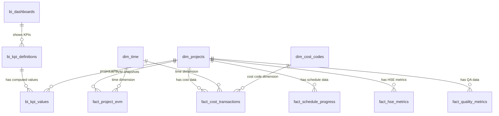

# Module 24: Analytics & Business Intelligence
## MimarERP v7 — Enterprise Construction ERP

---

## 1. Purpose

The Analytics & BI module provides a unified enterprise intelligence platform that transforms raw construction project data into strategic insights, automated reports, and predictive analytics. It delivers real-time dashboards for every management level — from site supervisor to CEO — and integrates with Microsoft Power BI for advanced OLAP analysis.

---

## 2. Business Objectives

1. **Single source of truth** — Consolidate data from all 25 ERP modules into a unified data warehouse with zero discrepancies.
2. **Real-time executive visibility** — Board-level dashboards updated within 60 seconds of data entry at site level.
3. **Automated reporting** — Eliminate manual monthly report compilation (typically 40+ man-hours/month per project).
4. **Predictive intelligence** — ML-based delay probability and cost overrun prediction with ≥75% accuracy.
5. **Regulatory reporting** — Auto-generate statutory reports (GOSI, VAT, ZATCA, Nitaqat, Zakat filing support).
6. **Benchmarking** — Compare project KPIs against industry benchmarks and internal historical data.

---

## 3. User Roles & Permissions

| Role | Access Level |
|---|---|
| ExecutiveDirector | All projects, all KPIs, financial consolidation |
| PortfolioManager | All projects (no financial detail) |
| ProjectManager | Own projects only, full detail |
| CostControlEngineer | Financial metrics, EVM, cost variance |
| PlanningEngineer | Schedule analytics, critical path, lookahead |
| QSEngineer | Quantity, billing, payment analytics |
| ProcurementManager | Spend analytics, vendor performance |
| HSEManager | Safety statistics, incident trends |
| FinanceDirector | Cash flow, P&L, GL analytics |
| Auditor | Read-only all data, full audit trail |
| BI_Analyst | Full access to data warehouse, custom queries |

---

## 4. Database Tables (Data Warehouse Schema)

```sql
-- FACT TABLES (Transactional measures)

CREATE TABLE fact_project_evm (
  id                UUID PRIMARY KEY DEFAULT gen_random_uuid(),
  tenant_id         UUID NOT NULL,
  project_id        UUID NOT NULL REFERENCES projects(id),
  snapshot_date     DATE NOT NULL,
  bac               NUMERIC(18,2) NOT NULL,
  pv                NUMERIC(18,2) NOT NULL,
  ev                NUMERIC(18,2) NOT NULL,
  ac                NUMERIC(18,2) NOT NULL,
  cv                NUMERIC(18,2) GENERATED ALWAYS AS (ev - ac) STORED,
  sv                NUMERIC(18,2) GENERATED ALWAYS AS (ev - pv) STORED,
  cpi               NUMERIC(8,4) GENERATED ALWAYS AS (CASE WHEN ac = 0 THEN 1 ELSE ROUND(ev/ac,4) END) STORED,
  spi               NUMERIC(8,4) GENERATED ALWAYS AS (CASE WHEN pv = 0 THEN 1 ELSE ROUND(ev/pv,4) END) STORED,
  eac               NUMERIC(18,2),
  etc               NUMERIC(18,2),
  vac               NUMERIC(18,2),
  tcpi              NUMERIC(8,4),
  percent_complete  NUMERIC(5,2),
  created_at        TIMESTAMPTZ NOT NULL DEFAULT NOW()
);

CREATE TABLE fact_cost_transactions (
  id              UUID PRIMARY KEY DEFAULT gen_random_uuid(),
  tenant_id       UUID NOT NULL,
  project_id      UUID NOT NULL,
  cost_code_id    UUID REFERENCES cost_codes(id),
  wbs_id          UUID REFERENCES wbs_items(id),
  transaction_date DATE NOT NULL,
  type            VARCHAR(30) NOT NULL, -- budget | actual | commitment | accrual | forecast
  amount          NUMERIC(18,2) NOT NULL,
  currency        VARCHAR(3) DEFAULT 'SAR',
  source_module   VARCHAR(50),          -- procurement | subcontracts | payroll | equipment
  source_ref_id   UUID,
  created_at      TIMESTAMPTZ DEFAULT NOW()
);

CREATE TABLE fact_schedule_progress (
  id                  UUID PRIMARY KEY DEFAULT gen_random_uuid(),
  tenant_id           UUID NOT NULL,
  project_id          UUID NOT NULL,
  activity_id         UUID NOT NULL REFERENCES activities(id),
  snapshot_date       DATE NOT NULL,
  planned_start       DATE,
  planned_finish      DATE,
  actual_start        DATE,
  actual_finish       DATE,
  percent_complete    NUMERIC(5,2),
  total_float_days    INTEGER,
  is_critical         BOOLEAN DEFAULT FALSE,
  delay_days          INTEGER GENERATED ALWAYS AS (
    CASE WHEN actual_finish IS NOT NULL AND actual_finish > planned_finish
         THEN actual_finish - planned_finish
         WHEN actual_finish IS NULL AND CURRENT_DATE > planned_finish
         THEN CURRENT_DATE - planned_finish
         ELSE 0 END
  ) STORED
);

CREATE TABLE fact_procurement_spend (
  id              UUID PRIMARY KEY DEFAULT gen_random_uuid(),
  tenant_id       UUID NOT NULL,
  project_id      UUID NOT NULL,
  po_id           UUID REFERENCES po_headers(id),
  vendor_id       UUID REFERENCES partners(id),
  unspsc_code     VARCHAR(20),
  category        VARCHAR(100),
  po_date         DATE,
  delivery_date   DATE,
  po_amount       NUMERIC(18,2),
  delivered_amount NUMERIC(18,2),
  invoiced_amount NUMERIC(18,2),
  paid_amount     NUMERIC(18,2),
  currency        VARCHAR(3) DEFAULT 'SAR'
);

CREATE TABLE fact_hse_metrics (
  id               UUID PRIMARY KEY DEFAULT gen_random_uuid(),
  tenant_id        UUID NOT NULL,
  project_id       UUID NOT NULL,
  snapshot_date    DATE NOT NULL,
  man_hours_worked NUMERIC(12,2) DEFAULT 0,
  incident_count   INTEGER DEFAULT 0,
  lti_count        INTEGER DEFAULT 0,
  near_miss_count  INTEGER DEFAULT 0,
  ptw_count        INTEGER DEFAULT 0,
  tbt_count        INTEGER DEFAULT 0,
  ltifr            NUMERIC(10,4), -- LTI Frequency Rate = (LTIs × 1,000,000) / Man-hours
  trifr            NUMERIC(10,4)  -- Total Recordable Injury FR
);

CREATE TABLE fact_quality_metrics (
  id              UUID PRIMARY KEY DEFAULT gen_random_uuid(),
  tenant_id       UUID NOT NULL,
  project_id      UUID NOT NULL,
  snapshot_month  DATE NOT NULL, -- first day of month
  ir_raised       INTEGER DEFAULT 0,
  ir_accepted     INTEGER DEFAULT 0,
  ir_rejected     INTEGER DEFAULT 0,
  ncr_raised      INTEGER DEFAULT 0,
  ncr_closed      INTEGER DEFAULT 0,
  ncr_open        INTEGER DEFAULT 0,
  car_raised      INTEGER DEFAULT 0,
  rfi_raised      INTEGER DEFAULT 0,
  rfi_avg_response_days NUMERIC(6,2),
  submittal_raised INTEGER DEFAULT 0,
  submittal_approved INTEGER DEFAULT 0
);

-- DIMENSION TABLES

CREATE TABLE dim_projects (
  id              UUID PRIMARY KEY,
  tenant_id       UUID NOT NULL,
  code            VARCHAR(30),
  name_ar         VARCHAR(300),
  name_en         VARCHAR(300),
  client_name     VARCHAR(200),
  contract_type   VARCHAR(100),
  contract_value  NUMERIC(18,2),
  city            VARCHAR(100),
  sector          VARCHAR(100),
  start_date      DATE,
  planned_end     DATE,
  status          VARCHAR(50)
);

CREATE TABLE dim_cost_codes (
  id              UUID PRIMARY KEY,
  tenant_id       UUID NOT NULL,
  code            VARCHAR(50),
  name_ar         VARCHAR(300),
  name_en         VARCHAR(300),
  division        VARCHAR(100),
  category        VARCHAR(100),
  parent_id       UUID REFERENCES dim_cost_codes(id)
);

CREATE TABLE dim_time (
  date_id         DATE PRIMARY KEY,
  year            SMALLINT,
  quarter         SMALLINT,
  month           SMALLINT,
  week            SMALLINT,
  day_of_week     SMALLINT,
  is_weekend      BOOLEAN,
  is_saudi_holiday BOOLEAN,
  hijri_month     VARCHAR(30),
  hijri_year      SMALLINT
);

CREATE TABLE bi_saved_reports (
  id              UUID PRIMARY KEY DEFAULT gen_random_uuid(),
  tenant_id       UUID NOT NULL,
  name            VARCHAR(300) NOT NULL,
  description     TEXT,
  report_type     VARCHAR(50),
  config_json     JSONB NOT NULL,
  created_by      UUID REFERENCES users(id),
  is_public       BOOLEAN DEFAULT FALSE,
  schedule_cron   VARCHAR(100),
  recipients      UUID[],
  last_run_at     TIMESTAMPTZ,
  created_at      TIMESTAMPTZ DEFAULT NOW(),
  updated_at      TIMESTAMPTZ DEFAULT NOW()
);

CREATE TABLE bi_dashboards (
  id              UUID PRIMARY KEY DEFAULT gen_random_uuid(),
  tenant_id       UUID NOT NULL,
  name            VARCHAR(300),
  owner_id        UUID REFERENCES users(id),
  layout_json     JSONB,         -- widget positions and config
  is_default      BOOLEAN DEFAULT FALSE,
  is_public       BOOLEAN DEFAULT FALSE,
  created_at      TIMESTAMPTZ DEFAULT NOW()
);

CREATE TABLE bi_kpi_definitions (
  id              UUID PRIMARY KEY DEFAULT gen_random_uuid(),
  tenant_id       UUID NOT NULL,
  code            VARCHAR(50) UNIQUE NOT NULL,
  name_ar         VARCHAR(200),
  name_en         VARCHAR(200),
  formula         TEXT,          -- SQL expression or computed field reference
  unit            VARCHAR(30),
  red_threshold   NUMERIC,
  amber_threshold NUMERIC,
  green_threshold NUMERIC,
  higher_is_better BOOLEAN DEFAULT TRUE,
  module          VARCHAR(50),
  created_at      TIMESTAMPTZ DEFAULT NOW()
);

CREATE TABLE bi_kpi_values (
  id              UUID PRIMARY KEY DEFAULT gen_random_uuid(),
  tenant_id       UUID NOT NULL,
  kpi_id          UUID REFERENCES bi_kpi_definitions(id),
  project_id      UUID REFERENCES projects(id),
  org_id          UUID REFERENCES organizations(id),
  period_date     DATE NOT NULL,
  value           NUMERIC(18,4),
  rag_status      VARCHAR(10),   -- red | amber | green
  calculated_at   TIMESTAMPTZ DEFAULT NOW()
);
```

---

## 5. Entity Relationships



---

## 6. Report Catalog (50+ Reports)

### 6.1 Executive Reports

| # | Report Name | Description | Key Columns |
|---|---|---|---|
| R-EX-001 | Portfolio Health Dashboard | RAG status for all projects | Project, CPI, SPI, Completion%, Budget Variance, Schedule Variance, Health |
| R-EX-002 | Consolidated P&L | Multi-company profit & loss | Revenue, Direct Cost, Overhead, EBITDA, Margin% |
| R-EX-003 | Cash Flow Forecast | 24-month forward cash projection | Month, Receipts, Payments, Net, Cumulative, Funding Gap |
| R-EX-004 | Executive KPI Summary | One-page CEO scorecard | 12 key KPIs with trend arrows and RAG |
| R-EX-005 | Risk Exposure Report | Quantified project risks | Risk, Probability, Impact, Expected Value, Mitigation |

### 6.2 Cost Control Reports

| # | Report Name | Description |
|---|---|---|
| R-CC-001 | EVM Dashboard | Full earned value analysis by project/WBS |
| R-CC-002 | Budget vs Actual | Variance by cost code, period, responsibility |
| R-CC-003 | Cost-to-Complete | ETC analysis with 3 completion scenarios |
| R-CC-004 | Commitment Report | PO + subcontract commitments vs budget |
| R-CC-005 | Accrual Report | GRNs not invoiced, work done not certified |
| R-CC-006 | Cash Flow S-Curve | Planned vs actual vs forecast cumulative |
| R-CC-007 | Cost Code Variance Analysis | Root cause narrative for top 10 variances |
| R-CC-008 | Month-End Cost Report | Standard monthly reporting pack |

### 6.3 Schedule Reports

| # | Report Name | Description |
|---|---|---|
| R-SC-001 | Critical Path Report | Activities on critical path with float |
| R-SC-002 | 4-Week Lookahead | Activities due next 4 weeks |
| R-SC-003 | Delay Analysis | Activities behind schedule with delay days |
| R-SC-004 | S-Curve Progress | Planned vs actual vs EV cumulative curves |
| R-SC-005 | Resource Histogram | Resource loading by week/month |
| R-SC-006 | Recovery Plan | Compressed schedule to recover delays |
| R-SC-007 | Baseline Comparison | Baseline vs current schedule delta |

### 6.4 Procurement & Supply Chain

| # | Report Name | Description |
|---|---|---|
| R-PR-001 | Spend Analysis | Total spend by vendor, category, project |
| R-PR-002 | Vendor Performance | On-time delivery %, quality score, pricing |
| R-PR-003 | PO Aging | Open POs by age: <30, 30-60, 60-90, >90 days |
| R-PR-004 | Procurement Pipeline | PRs → RFQs → POs pipeline status |
| R-PR-005 | 3-Quote Compliance | POs that bypassed 3-quote rule with justification |
| R-PR-006 | Stock Consumption | Material usage by project, month, category |
| R-PR-007 | Reorder Alert | Items at or below reorder level |

### 6.5 Quality & HSE

| # | Report Name | Description |
|---|---|---|
| R-QA-001 | Quality KPI Dashboard | IR acceptance rate, NCR closure rate, submittal cycle time |
| R-QA-002 | NCR Register | All NCRs with status, age, responsible party |
| R-QA-003 | Inspection Statistics | WIR acceptance/rejection rates by discipline |
| R-HS-001 | HSE Statistics | LTIFR, TRIFR, LTISR, man-hours, incidents |
| R-HS-002 | Incident Register | All incidents with investigation status |
| R-HS-003 | Near Miss Trend | Near miss frequency with leading indicator analysis |
| R-HS-004 | PTW Status | Active, expired, pending permits by type |
| R-HS-005 | Toolbox Talk Log | TBT count, attendance, topics covered |

### 6.6 Finance & ZATCA

| # | Report Name | Description |
|---|---|---|
| R-FI-001 | Trial Balance | GL accounts debit/credit/balance |
| R-FI-002 | Aged Receivables | IPC amounts outstanding by age bucket |
| R-FI-003 | Aged Payables | Supplier invoices by age bucket |
| R-FI-004 | ZATCA Compliance | E-invoice submission status and clearance |
| R-FI-005 | VAT Return | Taxable supplies and input tax for GAZT filing |
| R-FI-006 | WPS Report | Wages Protection System payroll data for MOL |
| R-FI-007 | GOSI Contributions | Monthly GOSI employer and employee contributions |

---

## 7. KPI Definitions (Enterprise KPI Library)

| Code | KPI Name | Formula | Unit | Red | Amber | Green |
|---|---|---|---|---|---|---|
| KPI-CC-001 | Cost Performance Index (CPI) | EV ÷ AC | Ratio | <0.85 | 0.85–0.95 | ≥0.95 |
| KPI-CC-002 | Schedule Performance Index (SPI) | EV ÷ PV | Ratio | <0.80 | 0.80–0.90 | ≥0.90 |
| KPI-CC-003 | Budget Utilization Rate | AC ÷ BAC | % | >110% | 100–110% | <100% |
| KPI-CC-004 | Forecast Accuracy | |EAC-BAC| ÷ BAC | % | >15% | 5–15% | <5% |
| KPI-PR-001 | On-Time Delivery Rate | (Deliveries on time ÷ Total) × 100 | % | <80% | 80–95% | ≥95% |
| KPI-PR-002 | PO Cycle Time | Avg days from PR approval to PO issue | Days | >14 | 7–14 | ≤7 |
| KPI-QA-001 | IR First-Time Acceptance Rate | (Accepted IRs ÷ Total IRs) × 100 | % | <75% | 75–90% | ≥90% |
| KPI-QA-002 | NCR Closure Rate | (Closed NCRs ÷ Total NCRs) × 100 | % | <70% | 70–90% | ≥90% |
| KPI-QA-003 | RFI Response Time | Avg days from submission to response | Days | >14 | 7–14 | ≤7 |
| KPI-HS-001 | LTI Frequency Rate (LTIFR) | (LTIs × 1,000,000) ÷ Man-hours | Per M hrs | >1.0 | 0.1–1.0 | 0 |
| KPI-HS-002 | Days Without LTI | Consecutive days with no LTI | Days | 0 | 1–30 | >30 |
| KPI-FI-001 | Cash Collection Efficiency | (Cash received ÷ Billed) × 100 | % | <70% | 70–85% | ≥85% |
| KPI-FI-002 | Average Days Sales Outstanding | Avg days from IPC submission to receipt | Days | >90 | 60–90 | <60 |

---

## 8. AI-Powered Analytics Features

1. **Delay Prediction Engine** — ML model (XGBoost) trained on 5 years of project data predicts probability of delay for each activity (3-week horizon). Features: resource availability, weather risk, subcontractor performance, material delivery status.

2. **Cost Overrun Probability** — Bayesian model estimates probability of final cost exceeding budget by >5%, >10%, >15%. Triggers early warning alerts when probability exceeds 60%.

3. **Anomaly Detection** — Identifies unusual cost spikes, abnormal procurement patterns, or sudden drops in productivity using statistical process control (SPC) charts with 3-sigma boundaries.

4. **Natural Language Report Generation** — AI narrates the monthly project status report in Arabic or English based on data, reducing report writing time by 80%.

5. **Benchmark Comparison** — Compares project KPIs against anonymized industry database of 500+ similar projects (by type, size, location, sector).

---

## 9. Power BI Integration

```
Connector Type:    DirectQuery + Import (hybrid)
Refresh Schedule:  Every 15 minutes (operational KPIs), Daily (financial)
Datasets:
  - MimarERP_Project_KPIs      → Executive dashboard
  - MimarERP_Cost_Analysis     → Finance & cost control
  - MimarERP_Schedule_Analysis → Planning
  - MimarERP_Safety_Stats      → HSE
  - MimarERP_Procurement       → Supply chain

Row Level Security (RLS) in Power BI:
  Enforced by embedding user JWT tenant_id and project_ids[]
```

---

## 10. API Endpoints

| Method | Endpoint | Description |
|---|---|---|
| GET | /analytics/portfolio | Portfolio-level aggregated KPIs |
| GET | /analytics/projects/{id}/kpis | Project KPI dashboard data |
| GET | /analytics/projects/{id}/evm-history | EVM trend over time |
| GET | /reports/{report_code} | Generate a predefined report |
| POST | /reports/custom | Execute custom BI query |
| GET | /bi/dashboards | List saved dashboards |
| POST | /bi/dashboards | Create new dashboard |
| GET | /bi/kpis | List KPI definitions |
| GET | /bi/kpi-values | Computed KPI values with RAG |
| POST | /analytics/predict/delay | AI delay prediction for activity |
| POST | /analytics/predict/cost-overrun | AI cost overrun probability |
| GET | /analytics/benchmarks | Industry benchmark comparison |
| POST | /reports/schedule | Schedule automated report delivery |
| GET | /powerbi/embed-token | Get Power BI embedded token |

---

## 11. Automations

| Trigger | Condition | Action |
|---|---|---|
| CPI snapshot | CPI < 0.90 | Email alert to PM and ExecutiveDirector |
| SPI snapshot | SPI < 0.85 | Auto-create recovery plan task |
| LTIFR calculation | LTIFR > 1.0 | Notify HSEManager, escalate to Board |
| Monthly end | Day 1 of month | Generate and email executive report pack |
| NCR aging | NCR open > 30 days | Reminder email to responsible party |
| IPC aging | IPC unpaid > 60 days | Escalation alert to Commercial Manager |
| Stock check | Item below reorder level | Auto-generate PR in Procurement |

---

## 12. Integration Requirements

| System | Integration Type | Data Flow |
|---|---|---|
| Microsoft Power BI | Embedded API + DirectQuery | Bidirectional — push KPIs, embed dashboards |
| Microsoft Excel | XLSX export via worker | One-way — export all report tables |
| PDF Engine (Puppeteer/wkhtmltopdf) | Internal service | Generate formatted PDF reports |
| Email (SendGrid / SES) | SMTP | Automated report delivery |
| WhatsApp Business API | Webhook | Alert notifications in Arabic |
| Google Looker Studio | REST API connector | Optional BI alternative |
| ZATCA FATOORAH Portal | SOAP/REST API | Tax invoice submission and clearance |
