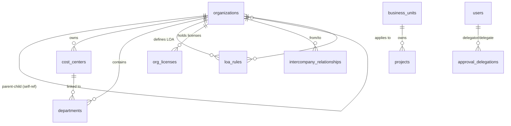

# Module 25: Organization Management
## MimarERP v7 — Enterprise Construction ERP

---

## 1. Purpose

The Organization Management module forms the structural backbone of MimarERP v7. It defines the enterprise hierarchy — Holding Companies, Subsidiaries, Branch Offices, Departments, Cost Centers, and Profit Centers — and governs every other module's data access, approval routing, financial consolidation, and regulatory compliance. It is the Master Data foundation from which all organizational context flows.

---

## 2. Business Objectives

1. **Enterprise Structure Modeling** — Support unlimited-depth organizational hierarchies from group holding level down to individual project site.
2. **Multi-Company Consolidation** — Intercompany transaction elimination and consolidated financial reporting across all subsidiaries.
3. **Approval Authority Matrix** — Define and enforce financial authorization limits per role, per org unit, per transaction type (LoA — Limits of Authority).
4. **Regulatory Identity Management** — Track CR numbers, VAT registrations, GOSI registrations, Nitaqat classifications, MOL licenses per entity.
5. **Resource Allocation** — Pool human resources, equipment, and financial limits across the organizational hierarchy.
6. **Reporting Structure** — Flexible matrix reporting lines (functional vs. project reporting) using RACI principles.

---

## 3. User Roles & Permissions

| Role | Capability |
|---|---|
| ExecutiveDirector / CEO | Full organization management, LoA definition |
| CFO / Finance Director | Cost center management, intercompany, LoA for finance |
| HR Director | Employee org assignments, department management |
| IT Administrator | System configuration, role definitions |
| General Manager (Branch) | View and manage own branch only |
| Department Head | View department structure |
| Auditor | Read-only full access, compliance reports |

---

## 4. Database Tables

```sql
-- ORGANIZATION HIERARCHY

CREATE TABLE organizations (
  id              UUID PRIMARY KEY DEFAULT gen_random_uuid(),
  tenant_id       UUID NOT NULL,
  code            VARCHAR(30) UNIQUE NOT NULL,
  name_ar         VARCHAR(300) NOT NULL,
  name_en         VARCHAR(300),
  short_name      VARCHAR(100),
  type            VARCHAR(50) NOT NULL,  -- holding | subsidiary | branch | department | division | site_office
  parent_id       UUID REFERENCES organizations(id),
  level           SMALLINT NOT NULL DEFAULT 1,  -- auto-computed depth in tree
  path            TEXT,                 -- materialized path: /org001/org002/org003
  cr_number       VARCHAR(20),          -- Commercial Registration (10 digits for KSA)
  vat_number      VARCHAR(20),          -- Tax Registration Number (15 digits)
  gosi_number     VARCHAR(30),
  mol_license     VARCHAR(30),
  nitaqat_category VARCHAR(50),         -- Platinum | Green | Yellow | Red
  address_ar      TEXT,
  address_en      TEXT,
  city            VARCHAR(100),
  region          VARCHAR(100),
  postal_code     VARCHAR(10),
  country         VARCHAR(50) DEFAULT 'Saudi Arabia',
  phone           VARCHAR(30),
  email           VARCHAR(200),
  website         VARCHAR(200),
  logo_url        TEXT,
  base_currency   VARCHAR(3) DEFAULT 'SAR',
  fiscal_year_start SMALLINT DEFAULT 1, -- month number (1=January, 4=April for some groups)
  is_active       BOOLEAN DEFAULT TRUE,
  established_date DATE,
  consolidation_method VARCHAR(30),     -- full | proportional | equity | none
  ownership_pct   NUMERIC(5,2),         -- % owned by parent
  created_at      TIMESTAMPTZ DEFAULT NOW(),
  updated_at      TIMESTAMPTZ DEFAULT NOW(),
  created_by      UUID,
  updated_by      UUID,
  is_deleted      BOOLEAN DEFAULT FALSE
);

-- COST & PROFIT CENTERS

CREATE TABLE cost_centers (
  id              UUID PRIMARY KEY DEFAULT gen_random_uuid(),
  tenant_id       UUID NOT NULL,
  org_id          UUID NOT NULL REFERENCES organizations(id),
  code            VARCHAR(30) NOT NULL,
  name_ar         VARCHAR(300) NOT NULL,
  name_en         VARCHAR(300),
  type            VARCHAR(20) NOT NULL,  -- cost | profit | investment
  parent_id       UUID REFERENCES cost_centers(id),
  manager_id      UUID REFERENCES users(id),
  gl_account_prefix VARCHAR(20),
  annual_budget   NUMERIC(18,2) DEFAULT 0,
  currency        VARCHAR(3) DEFAULT 'SAR',
  is_active       BOOLEAN DEFAULT TRUE,
  created_at      TIMESTAMPTZ DEFAULT NOW(),
  updated_at      TIMESTAMPTZ DEFAULT NOW(),
  is_deleted      BOOLEAN DEFAULT FALSE
);

-- DEPARTMENTS

CREATE TABLE departments (
  id              UUID PRIMARY KEY DEFAULT gen_random_uuid(),
  tenant_id       UUID NOT NULL,
  org_id          UUID NOT NULL REFERENCES organizations(id),
  code            VARCHAR(30) NOT NULL,
  name_ar         VARCHAR(300) NOT NULL,
  name_en         VARCHAR(300),
  head_id         UUID REFERENCES users(id),   -- Department Head
  parent_dept_id  UUID REFERENCES departments(id),
  cost_center_id  UUID REFERENCES cost_centers(id),
  headcount_budget INTEGER,
  is_active       BOOLEAN DEFAULT TRUE,
  created_at      TIMESTAMPTZ DEFAULT NOW()
);

-- BUSINESS UNITS (cross-cutting: e.g., Buildings BU, Infrastructure BU, Industrial BU)

CREATE TABLE business_units (
  id              UUID PRIMARY KEY DEFAULT gen_random_uuid(),
  tenant_id       UUID NOT NULL,
  code            VARCHAR(30) UNIQUE NOT NULL,
  name_ar         VARCHAR(300) NOT NULL,
  name_en         VARCHAR(300),
  head_id         UUID REFERENCES users(id),
  sector          VARCHAR(100),    -- Buildings | Infrastructure | Industrial | Real Estate
  revenue_target  NUMERIC(18,2),
  margin_target   NUMERIC(5,2),
  created_at      TIMESTAMPTZ DEFAULT NOW()
);

-- LIMITS OF AUTHORITY (LOA) MATRIX

CREATE TABLE loa_rules (
  id              UUID PRIMARY KEY DEFAULT gen_random_uuid(),
  tenant_id       UUID NOT NULL,
  org_id          UUID REFERENCES organizations(id),
  role_name       VARCHAR(100) NOT NULL,
  transaction_type VARCHAR(100) NOT NULL,  -- PO | PR | VO | Contract | Payment | Hire | Dismiss | Write-off
  min_amount      NUMERIC(18,2) DEFAULT 0,
  max_amount      NUMERIC(18,2),           -- NULL = unlimited
  currency        VARCHAR(3) DEFAULT 'SAR',
  requires_countersign BOOLEAN DEFAULT FALSE,
  countersign_role VARCHAR(100),
  additional_conditions TEXT,
  effective_date  DATE NOT NULL,
  expiry_date     DATE,
  is_active       BOOLEAN DEFAULT TRUE,
  approved_by     UUID REFERENCES users(id),
  created_at      TIMESTAMPTZ DEFAULT NOW()
);

-- APPROVAL DELEGATION

CREATE TABLE approval_delegations (
  id              UUID PRIMARY KEY DEFAULT gen_random_uuid(),
  tenant_id       UUID NOT NULL,
  delegator_id    UUID NOT NULL REFERENCES users(id),
  delegate_id     UUID NOT NULL REFERENCES users(id),
  scope_modules   TEXT[],          -- ['procurement','hr'] or ['all']
  max_amount      NUMERIC(18,2),
  valid_from      TIMESTAMPTZ NOT NULL,
  valid_to        TIMESTAMPTZ NOT NULL,
  reason          TEXT,
  is_active       BOOLEAN DEFAULT TRUE,
  created_at      TIMESTAMPTZ DEFAULT NOW()
);

-- INTERCOMPANY RELATIONSHIPS

CREATE TABLE intercompany_relationships (
  id              UUID PRIMARY KEY DEFAULT gen_random_uuid(),
  tenant_id       UUID NOT NULL,
  from_org_id     UUID NOT NULL REFERENCES organizations(id),
  to_org_id       UUID NOT NULL REFERENCES organizations(id),
  relationship_type VARCHAR(50),   -- service_provider | lender | guarantor | shared_resource
  gl_receivable_account VARCHAR(20),
  gl_payable_account    VARCHAR(20),
  transfer_pricing_method VARCHAR(100),
  is_active       BOOLEAN DEFAULT TRUE,
  created_at      TIMESTAMPTZ DEFAULT NOW()
);

-- REGULATORY LICENSES & CERTIFICATES

CREATE TABLE org_licenses (
  id              UUID PRIMARY KEY DEFAULT gen_random_uuid(),
  tenant_id       UUID NOT NULL,
  org_id          UUID NOT NULL REFERENCES organizations(id),
  license_type    VARCHAR(100),    -- MOMRA | SEC | SASO | SFDA | Municipal
  license_number  VARCHAR(100),
  issuing_authority VARCHAR(200),
  issue_date      DATE,
  expiry_date     DATE,
  document_url    TEXT,
  renewal_reminder_days INTEGER DEFAULT 90,
  status          VARCHAR(30) DEFAULT 'active',
  created_at      TIMESTAMPTZ DEFAULT NOW()
);
```

---

## 5. Entity Relationships



---

## 6. Business Workflows

### 6.1 New Organization Entity Creation
```
1. Executive Director / CFO initiates org unit creation request
2. Enter org type, name (AR + EN), parent entity, CR/VAT numbers
3. System validates CR number format (10 digits) and VAT number (15 digits starting with 3)
4. System checks for duplicate CR or VAT across tenant
5. Assign org head (links to HR → employee record)
6. Define GL account prefix for financial consolidation
7. Set cost center / profit center classification
8. Upload CR, VAT certificate, MOMRA license documents
9. System Administrator activates the entity
10. Trigger: Notify Finance, HR, IT teams to configure per-entity settings
```

### 6.2 Limits of Authority (LoA) Update
```
1. CFO/CEO proposes LoA change for a role or org unit
2. Enter: Transaction type, min/max amounts, role, countersign requirements
3. LoA change requires Board/Executive approval (via approval workflow)
4. Version control: previous LoA archived, effective date set
5. All approval workflows in ERP re-read LoA at approval time (not at creation)
6. Audit log: every LoA change recorded with approver and timestamp
```

### 6.3 Approval Delegation (Out-of-Office)
```
1. User initiates delegation (e.g., going on annual leave)
2. Select: delegate user, scope (all modules or specific), max amount, date range
3. Delegation requires manager approval if > 50% of delegator's LoA
4. During delegation period, approval requests go to delegate
5. System shows "Acting For: [delegator name]" in approval actions
6. Delegation auto-expires at valid_to date
7. Audit: all approvals made under delegation flagged clearly in audit log
```

---

## 7. UI Screens

| Screen | Purpose |
|---|---|
| Organization Tree View | Interactive visual hierarchy with expand/collapse |
| Entity Detail Form | Full org entity CRUD with all tabs (General, Regulatory, Finance, Users) |
| Cost Center Management | Tree of cost/profit centers with budget vs actuals chart |
| LoA Matrix | Table view of all authorization limits by role and transaction type |
| Approval Delegation Manager | Manage active and historical delegations |
| Org Chart Builder | Drag-and-drop org chart visualization |
| License & Certificates Register | Document repository with expiry alerts |
| Intercompany Map | Visual map of related entities and relationships |
| Regulatory Compliance Dashboard | License expiry, Nitaqat status, VAT filing status |

---

## 8. Dashboard KPIs

| KPI | Description | RAG |
|---|---|---|
| Entities Active | Count of active organization entities | — |
| Licenses Expiring (90 days) | Licenses expiring in next 90 days | >5=Red, 1-5=Amber, 0=Green |
| Nitaqat Platinum Coverage | % of entities at Platinum Nitaqat | <60%=Red, 60-80%=Amber, >80%=Green |
| LoA Compliance Rate | % of transactions within LoA limits | <95%=Red, 95-99%=Amber, 100%=Green |
| Active Delegations | Count of currently active approval delegations | — |
| Intercompany Balances | Net intercompany receivable/payable | — |

---

## 9. Reports

| Report | Description |
|---|---|
| Organization Hierarchy Report | Full tree with entity details, type, CR, VAT |
| LoA Compliance Report | Transactions vs LoA limits — exceptions highlighted |
| License Expiry Report | All licenses expiring in next 30/60/90/180 days |
| Nitaqat Status Report | Saudization percentage per entity vs target |
| Intercompany Balances Report | Receivable/payable between group entities |
| Cost Center Budget Report | Budget vs actual by cost center, period |
| Delegation Audit Report | History of all approval delegations and approvals made |
| Org Chart PDF | Printable org chart for board/client submissions |
| Regulatory Compliance Calendar | All license renewals, filing deadlines for 12 months |
| Headcount by Org Unit | Employee count by entity, department, nationality, designation |

---

## 10. KPIs with Formulas

| KPI | Formula | Target |
|---|---|---|
| Entity Compliance Score | (Entities with valid CR+VAT+licenses ÷ Total) × 100 | ≥95% |
| Nitaqat % (Saudi nationals) | (Saudi employees ÷ Total employees) × 100 per entity | Platinum ≥ threshold |
| LoA Violation Rate | (Transactions exceeding LoA ÷ Total) × 100 | 0% |
| License Renewal On-Time Rate | (Renewed before expiry ÷ Total) × 100 | 100% |

---

## 11. API Endpoints

| Method | Endpoint | Description |
|---|---|---|
| GET | /organizations | List all org entities (with tree option) |
| POST | /organizations | Create new org entity |
| GET | /organizations/{id} | Get org entity detail |
| PUT | /organizations/{id} | Update org entity |
| GET | /organizations/{id}/tree | Subtree rooted at this entity |
| GET | /organizations/approval-matrix | Full LoA matrix |
| GET | /cost-centers | List all cost centers |
| POST | /cost-centers | Create cost center |
| GET | /cost-centers/{id}/budget | Budget vs actual |
| GET | /departments | List departments |
| POST | /departments | Create department |
| GET | /loa-rules | List all LoA rules |
| POST | /loa-rules | Create/update LoA rule |
| POST | /approval-delegations | Create delegation |
| DELETE | /approval-delegations/{id} | Revoke delegation |
| GET | /org-licenses | List all licenses with expiry status |
| POST | /org-licenses | Add license document |
| GET | /intercompany | List intercompany relationships |
| GET | /organizations/compliance-status | Regulatory compliance dashboard |

---

## 12. Required Permissions

| Permission Code | Description |
|---|---|
| ORG_VIEW | View organization hierarchy |
| ORG_CREATE | Create new org entities |
| ORG_EDIT | Edit existing org entities |
| ORG_DELETE | Deactivate org entities |
| COST_CENTER_MANAGE | Full CRUD on cost centers |
| LOA_MANAGE | Define and edit LoA rules |
| DELEGATION_CREATE | Create approval delegations |
| DELEGATION_MANAGE_ALL | Manage any user's delegation |
| LICENSE_MANAGE | Upload and manage regulatory licenses |
| ORG_REPORT | Access compliance and org reports |

---

## 13. Approval Workflows

| Action | Approver | SLA |
|---|---|---|
| New subsidiary creation | Board Resolution + CEO | No SLA (Board schedule) |
| New branch creation | CEO | 5 business days |
| New department creation | General Manager + CFO | 3 business days |
| LoA rule change | CFO + CEO | 2 business days |
| Approval delegation (>50% LoA) | Direct manager | 1 business day |
| License renewal submission | Dept Head | 60 days before expiry |

---

## 14. AI Features

1. **Organizational Chart Intelligence** — AI suggests optimal reporting structure based on project portfolio size and types.
2. **Nitaqat Advisor** — Monitors Saudization % in real-time and suggests hiring targets per entity to maintain Platinum status.
3. **License Expiry Prediction** — Predicts total cost of license renewals for next 12 months based on historical renewal rates.
4. **Intercompany Analysis** — Identifies intercompany balance anomalies and suggests journal entries for period-end reconciliation.
5. **LoA Recommendation** — Based on project risk profile and procurement patterns, AI recommends optimal approval thresholds.

---

## 15. Automations

| Trigger | Condition | Action |
|---|---|---|
| Daily cron | License expiring in 90 days | Email to GM + Procurement |
| Daily cron | License expiring in 30 days | Escalate to CFO + CEO |
| Daily cron | License expired | Critical alert + suspend related procurement |
| Monthly cron | Month start | Calculate Nitaqat % per entity, alert if below threshold |
| LoA violation | Transaction > LoA submitted | Block submission, notify user of limit |
| Delegation expiry | Delegation valid_to passed | Auto-revoke, restore original authority |
| New entity | Organization created | Trigger: IT to create tenant schemas, HR to setup payroll entity |

---

## 16. Integration Requirements

| System | Integration | Purpose |
|---|---|---|
| Ministry of Commerce (Marsoom) | API | CR verification and renewal |
| ZATCA (FATOORAH) | API | VAT registration verification |
| GOSI Online | API | Employer registration and contribution verification |
| Ministry of Labor (Musaned/Qiwa) | API | Nitaqat status, WPS compliance |
| MOMRA (Balady) | API | Municipal license verification |
| Modon / RCJY / NEOM portals | API | Sector-specific prequalification status |
| Core ERP modules | Internal | All modules inherit tenant_id and org_id from this module |
| Finance / GL | Internal | Cost center → GL account prefix mapping for journal entries |
| HR | Internal | Department → payroll entity mapping |
| Procurement | Internal | LoA rules → PO approval thresholds |
