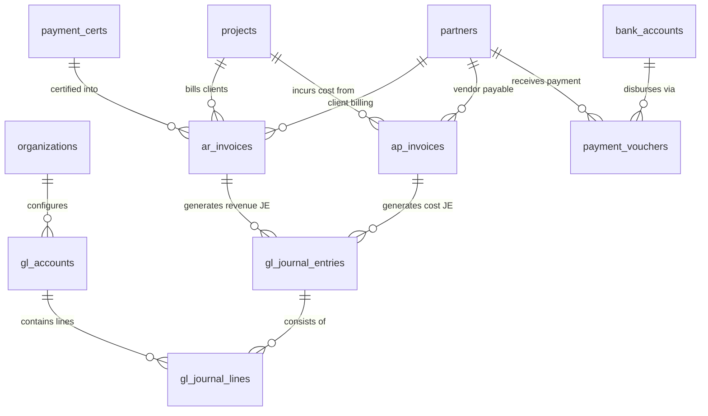

# Module 26: Financial Management, Cost Accounting & ZATCA Phase 2 E-Invoicing
## MimarERP v7 — Enterprise Construction ERP

---

## 1. Purpose

The Financial Management & ZATCA Module serves as the general accounting, treasury, and tax engine of MimarERP v7. Tailored specifically for the construction and real estate development industries in the Kingdom of Saudi Arabia (KSA) and the GCC region, it bridges operational project events (IPCs, POs, Subcontract variations, Equipment timesheets) into formal financial books (General Ledger, Accounts Payable, Accounts Receivable, Cash Management) and ensures strict compliance with ZATCA Phase 2 (FATOORA) e-invoicing mandates, SOCPA accounting standards, and IFRS 15 (Revenue from Contracts with Customers).

---

## 2. Business Objectives

1. **IFRS 15 Revenue Recognition:** Automate percentage-of-completion revenue recognition tied directly to verified Interim Payment Certificates (IPCs) and EVM earned progress.
2. **End-to-End ZATCA Phase 2 Compliance:** Native cryptographic stamping (ECDSA secp256k1), SHA-256 invoice hashing, Base64 QR code generation, and direct API clearance/reporting with the ZATCA FATOORAH portal.
3. **Retention & Guarantee Accounting:** Automated segregation and tracking of contractor retention payables and client retention receivables with release schedule governance.
4. **Project-Cost Center Double-Entry Integration:** Every journal entry carries both project code and WBS/cost code for real-time cost-versus-financial reconciliation.
5. **Multi-Currency & VAT Compliance:** Standard 15% Saudi VAT calculation, reverse-charge mechanism for foreign consultants, and automated GAZT VAT return compilation.
6. **Cash Flow & Liquidity Optimization:** Daily treasury visibility, automated bank statement reconciliation (MT940/CAMT.053), and forward-looking cash forecasting.

---

## 3. User Roles & Permissions

| Role Code | Role Title | Responsibilities | Access Level |
|---|---|---|---|
| CFO | Chief Financial Officer | Overall financial governance, LoA approvals, tax policy | Full Group Access |
| FIN_DIR | Finance Director | Balance sheet, P&L review, banking relationships, audits | Full Group Access |
| PROJ_ACCT | Project Accountant | Project cost entries, invoice verification, IPC billing entries | Project-Scoped |
| AP_SPEC | Accounts Payable Specialist | Vendor & subcontractor invoice processing, 3-way matching | Operational Read/Write |
| AR_SPEC | Accounts Receivable Specialist | Client invoicing, ZATCA submission, payment collection | Operational Read/Write |
| TREAS_MGR | Treasury Manager | Cash management, bank reconciliation, payment voucher release | Financial Operational |
| AUDIT_EXT | External / Internal Auditor | Compliance audit, trial balance, tax reports, ledger verification | Read-Only Full Ledger |

---

## 4. Database Tables

```sql
-- CHART OF ACCOUNTS (Unified Construction COA)
CREATE TABLE gl_accounts (
  id              UUID PRIMARY KEY DEFAULT gen_random_uuid(),
  tenant_id       UUID NOT NULL,
  account_code    VARCHAR(30) NOT NULL,        -- e.g. 1110.01 (Petty Cash Riyadh)
  name_ar         VARCHAR(250) NOT NULL,
  name_en         VARCHAR(250) NOT NULL,
  account_type    VARCHAR(30) NOT NULL,        -- ASSET | LIABILITY | EQUITY | REVENUE | DIRECT_COST | OVERHEAD
  parent_id       UUID REFERENCES gl_accounts(id),
  level           SMALLINT NOT NULL DEFAULT 1,
  currency        VARCHAR(3) DEFAULT 'SAR',
  is_reconciled   BOOLEAN DEFAULT FALSE,
  is_active       BOOLEAN DEFAULT TRUE,
  created_at      TIMESTAMPTZ DEFAULT NOW(),
  CONSTRAINT uq_tenant_account_code UNIQUE (tenant_id, account_code)
);

-- JOURNAL ENTRIES & FINANCIAL TRANSACTIONS
CREATE TABLE gl_journal_entries (
  id              UUID PRIMARY KEY DEFAULT gen_random_uuid(),
  tenant_id       UUID NOT NULL,
  entry_number    VARCHAR(50) UNIQUE NOT NULL, -- e.g. JE-2026-000452
  posting_date    DATE NOT NULL,
  fiscal_year     SMALLINT NOT NULL,
  fiscal_period   SMALLINT NOT NULL,           -- 1 to 12
  entry_type      VARCHAR(30) NOT NULL,        -- MANUAL | REVENUE | AP_BILL | PAYROLL | DEPRECIATION | INTERCOMPANY
  source_module   VARCHAR(50),                 -- IPC | PO | Subcontract | Asset | WPS
  source_ref_id   UUID,                        -- Link to operational document
  description_ar  TEXT NOT NULL,
  description_en  TEXT,
  total_debit     NUMERIC(18,2) NOT NULL DEFAULT 0,
  total_credit    NUMERIC(18,2) NOT NULL DEFAULT 0,
  status          VARCHAR(20) DEFAULT 'DRAFT', -- DRAFT | POSTED | VOIDED
  posted_by       UUID REFERENCES users(id),
  posted_at       TIMESTAMPTZ,
  created_at      TIMESTAMPTZ DEFAULT NOW(),
  CONSTRAINT chk_balanced_entry CHECK (total_debit = total_credit)
);

CREATE TABLE gl_journal_lines (
  id              UUID PRIMARY KEY DEFAULT gen_random_uuid(),
  tenant_id       UUID NOT NULL,
  entry_id        UUID NOT NULL REFERENCES gl_journal_entries(id) ON DELETE CASCADE,
  account_id      UUID NOT NULL REFERENCES gl_accounts(id),
  line_number     SMALLINT NOT NULL,
  debit           NUMERIC(18,2) NOT NULL DEFAULT 0,
  credit          NUMERIC(18,2) NOT NULL DEFAULT 0,
  currency        VARCHAR(3) DEFAULT 'SAR',
  fx_rate         NUMERIC(12,6) DEFAULT 1.000000,
  project_id      UUID REFERENCES projects(id),
  cost_center_id  UUID REFERENCES cost_centers(id),
  wbs_id          UUID REFERENCES wbs_items(id),
  partner_id      UUID REFERENCES partners(id),
  memo            VARCHAR(300),
  reconciled      BOOLEAN DEFAULT FALSE,
  created_at      TIMESTAMPTZ DEFAULT NOW()
);

-- ACCOUNTS RECEIVABLE & CLIENT INVOICES (ZATCA PHASE 2 ELIGIBLE)
CREATE TABLE ar_invoices (
  id                  UUID PRIMARY KEY DEFAULT gen_random_uuid(),
  tenant_id           UUID NOT NULL,
  invoice_number      VARCHAR(50) NOT NULL,     -- Sequential e.g. INV-2026-0012
  uuid                UUID NOT NULL DEFAULT gen_random_uuid(), -- ZATCA standard UUIDv4
  invoice_type        VARCHAR(30) NOT NULL,     -- STANDARD (B2B) | SIMPLIFIED (B2C) | DEBIT_NOTE | CREDIT_NOTE
  project_id          UUID NOT NULL REFERENCES projects(id),
  ipc_id              UUID REFERENCES payment_certs(id),
  client_id           UUID NOT NULL REFERENCES partners(id),
  issue_date          DATE NOT NULL,
  issue_time          TIME NOT NULL,
  due_date            DATE NOT NULL,
  currency            VARCHAR(3) DEFAULT 'SAR',
  gross_amount        NUMERIC(18,2) NOT NULL,
  retention_deducted  NUMERIC(18,2) DEFAULT 0,
  advance_deducted    NUMERIC(18,2) DEFAULT 0,
  other_deductions    NUMERIC(18,2) DEFAULT 0,
  taxable_amount      NUMERIC(18,2) NOT NULL,
  vat_rate            NUMERIC(5,2) DEFAULT 15.00,
  vat_amount          NUMERIC(18,2) NOT NULL,
  net_payable         NUMERIC(18,2) NOT NULL,
  paid_amount         NUMERIC(18,2) DEFAULT 0,
  payment_status      VARCHAR(20) DEFAULT 'UNPAID', -- UNPAID | PARTIAL | PAID
  
  -- ZATCA PHASE 2 CRYPTOGRAPHIC METADATA
  zatca_invoice_hash  TEXT,                     -- SHA-256 base64 hash of XML
  zatca_prev_hash     TEXT,                     -- Chained hash of previous invoice
  zatca_crypto_stamp  TEXT,                     -- ECDSA digital signature
  zatca_qr_code       TEXT,                     -- TLV encoded Base64 QR
  zatca_clearance_status VARCHAR(20) DEFAULT 'PENDING', -- PENDING | CLEARED | REPORTED | REJECTED
  zatca_clearance_id  TEXT,
  zatca_errors        JSONB,
  ubl_xml_content     TEXT,                     -- UBL 2.1 XML output
  submitted_at        TIMESTAMPTZ,
  created_at          TIMESTAMPTZ DEFAULT NOW()
);

-- ACCOUNTS PAYABLE & SUBCONTRACTOR / VENDOR INVOICES
CREATE TABLE ap_invoices (
  id                  UUID PRIMARY KEY DEFAULT gen_random_uuid(),
  tenant_id           UUID NOT NULL,
  bill_number         VARCHAR(50) NOT NULL,
  vendor_invoice_no   VARCHAR(100) NOT NULL,
  project_id          UUID NOT NULL REFERENCES projects(id),
  vendor_id           UUID NOT NULL REFERENCES partners(id),
  po_id               UUID REFERENCES po_headers(id),
  subcontract_id      UUID REFERENCES subcontracts(id),
  grn_id              UUID REFERENCES deliveries(id),
  bill_date           DATE NOT NULL,
  due_date            DATE NOT NULL,
  currency            VARCHAR(3) DEFAULT 'SAR',
  subtotal_amount     NUMERIC(18,2) NOT NULL,
  retention_amount    NUMERIC(18,2) DEFAULT 0,
  discount_amount     NUMERIC(18,2) DEFAULT 0,
  taxable_amount      NUMERIC(18,2) NOT NULL,
  vat_amount          NUMERIC(18,2) NOT NULL,
  total_amount        NUMERIC(18,2) NOT NULL,
  paid_amount         NUMERIC(18,2) DEFAULT 0,
  three_way_match     BOOLEAN DEFAULT FALSE,
  status              VARCHAR(20) DEFAULT 'PENDING_APPROVAL', -- PENDING_APPROVAL | APPROVED | PAID | DISPUTED
  approved_by         UUID REFERENCES users(id),
  created_at          TIMESTAMPTZ DEFAULT NOW()
);

-- TREASURY, CASH MANAGEMENT & BANK ACCOUNTS
CREATE TABLE bank_accounts (
  id              UUID PRIMARY KEY DEFAULT gen_random_uuid(),
  tenant_id       UUID NOT NULL,
  org_id          UUID NOT NULL REFERENCES organizations(id),
  bank_name_ar    VARCHAR(200) NOT NULL,
  bank_name_en    VARCHAR(200),
  account_number  VARCHAR(50) NOT NULL,
  iban            VARCHAR(34) NOT NULL,        -- SA + 22 alphanumeric digits
  currency        VARCHAR(3) DEFAULT 'SAR',
  gl_account_id   UUID NOT NULL REFERENCES gl_accounts(id),
  current_balance NUMERIC(18,2) DEFAULT 0,
  is_active       BOOLEAN DEFAULT TRUE,
  created_at      TIMESTAMPTZ DEFAULT NOW()
);

CREATE TABLE payment_vouchers (
  id              UUID PRIMARY KEY DEFAULT gen_random_uuid(),
  tenant_id       UUID NOT NULL,
  voucher_number  VARCHAR(50) UNIQUE NOT NULL, -- PV-2026-000891
  voucher_type    VARCHAR(30) NOT NULL,        -- AP_PAYMENT | AR_RECEIPT | ADVANCE | PETTY_CASH
  bank_account_id UUID NOT NULL REFERENCES bank_accounts(id),
  partner_id      UUID NOT NULL REFERENCES partners(id),
  project_id      UUID REFERENCES projects(id),
  voucher_date    DATE NOT NULL,
  payment_method  VARCHAR(30) NOT NULL,        -- WIRE_TRANSFER | SARIE | CHEQUE | SADAD
  reference_no    VARCHAR(100),
  amount          NUMERIC(18,2) NOT NULL,
  currency        VARCHAR(3) DEFAULT 'SAR',
  status          VARCHAR(20) DEFAULT 'ISSUED',-- ISSUED | CLEARED | CANCELLED
  authorized_by   UUID REFERENCES users(id),
  created_at      TIMESTAMPTZ DEFAULT NOW()
);
```

---

## 5. Entity Relationships



---

## 6. Business Workflows

### 6.1 Client Billing & ZATCA Phase 2 Clearance Workflow
```
[Consultant Certifies IPC] 
       ↓
[Generate AR Draft Invoice with IPC Breakdown (Gross, Retention 10%, Advance Recovery)]
       ↓
[Validation Engine checks Client Tax Number (15 digits) & Mandatory UBL Fields]
       ↓
[Finance Service builds UBL 2.1 XML Document]
       ↓
[Cryptographic Engine generates SHA-256 Hash + Previous Invoice Hash Chaining]
       ↓
[Sign XML with Private Key ECDSA secp256k1 & Generate Base64 TLV QR Code]
       ↓
[Dispatch to ZATCA FATOORAH API Gateway via Mutual TLS / REST]
       ↓
  ┌─────────────────────────┴────────────────────────┐
  ↓ (Status = CLEARED)                               ↓ (Status = REJECTED)
[Store Clearance Signature & Approved XML]         [Log Validation Error & Alert CFO]
  ↓                                                  ↓
[Post Revenue Journal Entry to GL]                 [Correct Invoice Data & Resubmit]
  ↓
[Generate Final Tax Invoice PDF with ZATCA Stamp & QR]
  ↓
[Transmit Officially to Client for Payment Collection]
```

### 6.2 Accounts Payable 3-Way Matching Workflow
```
[Vendor / Subcontractor submits Invoice]
       ↓
[System performs 3-Way Match]:
  1. Purchase Order / Subcontract Rate verification
  2. Warehouse Goods Receipt Note (GRN) / Field Work Measurement Sheet
  3. Tax Invoice mathematical verification (+15% VAT)
       ↓
  ┌─────────────────────────┴────────────────────────┐
  ↓ (Match Confirmed within 0.5% tolerance)          ↓ (Mismatch detected > 0.5%)
[Route for Managerial Approval based on LoA]        [Mark as DISPUTED & Notify Vendor]
  ↓                                                  ↓
[Post AP Journal Entry (Debit WIP / Credit AP)]    [Escalate to Procurement / Technical Office]
  ↓
[Queue for Treasury Payment Schedule based on Terms (e.g. Net 45)]
```

---

## 7. UI Screens

| Screen ID | Screen Name | Key Features |
|---|---|---|
| FIN-01 | General Ledger & Chart of Accounts | Interactive tree of accounts, real-time balance drilldown, GL journal entry posting. |
| FIN-02 | Journal Voucher Entry Studio | Multi-currency entry, automated debit/credit balancing, project/WBS tagging. |
| FIN-03 | ZATCA Phase 2 E-Invoicing Console | Live status of B2B/B2C invoices, clearance status badges, QR code preview, XML download. |
| FIN-04 | Accounts Payable Hub (3-Way Match) | Side-by-side PO vs. GRN vs. Invoice matching, retention deduction calculator. |
| FIN-05 | Accounts Receivable & Client Billing | IPC-to-Invoice converter, client payment aging, statement of accounts. |
| FIN-06 | Treasury & Cash Management | Bank balances cockpit, bank reconciliation engine, payment voucher issuance. |
| FIN-07 | VAT & Statutory Tax Center | GAZT VAT Return auto-calculator, input/output tax reconciliations, Zakat estimates. |

---

## 8. Financial Controller & CFO Cockpit

- **Working Capital KPI Banner:** Cash on hand, Unbilled WIP, Accounts Receivable (Gross & Net), Accounts Payable, Net Working Capital.
- **ZATCA Compliance Health Monitor:** Total invoices cleared, 100% compliance rate, zero rejected invoices indicator.
- **Aging Receivables & Payables Histogram:** Visual 30/60/90/120+ days aging buckets with contractor retention isolation.
- **Project Gross Profitability Heatmap:** Actual margin vs. bid margin across all active joint ventures and subsidiaries.
- **Treasury 60-Day Runway Forecast:** Projected cash inflows (certified IPC collections) vs. committed outflows (payroll WPS, material POs, equipment rentals).

---

## 9. Reports Catalog

1. **Trial Balance (ميزان المراجعة):** Detailed opening, debit, credit, and closing balances with drill-down to journal lines.
2. **Profit & Loss Statement (قائمة الدخل):** Consolidated and per-project P&L conforming to IFRS construction accounting.
3. **Balance Sheet (الميزانية العمومية):** Assets, liabilities, retentions, and shareholder equity.
4. **Project Cost Value Reconciliation (CVR):** Financial ledger cost reconciled against engineering EVM actuals.
5. **Aged Debtors Ledger (أعمار الديون - عملاء):** Retention vs. current billed receivables.
6. **Aged Creditors Ledger (أعمار الديون - موردين ومقاولين):** Pending subcontractor certified payments.
7. **ZATCA Tax Return Sheet (إقرار ضريبة القيمة المضافة):** Standard Box 1 to 16 formatted exactly to GAZT official portal specifications.
8. **Bank Reconciliation Statement (مذكرة تسوية البنك):** Book balance vs. bank statement delta with outstanding cheques.
9. **Subcontractor Retention Liability Ledger (سجل محتجزات ضمان مقاولي الباطن):** Matured vs. non-matured retentions.
10. **WPS Payroll Financial Reconciliation (مطابقة حماية الأجور):** Net payroll disbursement matching bank debit file.

---

## 10. Key Financial KPIs

| Metric Code | KPI Name | Formula | Benchmark Target |
|---|---|---|---|
| KPI-FN-01 | Days Sales Outstanding (DSO) | $(\text{AR} \div \text{Credit Sales}) \times 365$ | $\le 75 \text{ days}$ |
| KPI-FN-02 | Days Payable Outstanding (DPO) | $(\text{AP} \div \text{Cost of Sales}) \times 365$ | $60 - 90 \text{ days}$ |
| KPI-FN-03 | Quick Ratio (نسبة السيولة السريعة) | $(\text{Cash} + \text{Marketable Securities} + \text{AR}) \div \text{Current Liabilities}$ | $\ge 1.25$ |
| KPI-FN-04 | ZATCA First-Time Clearance Rate | $(\text{Cleared Invoices} \div \text{Total Submitted}) \times 100$ | $100.0\%$ |
| KPI-FN-05 | Project Gross Margin Variance | $\text{Actual Margin \%} - \text{Bid Target Margin \%}$ | $\ge -1.5\%$ |
| KPI-FN-06 | Retention Recovery Efficiency | $(\text{Collected Retentions} \div \text{Matured Retentions}) \times 100$ | $\ge 95\%$ |

---

## 11. API Endpoints

```http
# General Ledger
GET    /api/v1/finance/accounts                # List Chart of Accounts
POST   /api/v1/finance/accounts                # Create Account
POST   /api/v1/finance/journal-entries         # Post Journal Entry (Double-Entry Balanced)
GET    /api/v1/finance/journal-entries/{id}    # Retrieve Journal Entry with Audit Trail

# ZATCA Phase 2 E-Invoicing
POST   /api/v1/finance/invoices/generate-zatca # Generate UBL 2.1 XML & Hash
POST   /api/v1/finance/invoices/{id}/submit-zatca # Transmit to ZATCA FATOORAH
GET    /api/v1/finance/invoices/{id}/qr-code   # Retrieve Base64 Rendered QR Code
GET    /api/v1/finance/invoices/{id}/xml       # Download Cryptographically Signed XML

# Accounts Payable
GET    /api/v1/finance/ap/invoices             # List Vendor Bills
POST   /api/v1/finance/ap/invoices             # Register Vendor Bill
POST   /api/v1/finance/ap/3-way-match/{id}     # Run Automated 3-Way Match Engine

# Treasury & Banking
GET    /api/v1/finance/bank-accounts           # List Bank Accounts & Balances
POST   /api/v1/finance/payment-vouchers        # Issue Payment Voucher
POST   /api/v1/finance/bank-reconciliation     # Upload & Reconcile MT940 / CAMT.053 Statement
```

---

## 12. Required Permissions

- `FIN_GL_POST`: Permission to post journal entries directly to General Ledger.
- `FIN_ZATCA_SUBMIT`: Authorization to submit tax invoices to ZATCA FATOORAH portal.
- `FIN_AP_APPROVE`: Authorize vendor bills for payment up to defined LoA limits.
- `FIN_TREASURY_RELEASE`: Release bank wire transfers and electronic cheques.
- `FIN_AUDIT_VIEW`: Read-only access to historical transaction ledgers and cryptographic hashes.

---

## 13. Approval Workflows & Authority Limits (LoA)

```
Payment Voucher Amount:
- Up to SAR 50,000:       Project Accountant + Project Manager Approval
- SAR 50,001 - 250,000:   Finance Manager Approval
- SAR 250,001 - 1,000,000: Finance Director + General Manager Approval
- Above SAR 1,000,000:    CFO + Chief Executive Officer (CEO) Signature
```

---

## 14. AI & Machine Learning Features

1. **Automated Receipt & Invoice OCR Parsing:** Computer vision extracts vendor CR, VAT number, line items, and bank details from scanned PDFs with 99% accuracy.
2. **Predictive Cash Flow Forecasting:** LSTM neural network predicts monthly net cash position based on client historical payment latency and contractor milestones.
3. **Anomalous Journal Entry Detection:** Isolation Forest algorithm flags unexpected GL accounts pairings or out-of-sequence postings before final ledger commitment.
4. **ZATCA Compliance Pre-Audit Copilot:** LLM checks invoice XML structure against 150+ ZATCA Phase 2 business rules prior to government transmission.

---

## 15. Automations

- **Automated Retention Maturity Alerts:** 60 days before warranty period expiry, system generates task to request Client Final Certificate and release retentions.
- **Bank Feed Auto-Reconciliation:** Nightly cron parses bank statements and automatically matches 90%+ of transactions by reference number and amount.
- **Automated VAT Return Preparation:** On the 1st of each month, compiles draft GAZT VAT report with automatic reconciliation to GL tax liability accounts.

---

## 16. Integration Requirements

- **ZATCA FATOORAH Portal:** Direct REST/SOAP mutual TLS integration for live clearance of Standard Tax Invoices and reporting of Simplified Invoices.
- **Saudi SAMA Banking Channels:** Direct B2B host-to-host connectivity (Riyad Bank, Al Rajhi, SNB) for SARIE bulk payroll and supplier payments.
- **Ministry of Human Resources (Qiwa / Mudad):** Automated Wage Protection System (WPS) encrypted file generation.
- **Core ERP Operational Modules:** Real-time listeners on IPC certification (Module 07), GRN acceptance (Module 08), and Equipment logs (Module 10).
