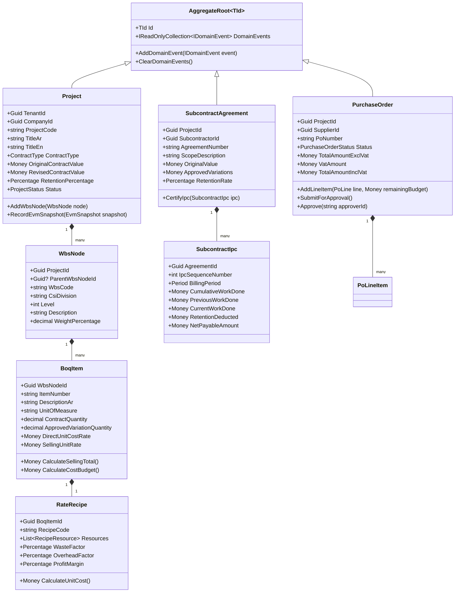
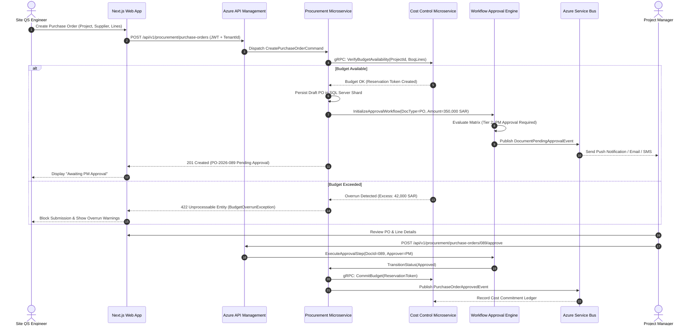
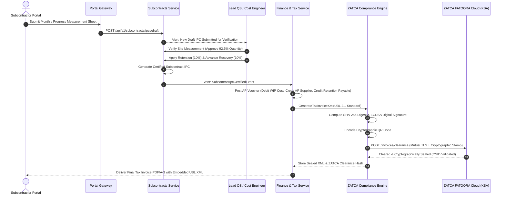
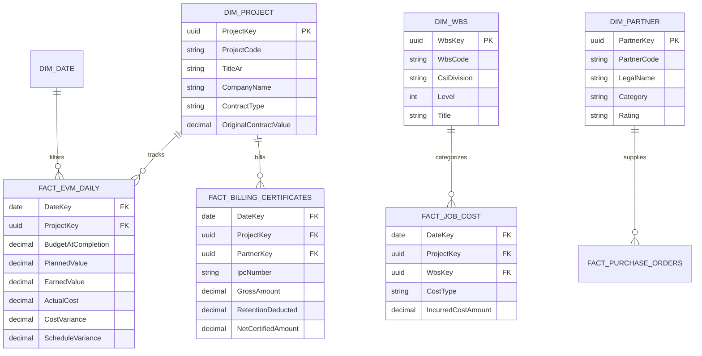

# Tier-1 Enterprise Construction ERP SaaS Platform: Master Engineering & Solution Specification
**System Designation:** `Aethelgard ERP / Mimar Enterprise 3.0`  
**Industry Benchmark:** SAP S/4HANA for Engineering and Construction, Oracle Primavera Unifier, Microsoft Dynamics 365 Project Operations, Infor CloudSuite Construction  
**Audience:** Chief Technology Officers, Enterprise Architects, Technical Office Directors, Commercial & Cost Managers, Engineering Leads  
**Regulatory & Technical Frameworks:** FIDIC (Red, Yellow, Silver Books), PMI PMBOK (7th Edition), AACE International (10S-90, 18R-97, 29R-03), CSI MasterFormat (50 Divisions), ZATCA Phase 2 (FATOORA), ISO 9001 / 14001 / 45001, ISO 19650 (BIM Common Data Environment)

---

## 1. Executive Summary & Enterprise Benchmark

Legacy construction management software suffers from critical architectural fragmentation: project controls run in standalone scheduling tools (Primavera P6), site records live in point solutions (Procore), while financials reside in generic accounting systems with no native understanding of Work Breakdown Structures (WBS), retention guarantees, or progress measurement sheets.

`Aethelgard ERP` is engineered from first principles as a **Cloud-Native, Multi-Tenant SaaS Construction Operating System** delivering unified operational, engineering, and financial intelligence:

| Architectural Capability | Legacy Construction Point Solutions | Generic Tier-1 ERPs (SAP/Oracle/D365 Base) | `Aethelgard ERP` (This Blueprint) |
|---|---|---|---|
| **Multi-Tenancy** | Single-tenant or siloed instances | Add-on multi-company modules | **Native SaaS Multi-Tenant Elastic Pools + Shards** |
| **BOQ & Rate Analysis** | Separate spreadsheets or basic lists | Third-party vertical add-on required | **Native 5-Level WBS & Multi-Resource Recipe Engine** |
| **Contractual Claims (FIDIC)**| Unstructured emails and Word logs | Generic CRM dispute records | **Native Cl. 20.1 Notice, Interim Determinations & Log** |
| **Cost Control (PMI EVM)** | Manual monthly Excel calculations | High-latency batch reporting | **Real-Time PV/EV/AC/CPI/SPI & S-Curve on Transaction Post** |
| **Local Statutory (ZATCA)** | Third-party middleware plugins | Expensive country localization packages | **Native Embedded Cryptographic ECDSA & UBL 2.1 XML Engine**|
| **Site Operations** | Disconnected offline mobile forms | Desktop-centric heavy web interfaces | **Offline-First CRDT-Synced Mobile Engine (Flutter/SQLite)** |

---

## 2. Business Requirements Document (BRD)

### 2.1 Strategic Business Drivers
1. **Margin Protection & Leakage Elimination:** Prevent procurement budget overruns at source through pre-commitment real-time validation against the approved BOQ direct cost baselines.
2. **Accelerated Cash Flow & Billing Cycles:** Reduce Interim Payment Certificate (IPC) processing and consultant certification latency from an industry average of 45 days down to under 7 days.
3. **Auditability & Corporate Governance:** Guarantee an immutable, tamper-proof audit trail for every contract change order, design revision, material approval, and payment release (SOX, SOC 2, ISO 9001 compliant).
4. **Unified Stakeholder Collaboration:** Bridge contractors, project owners, supervising consultants, subcontractors, and vendors through dedicated, zero-license-cost external web portals.

### 2.2 Stakeholder Landscape & Value Realization
- **Project Owners / Real Estate Developers:** Real-time visibility into portfolio cash flow forecasts, committed liabilities, variation orders, and milestone progress.
- **Main / EPC Contractors:** Centralized command of multi-project labor crews, plant equipment utilization, supplier rate benchmarking, and subcontractor claims.
- **Supervising Consultants / PMOs:** Rigorous digital tracking of Work Inspection Requests (WIR), Material Approval Requests (MAR), Technical Submittals, and RFIs.
- **Subcontractors & Suppliers:** Direct visibility of purchase orders, electronic delivery receipts (GRN), invoice certification status, and retention release schedules.

---

## 3. System Requirements Specification (SRS)

### 3.1 Non-Functional Requirements & Performance SLAs
- **Availability:** 99.99% multi-region high availability with automated failover (< 30 seconds RTO, 0 RPO for financial ledgers).
- **Transaction Throughput:** Capable of processing 10,000+ concurrent transactions per second across multi-tenant shards.
- **Read Latency:** 95th percentile API response time under 120 ms for operational queries; under 40 ms for cached Redis lookups.
- **Reporting & Analytics:** Complex multi-project Earned Value aggregations generated in under 1.5 seconds via read-replica Star Schemas.
- **Scalability:** Horizontal auto-scaling on Azure Kubernetes Service (HPA) from 3 to 100+ pods dynamically responding to CPU, memory, and message queue depths.

### 3.2 Regulatory, Engineering & Compliance Standards
- **FIDIC Contracts:** Native lifecycle workflows for Clauses 13 (Variations and Adjustments), 14 (Contract Price and Payment), and 20 (Claims, Disputes and Arbitration).
- **PMI PMBOK & AACE International:** EVM compliant with ANSI/PMI 19-006-2019 and AACE Recommended Practices 10S-90 (Cost Engineering Terminology) and 29R-03 (Forensic Schedule Analysis).
- **ZATCA Phase 2 (Saudi Arabia):** Native cryptographic ECDSA secp256k1 digital signatures, SHA-256 invoice hashing, UUID generation, cryptographic stamp identifiers, and UBL 2.1 invoice XML payloads pushed to the ZATCA FATOORA clearing platform.
- **ISO 19650 (BIM CDE):** Document naming conventions, revision status codes (WIP, Shared, Published, Archived), and metadata classification.

---

## 4. Functional Requirements Document (FRD) - 25 Modules

```
┌────────────────────────────────────────────────────────────────────────────────────────────────────────┐
│                              AETHELGARD ERP: 25 CORE ENTERPRISE MODULES                                │
├──────────────────────────┬─────────────────────────────┬───────────────────────────────────────────────┤
│ 1. System Administration │ 2. Identity & Access (IAM)  │ 3. Master Data Management (MDM)               │
│    - Tenant Provisioning │    - Azure Entra ID / OIDC  │    - CSI MasterFormat 50 Divs                 │
│    - Quotas & Storage    │    - Fine-grained RBAC      │    - Units of Measure (ISO 80000)             │
│    - Global Feature Flags│    - Multi-factor Auth (MFA)│    - Global Currency & Daily FX Rates         │
├──────────────────────────┼─────────────────────────────┼───────────────────────────────────────────────┤
│ 4. CRM & Business Dev    │ 5. Tender & Bid Management  │ 6. Cost Estimation & Recipes                  │
│    - Opportunity Funnel  │    - Tender Packages / Addenda│    - Direct Material / Labor / Plant Recipes │
│    - Client Pre-qual     │    - Subcontractor Quotes   │    - Waste Factors, Overheads, Markups        │
│    - Win/Loss Analytics  │    - Bid Decision Scoring   │    - Selling Price vs. Cost Budget            │
├──────────────────────────┼─────────────────────────────┼───────────────────────────────────────────────┤
│ 7. Bill of Quantities    │ 8. Quantity Surveying (QS)  │ 9. Technical Office Management                │
│    - Multi-Level WBS Tree│    - Digital Measurement Shs│    - Drawing Register & Revision Control      │
│    - Re-measured / Lumpsum│    - Automatic Deductions  │    - Requests for Information (RFI)           │
│    - Item Revisions & VOs│    - Quantity Growth Matrix │    - Submittals (MAR, WIR, Shop Drawings)     │
├──────────────────────────┼─────────────────────────────┼───────────────────────────────────────────────┤
│ 10. Planning & Schedule  │ 11. Procurement & SCM       │ 12. Inventory & Warehouses                    │
│    - Primavera P6 XER Sync│    - Material Requisitions  │    - Multi-Store / Multi-Site Stock Ledgers   │
│    - Critical Path (CPM) │    - RFQs & Comparative Bids│    - GRN with QC Pass/Fail Quarantine         │
│    - 3-Week Lookahead    │    - 3-Way Matching PO/GRN  │    - Batch, Expiry & Safety Stock Alerts      │
├──────────────────────────┼─────────────────────────────┼───────────────────────────────────────────────┤
│ 13. Plant & Equipment    │ 14. Subcontract Management  │ 15. Cost Control & EVM                        │
│    - Fleet Telematics/GPS│    - Back-to-Back Contracts │    - Real-Time PV, EV, AC, BAC                │
│    - Internal Hire Rates │    - Subcontractor IPCs     │    - CPI, SPI, EAC, VAC, TCPI Calculation     │
│    - Maintenance & Fuel  │    - Contra Charges & Holds │    - Cost Value Reconciliation (CVR)          │
├──────────────────────────┼─────────────────────────────┼───────────────────────────────────────────────┤
│ 16. Contract Admin       │ 17. Human Resources (HR)    │ 18. Site & Staff Payroll                      │
│    - FIDIC Claims Engine │    - Labor Visa & Iqama Logs│    - Daily Site Biometric Attendance          │
│    - Bank Guarantees     │    - Craft Trades & Crews   │    - Wage Protection System (WPS)             │
│    - Extension of Time   │    - Safety Violations Log  │    - Overtime, Gratuity & Indemnity Accruals  │
├──────────────────────────┼─────────────────────────────┼───────────────────────────────────────────────┤
│ 19. Financial Management │ 20. Treasury & Cash Flow    │ 21. Fixed Assets                              │
│    - Multi-Entity GL     │    - Bank Accounts & Escrow │    - Asset Capitalization & Depreciation      │
│    - AP / AR / Retainage │    - Cash In/Out Forecasts  │    - Site Transfer Movement Slips             │
│    - ZATCA Phase 2 FATOORA│   - LC / Letters of Credit │    - Disposal, Salvage & Maintenance Cost     │
├──────────────────────────┼─────────────────────────────┼───────────────────────────────────────────────┤
│ 22. Document Mgt (DMS)   │ 23. BI & Analytics          │ 24. Client & Consultant Portal                │
│    - ISO 19650 CDE Engine│    - Real-Time PMO Dashboards│   - Online IPC Certification Review          │
│    - PDF Watermarking    │    - S-Curve Analysis       │    - Project Progress & Snag Transparency     │
│    - Dynamic OCR Indexing│    - Executive KPI Cockpit  │    - Formal Transmittal Approvals             │
├──────────────────────────┴─────────────────────────────┴───────────────────────────────────────────────┤
│ 25. Supplier & Subcontractor Portal                                                                    │
│    - Digital RFQ Submission, Commercial Bidding, PO Acceptance, Advanced Shipping Notices (ASN)        │
│    - Subcontractor Progress Measurement Sheets, Monthly Invoice Submission, Statement of Accounts      │
└────────────────────────────────────────────────────────────────────────────────────────────────────────┘
```

---

## 5. Domain-Driven Design (DDD) Class Model & Clean Architecture



---

## 6. End-to-End Sequence Diagrams: Core Lifecycles

### 6.1 Purchase Order Generation with Live Budget Interception & Multi-Tier Matrix


### 6.2 Contractor IPC Certification & Cryptographic ZATCA Invoicing


---

## 7. Multi-Tenant Database DDL & Schema Architecture (SQL Server 2022)

```sql
-- =============================================================================
-- AETHELGARD ERP: ENTERPRISE DATABASE SCHEMA ARCHITECTURE
-- =============================================================================
CREATE SCHEMA [iam]  AUTHORIZATION [dbo];
GO
CREATE SCHEMA [core] AUTHORIZATION [dbo];
GO
CREATE SCHEMA [tech] AUTHORIZATION [dbo];
GO
CREATE SCHEMA [cost] AUTHORIZATION [dbo];
GO
CREATE SCHEMA [scm]  AUTHORIZATION [dbo];
GO
CREATE SCHEMA [fin]  AUTHORIZATION [dbo];
GO

-- 1. TENANT ENTITIES & BRANCHES
CREATE TABLE [core].[Organizations] (
    [TenantId] UNIQUEIDENTIFIER NOT NULL,
    [CompanyId] UNIQUEIDENTIFIER NOT NULL DEFAULT NEWSEQUENTIALID(),
    [CompanyCode] VARCHAR(32) NOT NULL,
    [LegalNameAr] NVARCHAR(255) NOT NULL,
    [LegalNameEn] NVARCHAR(255) NOT NULL,
    [CommercialRegNumber] VARCHAR(32) NOT NULL,
    [TaxIdentificationNumber] VARCHAR(32) NOT NULL,
    [BaseCurrency] CHAR(3) NOT NULL DEFAULT 'SAR',
    [FiscalYearStartMonth] INT NOT NULL DEFAULT 1,
    [IsActive] BIT NOT NULL DEFAULT 1,
    [CreatedAtUtc] DATETIME2(7) NOT NULL DEFAULT SYSUTCDATETIME(),
    CONSTRAINT [PK_Organizations] PRIMARY KEY CLUSTERED ([CompanyId]),
    CONSTRAINT [UQ_Organizations_Code] UNIQUE ([TenantId], [CompanyCode])
);
GO

-- 2. PROJECTS (With Spatial Coordinates, Contract Forms & Bonds)
CREATE TABLE [core].[Projects] (
    [TenantId] UNIQUEIDENTIFIER NOT NULL,
    [ProjectId] UNIQUEIDENTIFIER NOT NULL DEFAULT NEWSEQUENTIALID(),
    [CompanyId] UNIQUEIDENTIFIER NOT NULL,
    [ProjectCode] VARCHAR(32) NOT NULL,
    [TitleAr] NVARCHAR(255) NOT NULL,
    [TitleEn] NVARCHAR(255) NOT NULL,
    [ContractForm] VARCHAR(32) NOT NULL, -- FIDIC_Red, FIDIC_Yellow, EPC_Turnkey
    [ContractType] VARCHAR(32) NOT NULL, -- Remeasured, LumpSum, CostPlus
    [OriginalContractValue] DECIMAL(18, 4) NOT NULL,
    [ApprovedVariationValue] DECIMAL(18, 4) NOT NULL DEFAULT 0,
    [RevisedContractValue] AS ([OriginalContractValue] + [ApprovedVariationValue]) PERSISTED,
    [DirectCostBudget] DECIMAL(18, 4) NOT NULL,
    [PlannedStartDate] DATE NOT NULL,
    [PlannedCompletionDate] DATE NOT NULL,
    [ActualStartDate] DATE NULL,
    [ActualCompletionDate] DATE NULL,
    [RetentionPercentage] DECIMAL(5, 2) NOT NULL DEFAULT 10.00,
    [RetentionCapAmount] DECIMAL(18, 4) NULL,
    [AdvancePaymentPercentage] DECIMAL(5, 2) NOT NULL DEFAULT 10.00,
    [VatRatePercentage] DECIMAL(5, 2) NOT NULL DEFAULT 15.00,
    [Status] VARCHAR(32) NOT NULL DEFAULT 'Active',
    [CreatedAtUtc] DATETIME2(7) NOT NULL DEFAULT SYSUTCDATETIME(),
    [RowVersion] ROWVERSION NOT NULL,
    CONSTRAINT [PK_Projects] PRIMARY KEY CLUSTERED ([ProjectId]),
    CONSTRAINT [FK_Projects_Org] FOREIGN KEY ([CompanyId]) REFERENCES [core].[Organizations] ([CompanyId]),
    CONSTRAINT [UQ_Projects_Code] UNIQUE ([TenantId], [ProjectCode])
);
GO

-- 3. HIERARCHICAL WORK BREAKDOWN STRUCTURE (WBS)
CREATE TABLE [tech].[WbsNodes] (
    [TenantId] UNIQUEIDENTIFIER NOT NULL,
    [WbsNodeId] UNIQUEIDENTIFIER NOT NULL DEFAULT NEWSEQUENTIALID(),
    [ProjectId] UNIQUEIDENTIFIER NOT NULL,
    [ParentWbsNodeId] UNIQUEIDENTIFIER NULL,
    [WbsCode] VARCHAR(64) NOT NULL,       -- e.g. 01.03.02.01
    [CsiDivision] VARCHAR(16) NULL,       -- CSI MasterFormat 50 Div Code
    [Level] INT NOT NULL,                 -- Levels 1 to 5
    [TitleAr] NVARCHAR(255) NOT NULL,
    [TitleEn] NVARCHAR(255) NOT NULL,
    [WeightPercentage] DECIMAL(7, 4) NOT NULL DEFAULT 0.0000,
    CONSTRAINT [PK_WbsNodes] PRIMARY KEY CLUSTERED ([WbsNodeId]),
    CONSTRAINT [FK_WbsNodes_Projects] FOREIGN KEY ([ProjectId]) REFERENCES [core].[Projects] ([ProjectId]),
    CONSTRAINT [FK_WbsNodes_Parent] FOREIGN KEY ([ParentWbsNodeId]) REFERENCES [tech].[WbsNodes] ([WbsNodeId])
);
GO

-- 4. BILL OF QUANTITIES (BOQ)
CREATE TABLE [tech].[BoqItems] (
    [TenantId] UNIQUEIDENTIFIER NOT NULL,
    [BoqItemId] UNIQUEIDENTIFIER NOT NULL DEFAULT NEWSEQUENTIALID(),
    [ProjectId] UNIQUEIDENTIFIER NOT NULL,
    [WbsNodeId] UNIQUEIDENTIFIER NOT NULL,
    [ItemNumber] VARCHAR(32) NOT NULL,
    [DescriptionAr] NVARCHAR(MAX) NOT NULL,
    [DescriptionEn] NVARCHAR(MAX) NULL,
    [UnitOfMeasure] NVARCHAR(32) NOT NULL,
    [ContractQuantity] DECIMAL(18, 4) NOT NULL,
    [ApprovedVariationQuantity] DECIMAL(18, 4) NOT NULL DEFAULT 0,
    [TotalProjectedQuantity] AS ([ContractQuantity] + [ApprovedVariationQuantity]) PERSISTED,
    [DirectUnitCostRate] DECIMAL(18, 4) NOT NULL,
    [SellingUnitRate] DECIMAL(18, 4) NOT NULL,
    [OriginalCostBudget] AS ([ContractQuantity] * [DirectUnitCostRate]) PERSISTED,
    [TotalSellingValue] AS (([ContractQuantity] + [ApprovedVariationQuantity]) * [SellingUnitRate]) PERSISTED,
    [CommittedCost] DECIMAL(18, 4) NOT NULL DEFAULT 0,
    [ActualCostIncurred] DECIMAL(18, 4) NOT NULL DEFAULT 0,
    [Status] VARCHAR(32) NOT NULL DEFAULT 'Approved',
    CONSTRAINT [PK_BoqItems] PRIMARY KEY CLUSTERED ([BoqItemId]),
    CONSTRAINT [FK_BoqItems_Projects] FOREIGN KEY ([ProjectId]) REFERENCES [core].[Projects] ([ProjectId]),
    CONSTRAINT [FK_BoqItems_Wbs] FOREIGN KEY ([WbsNodeId]) REFERENCES [tech].[WbsNodes] ([WbsNodeId])
);
GO

-- 5. COST CONTROL - EVM DAILY LEDGER (PMI & AACE Compliant)
CREATE TABLE [cost].[EvmSnapshots] (
    [TenantId] UNIQUEIDENTIFIER NOT NULL,
    [SnapshotId] UNIQUEIDENTIFIER NOT NULL DEFAULT NEWSEQUENTIALID(),
    [ProjectId] UNIQUEIDENTIFIER NOT NULL,
    [CutoffDate] DATE NOT NULL,
    [BudgetAtCompletion] DECIMAL(18, 4) NOT NULL,  -- BAC
    [PlannedValue] DECIMAL(18, 4) NOT NULL,         -- PV
    [EarnedValue] DECIMAL(18, 4) NOT NULL,          -- EV
    [ActualCost] DECIMAL(18, 4) NOT NULL,           -- AC
    [CostVariance] AS ([EarnedValue] - [ActualCost]) PERSISTED,
    [ScheduleVariance] AS ([EarnedValue] - [PlannedValue]) PERSISTED,
    [CostPerformanceIndex] AS (CASE WHEN [ActualCost] > 0 THEN [EarnedValue] / [ActualCost] ELSE 1.0 END) PERSISTED,
    [SchedulePerformanceIndex] AS (CASE WHEN [PlannedValue] > 0 THEN [EarnedValue] / [PlannedValue] ELSE 1.0 END) PERSISTED,
    [EstimateAtCompletion] AS (CASE WHEN [ActualCost] > 0 AND [EarnedValue] > 0 THEN [BudgetAtCompletion] / ([EarnedValue] / [ActualCost]) ELSE [BudgetAtCompletion] END) PERSISTED,
    [VarianceAtCompletion] AS ([BudgetAtCompletion] - (CASE WHEN [ActualCost] > 0 AND [EarnedValue] > 0 THEN [BudgetAtCompletion] / ([EarnedValue] / [ActualCost]) ELSE [BudgetAtCompletion] END)) PERSISTED,
    [ToCompletePerformanceIndex] AS (CASE WHEN ([BudgetAtCompletion] - [ActualCost]) > 0 THEN ([BudgetAtCompletion] - [EarnedValue]) / ([BudgetAtCompletion] - [ActualCost]) ELSE 1.0 END) PERSISTED,
    [CreatedAtUtc] DATETIME2(7) NOT NULL DEFAULT SYSUTCDATETIME(),
    CONSTRAINT [PK_EvmSnapshots] PRIMARY KEY CLUSTERED ([SnapshotId]),
    CONSTRAINT [FK_EvmSnapshots_Projects] FOREIGN KEY ([ProjectId]) REFERENCES [core].[Projects] ([ProjectId]),
    CONSTRAINT [UQ_EvmSnapshots_Date] UNIQUE ([TenantId], [ProjectId], [CutoffDate])
);
GO

-- 6. IMMUTABLE SYSTEM AUDIT TRAIL (SOC 2 & ISO 27001 Compliant)
CREATE TABLE [core].[AuditLogs] (
    [LogId] BIGINT IDENTITY(1,1) NOT NULL,
    [TenantId] UNIQUEIDENTIFIER NOT NULL,
    [UserId] VARCHAR(128) NOT NULL,
    [UserEmail] VARCHAR(255) NOT NULL,
    [TimestampUtc] DATETIME2(7) NOT NULL DEFAULT SYSUTCDATETIME(),
    [Module] VARCHAR(64) NOT NULL,
    [EntityName] VARCHAR(64) NOT NULL,
    [EntityId] VARCHAR(128) NOT NULL,
    [ActionType] VARCHAR(32) NOT NULL, -- INSERT, UPDATE, DELETE, APPROVE, REJECT
    [OldValuesJson] NVARCHAR(MAX) NULL,
    [NewValuesJson] NVARCHAR(MAX) NULL,
    [ClientIpAddress] VARCHAR(64) NOT NULL,
    [UserAgent] NVARCHAR(512) NULL,
    CONSTRAINT [PK_AuditLogs] PRIMARY KEY CLUSTERED ([LogId])
);
GO

-- 7. ROW-LEVEL SECURITY ENFORCEMENT
CREATE PREDICATE FUNCTION [core].[fn_TenantSecurityPredicate](@TenantId UNIQUEIDENTIFIER)
RETURNS TABLE
WITH SCHEMABINDING
AS
RETURN SELECT 1 AS [fn_securityResult]
WHERE @TenantId = CAST(SESSION_CONTEXT(N'TenantId') AS UNIQUEIDENTIFIER)
   OR CAST(SESSION_CONTEXT(N'IsSuperAdmin') AS BIT) = 1;
GO

CREATE SECURITY POLICY [core].[TenantSecurityPolicy]
ADD FILTER PREDICATE [core].[fn_TenantSecurityPredicate]([TenantId]) ON [core].[Organizations],
ADD FILTER PREDICATE [core].[fn_TenantSecurityPredicate]([TenantId]) ON [core].[Projects],
ADD FILTER PREDICATE [core].[fn_TenantSecurityPredicate]([TenantId]) ON [tech].[WbsNodes],
ADD FILTER PREDICATE [core].[fn_TenantSecurityPredicate]([TenantId]) ON [tech].[BoqItems],
ADD FILTER PREDICATE [core].[fn_TenantSecurityPredicate]([TenantId]) ON [cost].[EvmSnapshots],
ADD FILTER PREDICATE [core].[fn_TenantSecurityPredicate]([TenantId]) ON [core].[AuditLogs]
WITH (STATE = ON);
GO
```

---

## 8. REST & gRPC API Architectural Specification

### 8.1 OpenAPI 3.1 RESTful Endpoint Standards
All external interfaces communicate over HTTPS with JSON / UBL 2.1 payloads conforming strictly to RESTful conventions, semantic HTTP status codes, and deterministic idempotency keys:

| Resource Path | Verb | Authorization Scope | Primary Action | Idempotency |
|---|:---:|---|---|:---:|
| `/api/v1/projects/{id}/boq-items` | `GET` | `boq:read` | Fetch hierarchical BOQ tree with real-time costs | No |
| `/api/v1/projects/{id}/boq-items` | `POST` | `boq:write` | Create new BOQ item with rate recipe definition | Yes |
| `/api/v1/procurement/purchase-orders` | `POST` | `procurement:create` | Issue purchase order with budget validation | Yes |
| `/api/v1/procurement/purchase-orders/{id}/approve` | `POST` | `procurement:approve` | Execute workflow matrix approval | Yes |
| `/api/v1/cost-control/{id}/evm-snapshots` | `GET` | `cost:read` | Retrieve S-Curve historical PV/EV/AC curve | No |
| `/api/v1/subcontracts/agreements/{id}/ipcs` | `POST` | `subcontracts:certify` | Certify monthly subcontractor payment slip | Yes |
| `/api/v1/finance/invoices/{id}/zatca-clear` | `POST` | `finance:tax` | Transmit cryptographic invoice to ZATCA | Yes |

### 8.2 High-Performance gRPC Inter-Service Contracts
Inter-microservice communication occurs over HTTP/2 using binary protocol buffers to eliminate serialization overhead:

```protobuf
syntax = "proto3";

package aethelgard.costcontrol.v1;

option csharp_namespace = "Aethelgard.CostControl.Grpc";

service CostControlService {
  rpc CheckBudgetAvailability (BudgetCheckRequest) returns (BudgetCheckResponse);
  rpc CommitCostTransaction (CostCommitmentRequest) returns (CostCommitmentResponse);
}

message BudgetCheckRequest {
  string tenant_id = 1;
  string project_id = 2;
  string boq_item_id = 3;
  double requested_amount = 4;
  string currency = 5;
}

message BudgetCheckResponse {
  bool is_available = 1;
  double allocated_budget = 2;
  double committed_to_date = 3;
  double remaining_budget = 4;
  string reservation_token = 5;
  string failure_reason = 6;
}

message CostCommitmentRequest {
  string reservation_token = 1;
  string document_ref = 2;
}

message CostCommitmentResponse {
  bool is_committed = 1;
  string transaction_id = 2;
}
```

---

## 9. Next.js 15 & Material UI Component Architecture

```
src/
├── app/
│   ├── (auth)/login/page.tsx               # Azure Entra ID / OIDC Client Authentication
│   ├── (dashboard)/
│   │   ├── layout.tsx                      # Master Shell (Sidebar, Tenant Switcher, Notification Bell)
│   │   ├── page.tsx                        # Executive Cockpit Dashboard
│   │   ├── projects/
│   │   │   ├── [id]/boq/page.tsx           # Virtualized Hierarchical BOQ DataGrid
│   │   │   ├── [id]/cost-control/page.tsx  # Dynamic Canvas S-Curve & CVR Grid
│   │   │   └── [id]/technical-office/page.tsx # Measurement Sheets & 2D Drawing Overlay
│   │   ├── procurement/
│   │   │   ├── purchase-orders/page.tsx    # PO Multi-Tier Approval Matrix Interface
│   │   │   └── supplier-benchmark/page.tsx # 3-Color Live Price Comparison Matrix
│   │   └── subcontracts/
│   │       └── ipcs/page.tsx               # FIDIC Interim Payment Certification Matrix
├── components/
│   ├── boq/BoqTreeGrid.tsx                 # High-performance 100k+ row virtualized table
│   ├── cost-control/ScurveChart.tsx        # HTML5 Canvas / Chart.js Multi-series Curve
│   ├── dms/PdfDrawingAnnotator.tsx         # Canvas PDF viewer with issue pin-drop
│   └── shared/ZatcaTaxBadge.tsx            # Cryptographic status indicator
├── store/
│   ├── slices/projectSlice.ts              # Active Project State & Switching
│   ├── slices/evmSlice.ts                  # Real-Time EVM Metric Snapshots
│   └── api/baseApi.ts                      # RTK Query with Tenant Token Injection
```

---

## 10. Complete Construction KPI Catalog

| KPI Name | Formula | Standard / Benchmark | Target Threshold | Business Impact |
|---|---|:---:|:---:|---|
| **Cost Performance Index (CPI)** | `CPI = EV / AC` | PMI PMBOK / AACE | `>= 1.000` | Measures cost efficiency of work completed |
| **Schedule Performance Index (SPI)** | `SPI = EV / PV` | PMI PMBOK / AACE | `>= 1.000` | Measures schedule progression velocity |
| **Estimate at Completion (EAC)** | `EAC = BAC / CPI` | PMI PMBOK | `<= BAC` | Forecasts final expected project cost |
| **Variance at Completion (VAC)** | `VAC = BAC - EAC` | PMI PMBOK | `>= 0.00 SAR` | Projected budget surplus or overrun |
| **To-Complete Perf. Index (TCPI)** | `TCPI = (BAC-EV)/(BAC-AC)` | PMI PMBOK | `<= 1.000` | Efficiency required to meet remaining budget |
| **Cost Value Reconciliation (CVR)** | `CVR = Certified Value - AC` | FIDIC / RICS | Positive Margin | Reconciles certified revenue against costs |
| **Subcontract Retention Ratio** | `Ret. = Cumulative * 10%` | FIDIC Cl. 14.3 | `10.0% (Capped)`| Protects against defect liability |
| **Lost Time Injury Frequency (LTIFR)**| `(LTI * 1,000,000) / ManHours` | ISO 45001 / OSHA | `< 0.50` | World-class safety compliance indicator |
| **Equipment Availability Rate** | `(Uptime / Total Hours) * 100` | Plant Ops Standard | `>= 92.0%` | Maximizes heavy plant return on investment |
| **Days Sales Outstanding (DSO)** | `(AR / Total Credit Sales)*365` | Corporate Finance | `< 45 Days` | Safeguards working capital and liquidity |

---

## 11. Azure Cloud Infrastructure & CI/CD DevOps Architecture

```
[Azure Front Door / Traffic Manager] (WAF, SSL Termination, Geo-Routing)
        │
        ▼
[Azure API Management Premium] (OIDC Token Validation, Rate Limiting, APIM Ingress)
        │
        ├── AKS Cluster (Zone Redundant across 3 Availability Zones)
        │     ├── Ingress Controller (NGINX / Envoy)
        │     ├── Microservice Pods (ASP.NET Core 9, HPA scaled 3 - 50 pods)
        │     └── Event Consumers (MassTransit workers scaled via KEDA on Queue Depth)
        │
        ├── Azure Cache for Redis (Premium P2 Cluster with Active-Active Geo-Replication)
        ├── Azure Service Bus (Premium Tier with Geo-Disaster Recovery & Message Partitioning)
        ├── Azure Key Vault (HSM-backed Key Protection for ZATCA Certificates & DB Secrets)
        ├── Azure Blob Storage (ZRS Hot Storage with WORM Immutability for Legal Documents)
        └── Azure SQL Managed Instance (Business Critical Tier with 99.99% SLA & Read Replicas)
```

### GitFlow & Automated CI/CD Multi-Stage Pipeline
```
[Developer Branch] ──> [PR to Main] ──> [SonarQube Quality Gate (A-Rating, >85% Coverage)]
                                          │
                                          ├── [Trivy Vulnerability Scan (Zero Critical)]
                                          │
                                          ▼
[Merge to Main] ──> [Docker Build & Push to ACR] ──> [Helm Deploy to Staging Mesh]
                                                              │
                                                              ├── [Automated Integration Suite]
                                                              ├── [ZATCA Mock Sandbox Validation]
                                                              │
                                                              ▼
                                              [Manual Release Approval Gate]
                                                              │
                                                              ▼
                                              [Blue-Green Canary Deploy to Production]
```

---

## 12. Power BI Embedded Architecture & Star Schema Data Marts

Executive leadership monitors multi-billion dollar construction portfolios through embedded **Power BI Semantic Models** connected via **DirectQuery with Aggregations** to read-replicas:



---

## 13. Mobile Application Architecture (Offline-First Site Operations)

Built with **Flutter / React Native** targeting ruggedized Android and iOS devices on remote job sites, the mobile client implements an **Offline-First Synchronization Engine**:
- **Local Storage:** WatermelonDB / SQLite encrypted with SQLCipher (AES-256).
- **CRDT / Conflict Resolution:** Last-Write-Wins with server-arbitrated validation rules.
- **Site Photos & Inspections:** Native device camera capture with embedded cryptographic EXIF metadata (Latitude, Longitude, Altitude, Timestamp, Inspector ID) to prevent fraudulent off-site inspection approvals.
- **Drawing Callouts:** Vector PDF rendering with offline pin drops linking directly to RFI and snag items.

---

## 14. Implementation & Delivery Roadmap

```
[Weeks 1-4]   Phase 1: Multi-Tenant Core, IAM, Org Structure & Azure Mesh Foundation
[Weeks 5-10]  Phase 2: Technical Office, 5-Level WBS, CSI MasterFormat & BOQ Engine
[Weeks 11-16] Phase 3: Procurement, Subcontracts, 3-Way Match & Inventory Ledgers
[Weeks 17-20] Phase 4: Cost Control, EVM Calculation Engine & S-Curve Canvas
[Weeks 21-24] Phase 5: Finance Ledgers, ZATCA Phase 2 FATOORA Integration
[Weeks 25-28] Phase 6: Mobile Offline Engine, Power BI Portfolios & Commercial Go-Live
```
